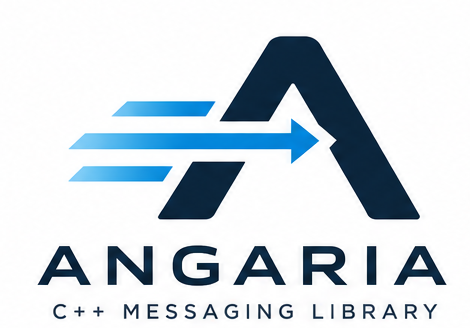

# Angaria

> **Development status:** Angaria is under active development and is incomplete. Its design, APIs, configuration, and persisted data formats may change incompatibly before the stable **1.0.0** release.

<p align="center">
  <a href="assets/logos/README.md"></a>
</p>

Angaria is a C++ inter-process messaging framework built around a shared Registry, producer-owned message logs, consumer-owned Source Queue Sets, Publishing Queue Sets and selectable policies. It targets bounded cooperating processes on one machine. The [roadmap](ROADMAP.md) follows the [original design wiki](https://github.com/smangano/angaria/wiki/Angaria); milestones 1–3 are complete and milestone 4 is in performance qualification.

Framework **0.4.39** admits the independent messaging runtime through the public API. Applications can register their Tasks, schemas and connections, then send through `QueueWriter` and receive through a `SourceQueueSet` with one Active input. Acknowledgment is enabled by default; TOML can select recorded unacknowledged delivery. Both modes retain every accepted message for inspection and replay. Established messaging uses producer/connection/consumer state without the Session administrative gate. See the [public runtime contract](docs/public-runtime-admission.md) and [latency and throughput qualification](docs/public-runtime-performance.md).

Framework **0.4.40** [reduces ownership-check overhead](docs/performance-fork-aware-ownership.md) using the existing fork-invalidation registry. Process/Thread ownership and early inherited-handle rejection remain part of the public runtime contract.

All registration and activation must finish before the first writer, Source or publication-ID issuer opens the runtime. That first admission seals the catalog. Use fresh development Sessions: the current native format is **3.0**, synchronization revision **2**, and earlier native formats are rejected. The superseded Session-gated message engine and v0 prototype have been removed; their pinned source and measurements remain available in Git history.

The current profile supports multiple outgoing Queues and exact schemas per producer Task, Process and Thread Tasks, optional acknowledgment, replacement, backlog recovery, owning Message copies and public log replay/export. Multiple-input scheduling, Publishing Queue Set execution, allowed-loss delivery, notification waiting, log reclamation and other policies follow later roadmap steps. Metadata declarations for future topology do not imply those operations are implemented.

## Build and test

Use CMake 3.20 or later, a C++20 compiler, Boost headers, Python 3 and GoogleTest for tests. CMake fetches the pinned cpptoml TOML parser. Boost and Intel TBB may be used where warranted.

```sh
cmake -S . -B build -DCMAKE_BUILD_TYPE=Release
cmake --build build --parallel 3
ctest --test-dir build --output-on-failure
```

CI runs Linux x86_64, Linux ARM64 and macOS ARM64. macOS x86_64 is available on request. Ordinary CI checks correctness and focused performance invariants without timing thresholds. The optional [public IPC comparison](docs/public-runtime-performance.md) compares both delivery modes with pinned classic nanomsg 1.3.0 using verified payloads, end-to-end latency and completed throughput.

## Learn the public API

Start with the [programmer primer](docs/primer.md). Its eighteen runnable lessons use public Angaria calls with explicit configuration and error handling. They progress from Session creation and registration to schemas, portable captures, process exchange, Queue messaging, acknowledgment, a three-process application, and replaying accepted messages.

```sh
build/angaria_primer_15_receive /tmp/angaria-receive
build/angaria_primer_18_log_replay /tmp/angaria-receive /tmp/angaria-capture.bin
```

Choose fresh paths for the Session and export file. The replay lesson preserves producer and Queue order; it does not reconstruct the consumer's original execution schedule. Its flat export needs the matching retained catalog and contains no processing receipts or execution trace.

A `MessageView` borrows immutable message bytes and exposes the same `MessageHeader` as an owning `Message`. `copy()` preserves that header, payload and decoding context beyond runtime-handle lifetimes. A `Delivery` adds an acknowledgment token in acknowledged mode. Returning transport credit permits another send; it does not assert that the application processed a message. Accepted destination results expose their Queue sequence, and `QueueWriter::acknowledged_sequence()` reports a conservative committed processing lower bound.

Useful references:

- [Public API](docs/api.md), [TOML configuration](docs/configuration.md) and [terminology](docs/glossary.md).
- [Current storage format](docs/mapped-format.md), [producer logs](docs/producer-log.md), [recorded connections](docs/recorded-queue.md) and [acknowledgment progress](docs/recorded-acknowledged-progress.md).
- [Public interface direction](docs/public-interface.md), whose status table distinguishes implemented methods from later proposals.
- [Milestone 4 review history](docs/milestones/milestone-4.md) and [the independent messaging plan](docs/recorded-unacknowledged-delivery-plan.md).

`VERSION` is the framework version source. Development uses `0.<milestone>.<build>`, with a new build number for each PR; completion of the roadmap produces **1.0.0**. Framework, configuration, schema, portable record and native format versions are distinct.
