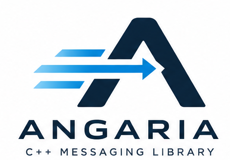
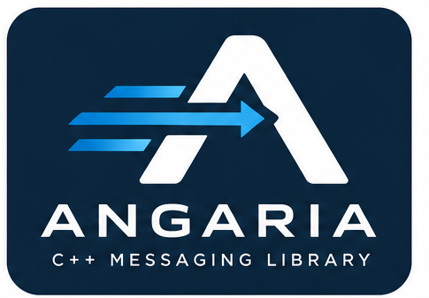

# Angaria logos

Use **A1 original** by default in the README, documentation, and other project materials. Use **A6 dark** when its navy panel fits a dark layout better. The filenames retain the variant names from the supplied asset pack.

| A1 original — default | A6 dark — alternate |
| --- | --- |
|  |  |

Use the web PNGs for repository documentation. Preserve the aspect ratio and display them at their native size or smaller. The root README uses A1 at 360 pixels wide; the roadmap uses it at 200 pixels wide.

| Variant | Web PNG | Print PNG | Print PDF |
| --- | --- | --- | --- |
| A1 original | [Web image](A1_original_web.png) | [4× raster image](A1_original_print_4x.png) | [Raster PDF](A1_original_print.pdf) |
| A6 dark | [Web image](A6_dark_web.png) | [4× raster image](A6_dark_print_4x.png) | [Raster PDF](A6_dark_print.pdf) |

All seven files from `angaria_A1_A6_assets.zip` are preserved unchanged, including the supplier's [export notes](README.txt). The print PNGs are resampled raster images with 300 DPI metadata, and the PDFs embed raster artwork. They are not editable vector masters; large-format work requires a vector rebuild.
