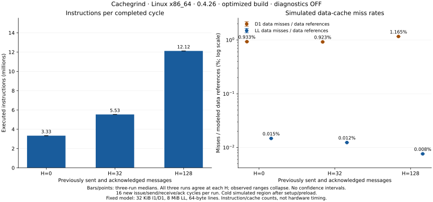

# Linux Cachegrind cycle profile

Raw samples and profiler payloads described below are retained in the maintainer archive, not this checkout. Reports, plots, summaries and provenance remain here. [Archive catalog and restore instructions](../README.md#restore-archived-evidence) identify snapshot `2026-11-28-332118be2291`; restore its payloads before running the verification or figure commands below.

Step **4.24**, framework **0.4.26**. [GitHub Linux run 45985142320](https://github.com/smangano/angaria/actions/runs/45985142320/job/140458717930) completed **nine profiles / 144 measured message cycles**, three fresh-Session repetitions at H0/32/128. Every report completes 16/16 with verified data/header/token/acknowledgment and zero pending or unacknowledged-at-stop deliveries. H means messages already sent and acknowledged before the sixteen new cycles. Preloading adds 480 messages outside profiling.

This is a CPU-work/cache-model experiment, not a latency benchmark or optimization. Transport algorithms and public API behavior are unchanged. The [method guide](../../../docs/performance-cachegrind.md) describes opt-in hooks, exact region boundaries, on-demand triggering and reproduction.

## Provenance and scope

The profiled source is `0fc124c3e6ccb87b8bea108ead2a1d70c19cee39`, checked out as the exact PR head. All **129** recorded measurement-input hashes match that source and the final code inputs; subsequent commits add results/docs only. The executable SHA256 is `bcf6bdd2a8380ba5f2f01808ebbf7a2de6f95d9d98b92edb84e7679da4bf5046`. Ubuntu 24.04 x86_64, GCC 13.3, glibc 2.39, Release `-O3 -DNDEBUG` plus `-g`, Valgrind and cg_annotate **3.22.0**. The hosted CPU identifies as AMD EPYC 7763; the cache model is deliberately explicit rather than copied from that hardware.

`ANGARIA_ENABLE_CACHEGRIND=ON`, ordinary private diagnostics OFF, `collection=none`. The region brackets only the existing serial issue/send/receive/verify/ack loop. Session creation, registration, acknowledged-history preload, sample-buffer allocation, status/retry/empty controls, JSON output and teardown remain outside it. Ordinary benchmark bookkeeping and API clocks inside the loop remain included. All Sessions have four channels, nine active claims and eight-entry rings; one channel exchanges eight-byte fixed-ASCII messages with one Field and default RecoverFromLog delivery.

The model is I1/D1 **32 KiB, eight-way, 64-byte lines** and unified LL **8 MiB, sixteen-way, 64-byte lines**; branch simulation is enabled. Simulation starts cold after uninstrumented setup/preload. The OS file cache can already be warm. Valgrind's generic warning about detected L3 geometry does not change the explicit model; each raw profile confirms the requested geometry.

## Work and modeled misses

All three repetitions at a given H agree **exactly on all thirteen event totals**. The plotted observed ranges therefore collapse; they are not confidence intervals or claims of layout-independent behavior. Values below are totals divided by sixteen completed cycles.

| History | Instructions/cycle | Modeled data references/cycle | D1 data misses/cycle | LL data misses/cycle |
| --- | ---: | ---: | ---: | ---: |
| H0 | 3,332,787.19 | 1,469,521.38 | 13,712.25 | 217.12 |
| H32 | 5,532,543.50 | 2,530,551.88 | 23,365.12 | 313.56 |
| H128 | 12,120,570.19 | 5,589,459.62 | 65,141.06 | 426.19 |

| History | I1 instruction miss rate | D1 data miss rate | LL data miss rate | Branch misprediction rate |
| --- | ---: | ---: | ---: | ---: |
| H0 | 0.5111% | 0.9331% | 0.014775% | 5.4282% |
| H32 | 0.3194% | 0.9233% | 0.012391% | 4.2249% |
| H128 | 0.1699% | 1.1654% | 0.007625% | 3.3877% |

D1/LL data rates divide their respective read-plus-write misses by `Dr+Dw`; instruction rates use `Ir`; branch rate uses `(Bcm+Bim)/(Bc+Bi)`. The right plot uses a clearly labeled logarithmic percent axis. LL's fraction falls while its absolute miss count rises—this does not mean longer history causes fewer misses.

Instructions per completed cycle grow **3.64×** between H0 and H128, and modeled data references grow about 3.80×, despite the payload remaining eight bytes. The nearly linear history slope is stronger evidence of repeated work than of an LL-capacity bottleneck in this model. Low modeled LL rates do not establish actual hardware cache behavior, memory latency or the fraction of native time stalled on memory.

## Where instructions go

The following are flat function self-instruction totals for the sixteen-cycle H128 region, including compiler-inlined source rows but excluding callee costs. They are not inclusive call-path or wall-time shares.

| Function | Self instructions | Share of H128 region |
| --- | ---: | ---: |
| `_int_free` | 13,026,204 | 6.717% |
| `malloc` | 10,263,156 | 5.292% |
| `check_publication` | 9,750,016 | 5.028% |
| `decode_manifest_body` | 9,706,408 | 5.005% |
| `decode_commands` | 8,358,840 | 4.310% |
| `RuntimeAccess::read_words` | 8,249,664 | 4.254% |
| `scan_prefix` | 7,968,000 | 4.109% |

As an alternative file view, glibc `malloc.c` accounts for **37,186,458 instructions / 19.175%**. Do not add that file total to allocator function rows; they describe overlapping views. Manifest and command decoding together account for **18,065,248 / 9.315%** of nonoverlapping self instructions. Allocator work cannot all be attributed to manifests without call-path evidence. [analysis.json](analysis.json) retains exact totals, rates and the top 25 function groups at every H.

### A concrete avoidable initialization

[Publication validation](../../../src/publication_metadata.cpp) constructs `std::bitset<65536> queues` at line 251 to detect duplicate Queue destinations. Its default constructor clears **8 KiB**, even for this workload's single-destination Publications. At H128 the raw line events identify **8,768** clears: **9,013,504 Cachegrind instructions**, **4.648%** of region instruction counts, and **8,978,432 modeled data-write references**, about **68.5 MiB of zero writes** over sixteen cycles. Those stores represent **23.667%** of all modeled data writes. The corresponding H0/H32 clear counts are 576/2,624.

This is a narrow optimization candidate: specialize uniqueness handling for a single destination while preserving per-destination validation and the complete multi-destination checks. It is not implemented here. On x86 Cachegrind counts REP-prefixed instruction iterations separately, so these instruction totals are not equivalent to hardware-retired-instruction counts; they do not predict a 4.648% latency gain. The [Cachegrind accuracy discussion](https://valgrind.org/docs/manual/cg-manual.html) explains that distinction.

## Interpretation and next work

1. Measure a single-destination uniqueness fast path first: the bitmap clear is specific and unnecessary for cardinality one, with a clear correctness boundary.
2. Investigate validation-only manifest/command traversal and operation-local scratch reuse to reduce repeated owning-vector construction. Accepted-batch application and recovery still need correct ownership and complete checks.
3. Address repeated processing of unchanged committed history for larger gains, with explicit invalidation/recovery and corruption-detection assumptions before changing that contract.
4. Keep remaining mapping reuse on the plan. Cachegrind excludes kernel execution and cannot price mmap/munmap, fstat or scheduling overhead.

These are proposals for later measured PRs, not changes to synchronization, recovery or validation guarantees in this experiment. The virtual-address cache model omits physical aliases, TLB/page-fault costs, prefetch/speculation, kernel cache effects and interprocess coherence. No claim about multicore contention, native throughput or production tails follows. Use the separate matched native benchmarks for those questions.

## Retained evidence and qualification

The [downloaded artifact](linux-x86_64/) is retained unchanged: manifest, versions, nine per-attempt directories, raw event profiles, public reports, stderr, exact commands, function summaries and two CSVs. There are **zero failed profiles**. All nine public reports validate; every raw cost-row sum equals its named summary; all derived counts agree; both CSVs regenerate byte for byte, including all 57 aggregate metric rows. The [figure generator](generate_figures.py) also checks its plotted run fields, raw summary totals, derived counts and aggregate values. [PNG figure](cachegrind-history.png) is retained alongside SVG.

The source CI passes **823/823** tests on [Linux x86_64](https://github.com/smangano/angaria/actions/runs/45985086926/job/140458526510) (15.03 s), [Linux ARM64](https://github.com/smangano/angaria/actions/runs/45985087039/job/140458526290) (12.74 s) and [macOS ARM64](https://github.com/smangano/angaria/actions/runs/45985087039/job/140458526804) (29.65 s). Ordinary Linux CI also validates its 54 diagnostic runs. Local strict Release diagnostics-OFF build and diagnostic smoke pass, including rejection of unsupported/unknown profiling regions before Session creation. The optional Linux build verifies compatible headers and actually executes the enabled start/stop requests. No library source or public example changed; the primer's seventeen programs retain their ordinary dependency set.

To reproduce the nine cases, use the [method guide](../../../docs/performance-cachegrind.md#build-and-reproduce). Use a new output directory. To regenerate the figure, run `python3 -B benchmarks/results/milestone-4-cachegrind/generate_figures.py` with matplotlib installed. The runner itself uses Python's standard library plus the installed Valgrind tools. The on-demand job is requested with the PR label `profile-cachegrind`; normal pushes do not rerun it. Main integration remains held; Intel macOS stays request-only; no timing threshold is added to CI.
