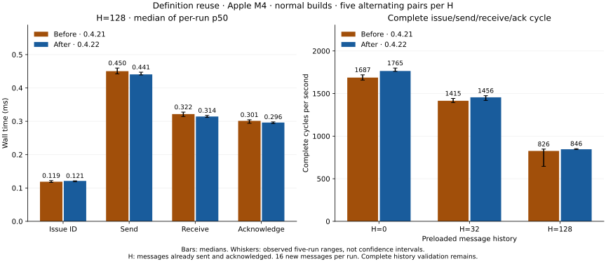
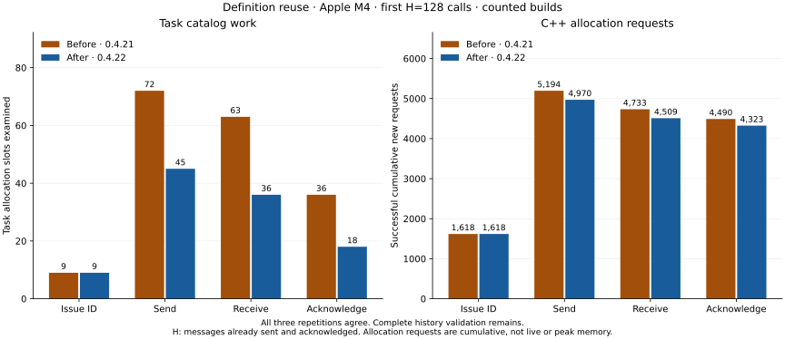

# Definition reuse measurements

Step **4.20**, framework **0.4.22**. The [guide and risk assessment](../../../docs/performance-definition-reuse.md) explain operation-local Task and retained topology reuse. The [diagnostic method](../../../docs/performance-diagnostics.md) defines workloads, counters and outcomes.

## Provenance

The **before** binaries are preserved 0.4.21 executables compiled from `22bab0c42d835eb37b5c92454f41362590a5c55f`, copied before rebuilding with their original CMake caches. Normal SHA256 is `0d7d035fe3ace3aa043f660fe04de28228effb38e5e920e7eee6dbc1433adb14`; enabled is `e790a839f1fa68007f296a47ed61016856088c982d59cbf90e9b4e2f4b9dfa80`. The measurement checkout is merged staging `7c943c46b848268b7a9664700f5e3b1cc7e9b0d4`. All 128 input hashes match the preceding measured source. The manifest names the measurement checkout rather than claiming it compiled the binaries.

The **after** executables are built from `57066388605e21635062c2af3b0a91a59da42318`, version 0.4.22. Normal/enabled manifests retain the same 128 measurement input hashes. Only VERSION and six production files differ from before: runtime_state.h, schema_runtime.cpp, topology_state.h, topology_runtime.cpp and delivery_runtime.h/.cpp. Later commits add docs, results and plots only. Builds use Apple clang 21, Release `-O3 -DNDEBUG`, plus `-Wall -Wextra -Werror -g`. Diagnostics are OFF for timing comparisons and ON for attribution. The workload and driver are unchanged.

The local host is Apple M4, ten logical CPUs, 16 GiB, macOS 27.0.1, with native ARM64 executables and an x86_64 Python 3.10.15 coordinator. Measurements took place November 26, 2026 in New York (November 27 UTC), using the local Data volume. No builds or tests ran during measurements. Host isolation, thermal/frequency/affinity controls and cache flushing were not used. These small windows do not qualify production tail latency.

## Populations and ordering

- [Fresh before normal](macos-arm64-before-normal/): 33 validated complete runs.
- [Fresh before enabled](macos-arm64-before-enabled/): 75 validated complete runs.
- [After normal](macos-arm64-after-normal/): 33 validated complete runs.
- [After enabled](macos-arm64-after-enabled/): 75 validated complete runs.
- [Alternating serial comparison](alternating/): 30 validated complete runs, five pairs per H=0/32/128.
- [Hosted Linux after](linux-x86_64-after/): 54 validated complete runs, including all six loaded cases, plus a separate syscall trace.

**H stands for history:** messages already sent and acknowledged before the measured window begins. Each local window adds sixteen new messages.

Local populations total **246 runs**; with Linux, **300**. Full matrices ran sequentially: before normal/enabled, then (after builds/tests) after normal/enabled. The alternating study followed. Each run uses a fresh Session. Local windows contain sixteen messages, four channels and eight-entry rings, preserving history/capacity/payload/Field/backlog controls. Serial/backlog has nine active claims; thread/process streams have two plus requested idle consumers. Measured channels use default RecoverFromLog delivery; allowed loss remains correctness-qualified but is not performance-plotted.

The unchanged [comparison harness](../milestone-4-gate-handoff/run_interleaved.py) imports each checkout's own driver/version/metadata globals. Both manifests record its hash. Fifteen adjacent pairs alternate AB then BA (eight AB, seven BA), with H=0/32/128 per repetition; ordering is deterministic, not randomized. [order.csv](alternating/order.csv) records execution order and whole-invocation time, including startup/preload. That time is not per-operation latency.

Raw compressed JSON lines retain every sample and outcome. Each dataset includes TOML metadata and run/summary/phase CSVs. Summaries use nearest-rank within-run quantiles, then medians of per-run statistics; samples are not pooled. All local requests complete 16/16 with zero pending messages or unacknowledged-at-stop deliveries. All 128 input hashes and local binary hashes match manifests; the eighteen local CSVs regenerate byte-for-byte. No outliers were removed.

## Plots



Left: four operation p50 medians at H=128. Right: complete issue/send/receive/ack cycles per second at H=0/32/128. Bars compare medians of five alternating normal runs per variant; whiskers show observed five-run ranges, not confidence intervals. At H=128 send/receive/ack medians fall **2.2%/2.3%/1.6%**, while unchanged-work ID issuance rises **2.0%**. All four H=128 latency ranges overlap. Complete-cycle medians rise **4.6%/2.9%/2.4%** at H=0/32/128. One slightly slower receive/ack pair and the slow before-cycle run remain in the data.



Counted controls show the first H=128 call, with exact agreement across all three repetitions. Send/receive/ack examine **72→45 / 63→36 / 36→18 Task slots**, and make **5,194→4,970 / 4,733→4,509 / 4,490→4,323 allocation requests**. Task slots include unused allocation-table slots; they are not distinct Tasks. Allocation counts are successful cumulative C++ new requests in the captured thread, not live/peak memory. Issue ID remains at nine slots and 1,618 allocations.

Across all 603 samples in nine matched counted runs, only the Task-slot, allocation-request and allocated-byte work counters change. All issue counters are identical. Complete prefix/delivery/Publication checks, native, gate and recovery counters remain unchanged. First H=128 receive still checks 129 Publications, with one topology build, one delivery validation and one prefix scan/321 visits; it records 16 maps, zero native reads and 45 stats. Observer tests separately verify single definition-copy requests in the targeted paths.

[PNG performance](definition-performance.png) and [PNG work](definition-work.png) are also retained. [Regenerate both](generate_figures.py) with matplotlib; the generator reuses existing report helpers. Benchmark runners need only Python's standard library.

## Variation and remaining costs

The initial sequential H=0/32/128 receive medians rise **14.2%/14.5%/5.0%**. Untargeted ID medians also rise substantially in those populations, consistent with host/ordering variation; that explanation is an inference. The alternating study reduces this confound without controlling scheduling, heat, frequency or code layout. It supports modest observed improvements, not a universal speedup. The [guide](../../../docs/performance-definition-reuse.md#controls-and-limits) records exact control values, paired ranges and all stream/process intervals.

The sixteen-times-capacity sequential control improves receive 8.7%; other history/payload/Field/backlog receive controls are slower. The no-idle/three-idle stream median intervals rise 4.5%/0.9%; the process median falls 9.6%, with overlapping elapsed ranges in each comparison. All requested messages finish. Concurrent receive includes waiting and scheduling. No fairness or bounded-latency claim follows.

Enabled H=128 receive p50 is 0.310042 ms in None mode, 0.317917 Counts and 0.317583 Timings, versus 0.303833 in the initial normal matrix. These sequential observations are not a causal overhead estimate. Generic Task loading moved outside the SchemaLookup scope, so its inclusive boundary differs from the preceding build. Headline comparisons use whole-operation normal timings and work counters, rather than treating that nested phase as unchanged.

One full-prefix scan and complete delivery validation, additional Field/Schema preparation, remaining Publication/successor searches, native checks/growth and idle polling remain. No cross-operation caching or synchronization architecture change is introduced.

## Linux corroboration and qualification

[Linux CI run 45939372292](https://github.com/smangano/angaria/actions/runs/45939372292) produced the downloaded artifact retained unchanged here. Its synthetic merge is `b04331138b26cff090bcdafa48f91fc33b4dee71`; all 128 measurement inputs match measured source. All **54/54** eight-message workloads complete, including all six loaded cases at 8/8, with zero pending or unacknowledged-at-stop deliveries. Timed first H=128 calls examine 9/45/36/18 Task slots for issue/send/receive/ack, matching local controls. Receive still has one prefix scan/321 record visits, one topology build, one delivery validation, 129 Publications, 16 maps and 45 stats. Linux records 4,618 allocation requests/615,426 bytes for this receive versus Mac Counts 4,509/597,108; allocator/library, collection and window differences prevent treating them as equal cross-platform quantities.

The separate [syscall trace](linux-x86_64-after/syscalls.txt) includes startup, setup, H=32 preload, eight serial messages, controls and teardown. Relative to the [preceding 0.4.21 trace](../milestone-4-delivery-lookup/linux-x86_64-after/syscalls.txt), getpid falls **75,082→67,614**. fstat **6,876**, pread64 **2,169**, mmap **3,002** and munmap **2,981** remain unchanged. Repeated logical metadata reads and ownership checks fall without changing native mapping/stat counts. Do not divide whole-program totals by eight or treat traced syscall-time shares as ordinary latency.

Strict local Release diagnostics OFF/ON each pass **817/817 tests** (16.88/16.87 s). Measured-source CI passes 817/817 on [Linux x86_64](https://github.com/smangano/angaria/actions/runs/45939372292/job/140309897177) (11.39 s), [Linux ARM64](https://github.com/smangano/angaria/actions/runs/45939372231/job/140309897402) (11.92 s) and [macOS ARM64](https://github.com/smangano/angaria/actions/runs/45939372231/job/140309897084) (21.56 s). Tests include the original benchmark smoke, native walkthroughs, seventeen public primer programs and three focused private definition-reuse scenarios alongside existing history/corruption/recovery/loss/ownership tests. Intel macOS remains request-only; integration into main stays held. CI has no timing thresholds.

## Reproduce

Use the matching checkout/executable and a new output directory:

```sh
python3 -B benchmarks/run_diagnostics.py MATCHING_EXECUTABLE \
  --suite diagnostic --repetitions 3 --output NEW_RESULTS \
  --host-label 'DESCRIBE THE ACTUAL HOST'
```

For the alternating comparison:

```sh
python3 -B benchmarks/results/milestone-4-gate-handoff/run_interleaved.py \
  --before-root BEFORE_CHECKOUT --before-executable BEFORE_BINARY \
  --after-root AFTER_CHECKOUT --after-executable AFTER_BINARY \
  --output NEW_COMPARISON --host-label 'DESCRIBE THE ACTUAL HOST'
```

Temporary Session files are removed. Rebuilds may change binary hashes; retain your settings/hashes. Output directories must be new. A validated budget stop is not completion: inspect actual progress and outcomes.

## Execution-context clarification

A step-4.21 audit found different execution-permission requests in the initial local sequential before and after populations. Their timing deltas cannot isolate the optimization effect. Raw data remains unchanged. The primary adjacent normal alternating comparison already launched both variants under matching settings. See the [methodology correction](../../../docs/performance-diagnostics.md#match-execution-settings-as-well-as-code) for the scope and later matched controls. No permission-profile penalty is estimated.
