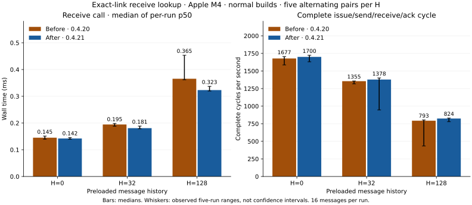
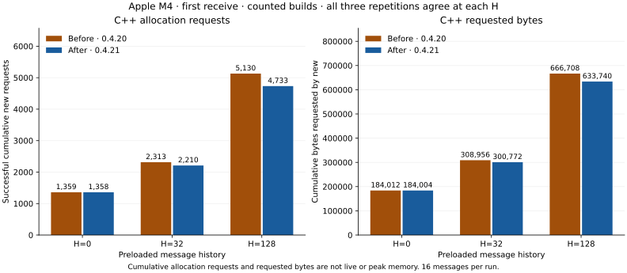

# Direct delivery lookup measurements

Raw samples and profiler payloads described below are retained in the maintainer archive, not this checkout. Reports, plots, summaries and provenance remain here. [Archive catalog and restore instructions](../README.md#restore-archived-evidence) identify snapshot `2026-11-28-332118be2291`; restore its payloads before running the verification or figure commands below.

Step **4.19**, framework **0.4.21**. The [guide and risk assessment](../../../docs/performance-delivery-lookup.md) explain exact oldest-pending resolution. The [diagnostic method](../../../docs/performance-diagnostics.md) defines workloads, counters and outcomes.

## Provenance

The **before** binaries are preserved 0.4.20 executables compiled from `762b4baa2a43630763f316d0e797a68de6814972`. They were copied before rebuilding, with original CMake caches. The normal binary SHA256 is `555ee90fad21176dbbcf503fd00b624d62036cd5b217123d1cba4b206a8da35c`; enabled is `c8d09b9c4b6cf70c206f4d205f434437421e21da7929421da2cd14851c1b6b13`. Measurement checkout is merged staging `fbc5232b978ba9ebe2b5d69ecd9fa6fdd32404b4`. All 128 input hashes match the previous measured source; the manifest names the measurement checkout rather than claiming it compiled the executable.

The **after** binaries are built from `22bab0c42d835eb37b5c92454f41362590a5c55f`, version 0.4.21. Normal/enabled manifests retain 128 matching input hashes. Only VERSION, delivery_history.h and delivery_progress.cpp differ from before. Later commits add documentation, results and plots only. Builds use Apple clang 21, Release `-O3 -DNDEBUG`, plus `-Wall -Wextra -Werror -g`. Diagnostics are OFF for timing comparisons and ON for attribution. The workload/driver is unchanged.

The local host is Apple M4, ten logical CPUs, 16 GiB, macOS 27.0.1, with native ARM64 executables and an x86_64 Python 3.10.15 coordinator. Measurements took place November 26, 2026 in New York (November 27 UTC), using the local Data volume. No builds or tests ran during measurements. Host isolation, thermal/frequency/affinity controls and cache flushing were not used. These small windows do not qualify production tail latency.

## Populations and ordering

- [Fresh before normal](macos-arm64-before-normal/): 33 validated complete runs.
- [Fresh before enabled](macos-arm64-before-enabled/): 75 validated complete runs.
- [After normal](macos-arm64-after-normal/): 33 validated complete runs.
- [After enabled](macos-arm64-after-enabled/): 75 validated complete runs.
- [Alternating serial comparison](alternating/): 30 validated complete runs, five pairs per H=0/32/128.
- [Hosted Linux after](linux-x86_64-after/): 54 validated complete runs, including all six loaded polling cases, plus a separate syscall trace.

The local populations total **246 runs**; with Linux, **300**. Full matrices ran sequentially: before normal/enabled, then (after builds/tests) after normal/enabled. The alternating serial study followed. Every run uses a fresh Session. Local windows contain sixteen messages, four channels and eight-entry rings, preserving history/capacity/payload/Field/backlog controls. Serial/backlog has nine active claims; stream/process cases have two plus requested idle consumers. Measured channels use default RecoverFromLog delivery; allowed loss remains correctness-qualified but is not performance-plotted.

The unchanged [comparison harness](../milestone-4-gate-handoff/run_interleaved.py) imports each checkout's own driver/version/metadata globals. Its hash is recorded in both manifests. Fifteen adjacent pairs alternate AB then BA (eight AB, seven BA), with H=0/32/128 per repetition; ordering is deterministic, not randomized. [order.csv](alternating/order.csv) records execution order and whole-invocation time, including startup/preload. That time is not per-operation latency.

Raw compressed JSON lines retain every sample and outcome. Each dataset includes TOML metadata and run/summary/phase CSVs. Summaries use nearest-rank within-run quantiles, then medians of per-run statistics; samples are not pooled. No outliers were removed. All local requests complete 16/16 with zero pending messages and zero unacknowledged-at-stop deliveries. Measured normal/enabled/source/binary hashes were verified; the eighteen local CSVs regenerate byte-for-byte.

## Plots



Bars are medians of five alternating sixteen-message normal runs per variant/H. Left: per-run receive p50. Right: completed messages divided by the whole issue/send/receive/ack interval. Whiskers are observed five-run min/max ranges, not confidence intervals. H=128 receive falls **0.365458→0.323125 ms**, **11.6%**; complete cycles rise **793.08→824.13/s**, **3.9%**. H=0 receive pairs include increases and decreases. Untargeted call ranges overlap and median changes are mixed.



Counted controls use the first receive at H=0/32/128. All three repetitions agree for the plotted values. H=128 C++ allocation requests fall **5,130→4,733** (7.7%) and requested bytes **666,708→633,740** (4.9%). These are successful cumulative C++ new requests/bytes on the captured thread, not live/peak memory. Complete topology/delivery validation is unchanged: H=128 still checks 129 Publications, with one topology build, one delivery validation and one prefix scan/321 record visits. Across all nine matched counted runs, every nonreceive counter is unchanged.

[PNG performance](receive-performance.png) and [PNG work](receive-work.png) are also retained. [Regenerate both](generate_figures.py) with matplotlib. The generator reuses prior report helpers. Benchmark runners need only Python's standard library.

## Variation and controls

The initial sequential H=0/32 receive medians rise 18.1%/5.0%, while H=128 falls 5.3%. Before runs have generally lower untargeted times than later populations, consistent with host/ordering variation; this explanation is an inference. The adjacent alternating study reduces that confound, without controlling scheduling, heat or clock frequency. Its H=128 paired receive changes range from 28.7% lower to 8.5% lower; the original slow before run is retained.

Concurrent receive includes waiting for publication and scheduling. The sequential no-idle thread stream's median whole interval rises 2.8%; its receive p50 rises 0.351→0.892 ms. Three-idle elapsed ranges overlap. The sequential process median whole interval falls 4.8%. All requested messages complete. These observations support no universal stream-speedup or fairness claim. The [guide](../../../docs/performance-delivery-lookup.md#controls-and-limits) records the remaining controls and exact observed ranges.

At H=128 the enabled receive p50 is 0.329333 ms in None mode, 0.333583 Counts and 0.328750 Timings, versus 0.310542 in the initial normal matrix. Sequential populations and noise prevent treating those differences as a causal overhead estimate. Ordinary alternating builds supply the headline comparisons.

## Linux corroboration and correctness

[Linux CI run 45936409686](https://github.com/smangano/angaria/actions/runs/45936409686) produced the downloaded artifact retained unchanged here. Its synthetic merge is `68813e7e6de134cb6af74f66381156053775d543`; all 128 measurement inputs match the measured source. All **54/54** eight-message workloads complete, including all six loaded cases at 8/8. No pending/unacknowledged-at-stop deliveries remain. All three H=128 timed first receives record one topology build, one delivery validation, 129 Publications, one prefix scan/321 visits, 16 maps and 45 stats. Linux records 4,842 allocation requests/654,530 bytes versus the Mac counted 4,733/633,740; allocator/library, collection and window differences prevent interpreting those as equal cross-platform quantities.

The separate [syscall trace](linux-x86_64-after/syscalls.txt) includes startup, setup, H=32 preload, eight serial messages, controls and teardown. Relative to the [preceding 0.4.20 trace](../milestone-4-receive-validation/linux-x86_64-after/syscalls.txt), getpid falls **78,202→75,082**; fstat **6,876**, pread64 **2,169**, mmap **3,002** and munmap **2,981** remain unchanged. H=32 per-call mapping counts are also unchanged; the H=128 example uses different geometry. Do not divide whole-program totals by eight or treat traced syscall-time shares as ordinary latency.

Strict local Release diagnostics OFF/ON each pass **814/814 tests** (16.88/16.87 s). Measured-source CI passes 814/814 on [Linux x86_64](https://github.com/smangano/angaria/actions/runs/45936409686/job/140300528447) (8.48 s), [Linux ARM64](https://github.com/smangano/angaria/actions/runs/45936409753/job/140300528403) (12.18 s) and [macOS ARM64](https://github.com/smangano/angaria/actions/runs/45936409753/job/140300528567) (20.35 s). Tests include the original benchmark smoke, native walkthroughs, seventeen public primer programs, existing recovery/loss/ownership tests and the two focused private resolver scenarios. Timing values have no CI thresholds. Intel macOS remains request-only; integration into main stays held.

## Reproduce

Use the matching checkout/executable and a new output directory:

```sh
python3 -B benchmarks/run_diagnostics.py MATCHING_EXECUTABLE \
  --suite diagnostic --repetitions 3 --output NEW_RESULTS \
  --host-label 'DESCRIBE THE ACTUAL HOST'
```

For the alternating comparison:

```sh
python3 -B benchmarks/results/milestone-4-gate-handoff/run_interleaved.py \
  --before-root BEFORE_CHECKOUT --before-executable BEFORE_BINARY \
  --after-root AFTER_CHECKOUT --after-executable AFTER_BINARY \
  --output NEW_COMPARISON --host-label 'DESCRIBE THE ACTUAL HOST'
```

Temporary Session files are removed. Rebuilds may change binary hashes; retain your settings/hashes. Result directories must be new. A validated budget stop is not completion: inspect actual progress and outcomes.

## Execution-context clarification

A step-4.21 audit found different execution-permission requests in the initial local sequential before and after populations. Their timing deltas cannot isolate the optimization effect. Raw data remains unchanged. The primary adjacent normal alternating comparison already launched both variants under matching settings. See the [methodology correction](../../../docs/performance-diagnostics.md#match-execution-settings-as-well-as-code) for the scope and later matched controls. No permission-profile penalty is estimated.
