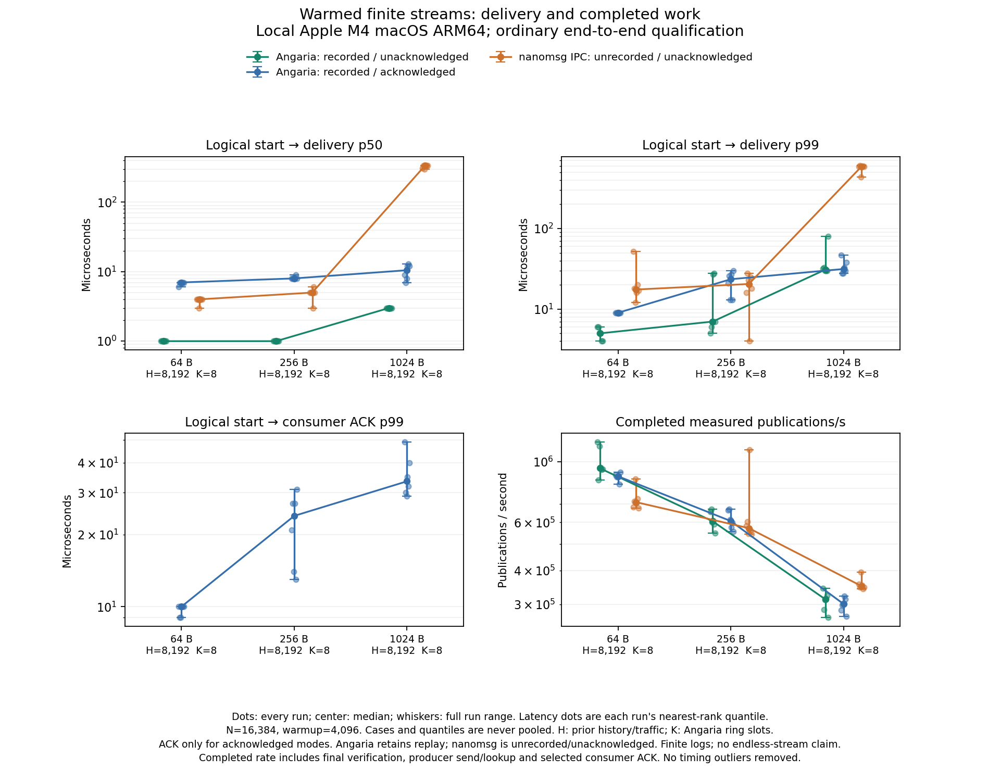
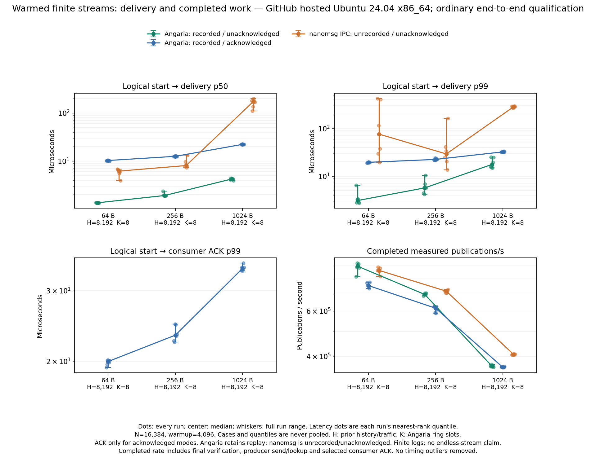
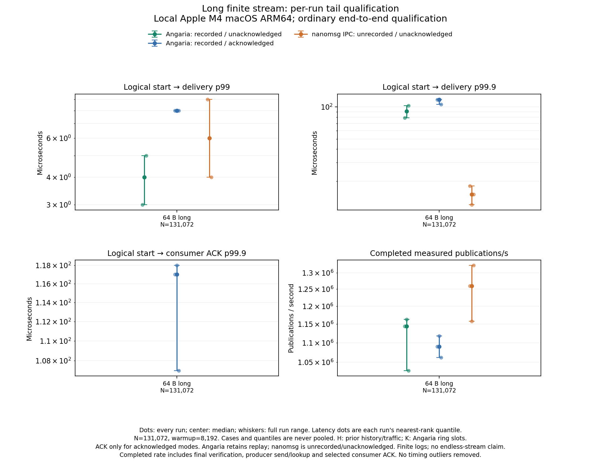
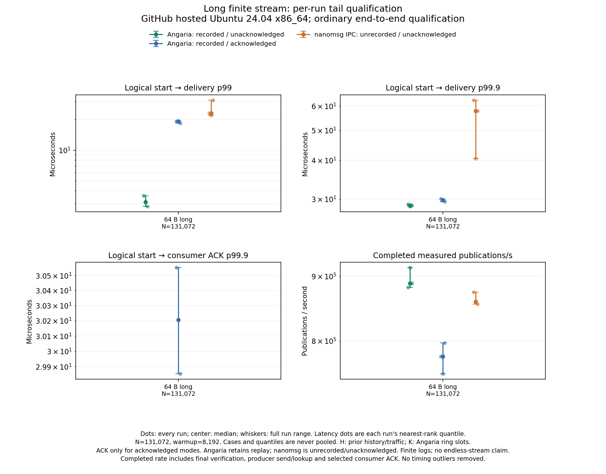

# End-to-end qualification: both recorded modes and nanomsg

Framework **0.4.38**, milestone step **4.36**, workstream step **7**. Measurement source: [`8bcd30810b55a69d00eeed1625a3018e3ced1527`](https://github.com/smangano/angaria/commit/8bcd30810b55a69d00eeed1625a3018e3ced1527). The [methodology](../../../docs/end-to-end-qualification.md) defines every window, guarantee and case. This PR adds qualification coverage; it makes no transport-algorithm speedup claim.

**514 full-matrix attempts completed, with no failed or discarded attempts:** 257 on the local Apple M4 and 257 on one hosted Intel Xeon 6975P-C. Each host runs both recorded modes and nanomsg in the same ordinary Release executable. The six balanced orders put every primary adapter twice in each position. The long case uses three rotations; short legacy controls use five rotations. Two additional hosted native smoke sets retain 22 attempts each.

The recorded modes retain accepted messages for replay. Acknowledged mode also commits explicit consumer processing progress. Nanomsg is unrecorded and unacknowledged. Differences measure these complete paths, including producer ID issuance and ordinary acceptance lookup for the new recorded modes; they do not isolate recording or acknowledgment overhead.

## Main results

Each number is the median of six **per-run** measurements, with **16,384 measured messages after 4,096 live warmup messages**, H=8,192 retained messages/prior traffic, K=8 Angaria credits and an unpaced producer. Latencies are microseconds. Completed throughput includes the final producer send/lookup, consumer payload verification and selected acknowledgment return. The bracketed throughput interval is the full observed run range, not a confidence interval. Quantiles and populations are never pooled across runs or hosts.

### Local Apple M4; native ARM64 measured executable

| Bytes | Adapter | Delivery p50 (µs) | Delivery p99 (µs) | Consumer ACK p99 (µs) | Completed k/s [full range] |
| --- | --- | ---: | ---: | ---: | ---: |
| 64 | Recorded, unacknowledged | 1.000 | 5.000 | — | 947.1 [857.4, 1183.7] |
| 64 | Recorded, acknowledged | 7.000 | 9.000 | 10.000 | 885.6 [828.5, 916.9] |
| 64 | nanomsg IPC | 4.000 | 17.500 | — | 711.8 [678.0, 863.8] |
| 256 | Recorded, unacknowledged | 1.000 | 7.000 | — | 605.6 [549.1, 669.5] |
| 256 | Recorded, acknowledged | 8.000 | 23.500 | 24.000 | 606.8 [554.9, 671.8] |
| 256 | nanomsg IPC | 5.000 | 20.500 | — | 571.5 [544.5, 1109.1] |
| 1024 | Recorded, unacknowledged | 3.000 | 31.000 | — | 313.2 [268.7, 343.5] |
| 1024 | Recorded, acknowledged | 10.500 | 31.500 | 33.500 | 301.4 [271.5, 321.6] |
| 1024 | nanomsg IPC | 337.500 | 592.000 | — | 350.4 [343.0, 393.6] |



### Hosted Linux x86_64; Intel Xeon 6975P-C

| Bytes | Adapter | Delivery p50 (µs) | Delivery p99 (µs) | Consumer ACK p99 (µs) | Completed k/s [full range] |
| --- | --- | ---: | ---: | ---: | ---: |
| 64 | Recorded, unacknowledged | 1.353 | 3.092 | — | 897.3 [815.6, 923.5] |
| 64 | Recorded, acknowledged | 10.285 | 19.516 | 19.963 | 754.5 [734.9, 776.6] |
| 64 | nanomsg IPC | 6.183 | 75.900 | — | 864.2 [818.6, 891.3] |
| 256 | Recorded, unacknowledged | 1.919 | 5.700 | — | 696.4 [688.0, 705.0] |
| 256 | Recorded, acknowledged | 12.564 | 22.452 | 23.221 | 615.9 [588.3, 625.3] |
| 256 | nanomsg IPC | 8.077 | 29.247 | — | 717.2 [705.6, 728.3] |
| 1024 | Recorded, unacknowledged | 4.239 | 17.669 | — | 366.2 [362.6, 372.0] |
| 1024 | Recorded, acknowledged | 22.295 | 32.297 | 34.060 | 362.8 [361.7, 364.9] |
| 1024 | nanomsg IPC | 173.890 | 283.132 | — | 407.0 [405.4, 409.2] |



The unacknowledged path has the lowest median delivery latency in these cells. On Linux its 64-byte completed rate is close to nanomsg, with substantially overlapping ranges; nanomsg leads both recorded modes at 256 and 1,024 bytes. The acknowledged path has higher delivery latency as its consumer commits progress and the Queue fills. On the Mac both recorded modes have higher median rates in the 64/256-byte cells, while nanomsg leads at 1,024 bytes. No adapter wins every throughput case.

## Longer streams and tails

These are separate cases: **131,072 measured messages after 8,192 live warmup messages**, 64 bytes, H=8,192, K=8. Each cell has three runs, enough messages per run to report its nearest-rank p99.9. Three repetitions do not establish a stable capacity or production latency guarantee.

| Host | Adapter | Delivery p50 (µs) | p99 (µs) | p99.9 (µs) | Consumer ACK p99.9 (µs) | Completed M/s [full range] |
| --- | --- | ---: | ---: | ---: | ---: | ---: |
| macos-arm64 | Recorded, unacknowledged | 1.000 | 4.000 | 91.000 | — | 1.145 [1.029, 1.163] |
| macos-arm64 | Recorded, acknowledged | 5.000 | 8.000 | 117.000 | 117.000 | 1.090 [1.062, 1.118] |
| macos-arm64 | nanomsg IPC | 2.000 | 6.000 | 15.000 | — | 1.260 [1.158, 1.323] |
| linux-x86_64 | Recorded, unacknowledged | 1.344 | 3.105 | 28.584 | — | 0.889 [0.882, 0.915] |
| linux-x86_64 | Recorded, acknowledged | 9.940 | 19.214 | 29.784 | 30.206 | 0.778 [0.753, 0.797] |
| linux-x86_64 | nanomsg IPC | 5.397 | 23.092 | 57.855 | — | 0.859 [0.856, 0.874] |

Nanomsg leads the longer Mac case in completed rate and p99.9, reversing the shorter 64-byte throughput ranking. On Linux, unacknowledged Angaria has a modest rate lead in this particular three-run case; both recorded modes have lower delivery p99.9 than nanomsg. These host-specific results warrant investigation; they are not evidence for an isolated operating-system or architecture cause.




## History, offered load and backpressure

- **History:** Angaria's median delivery latency stays close across H=0, 8,192 and 65,536 at 64 bytes. Rates vary: for example Mac unacknowledged is 951k/947k/893k per second and Linux 923k/897k/853k. Prior nanomsg traffic also changes its observed results, though it has no replay history. The data does not support declaring all history effects eliminated or attributing every change to a history scan.
- **Credit:** Increasing acknowledged K from 1 to 8 to 64 raises queued delivery latency: Mac p50 is 1/7/20.5 µs and Linux 2.016/10.285/78.569 µs. Rate changes are much smaller. Queue depth is a latency policy, not a free throughput improvement. Nanomsg's byte buffers are not equivalent to K credits.
- **Offered load:** Every adapter completes the measured suffix near its 50k/s and 100k/s target. Logical-start latency alone hides producer schedule debt. Mac recorded scheduled-delivery p99 medians are 64–108.5 µs versus nanomsg 12–13 µs. Linux recorded medians are 4.859–9.571 µs versus nanomsg 18.790–31.083 µs. Keep the scheduled and logical-start metrics separate. Mac's 1 µs clock rounds some median values to zero; that is not zero physical latency.
- **Slow consumer:** With 50 µs of actual simulated application work per message, Mac recorded delivery p50 is about 449–450 µs versus nanomsg about 90.7 ms; Linux is about 457–461 µs versus 11.5 ms. Different buffering/backpressure contracts explain why queueing behavior must be reported alongside rate. Finite measured-suffix completion includes existing warm backlog: one Mac nanomsg run spans 911.6 ms in the common window versus 820.4 ms in its own consumer loop. Its roughly 18k/s common rate is not proof of an 18k/s steady-state processing limit. Recorded spinning costs about 99–103 µs of summed process CPU per publication here versus nanomsg about 51–52 µs.
- **Paused consumer:** A requested 20 ms pause actually lasts 21.872–30.025 ms in the Mac runs. Median per-run maximum delivery is about 30 ms for all three adapters; Linux maxima are about 20.1–20.2 ms. Nine messages per recorded Mac run exceed 20 ms, below 1% of 16,384, so recorded p99 alone misses the pause. Nanomsg buffers about 1,800 affected messages in these Mac runs. This is bounded buffering behavior, not elimination of the stall. Raw reports retain maximum latency and actual pause boundaries.

## CPU, VM faults and next investigations

At 64-byte saturation, summed inclusive process CPU per publication is 1.903/2.030/2.814 µs on Mac and 2.233/2.655/2.295 µs on Linux (unacknowledged/acknowledged/nanomsg). CPU includes all library threads and per-role control tail through FINISH; windows differ between roles. Pacing and simulated work deliberately consume CPU. Lower CPU under one workload is not a universal efficiency result.

Every basic Mac recorded run reports 256 major faults in its measured window, and every longer recorded run reports 2,048. The corresponding nanomsg Mac and all Linux runs report zero major faults in these cases. Fresh mapped log pages are an attribution candidate; these counters do not prove disk I/O or a cache-contention cause, and operating systems classify VM faults differently. No cache-miss measurement was taken in this ordinary timing study.

The next useful attribution work is to separate mapped-page first-touch cost from scheduling/CPU contention on Mac, examine acknowledged progress and credit sizing, and explain longer-stream versus shorter-stream nanomsg behavior. Any change needs matched latency/throughput evidence with replay retained. Public runtime admission remains workstream step 8; these private one-Queue/one-schema Process bindings do not qualify future fan-in, fan-out, public Task lifecycles, notification waits or log reclamation.

## Evidence, plots and reproduction

| Evidence | Mac | Linux |
| --- | --- | --- |
| Frozen provenance and plan | [manifest](macos-arm64/manifest.json) | [manifest](linux-x86_64/manifest.json) |
| Every attempt and distribution | [reports](macos-arm64/reports.jsonl) | [reports](linux-x86_64/reports.jsonl) |
| Every plotted value and full range | [CSV](macos-arm64/comparison.csv) | [CSV](linux-x86_64/comparison.csv) |
| History | [plot](macos-arm64/history-sensitivity.png) | [plot](linux-x86_64/history-sensitivity.png) |
| Offered load | [plot](macos-arm64/offered-load.png) | [plot](linux-x86_64/offered-load.png) |
| Backpressure | [plot](macos-arm64/backpressure.png) | [plot](linux-x86_64/backpressure.png) |
| CPU and faults | [plot](macos-arm64/cpu-faults.png) | [plot](linux-x86_64/cpu-faults.png) |
| Legacy controls | [plot](macos-arm64/legacy-controls.png) | [plot](linux-x86_64/legacy-controls.png) |
| Lossless samples/control transcripts | [257 raw archives](macos-arm64/raw/) | [257 raw archives](linux-x86_64/raw/) |

SVG versions accompany every PNG. Original build/cache/link settings, executable/library hashes, exact framework/nanomsg pins, CPU and clock details remain in each host's manifest and provenance directory. The local measured executable is native ARM64, confirmed by `file`; its Python 3.10.15 coordinator runs as x86_64 under translation. Cross-process monotonic probes bracket both native workers against that coordinator. The hosted Linux executable and coordinator are both x86_64. Native timing data must not be confused with coordinator architecture metadata.

The 16-message H=0/128 controls compare current recorded modes with the existing public acknowledged runtime and the retained current-log SPSC experiment in the same executable and host. They have different guarantees and producer lookup work, and carry no p99 claim. Earlier [recorded-connection](../milestone-4-recorded-connection/README.md), [acknowledged](../milestone-4-recorded-acknowledged/README.md) and [producer-log](../milestone-4-producer-log-append/README.md) studies remain the retained baselines; their message counts, hosts and timing windows differ, so this report does not pool them or calculate a transport speedup from changed denominators.

Validation passed: strict local Release build; 987-test local run plus the subsequently registered coordinator suite; 21 binary-validator cases, 8 coordinator/archive cases and 8 C++ helper cases; all 22 frozen local smoke attempts; independent manual decoding of representative actual archives. [Hosted qualification](https://github.com/smangano/angaria/actions/runs/46127015975) passed the full Linux matrix plus [Linux ARM64 smoke](linux-arm64-smoke/) and [macOS ARM64 smoke](hosted-macos-arm64-smoke/), each with 22 retained and locally reconstructed attempts. Ordinary native CI exercises restart, recovery, replay and connection independence on Linux x86_64, Linux ARM64 and macOS ARM64. No speed threshold determines CI success.

The measurement source above remains fixed. Later changes in this PR only register the standard-library evidence tests in ordinary CI, make the malformed-archive fixture portable across Python versions, improve plot spacing, and add the retained results/documentation; benchmark algorithms and all published numeric summaries are unchanged.

From this repository, verify every raw attempt and redraw the figures:

```sh
python3 -B benchmarks/end_to_end_report.py benchmarks/results/milestone-4-end-to-end/macos-arm64
python3 -B benchmarks/end_to_end_report.py benchmarks/results/milestone-4-end-to-end/linux-x86_64
python3 -B benchmarks/run_end_to_end.py verify benchmarks/results/milestone-4-end-to-end/linux-arm64-smoke
python3 -B benchmarks/run_end_to_end.py verify benchmarks/results/milestone-4-end-to-end/hosted-macos-arm64-smoke
```

To collect a new full matrix, use a fresh output directory and a committed source tree at the requested `--source-commit`. Configure Release with `ANGARIA_BUILD_IPC_COMPARISON=ON`, `ANGARIA_BUILD_STALL_STUDY=ON`, diagnostics/Cachegrind OFF, then build `angaria_ipc_comparison`. The on-demand workflow runs this same command and retains failures as well as successes:

```sh
python3 -B benchmarks/run_end_to_end.py collect /absolute/build/angaria_ipc_comparison \
  --output /new/output --source-commit <commit> --host-label "actual host label"
```
