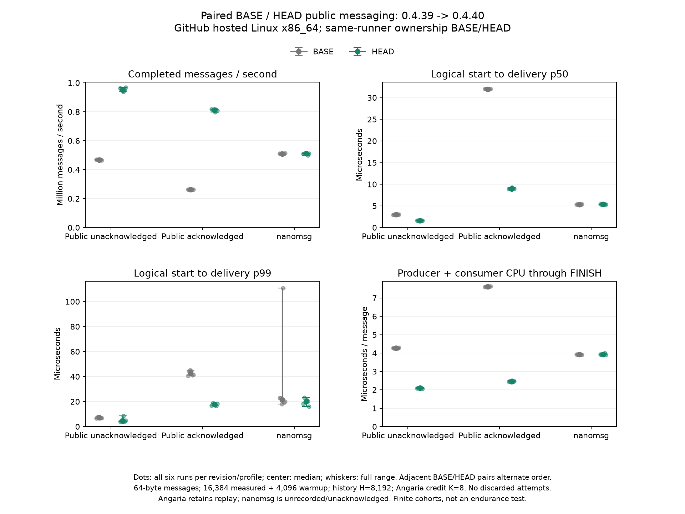
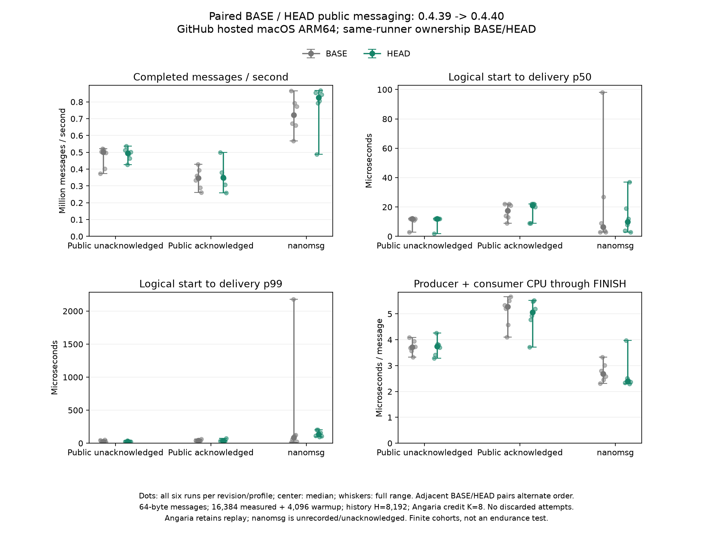
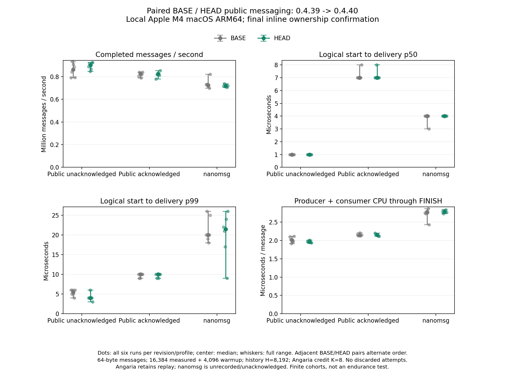

# Fork-aware ownership: retained measurements

Raw samples and profiler payloads described below are retained in the maintainer archive, not this checkout. Reports, plots, summaries and provenance remain here. [Archive catalog and restore instructions](../README.md#restore-archived-evidence) identify snapshot `2026-11-28-332118be2291`; restore its payloads before running the verification or figure commands below.

Framework **0.4.40**, milestone **4.38**, PR [#71](https://github.com/smangano/angaria/pull/71). Baseline [`ee200f0`](https://github.com/smangano/angaria/tree/ee200f06d2f757bfeb6cd7cddbe1b03eb328714b) is merged 0.4.39. Initial token implementation [`9618efb`](https://github.com/smangano/angaria/tree/9618efb501691af8f14251f9f546cbbf87b3fbc1) removes messaging PID queries. Final [`19b76ad`](https://github.com/smangano/angaria/tree/19b76adfc9dcca8c1b5bcc4c0fe4329800e771b8) inlines the flag probe. Test-only commit `026deb3` replaces unavailable `std::jthread`/`stop_token` in the held-lock regression with portable automatic stop/join cleanup; it changes no production messaging code.

## Method and populations

Each paired cohort has **36 attempts**: six rounds × three profiles × BASE/HEAD. Adjacent pairs alternate BASE-first and HEAD-first; profile order rotates. Each attempt has 16,384 measured 64-byte messages after 4,096 live warmup, H=8,192, K=8. Both ordinary Release binaries are built before timing, with matching compiler flags and the same nanomsg 1.3.0 pin. There are no diagnostic collectors or PID wrappers in timed binaries. All attempts, including unfavorable results and scheduling outliers, are retained.

The headline change is the **median of six same-round HEAD/BASE throughput ratios**. Tables also show medians per revision. A ratio of revision medians is a different statistic and must not replace the paired result. Quantiles are calculated per run; message samples and different cohorts are never pooled. Acknowledged completion includes the consumer's explicit acknowledgment. Nanomsg has no replay log or application acknowledgment.

Initial qualification runs comprise **108 paired attempts** and **621 separate full-HEAD attempts** across hosted Linux x86_64, hosted Mac ARM64, and the local Apple M4. The full matrices use the initial non-inlined token implementation and establish its broader workload qualification, not final-inline before/after improvements across all payloads. Final confirmation repeats **108 paired attempts** for the inline implementation. Both phases remain separate below; unfavorable initial measurements are not replaced by confirmation.

[Initial hosted workflow](https://github.com/smangano/angaria/actions/runs/46141428969) built both revisions in each host job and reconstructed raw evidence before plotting. The [final confirmation workflow](https://github.com/smangano/angaria/actions/runs/46143279203) runs paired measurements and the Linux PID guard without repeating the unchanged full workload plan. Every folder here retains its manifest, source/build hashes, compiler/host information, reports, recomputed summary and PNG/SVG plots. Raw sample/control archives are preserved in the external archive before workflow artifacts expire after 14 days; restore them before reconstruction. The local launcher's Python reports an x86_64 process under translation; both timed Mac binaries are independently verified as native ARM64 in the manifests.

## Final inline confirmation

### Hosted Linux x86_64



| Profile | BASE→HEAD thousands/s | Paired throughput change | BASE→HEAD delivery p99, µs |
| --- | ---: | ---: | ---: |
| Recorded / unacknowledged | 468.4→951.8 | +102.9% | 7.291→4.521 |
| Recorded / acknowledged | 262.6→812.1 | +209.2% | 42.859→17.706 |
| nanomsg | 510.4→510.7 | +0.0% | 21.561→19.920 |

Full run ranges and every paired difference/ratio are in [summary.json](linux-x86_64-confirmation/summary.json) and [comparison.csv](linux-x86_64-confirmation/comparison.csv).

This final cohort ran on a four-vCPU **AMD EPYC 9V74 / Microsoft hypervisor** host, whereas the initial Linux cohort ran on a four-vCPU **Intel Xeon 6975P-C / KVM** host. Both use GCC 13.3.0, but kernels and CPU mitigation settings also differ. These are separate paired experiments, each with its own baseline on the same host. The final Angaria throughput ranges are disjoint from their baseline in both modes; nanomsg's paired throughput is essentially unchanged. Inclusive CPU per publication falls about 51% unacknowledged and 68% acknowledged. This supports the ownership optimization on this host, but the much larger gain than the initial Linux cohort cannot be attributed to inlining alone. Absolute rates or differences between these two jobs do not isolate a code effect.

### Hosted Mac ARM64



| Profile | BASE→HEAD thousands/s | Paired throughput change | BASE→HEAD delivery p99, µs |
| --- | ---: | ---: | ---: |
| Recorded / unacknowledged | 501.3→494.7 | +3.5% | 22.000→23.000 |
| Recorded / acknowledged | 347.5→350.2 | +2.6% | 41.000→35.500 |
| nanomsg | 721.9→825.0 | +5.5% | 84.500→135.500 |

Full run ranges and every paired difference/ratio are in [summary.json](macos-hosted-confirmation/summary.json) and [comparison.csv](macos-hosted-confirmation/comparison.csv).

The hosted M1 VM remains variable. Its modest paired Angaria changes are smaller than nanomsg's control shift, and the unacknowledged revision medians actually fall despite the positive median paired ratio. This cohort does not establish a clear Mac improvement. It also does not repeat the initial cohort's large paired regression; both observations remain visible.

### Local Apple M4



| Profile | BASE→HEAD thousands/s | Paired throughput change | BASE→HEAD delivery p99, µs |
| --- | ---: | ---: | ---: |
| Recorded / unacknowledged | 862.3→900.1 | +6.4% | 5.500→4.000 |
| Recorded / acknowledged | 824.6→822.3 | -0.6% | 10.000→10.000 |
| nanomsg | 724.4→717.8 | -0.4% | 20.000→21.500 |

Full run ranges and every paired difference/ratio are in [summary.json](macos-m4-confirmation/summary.json) and [comparison.csv](macos-m4-confirmation/comparison.csv).

The local M4 suggests a modest unacknowledged improvement; acknowledged throughput is effectively flat. Observed ranges overlap, so six finite pairs do not establish a precise general speedup. Delivery p99 improves for unacknowledged messages and is unchanged for acknowledged messages in these revision medians.

## Initial implementation, including the Mac regression

These observations concern the initial non-inlined probe at `9618efb`; they remain part of the evidence.

| Host | Unacknowledged paired throughput | Acknowledged paired throughput | nanomsg paired throughput |
| --- | ---: | ---: | ---: |
| Linux x86_64 | +28.04% | +57.96% | +3.19% |
| Local M4 | −0.92% | +1.11% | −3.42% |
| Hosted M1 VM | **−21.44%** | +2.08% | −1.80% |

Linux has disjoint observed throughput ranges and improves in all six pairs per Angaria mode. Revision medians are 719→910k/s unacknowledged and 489→779k/s acknowledged. Delivery p99 medians are 3.258→2.724 µs and 25.888→18.677 µs. Inclusive CPU medians fall from 2.785→2.202 µs/publication and 4.089→2.570 µs/publication. Nanomsg's smaller control shift is retained, without subtracting it from Angaria's observations. See [Linux initial pairs](linux-x86_64-paired/summary.json).

The local M4 ranges overlap widely and show no clear initial throughput gain. One nanomsg BASE run reaches 1.267M/s and is retained. The [M4 paired result](macos-m4-paired/summary.json) differs from ratios of revision medians, which are −1.34% unacknowledged and −1.53% acknowledged; those ratios are not the headline paired result.

The hosted M1 unacknowledged regression is explicit: four of six pairs are slower, paired CPU rises 35.70%, and paired p99 rises 61.67%. Throughput ranges are 119–888k/s BASE and 325–871k/s HEAD. CPU rises in all four losing pairs, but polling/retry counts vary and do not fully explain the loss. Producer major/minor-fault counts remain unchanged, so different fault counts cannot explain this result. The unacknowledged ratio of revision medians is only −2.53%, which masks the unfavorable paired statistic. Acknowledged ratio-of-medians +44.58% likewise does not replace its paired +2.08%. See [hosted Mac initial pairs](macos-hosted-paired/summary.json).

That VM also shows strong scheduling variation across profiles: BASE unacknowledged round 1 achieves only 119k/s at about 0.50 effective CPU cores; a nanomsg HEAD run has delivery p50/p99 of 418/2,599 µs. VM interference is plausible, but the smaller nanomsg throughput shift does not prove it explains Angaria's negative result. The initial data cannot exclude a Darwin-specific regression. The inline refinement removes the helper call as a small focused cost reduction; comparisons between different hosted jobs cannot establish that this call caused the entire earlier regression.

## Full initial-HEAD qualification and remaining limits

The full matrices cover payloads 64/256/1,024 bytes, history 0/8,192/65,536, offered load, K=1/8/64, delayed/paused consumers and a 131,072-message measured stream. Every one of their 621 attempts completes with matching accepted/delivered and selected acknowledgment counts. Full results describe the initial implementation on each measured host; only the core64 paired studies establish BASE/HEAD changes.

- [Linux full matrix](linux-x86_64-head-full/qualification-summary.json): core64 U/ACK/nanomsg medians 908/792/876k/s; 256 B 726/641/717k/s; 1 KiB 371/370/406k/s. Nanomsg still leads 1 KiB throughput, and acknowledged throughput remains lower at all core payloads. The longer stream gives 901/812/871k/s with median delivery p99.9 of 28.511/29.129/49.082 µs. Slow-consumer polling still costs about twice nanomsg's CPU. Increasing acknowledged credit improves throughput but raises queuing latency.
- [Local M4 full matrix](macos-m4-head-full/qualification-summary.json): substantial variation remains, including a 9.265 ms acknowledged scheduled-p99 run at 100k/s. This separate population is workload coverage, not a paired improvement claim.
- [Hosted Mac full matrix](macos-hosted-head-full/qualification-summary.json): the 100k/s scheduled-p99 medians reach roughly 107/86/80 ms for U/ACK/nanomsg. Measured suffix rates above the offered rate reflect catch-up after late starts; they are not successful scheduling at the requested rate.

Short finite streams, nonexclusive hosts, limited repetitions, page faults and buffering differences bound interpretation. Excellent p99 does not establish an absence of stalls or good p99.9/maxima. Both Angaria modes retain immutable accepted messages; the acknowledged mode records processing progress. These tests do not establish endless-stream capacity, multi-input selection or fan-out scaling.

## Correctness and actual PID-call checks

All 752 local Release CTest entries pass after the inline refinement. The earlier instrumented public suite passes allocation, explicit file/mapping/history/Session-gate guards and inherited-handle/Thread/parent checks. [Portable-thread regression results](focused/portable-thread-public-tests.log) preserve the macOS CI fix. The first macOS build error is retained separately in [focused logs](focused/macos-initial-test-build-error.log).

[Linux initial PID interception](linux-getpid-check/getpid-ctest.log) verifies that two real libc calls are intercepted, then observes zero direct `getpid` calls over warmed buffered and owning sends/status, ID issuance, receive, repeated pins, release/redelivery, acknowledgment/watermarks and 10,000 empty polls in both modes. [Final confirmation](linux-final-getpid-check/getpid-ctest.log) repeats that check successfully for the inline implementation. Timed binaries have normal linkage; only the isolated test executable uses `--wrap=getpid`. This does not count every syscall inside dynamically linked dependencies.

Process/Thread ownership, early rejection before inherited local locks, producer-log acceptance, transport credit, optional processing acknowledgments and replay retain their contracts. A private token points to an immortal registry flag changed by the existing child fork handler. Cold registration errors reject binding. Ordinary registered fork handlers and exec-before-new-attachment remain the supported process model; an ordinary cached PID is not substituted for fork invalidation.

## Reproduction

From the matching source revision, use the commands and build provenance in each manifest. Both checkouts and binaries must be frozen and built before collecting a fresh output directory. For retained evidence:

```sh
python3 -B benchmarks/ownership_performance.py verify benchmarks/results/milestone-4-fork-ownership/linux-x86_64-confirmation
python3 -B benchmarks/ownership_performance.py render benchmarks/results/milestone-4-fork-ownership/linux-x86_64-confirmation
python3 -B benchmarks/run_end_to_end.py verify benchmarks/results/milestone-4-fork-ownership/linux-x86_64-head-full
```

`verify` reconstructs raw samples, framework-version routing, outcomes and summaries. `render` reconstructs before plotting. [Focused artifact integrity](focused/evidence-integrity.json) also records downloaded full-matrix hashes and recomputed summaries. The original negative result and every outlier remain available for further analysis.
