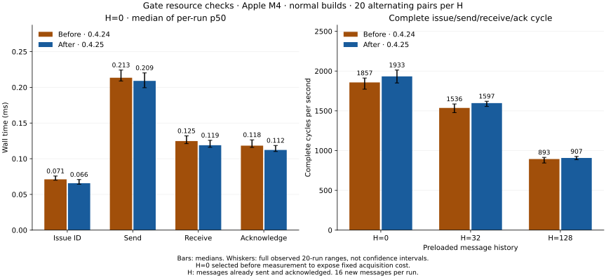
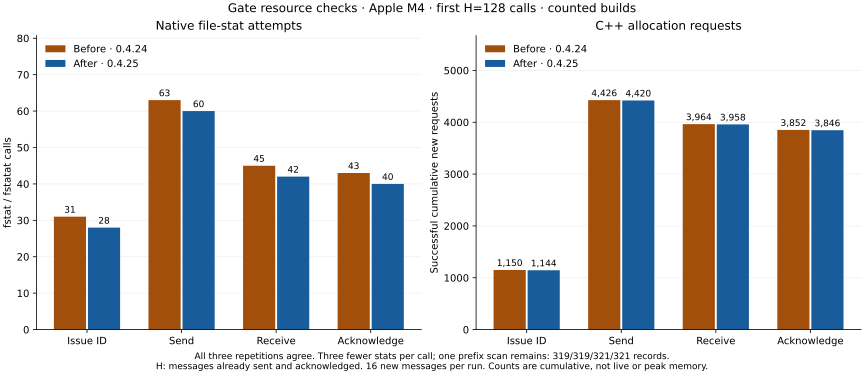

# Gate resource-check measurements

Milestone **4.23**, framework **0.4.25**. The [design and risk assessment](../../../docs/performance-gate-resources.md) explain removing the duplicate resource check before native gate acquisition. The [diagnostic method](../../../docs/performance-diagnostics.md) defines workloads, counters and outcomes. After-lock identity checks still precede a usable guard; the accepted tradeoff is delayed diagnosis of unsupported namespace replacement, including indefinite blocking on an obsolete held lock.

## Provenance

Before binaries are preserved 0.4.24 executables compiled from `da7d821991e77484a3b7aae874201723c6ea4ce4`, copied with their original CMake caches before rebuilding. Normal SHA256 is `804bc177bd6a507a163121be2502748f9a6a228e79173529a43bf0fd2e906572`; enabled is `98f3255af60bc81ab23627d541c7a6d1743c74fb6a83ecddcfec6b1edf95dac1`. The measurement checkout is merged staging `1b59dc4bb7ba9d7cc6efe84eca098109088eafad`; all 128 measurement-input hashes match the compiled source. Manifests identify the measurement checkout without claiming it compiled these preserved binaries.

After binaries are built from `abe49d8b99ff47fd14a8af60afa6401eae8f3a91`, version 0.4.25. Normal SHA256 is `c5d1929fbb1795fc4b56a6b40591bc007c851270e80386eae96b6e6d9b6881d8`; enabled is `3930a55a794b8967614acffa239a1aa56419a0e62d63d13e6ac9ded729d28da5`. Only VERSION and `src/session_controller.cpp` differ among the 128 measured inputs. Subsequent commits add results/docs only; benchmark drivers, workloads and C++ remain unchanged.

Builds use Apple clang 21, Release `-O3 -DNDEBUG`, plus `-Wall -Wextra -Werror -g`. Diagnostics are OFF for headline timing, ON for attribution. Host: Apple M4, ten logical CPUs, 16 GiB, macOS 27.0.1, native ARM64 executables and an x86_64 Python 3.10.15 coordinator. Temporary Sessions use the local Data volume. No builds/tests ran during measurements. Host isolation, affinity, thermal/frequency controls and cache flushing were not used; these windows do not establish production tail latency.

All local measurements use the same default execution request. Elevated git/worktree setup and preserved-binary copies ran separately. Adjacent comparisons use one shared coordinator for both variants. Enabled populations run sequentially before and after rebuilding/testing, supplying work attribution rather than headline timing. See [execution settings](execution-contexts.toml).

## Populations and ordering

| Population | Completed runs | Purpose |
| --- | ---: | --- |
| [Before enabled](macos-arm64-before-enabled/) | 75 | Count/phase attribution |
| [After enabled](macos-arm64-after-enabled/) | 75 | Count/phase attribution |
| [Alternating normal](alternating/) | 120 | Twenty pairs per H0/32/128 |
| [Matched normal controls](matched-controls/) | 66 | Eleven cases, three pairs each |
| [Hosted Linux after](linux-x86_64-after/) | 54 | Qualification and syscall corroboration |

Local populations total **336**; including Linux, **390**. Each local run completes all sixteen messages; each Linux run completes all eight, with zero pending or unacknowledged-at-stop deliveries. Seven manifests, 21 run/summary/phase CSVs, raw compressed JSON lines and two comparison order logs retain the full populations. Samples are not pooled; within-run nearest-rank quantiles are summarized using medians of per-run values. All observations remain, without outlier removal.

**H means history:** messages already sent and acknowledged before sixteen new measured messages. Each Session has four channels and eight-entry rings. Serial/backlog keeps nine claims attached; thread/process streams keep two plus requested idle consumers. Default RecoverFromLog delivery is measured; allowed loss remains correctness-qualified rather than performance-plotted.

The unchanged [shared serial coordinator](../milestone-4-gate-handoff/run_interleaved.py) imports each checkout's own driver/version/metadata and runs sixty adjacent AB/BA pairs, with H0/32/128 per repetition. Twenty repetitions were fixed before launch. The H0 operation plot was selected before measurement because the removed group is a fixed cost per acquisition, most visible without long retained history. Pair order alternates deterministically, not randomly. The [full control coordinator](../milestone-4-payload-preparation/run_matched_controls.py) adds 33 adjacent pairs over eleven unchanged cases. Invocation times in order logs include startup/preload, not just public calls.

## Timing and work results



Left: H0 operation p50 medians. Right: complete issue/send/receive/acknowledge cycles per second at H0/32/128. Bars use twenty adjacent normal runs per variant per history; whiskers show full observed run ranges, not confidence intervals.

| History / operation | Before p50 (ms) | After p50 (ms) | Change |
| --- | ---: | ---: | ---: |
| H0 Issue ID | 0.071083 | 0.065646 | -7.65% |
| H0 Send | 0.213459 | 0.209083 | -2.05% |
| H0 Receive | 0.124771 | 0.118937 | -4.68% |
| H0 Acknowledge | 0.118292 | 0.112312 | -5.05% |
| H128 Issue ID | 0.112584 | 0.107291 | -4.70% |
| H128 Send | 0.420042 | 0.415729 | -1.03% |
| H128 Receive | 0.297771 | 0.293458 | -1.45% |
| H128 Acknowledge | 0.284625 | 0.281437 | -1.12% |

| History | Before cycles/s | After cycles/s | Change | Faster after pairs |
| --- | ---: | ---: | ---: | ---: |
| H0 | 1,856.91 | 1,932.89 | +4.09% | 19/20 |
| H32 | 1,535.98 | 1,596.92 | +3.97% | 20/20 |
| H128 | 893.45 | 906.97 | +1.51% | 16/20 |

All cycle-rate ranges overlap. H128 includes four slower after pairs. Paired rate-change ranges are H0 -0.35…+8.97%, H32 +0.31…+7.84%, H128 -1.04…+7.98%. No unfavorable pairs are excluded. This fixed-cost reduction has a smaller relative effect as retained-history scans grow. It does not make operation cost independent of history or establish a universal latency/throughput gain.



The first H128 calls agree exactly across all three Counts repetitions:

| Operation | Stat attempts, before→after | Allocation requests, before→after | Requested bytes, before→after |
| --- | ---: | ---: | ---: |
| Issue ID | 31→28 | 1,150→1,144 | 231,360→230,208 |
| Send | 63→60 | 4,426→4,420 | 625,404→624,252 |
| Receive | 45→42 | 3,964→3,958 | 509,356→508,204 |
| Acknowledge | 43→40 | 3,852→3,846 | 497,268→496,116 |

Across **603 matching samples** in nine Counts runs, every sample saves exactly **three stats, six allocation requests and 1,152 requested bytes**. Removing the group also removes temporary pathname construction. All other work counters agree, including prefix/Publication/Task validation, native mapping/reads, gate and recovery counts. Allocation requests count successful cumulative C++ new requests in the captured thread, not live/peak memory.

First H128 issue/send/receive/acknowledge still scan one complete prefix with **319/319/321/321** record visits. Receive still validates 129 Publications, builds topology once, examines 27 Task slots, and records 16 maps and zero native reads. This step changes neither mapping reuse nor scan frequency.

### Acquisition and ownership boundaries

Sequential enabled Timings populations supply attribution, not the headline comparison. Values below are medians of three per-run means over sixteen calls at H0:

| Operation | Full acquisition before→after (µs) | Native hold before→after (µs) |
| --- | ---: | ---: |
| Issue ID | 11.609→6.149 | 61.386→61.865 |
| Send | 11.557→6.123 | 217.409→216.964 |
| Receive | 12.068→6.232 | 117.698→116.669 |
| Acknowledge | 11.664→6.128 | 112.005→109.990 |

Across the three histories, full-acquisition means fall about 46.6–48.6%, while native-hold means change −2.28…+0.78%. These enabled populations ran sequentially and are not a controlled estimate of instrumentation overhead. Acquisition includes local coordination and checks as well as locking; native hold starts after successful flock. They overlap and must not be added.

### Matched controls

All eleven normal control cases have three adjacent pairs per variant. Whole-window medians are shown below alongside receive p50. Serial/thread intervals use `cycle_phase_ns`; backlog sums publish and drain; processes use the worker-cohort `process_phase_ns`. These are distinct workload intervals.

| Case | Receive p50 before→after (ms) | Window median before→after (ms) |
| --- | ---: | ---: |
| H0 serial | 0.126083→0.120792 | 8.676→8.274 |
| H32 serial | 0.161666→0.157708 | 10.595→10.141 |
| H128 serial | 0.303541→0.294541 | 18.013→17.741 |
| H128 other-Queue history | 0.297709→0.293708 | 18.004→17.670 |
| H128 capacity ×16 | 0.417834→0.413500 | 24.039→23.645 |
| H128 payload 256 bytes | 0.311125→0.304959 | 18.791→18.214 |
| H128 payload 256 bytes / 32 Fields | 0.309625→0.307791 | 18.675→18.290 |
| H128 backlog | 0.300334→0.297000 | 18.604→18.411 |
| H128 thread stream | 0.819125→0.804041 | 19.910→19.639 |
| H128 stream / three idle pollers | 1.164917→1.122875 | 38.294→37.248 |
| H128 process stream | 0.755416→0.740958 | 19.418→18.921 |

Serial cycle-rate medians rise 1.53–4.85% across these controls. Backlog publish/drain rates rise 1.78%/0.44%; thread stream rises 1.38%, three-idle stream 2.81%, and process worker-cohort rate 2.63%. The three-run samples are small; receive in concurrent workloads includes scheduling and waiting, not just Angaria CPU work.

Thread stream window ranges: before 19.887–20.008 ms; after 19.573–19.685 ms.
Three-idle stream window ranges: before 37.233–41.874 ms; after 31.787–39.702 ms.
Process stream window ranges: before 18.951–19.462 ms; after 18.720–19.120 ms.

All messages complete, but no bounded-wait, fairness or production-tail claim follows. Complete history/delivery validation, remaining per-record mappings and decoded-result allocation remain costs.

[PNG performance](gate-resources-performance.png) and [PNG work](gate-resources-work.png) are retained. [Regenerate both figures](generate_figures.py) using matplotlib; the generator reuses existing report helpers. All eighteen local CSVs regenerate byte for byte, and all source/executable hashes match their manifests.

## Linux corroboration and qualification

[Source CI run 45977982652](https://github.com/smangano/angaria/actions/runs/45977982652) produced the unmodified artifact retained here. Its synthetic merge is `c6483e99c0d88f5d61bf0ff10d5d328958c82757`; all 128 measured input hashes match the local after source. All **54/54** eight-message diagnostic workloads finish, including all six loaded three-idle cases at 8/8, with zero pending or unacknowledged-at-stop deliveries.

First H128 timed issue/send/receive/acknowledge record **28/60/42/40 stats**, matching local after work counts, with unchanged prefix visits and map counts. Linux receive records **4,055 allocation requests / 524,515 requested bytes**, versus [preceding .24](../milestone-4-prefix-buffers/linux-x86_64-after/) 4,073/527,074. That is eighteen fewer requests and 2,559 fewer bytes on this library/path configuration; Mac Counts saves six/1,152. Do not equate allocator/library, collection and path-dependent byte/request counts across platforms.

The separate [syscall trace](linux-x86_64-after/syscalls.txt) includes startup, setup, H32 preload, eight serial messages, controls and teardown. Against the [preceding .24 trace](../milestone-4-prefix-buffers/linux-x86_64-after/syscalls.txt), `newfstatat` falls **6,107→5,384**, saving **723 calls (11.84%)**. `fstat` **6,733**, `getpid` **66,431**, `pread64` **2,169**, `mmap` **3,002** and `munmap` **2,981** stay unchanged. This corroborates the removed pathname checks, rather than a mapping or file-descriptor-stat change. Whole-program totals must not be divided by eight or treated as ordinary per-operation latency.

Strict local Release diagnostics OFF/ON each pass **823/823 tests** (18.47/18.54 seconds). Measured-source CI passes 823/823 on [Linux x86_64](https://github.com/smangano/angaria/actions/runs/45977982652/job/140434437541) (12.99 s), [Linux ARM64](https://github.com/smangano/angaria/actions/runs/45977982714/job/140434438015) (13.63 s) and [macOS ARM64](https://github.com/smangano/angaria/actions/runs/45977982714/job/140434438587) (31.87 s). These include the new private three-resource contention case, existing replacement/ownership/fork/local-handoff/recovery/crash/timeout tests, native walkthroughs, original benchmark smoke and seventeen public primer programs. The corruption test demonstrates try-only Busy followed by post-acquisition IoError and cleanup, not a measurement of blocking-wait duration. Intel macOS remains request-only; main integration remains held; CI has no timing threshold.

## Reproduce

Use each executable's matching checkout, identical execution settings and a new output directory:

```sh
python3 -B benchmarks/run_diagnostics.py MATCHING_EXECUTABLE \
  --suite diagnostic --repetitions 3 --output NEW_RESULTS \
  --host-label 'DESCRIBE THE ACTUAL HOST'

python3 -B benchmarks/results/milestone-4-gate-handoff/run_interleaved.py \
  --before-root BEFORE_CHECKOUT --before-executable BEFORE_BINARY \
  --after-root AFTER_CHECKOUT --after-executable AFTER_BINARY \
  --output NEW_COMPARISON --repetitions 20 \
  --host-label 'DESCRIBE THE ACTUAL HOST'

python3 -B benchmarks/results/milestone-4-payload-preparation/run_matched_controls.py \
  --before-root BEFORE_CHECKOUT --before-executable BEFORE_BINARY \
  --after-root AFTER_CHECKOUT --after-executable AFTER_BINARY \
  --output NEW_CONTROLS --host-label 'DESCRIBE THE ACTUAL HOST'
```

Benchmark runners need only Python's standard library. Temporary Sessions are removed. Rebuilds may change binary hashes. A validated budget stop is not completion: inspect progress and outcomes. Cachegrind profiling remains a separate experiment, with no added runtime dependency or automatic CI cost in this step.
