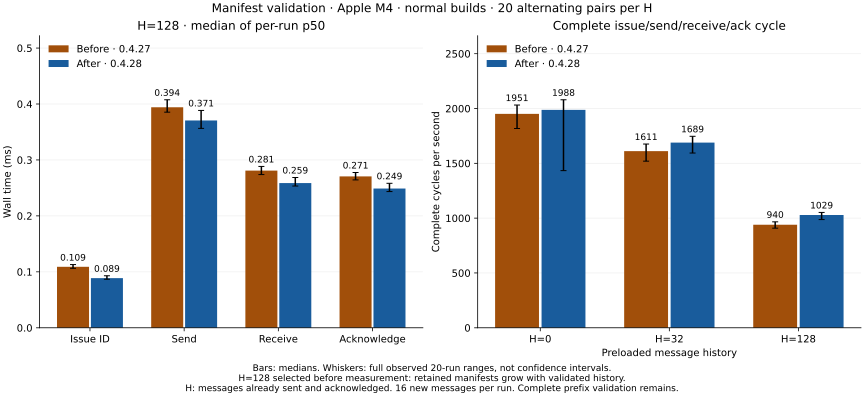
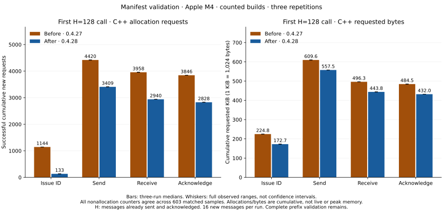
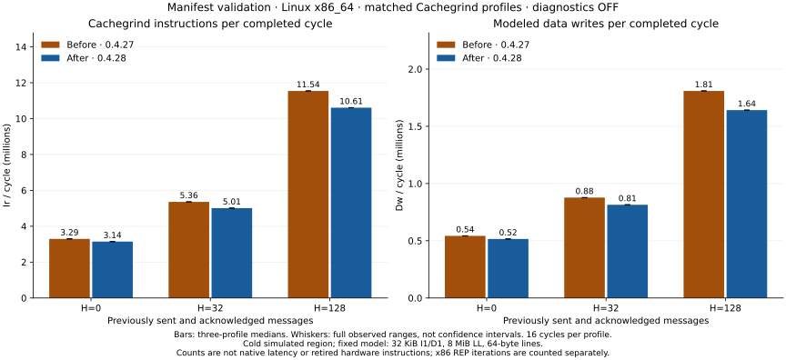

# Validation-only manifest measurements

Raw samples and profiler payloads described below are retained in the maintainer archive, not this checkout. Reports, plots, summaries and provenance remain here. [Archive catalog and restore instructions](../README.md#restore-archived-evidence) identify snapshot `2026-11-28-332118be2291`; restore its payloads before running the verification or figure commands below.

Step **4.26**, framework **0.4.28**. The [guide and risk assessment](../../../docs/performance-manifest-validation.md) explain the change: complete journal-history scans validate manifest references and redo-command bytes without constructing owning reference/command vectors or copying payloads. A manifest describes a committed batch; redo commands describe state changes recovery can apply again. Recovery/application retain owning decoding. Shared framing and semantic checks preserve corruption rejection and first-error details. Public APIs, formats, ownership, synchronization and scan frequency remain unchanged.

## Native latency and throughput

**H** is the number of messages already sent and acknowledged before the measured window. Each fresh Session then completes sixteen new issue-ID/send/receive/acknowledge cycles. The primary study fixed **twenty adjacent before/after pairs per H** before launch. AB/BA order alternates deterministically, rather than randomly. H=128 operation plots were selected before measurement because repeated manifest construction grows with validated history.

The rate table uses medians of twenty per-run complete-cycle rates. Brackets are full observed ranges, not confidence intervals. Change is the ratio of after/before medians; paired percentage medians are separate statistics.

| H | Before cycles/s [range] | After cycles/s [range] | Change | Median paired change | After faster |
|---|---:|---:|---:|---:|---:|
| 0 | 1,950.96 [1,817.68, 2,031.57] | 1,987.85 [1,433.14, 2,079.52] | +1.89% | +3.11% | 15/20 |
| 32 | 1,610.97 [1,519.53, 1,676.20] | 1,688.84 [1,593.63, 1,746.57] | +4.83% | +5.00% | 20/20 |
| 128 | 940.05 [908.81, 966.23] | 1,028.56 [987.02, 1,051.99] | +9.42% | +9.59% | 20/20 |

At H=128, ordinary API wall times change as follows. These are medians of per-run p50 values, rather than pooled message samples or production tail latencies.

| Operation | Before ms [range] | After ms [range] | Change | After lower |
|---|---:|---:|---:|---:|
| issue | 0.108938 [0.106333, 0.112958] | 0.088708 [0.086750, 0.093000] | -18.57% | 20/20 |
| send | 0.394166 [0.385333, 0.407500] | 0.370604 [0.356416, 0.388541] | -5.98% | 20/20 |
| receive | 0.280917 [0.273875, 0.288375] | 0.258667 [0.253375, 0.268625] | -7.92% | 20/20 |
| acknowledge | 0.270542 [0.264375, 0.277542] | 0.248833 [0.243500, 0.258292] | -8.02% | 20/20 |



[PNG](manifest-validation-performance.png). Whiskers span the full observed ranges. At H=128, the entire after throughput range exceeds the before range. H=0 is noisier: its after range includes a slow run around 1,433/s despite a higher median. No run is removed or attributed to scheduling without CPU evidence. These short windows support a workload-specific gain, not a universal speedup, sustained capacity estimate or production tail-latency guarantee.

## Allocation attribution

Enabled diagnostics supply attribution controls, not the primary latency population. All **603** matched serial Counts sample dictionaries at H=0/32/128 agree on every nonallocation counter. Allocation requests and requested bytes decrease; native calls, gate acquisitions, recovery checks, topology work, record visits and Publication validation passes remain.

For the first H=128 cycle, all three counted repetitions agree exactly on the following values. These counters describe successful cumulative C++ allocation requests/bytes within the operation; they do not describe live or peak resident memory.

| Operation | Allocation requests before→after | Change | Requested bytes before→after | Change |
|---|---:|---:|---:|---:|
| issue | 1,144→133 | -88.37% | 230,208→176,816 | -23.19% |
| send | 4,420→3,409 | -22.87% | 624,252→570,860 | -8.55% |
| receive | 3,958→2,940 | -25.72% | 508,204→454,428 | -10.58% |
| acknowledge | 3,846→2,828 | -26.47% | 496,116→442,340 | -10.84% |



[PNG](manifest-validation-allocations.png). The plot uses KiB = 1,024 bytes. Issue/send/receive/ack each retain one prefix scan and visit 319/319/321/321 records respectively. Send validates 128 historical Publications; receive and acknowledgment each validate 129. ID issuance benefits because it also scans the committed journal prefix, even though it does not perform those Publication semantic-validation passes. The borrowed view is consumed before the next scratch read; exported prefix ranges and recovery commands retain their existing ownership.

## All native controls

The unchanged [matched-control coordinator](../milestone-4-payload-preparation/run_matched_controls.py) runs eleven cases, three adjacent pairs each. Every workload completes sixteen messages, with no pending or unacknowledged work. Brackets show full three-run ranges. Backlog reports publication and drain separately; the process work phase and exit-inclusive interval are distinct measures.

| Case | Rate | Before /s [range] | After /s [range] | Change |
|---|---|---:|---:|---:|
| 1: Serial H=0 | complete cycles | 1,956.71 [1,888.17, 2,007.80] | 2,022.44 [1,942.61, 2,046.78] | +3.36% |
| 2: Serial H=32 | complete cycles | 1,642.72 [1,612.21, 1,676.72] | 1,726.63 [1,698.46, 1,741.15] | +5.11% |
| 3: Serial H=128 | complete cycles | 956.87 [953.38, 958.58] | 1,045.28 [1,019.25, 1,057.15] | +9.24% |
| 4: Other-Queue H=128 | complete cycles | 964.62 [963.80, 971.31] | 1,040.50 [1,006.47, 1,062.85] | +7.87% |
| 5: Capacity ×16, H=128 | complete cycles | 716.70 [703.95, 720.44] | 756.63 [744.24, 757.52] | +5.57% |
| 6: 256 bytes, H=128 | complete cycles | 926.01 [905.71, 928.99] | 995.77 [993.43, 1,009.21] | +7.53% |
| 7: 256 bytes / 32 Fields, H=128 | complete cycles | 933.77 [893.18, 939.92] | 1,004.66 [992.03, 1,015.14] | +7.59% |
| 8: Backlog H=128 | published messages | 2,033.54 [2,004.98, 2,040.23] | 2,181.29 [2,160.78, 2,217.45] | +7.27% |
| 8: Backlog H=128 | drained messages | 1,713.41 [1,705.70, 1,729.74] | 1,858.43 [1,856.32, 1,859.53] | +8.46% |
| 9: Thread stream H=128 | complete cycles | 855.13 [840.37, 867.35] | 923.21 [910.24, 954.84] | +7.96% |
| 10: Three idle pollers H=128 | complete cycles | 517.63 [432.98, 530.97] | 529.96 [511.67, 620.83] | +2.38% |
| 11: Process H=128 | work phase | 913.42 [911.62, 921.24] | 996.27 [988.81, 999.30] | +9.07% |
| 11: Process H=128 | exit-inclusive | 706.96 [699.76, 712.53] | 761.81 [757.14, 762.61] | +7.76% |

All control rate medians improve, but three repetitions are a small control sample. No operation has a higher p50 median in this control matrix; individual runs still vary. [analysis.json](analysis.json), raw reports and CSVs retain complete operation, CPU/wall, window and adjacent-pair statistics.

## Matched Linux Cachegrind profiles

[Run 46024481479](https://github.com/smangano/angaria/actions/runs/46024481479) builds the immutable PR base and source head on the same hosted Ubuntu x86_64 job, then profiles base before head. Each checkout uses its own runner. There are three profiles per H/version, sixteen complete cycles per profile, **eighteen successful profiles** total. Setup/preload, controls and teardown remain outside the cold measured region. This fresh matched comparison supplies the before/after evidence; the preceding step's standalone artifacts are not substituted for it.

Both builds use Intel Xeon 6975P-C, GCC 13.3.0, glibc 2.39, Valgrind/cg_annotate 3.22.0, Release `-O3 -DNDEBUG` plus `-g`, profiling hooks ON and diagnostics OFF. The fixed simulated model is I1/D1 **32 KiB, 8-way**, LL **8 MiB, 16-way**, all **64-byte lines**, with cache/branch simulation enabled. Instruction/write totals agree across the three plotted repetitions at each H/version. Values below are per completed cycle, not isolated send calls.

| H | Instructions before→after | Change | Data-write references before→after | Change |
|---|---:|---:|---:|---:|
| 0 | 3,294,719.6250→3,142,905.8125 | -4.61% | 542,740.1875→515,356.7500 | -5.05% |
| 32 | 5,359,192.1875→5,009,304.4375 | -6.53% | 877,103.2500→814,316.3125 | -7.16% |
| 128 | 11,541,340.0625→10,609,457.0625 | -8.07% | 1,808,802.6875→1,641,222.0625 | -9.26% |



[PNG](manifest-validation-cachegrind.png). These simulated x86 event counts are not native latency, CPU cycles or retired hardware instructions; Cachegrind counts REP iterations separately. Their percentage changes cannot predict matching speedups across compilers or architectures.

Cache and branch outcomes are mixed. At H=128, D1 data misses fall only 0.54% (977,589→972,336 over sixteen cycles), while their rate rises 1.21590%→1.31949% as reference counts shrink. LL data misses rise **3.14%** (6,729→6,940), and branch mispredictions rise **3.36%** (1,291,674→1,335,090); their rates rise 0.008369%→0.009418% and 4.24636%→4.69329% respectively. H=0 instruction-cache misses rise 1.17%. Reduced instructions, writes and measured allocation work do not establish better behavior for every cache/predictor metric.

## Provenance and retained evidence

The before source checkout is merged staging **`584696ac86dfaa14961f887cfdb5e3015950ef78`**, version 0.4.27. Both native executables are the exact preserved strict Release binaries built at **`c2bd1c04cceb7f71fb124313d74f767dbc6010b8`** during the preceding step. Their 129 measurement-input hashes match merged staging. The current manifests identify the new measurement checkout rather than claiming those binaries were recompiled there; copied CMake caches preserve the original build options. Current [before-normal metadata](alternating/before-normal/manifest.toml) and [before-enabled metadata](macos-arm64-before-enabled/manifest.toml) retain the executable hashes/settings, consistent with the [preceding source evidence](../milestone-4-single-destination/README.md).

After executables are built from **`0f88bec43efe384b371e78778d3a819b5d79c19f`**, version 0.4.28. Only **VERSION, `src/journal_format.h`, `src/journal_format.cpp` and `src/mutation_journal.cpp`** differ among the 129 measured inputs. Later commits add results/docs only. Measurement source states are tracked-clean. Before and after measurements use matching default execution requests, with elevated Git/worktree setup separate; [execution-contexts.toml](execution-contexts.toml) records ordering and selection.

The local host is Apple M4, ten logical CPUs, 16 GiB, macOS 27.0.1, native ARM64 executables, Apple clang 21, with an x86_64 Python 3.10.15 coordinator. Release flags are `-O3 -DNDEBUG` plus `-Wall -Wextra -Werror -g`. Builds/tests finish before timing. There is no host isolation, affinity, thermal/frequency control or cache flushing. The workload uses four channels, eight-entry rings, default RecoverFromLog, eight-byte payloads and one Field unless a control says otherwise. Serial/backlog keeps nine active claims; thread/process uses two plus requested idle consumers. Short sixteen-message windows do not qualify sustained load, ten cooperating processes or production tails.

| Population | Validated invocations | Evidence |
|---|---:|---|
| [Before enabled](macos-arm64-before-enabled/) / [after enabled](macos-arm64-after-enabled/) | 75 + 75 | None/Counts/Timings controls |
| [Alternating normal](alternating/) | 60 + 60 | Twenty pairs per H; order log |
| [Matched normal controls](matched-controls/) | 33 + 33 | Eleven cases × three pairs; order log |
| [Matched Cachegrind](cachegrind-comparison/) | 9 + 9 | Raw events, annotations, commands, reports, versions, manifests |
| [Linux source CI after](linux-x86_64-after/) | 54 | Eighteen eight-message cases × three; six three-idle streams complete |

**408 validated invocations** are retained: 336 local, eighteen Cachegrind and 54 Linux CI. All local and profiling workloads complete sixteen messages; Linux CI completes eight, with no pending or unacknowledged work. There are **25 generated CSV tables** (eighteen native, four Cachegrind, three Linux), plus two order logs. [analysis.json](analysis.json) retains complete metrics and audit results. The independent audit validates reports with their matching drivers, checks source/executable/coordinator hashes and ordering, regenerates all CSVs and checks raw profile event-row conservation. The figure generator validates its plotted report/model inputs and summary/counter consistency; it does not repeat every independent provenance or full-population audit check. Raw artifacts remain verbatim.

| Executable | SHA256 |
|---|---|
| Native before normal | `004786460eed0ee69a63f6ddf4079b7cd4ce002601c3494d831d5c5be357abb2` |
| Native before enabled | `743746118a6f4208de7e08107d84c6bf1c338126dafed6a7c9e3f6709ba9a6c6` |
| Native after normal | `0358d28a860203dddff22d297d2e7018b327cd1fd80c70e29de3bec6f877d972` |
| Native after enabled | `325c81b13eeed40569d86d5e271c1ff2449551b3aa1045b2e5b78baeeeca2f5b` |
| Linux Cachegrind before | `c51dcfea821576b282783fa161bfae459eaf84ad6584e1ba5ce3504c50be027a` |
| Linux Cachegrind after | `df568873b743fa1650f3532fd22f6f7719eaac9df16cf2f891c52d638be94f56` |

## Qualification and Linux control

Strict local Release diagnostics OFF/ON each pass **830/830 tests**, in 16.82/19.15 seconds. Five focused tests qualify independent golden streams, all four command opcodes, unaligned/padded/empty manifests, exact code/path/message and first-error parity, owning/borrowed lifetimes and a corrupt later historical command blocking exposure and mutation writes before repair. Existing scratch reuse, partial-read, rollback, interrupted recovery, public ownership, demos and all seventeen primer programs remain covered. The primer review requires no public API/example changes.

At source commit 0f88bec, [Linux x86_64 CI](https://github.com/smangano/angaria/actions/runs/46024461708) passes **830/830** (9.31 seconds); [native profile CI](https://github.com/smangano/angaria/actions/runs/46024461710) passes **830/830** on Linux ARM64 (13.56 seconds) and macOS ARM64 (25.03 seconds). All eighteen matched Cachegrind profiles pass. Final documentation/data commits run ordinary CI again before the PR is marked ready.

The retained Linux artifact's synthetic merge is `823b7c0df5bb37871dc34b25e0afc9ea0f21ffb1`, with all 129 code input hashes matching the measured after source. Its separate [whole-program syscall trace](linux-x86_64-after/syscalls.txt) includes setup, H=32 preload, eight measured serial cycles, controls and teardown: **66,431 `getpid`, 6,733 `fstat`, 5,384 `newfstatat`, 3,002 `mmap`, 2,981 `munmap`, 2,169 `pread64`**. These match the preceding .27 trace. They are not isolated per-operation counts, and traced percentages/seconds are not ordinary timing evidence.

## Reproduce

Use matching source checkouts and their own binaries/runners with new output directories. Run enabled attribution in each tree:

```sh
python3 -B benchmarks/run_diagnostics.py MATCHING_ENABLED_BINARY \
  --suite diagnostic --repetitions 3 --output NEW_ENABLED_RESULTS \
  --host-label 'DESCRIBE THE ACTUAL HOST'
```

From the repository root, run the unchanged coordinators:

```sh
python3 -B benchmarks/results/milestone-4-gate-handoff/run_interleaved.py \
  --before-root BEFORE_CHECKOUT --before-executable BEFORE_NORMAL_BINARY \
  --after-root AFTER_CHECKOUT --after-executable AFTER_NORMAL_BINARY \
  --repetitions 20 --output NEW_ALTERNATING_RESULTS \
  --host-label 'DESCRIBE THE ACTUAL HOST'
python3 -B benchmarks/results/milestone-4-payload-preparation/run_matched_controls.py \
  --before-root BEFORE_CHECKOUT --before-executable BEFORE_NORMAL_BINARY \
  --after-root AFTER_CHECKOUT --after-executable AFTER_NORMAL_BINARY \
  --output NEW_CONTROL_RESULTS --host-label 'DESCRIBE THE ACTUAL HOST'
```

On Linux, follow the [profiling instructions](../../../docs/performance-cachegrind.md) in each checkout using the same host/tools/flags/model, or apply `profile-cachegrind-compare` once to the PR to request the immutable base/head job. Reapply to request another source commit; documentation-only commits retain the verified code artifact without another profile.

Regenerate all three SVG/PNG plots with matplotlib:

```sh
python3 -B benchmarks/results/milestone-4-manifest-validation/generate_figures.py --plot all
```

`--plot native` writes latency/throughput and allocation plots; `--plot cachegrind` writes the model-work plot. Benchmark runners use only the Python standard library. Rebuilds may change executable hashes; retain new source, settings, host and execution context. Preserve incomplete/error attempts if a new workload reaches its cooperative budget; partial progress does not become successful completion.
