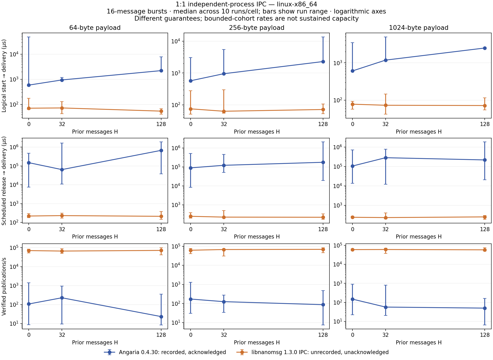

# Independent-process IPC baseline

Step **4.28**, framework **0.4.30**, implements the first 1:1 [comparison phase](../../../docs/nanomsg-comparison-plan.md). The current Angaria acknowledged/recorded path is substantially slower and more variable than classic libnanomsg's unacknowledged/unrecorded IPC path in this workload. The short-burst results also expose long Angaria producer stalls that ordinary per-message medians can hide.

## Measured latency and completed throughput

These are **16-message bursts**, ten fresh runs per profile/cell, using an independent producer and consumer. H is the number of prior verified messages (acknowledged and retained in Angaria; prior traffic only in nanomsg). Latency columns are the median across runs of each run's nearest-rank median. Throughput is the median of each run's verified count divided by common T0 to last verification. Metrics are summarized separately; one median need not be the reciprocal of another.

| Payload | H | Profile | Logical start → delivery | Scheduled release → delivery | Verified publications/s |
| ---: | ---: | --- | ---: | ---: | ---: |
| 64 B | 0 | Angaria recorded/acknowledged | 0.588 ms | 149.059 ms | 107.6 |
| 64 B | 0 | nanomsg unrecorded/unacknowledged | 0.070 ms | 0.219 ms | 69,644 |
| 64 B | 32 | Angaria recorded/acknowledged | 0.944 ms | 64.031 ms | 228.1 |
| 64 B | 32 | nanomsg unrecorded/unacknowledged | 0.072 ms | 0.231 ms | 65,826 |
| 64 B | 128 | Angaria recorded/acknowledged | 2.224 ms | 670.813 ms | 23.4 |
| 64 B | 128 | nanomsg unrecorded/unacknowledged | 0.054 ms | 0.212 ms | 71,131 |

The [complete table](comparison.csv) includes 256- and 1,024-byte payloads. [Detailed summaries](linux-x86_64/summary.csv) retain minimum and maximum run statistics. For example, 64-byte H=0 Angaria throughput ranges **8.8–1,405.6/s**; H=128 ranges **8.4–348.8/s**. That variability must accompany the medians. All attempts are included; no timing outliers were discarded.



Axes are logarithmic. Dots show medians across ten runs; bars show the full run range. The top two rows distinguish time after logical send begins from time after the original scheduled release. Every message in a burst remains scheduled at T0, so an early stall remains visible in the second row. The last row shows bounded-cohort completed work, **not sustained transport capacity**. Each cell has only 160 delivery observations per profile: p99/p99.9 are explicitly insufficient.

## What the raw timings reveal

The corrected adapter caches the stable Task claim during untimed attachment. Measured header/payload verification is local; the extra gated claim lookup is absent. Verification takes roughly 1.1 µs at the 64-byte cells, while long stalls remain inside producer ID/send calls and repeated consumer receive attempts.

For a concrete retained example, **attempt 135**, 64 bytes/H=128, completes in **1,915.972 ms**. Consumer process CPU is **1,915.083 ms**, producer CPU **35.287 ms**, and consumer acknowledgment API time totals **7.961 ms**. The consumer reports **384 receive calls, including 368 timeouts**. These are public receive calls, not lock-acquisition counts. CPU includes each worker's lead wait and work through the common FINISH barrier.

This is consistent with contention and repeated empty-poll work around the Session mutation gate. Source review shows that the consumer retries gate acquisition and history preparation, while producer ID/send and acknowledgment also use that gate. Existing local handoff preferences are process-local. The raw API intervals do not establish the precise split between lock waiting, gate-held work, and native operations; a focused cross-process diagnostic is needed to attribute it. The evidence does establish that summing acknowledgment API durations cannot explain the long cohort stalls.

This baseline should guide the recorded/unacknowledged design and its progress/notification mechanism. Simply removing the acknowledgment call is not evidence of a fast path. No runtime optimization or new delivery profile is implemented in this PR.

## Guarantees and provenance

Angaria retains accepted messages and receipt state under its documented process-recovery contract. Nanomsg supplies neither replay recording nor application processing acknowledgment in this profile. No power-loss durability is claimed. Recording, validation, synchronization, buffering, and transport also differ; their timing ratio cannot isolate acknowledgment overhead. Angaria receives a borrowed logged payload; nanomsg copies into an application buffer.

The primary matrix ran on one GitHub-hosted Ubuntu 24.04 x86_64 job, **Intel Xeon 6975P-C**, GCC/G++ **13.3.0**, Release `-O3 -DNDEBUG -g`, diagnostics and Cachegrind OFF. Both profiles used the same executable and normal hosted execution context. Classic libnanomsg **1.3.0** is statically linked from the exact commit/archive pin in the [guide](../../../docs/nanomsg-comparison.md).

Measured source: **`05f1858876e38d4fd3bebe1022c96b963e816d75`**. [Successful measurement and adapter qualification](https://github.com/smangano/angaria/actions/runs/46062073173). All **180 attempts completed**, **2,880 deliveries verified**, **1,440 Angaria acknowledgments**, with zero pending deliveries. Bracketed monotonic clocks, payload hashes, ordering, independent process identities and all eight measurement-source hashes were validated again after download. [Verification records](validation.json) include the three-platform eight-cohort checks and the green 830-test suites. Later documentation/figure commits preserve these measured source inputs.

A preliminary adapter characterization with a per-message claim lookup is preserved locally as superseded evidence and is excluded from these results. Local default execution blocks nanomsg IPC binding with `EPERM`; the local correctness suite passes with IPC access enabled. No local timings are mixed into this hosted comparison.

## Retained evidence and reproduction

- [Manifest](linux-x86_64/manifest.toml): host, source/executable hashes, exact dependency/runtime ABI, C/C++ flags, order and limits.
- [All run outcomes](linux-x86_64/runs.csv), [raw reports](linux-x86_64/reports.jsonl.gz), and [all attempt files](linux-x86_64/raw-attempts.tar.gz): commands, stdout/stderr, control events, per-message timings and reports.
- [SVG figure](comparison-linux-x86_64.svg), [derived table](comparison.csv), and [plot/validation script](generate_figures.py). CSV latency columns explicitly use microseconds. Retained CSV/SVG text uses normalized line endings/whitespace; raw report and attempt archives preserve the original evidence.

Follow the [build and run guide](../../../docs/nanomsg-comparison.md) to collect another matrix. To recreate the figure from retained evidence with Python and Matplotlib:

```sh
python3 -B benchmarks/results/milestone-4-nanomsg-comparison/generate_figures.py
```
