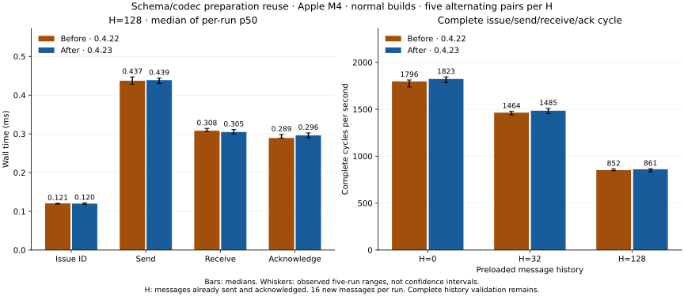
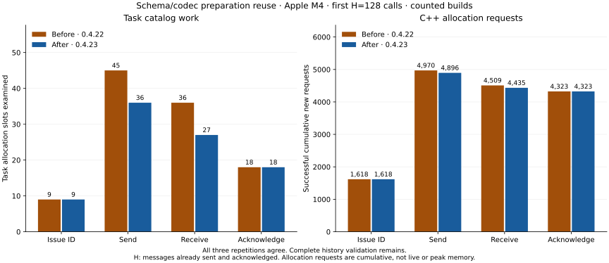

# Schema preparation measurements

Step **4.21**, framework **0.4.23**. The [guide and risk assessment](../../../docs/performance-payload-preparation.md) explain fresh schema/Field reuse during codec construction. The [diagnostic method](../../../docs/performance-diagnostics.md) defines workloads, counters and outcomes.

## Provenance

The **before** binaries are preserved 0.4.22 executables compiled from `57066388605e21635062c2af3b0a91a59da42318`, copied before rebuilding with their original CMake caches. Normal SHA256 is `bfd8c2e2da7b99dbf7040d9e3c8d985bf7179944e4b903a9931cb2a32644f856`; enabled is `9b7973e2518eec5cf7163792619178a30e2903e25548ff6c59279504e3feb6ca`. Measurement checkout is merged staging `b2c70dcda7047865fc8d15a3929756d1cfcc2aab`. All 128 inputs match the preceding measured source. The manifest names the measurement checkout rather than claiming it compiled the binaries.

The **after** executables are built from `48d561f7a33d1a9d6f150d50e1b7dde87f7e431d`, version 0.4.23. All populations retain 128 matching inputs for their variant. Only VERSION and five production files differ: runtime_state.h, schema_runtime.cpp, payload_runtime.h, publication_runtime.cpp and source_receive.cpp. Later commits add docs/results/plots and comparison orchestration, without changing those inputs. Builds use Apple clang 21, Release `-O3 -DNDEBUG`, plus `-Wall -Wextra -Werror -g`. Diagnostics are OFF for timing comparisons and ON for attribution. The diagnostic driver/workload is unchanged.

The local host is Apple M4, ten logical CPUs, 16 GiB, macOS 27.0.1, with native ARM64 executables and an x86_64 Python 3.10.15 coordinator. UTC timestamps and filesystem details are retained in manifests; the local study spans November 26–27. Sessions use the local Data volume. No builds or tests ran during measurement. Host isolation, thermal/frequency/affinity controls and cache flushing were not used. These windows do not qualify production tail latency.

## Execution-context correction

The initial sequential before matrices followed worktree setup in a command requesting `require_escalated`; the after matrices requested `use_default`. Their timing deltas are **not a matched comparison** and cannot isolate the optimization. They remain archived unchanged. Counts still document actual work; no permission-profile performance penalty is estimated.

The primary adjacent alternating serial study already launched **both variants under one default coordinator**. A later eleven-case matched normal matrix also uses one default coordinator and adds 66 controls. [execution-contexts.toml](execution-contexts.toml) records the observed requests; the original population manifests are untouched. See the [methodology correction](../../../docs/performance-diagnostics.md#match-execution-settings-as-well-as-code), which also clarifies the preceding two reports.

## Populations and ordering

- [Initial before normal](macos-arm64-before-normal/): 33 complete runs; cross-variant sequential timing comparison excluded.
- [Initial before enabled](macos-arm64-before-enabled/): 75 complete runs; work attribution, no matched timing conclusion.
- [Initial after normal](macos-arm64-after-normal/): 33 complete runs.
- [Initial after enabled](macos-arm64-after-enabled/): 75 complete runs.
- [Primary alternating serial](alternating/): 30 complete runs, five pairs per H=0/32/128.
- [Matched normal controls](matched-controls/): 66 complete runs, eleven cases × three adjacent pairs.
- [Hosted Linux after](linux-x86_64-after/): 54 complete runs, including all six three-idle-poller runs, plus a separate syscall trace.

Local populations total **312 runs**; with Linux, **366**. Initial sequential matrices ran before normal/enabled, then (after builds/tests) after normal/enabled. The primary alternating study followed. The execution-setting audit then prompted the full matched control matrix. **H means history:** messages already sent and acknowledged before measuring sixteen new messages. Every local run uses a fresh Session, four channels and eight-entry rings. Serial/backlog has nine active claims; thread/process streams have two plus requested idle consumers. Measured channels use default RecoverFromLog; allowed loss remains correctness-qualified but is not performance-plotted.

The primary study reuses the [existing harness](../milestone-4-gate-handoff/run_interleaved.py), whose hash is in both manifests. Fifteen adjacent pairs alternate AB then BA (eight AB, seven BA), with H=0/32/128 per repetition. The additional [matched-control runner](run_matched_controls.py) imports that harness's loader and each checkout's own driver. It takes the eleven unchanged normal cases directly from each driver's matrix, verifies matrix equality, and alternates 33 adjacent pairs (17 AB, 16 BA). Each study retains its own order.csv with variant, pair, repetition and sequence. Matched controls additionally record all dimensions and case index. Whole-invocation time includes setup/preload and is not operation latency. Ordering is deterministic, not randomized.

Raw compressed JSON lines retain every sample and outcome. Each dataset includes TOML metadata and run/summary/phase CSVs. Summaries use nearest-rank within-run quantiles followed by medians of per-run statistics, without pooling. All local workloads complete 16/16 with zero pending/unacknowledged-at-stop deliveries. No outliers were removed. All local source/binary/harness hashes match; Linux source hashes match measured inputs and its executable hash is recorded in the manifest. All 27 run/summary/phase tables across local/Linux datasets regenerate byte-for-byte. The two order logs are execution records rather than regenerated summary tables.

## Plots and primary results



Left: H=128 operation p50 medians. Right: complete issue/send/receive/ack cycles/s at H=0/32/128. Bars are five-run variant medians from the primary alternating study; whiskers are observed ranges, not confidence intervals. Receive medians fall **3.6%/2.3%/1.0%**, and complete-cycle medians rise **1.5%/1.4%/1.1%**. H=128 send/ack medians rise **0.3%/2.3%**. Every operation/control/cycle range overlaps. These small timing observations do not establish a universal or statistically significant speedup.



All three counted repetitions agree. First H=128 send/receive examine **45→36 / 36→27 Task slots**, with allocation requests **4,970→4,896 / 4,509→4,435**. Each removes nine slots, 74 successful allocation requests and 10,056 requested bytes. Slots include unused allocation-table entries; they are not distinct Tasks. Allocation counts/bytes are cumulative requests on the captured thread, not live/peak memory or all process allocations. Issue and acknowledgment work is unchanged.

Across 603 samples in nine counted run pairs, only send/receive Task-slot, allocation-request and allocated-byte counters change. Issue, acknowledgment, status, identical retry and empty-receive counters are identical. Prefix, topology, delivery, Publication lookup, native mapping/read/stat, gate and recovery counts remain. First H=128 receive still checks 129 Publications, with one topology build, one delivery validation, one prefix scan/321 visits, 16 maps, zero native reads and 45 stats. Observer tests establish the removed Field/Task definition reads independently of timing.

[PNG performance](preparation-performance.png) and [PNG work](preparation-work.png) are also retained. [Regenerate both](generate_figures.py) with matplotlib; it reuses previous report helpers. Benchmark runners need only Python's standard library.

## Matched control scope and remaining costs

The extra three-pair matched matrix is separate from the primary five-pair cohort. At H=128 it gives send/receive/ack medians 6.0%/7.3%/1.8% lower, while unchanged-work ID issuance is 4.3% lower. Those differences between studies reinforce cautious interpretation; the larger secondary gains do not replace the primary results. Receive falls 2.7% with unrelated history, 5.0% at sixteen-times capacity, 4.8% with a 256-byte payload and 0.5% with 32 Fields; backlog rises 0.8%. The [guide](../../../docs/performance-payload-preparation.md#matched-wider-controls) records exact values and limitations.

Matched no-idle/three-idle stream median intervals change **−4.2%/+5.4%**, and process **−1.8%**, with overlapping elapsed ranges. All requests finish. Waiting and scheduling contribute to concurrent receive; no fairness or bounded-latency claim follows. Initial after enabled H=128 receive is 0.309958/0.311292/0.313000 ms for None/Counts/Timings versus 0.305708 in ordinary after. These matching-profile but sequential populations do not estimate causal observation overhead.

Full history validation, selected-Publication metadata rereads, remaining identity/successor searches, allocation/copy costs, native checks/growth and idle polling remain. No cross-operation cache or synchronization architecture change is introduced.

## Linux corroboration and qualification

[Linux CI run 45942717042](https://github.com/smangano/angaria/actions/runs/45942717042) produced the downloaded artifact retained unchanged here. Its synthetic merge is `14932dafbf8696c428c473790d8429e3cc3e32ca`; all 128 inputs match measured source. All **54/54** eight-message workloads complete, including all six three-idle-poller runs at 8/8, with zero pending or unacknowledged-at-stop deliveries. Timed first H=128 Task slots match local controls (9/36/27/18 for issue/send/receive/ack). Receive retains one prefix scan/321 visits, one topology build, one delivery validation, 129 Publications, 16 maps and 45 stats. Linux records 4,544 allocation requests/604,770 bytes versus Mac Counts 4,435/587,052; allocator/library, collection and window differences prevent interpreting these as equal cross-platform quantities.

The separate [syscall trace](linux-x86_64-after/syscalls.txt) includes startup, setup, H=32 preload, eight serial messages, controls and teardown. Relative to the [preceding 0.4.22 trace](../milestone-4-definition-reuse/linux-x86_64-after/syscalls.txt), getpid falls **67,614→66,574**. fstat **6,876**, pread64 **2,169**, mmap **3,002** and munmap **2,981** remain unchanged. Do not divide whole-program totals by eight or treat traced syscall-time shares as ordinary latency.

Strict local diagnostics OFF/ON each pass **820/820 tests** (16.56/16.69 s). Measured-source CI passes 820/820 on [Linux x86_64](https://github.com/smangano/angaria/actions/runs/45942717042/job/140320402018) (14.49 s), [Linux ARM64](https://github.com/smangano/angaria/actions/runs/45942716927/job/140320402097) (11.62 s) and [macOS ARM64](https://github.com/smangano/angaria/actions/runs/45942716927/job/140320402366) (21.80 s). Existing history/corruption/recovery/loss/ownership and failure-cleanup tests, original benchmark smoke, native walkthroughs, seventeen primer programs and three new preparation tests remain included. Intel macOS remains request-only; integration into main stays held. CI has no timing thresholds.

## Reproduce

Build matching checkouts and execute both variants under identical permissions/restrictions. Keep setup requiring elevated permissions in a separate command. Use fresh output directories:

```sh
python3 -B benchmarks/run_diagnostics.py MATCHING_EXECUTABLE \
  --suite diagnostic --repetitions 3 --output NEW_RESULTS \
  --host-label 'DESCRIBE THE ACTUAL HOST'
```

For the primary serial study, use the existing harness:

```sh
python3 -B benchmarks/results/milestone-4-gate-handoff/run_interleaved.py \
  --before-root BEFORE_CHECKOUT --before-executable BEFORE_BINARY \
  --after-root AFTER_CHECKOUT --after-executable AFTER_BINARY \
  --output NEW_COMPARISON --host-label 'DESCRIBE THE ACTUAL HOST'
```

For the wider matched controls, use the same matching execution settings:

```sh
python3 -B benchmarks/results/milestone-4-payload-preparation/run_matched_controls.py \
  --before-root BEFORE_CHECKOUT --before-executable BEFORE_BINARY \
  --after-root AFTER_CHECKOUT --after-executable AFTER_BINARY \
  --output NEW_CONTROLS --host-label 'DESCRIBE THE ACTUAL HOST'
```

Temporary Sessions are removed. Rebuilds may change binary hashes; retain your settings/hashes. A budget stop is not completion; inspect actual progress and outcomes. This archive preserves all initial observations but excludes their unmatched sequential timing deltas from performance conclusions.
