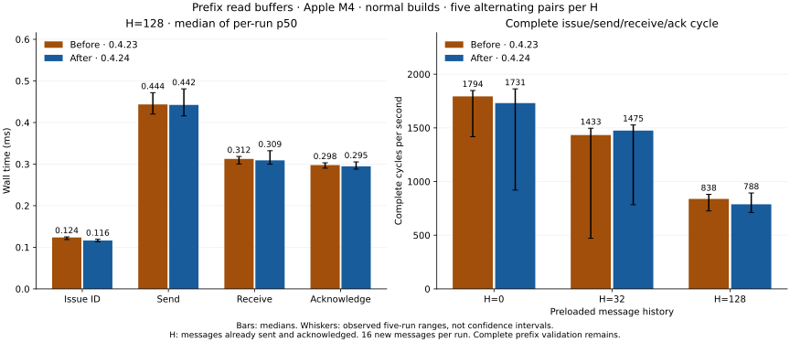
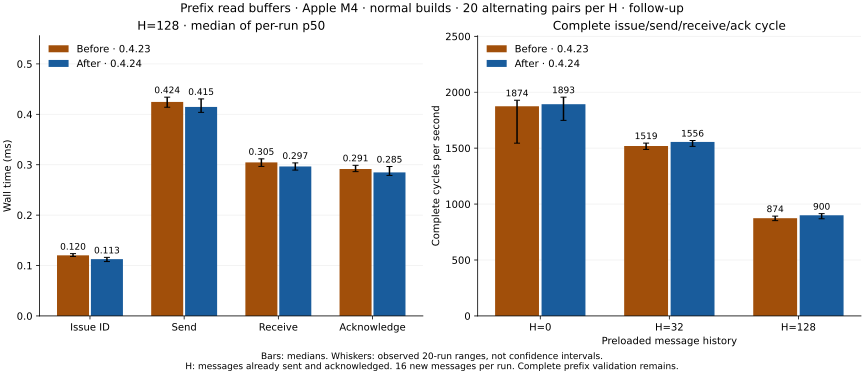
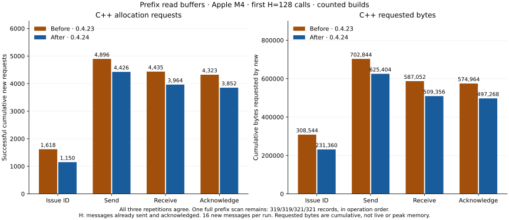

# Prefix-buffer reuse measurements

Raw samples and profiler payloads described below are retained in the maintainer archive, not this checkout. Reports, plots, summaries and provenance remain here. [Archive catalog and restore instructions](../README.md#restore-archived-evidence) identify snapshot `2026-11-28-332118be2291`; restore its payloads before running the verification or figure commands below.

Milestone **4.22**, framework **0.4.24**. The [design and risk assessment](../../../docs/performance-prefix-buffers.md) explain fixed record-prefix buffers and scan-local manifest scratch space. The [diagnostic method](../../../docs/performance-diagnostics.md) defines workloads, counters and outcomes.

## Provenance and execution settings

The before binaries are preserved 0.4.23 executables compiled from `48d561f7a33d1a9d6f150d50e1b7dde87f7e431d`, copied with their original CMake caches before rebuilding. Normal SHA256 is `c3b67562cceb66f9ce696ce839b6ced66adb47d732ef36c339e68d5f9ea4f79f`; enabled is `8af22c404334074772b30cdd9875b6e923baff45c984d3b08ab141edc836906b`. The measurement checkout is merged staging `de4978a58300dda685fb1e41647fdf3a6d1adce9`; all 128 input hashes match the preceding measured source. The manifests identify this checkout, without claiming it compiled the preserved binaries.

After binaries are built from `da7d821991e77484a3b7aae874201723c6ea4ce4`, version 0.4.24. Normal SHA256 is `804bc177bd6a507a163121be2502748f9a6a228e79173529a43bf0fd2e906572`; enabled is `98f3255af60bc81ab23627d541c7a6d1743c74fb6a83ecddcfec6b1edf95dac1`. Only VERSION and `src/mutation_journal.cpp` differ in the 128 measurement inputs. Subsequent changes add results/docs and a configurable repetition count to the shared comparison harness; measured C++ and drivers stay unchanged. The confirmation manifest's tracked-dirty flag reflects that harness edit. Harness hashes are retained in the corresponding manifests.

Builds use Apple clang 21, Release `-O3 -DNDEBUG`, plus `-Wall -Wextra -Werror -g`. Diagnostics are OFF for headline timings and ON for attribution. Local hardware is Apple M4, ten logical CPUs, 16 GiB, macOS 27.0.1, native ARM64 executables and an x86_64 Python 3.10.15 coordinator. The temporary Sessions use the local Data volume. No builds/tests ran during measurements. There are no host-isolation, affinity, thermal/frequency or cache-flushing controls. Small windows do not establish production tail latency.

All local benchmark commands use the same **default execution request**. Elevated worktree/git setup ran separately. Each adjacent comparison uses one shared coordinator for both variants; enabled populations ran sequentially before and after the rebuild. [Execution metadata](execution-contexts.toml) records these settings. There is no unmatched sequential normal timing comparison in this step.

## Retained populations

| Population | Complete runs | Role |
| --- | ---: | --- |
| [Before enabled](macos-arm64-before-enabled/) | 75 | Work attribution |
| [After enabled](macos-arm64-after-enabled/) | 75 | Work attribution |
| [Initial alternating serial](alternating/) | 30 | Five pairs per H; mixed timing |
| [Matched controls](matched-controls/) | 66 | Eleven unchanged cases, three pairs each |
| [Fixed follow-up](confirmation/) | 120 | Twenty pairs per H, selected before launch |
| [Hosted Linux after](linux-x86_64-after/) | 54 | Qualification and syscall corroboration |

These total **366 local / 420 with Linux** completed comparison/CI runs. Every local run completes 16/16, and every Linux run 8/8, with zero pending or unacknowledged-at-stop deliveries. Raw compressed JSON lines, nine manifests, 27 run/summary/phase CSVs and three comparison order logs retain every validated comparison observation. No outliers are removed and no populations are pooled. The 24 local CSVs regenerate byte for byte.

**H means history:** messages already sent and acknowledged before the measured window begins. Each local window adds sixteen new messages, four channels and eight-entry rings. Serial/backlog uses nine active claims; thread/process streams use two plus requested idle consumers. Default RecoverFromLog delivery is measured; allowed loss is correctness-qualified but not plotted.

The [shared serial harness](../milestone-4-gate-handoff/run_interleaved.py) imports each checkout's own driver/version/metadata. Pairs alternate AB/BA, deterministically rather than randomly, with H=0/32/128 in each repetition. The initial study has 15 adjacent pairs; the follow-up has 60, after explicitly choosing twenty repetitions because initial cycle results disagreed with operation medians. [Control ordering](matched-controls/order.csv) has 33 adjacent pairs. Invocation time in order logs includes startup/preload and is not operation latency.

A first follow-up launch selected an older executable at the wrong path. The version validator stopped it at the first pair. Its [failed manifests, one unmatched before report and error log](failed-confirmation-version-check/) remain archived, excluded from all comparisons and the 420-run count. The corrected launch uses the same executable hashes as the initial study and runs the entire fixed twenty-pair plan once.

## Timing results



Initial complete-cycle medians change **−3.49% / +2.90% / −6.01%** at H=0/32/128. H128 operation p50 medians change **−5.86% / −0.28% / −1.12% / −0.99%** for ID/send/receive/acknowledge. The H128 cycle elapsed median rises 19.085→20.304 ms despite slightly lower p50s: median run maxima for receive rise 0.340→0.591 ms and acknowledge 0.352→0.470 ms. Median summed core-call CPU rises 4.66%, so scheduling alone cannot explain this sample. Three of five H128 pairs improve; none are discarded.



The follow-up shows a modest reduction. Bars are medians of per-run p50 or cycle rate; whiskers are full observed run ranges, not confidence intervals.

| Metric | Before | After | Change |
| --- | ---: | ---: | ---: |
| H128 issue ID p50 | 0.120167 ms | 0.112646 ms | −6.26% |
| H128 send p50 | 0.424500 ms | 0.414583 ms | −2.34% |
| H128 receive p50 | 0.304542 ms | 0.296521 ms | −2.63% |
| H128 acknowledge p50 | 0.291500 ms | 0.284771 ms | −2.31% |
| H0 complete cycles/s | 1,874.37 | 1,892.81 | +0.98% |
| H32 complete cycles/s | 1,519.27 | 1,555.59 | +2.39% |
| H128 complete cycles/s | 873.92 | 900.22 | +3.01% |

After cycles improve in **16/20, 20/20 and 19/20** pairs at H0/32/128. H128 median summed core-call CPU falls 3.05%; wall-minus-CPU medians remain close. Cycle elapsed ranges are H0 8.297–10.358→8.180–9.151 ms, H32 10.353–10.751→10.201–10.555 ms, H128 17.923–18.781→17.490–18.422 ms. The initial study's opposite directions remain important: this is a small measured gain on this host, not a universal throughput or tail-latency guarantee.

## Allocation and validation work



First H128 calls have exact agreement across all three Counts repetitions:

| Operation | Allocation requests, before→after | Requested bytes, before→after |
| --- | ---: | ---: |
| Issue ID | 1,618→1,150 (−28.9%) | 308,544→231,360 |
| Send | 4,896→4,426 (−9.6%) | 702,844→625,404 |
| Receive | 4,435→3,964 (−10.6%) | 587,052→509,356 |
| Acknowledge | 4,323→3,852 (−10.9%) | 574,964→497,268 |

These count successful cumulative C++ new requests in the captured thread, not live/peak memory. The scan-local vector retains its largest manifest capacity until the scan ends. The fixed prefix avoids a vector per record; manifest input scratch is reused, but decoded owning Manifest results still allocate.

Across **603** samples in the nine matching Counts runs, allocation requests/bytes fall in every sample; only these and `file_stat_calls` change among work counters. The 144 send samples each save two stats by using the existing checked NativeFile fixed-body read without its duplicate preliminary size check. Task slots, validation, native maps/reads, gate and recovery counters stay unchanged. First H128 issue/send/receive/ack still perform one prefix scan with **319/319/321/321** record visits. Receive still validates 129 Publications, builds topology once, examines 27 Task slots, and records **16 maps, 45 stats and zero native reads**. This step does not optimize per-word mappings or gate resource checks.

## Matched controls and limits

All eleven normal controls use the same shared coordinator, three repetitions each:

| Case | Receive p50, before→after (ms) | Whole window median, before→after (ms) |
| --- | ---: | ---: |
| H0 serial | 0.123292→0.126417 | 8.526→8.731 |
| H32 serial | 0.166792→0.161667 | 10.763→10.567 |
| H128 serial | 0.308958→0.306000 | 18.659→18.990 |
| H128 other-Queue history | 0.305875→0.300667 | 18.465→18.463 |
| H128, capacity ×16 | 0.423917→0.413458 | 24.358→23.823 |
| H128, 256-byte payload | 0.317250→0.309000 | 19.228→18.597 |
| H128, 256 bytes / 32 Fields | 0.315458→0.312166 | 19.041→18.722 |
| H128 backlog | 0.308583→0.302459 | 19.354→18.900 |
| H128 thread stream | 0.842417→0.820417 | 20.563→20.087 |
| H128 stream / three idle pollers | 1.274333→1.137917 | 39.767→37.194 |
| H128 process stream | 0.757917→0.742583 | 19.104→18.758 |

Serial/thread windows use the complete cycle interval, backlog sums publish and drain intervals, and processes use `process_phase_ns` spanning the worker cohort. These are distinct workload intervals. Thread stream before/after ranges are 20.476–20.832 / 19.842–26.306 ms; three-idle ranges 37.586–44.548 / 34.897–42.166 ms; process ranges 18.994–19.424 / 18.535–18.839 ms. Concurrent receives include waiting and scheduling. All complete, but no fairness or bounded-latency claim follows.

[PNG initial](prefix-buffers-performance.png), [PNG follow-up](prefix-buffers-confirmation-performance.png) and [PNG work](prefix-buffers-work.png) are retained. [Regenerate figures](generate_figures.py) with matplotlib; runners require only Python's standard library.

## Linux corroboration and correctness

[Source CI run 45973689116](https://github.com/smangano/angaria/actions/runs/45973689116) produced the unmodified Linux artifact retained here. Its synthetic merge is `cdf6762856454cffee7c2a694d4c6fa5244158f6`; its 128 input hashes match measured after source. All **54/54** diagnostic workloads finish, including six three-idle cases at 8/8. First H128 timed receive has **4,073 allocations / 527,074 requested bytes**, one prefix scan/321 visits, 129 validated Publications, 27 Task slots, 16 maps and 45 stats. Allocator/library, window and collection differences prevent equating these with Mac Counts values.

The separate [syscall trace](linux-x86_64-after/syscalls.txt) covers startup, setup, H32 preload, eight serial messages, controls and teardown. Against the [preceding trace](../milestone-4-payload-preparation/linux-x86_64-after/syscalls.txt), `fstat` falls **6,876→6,733** and `getpid` **66,574→66,431**. `newfstatat` **6,107**, `pread64` **2,169**, `mmap` **3,002** and `munmap` **2,981** stay unchanged. The reduction is consistent with removing duplicate fixed-body NativeFile size checks. Whole-program traced totals must not be divided by eight or read as ordinary per-operation latency.

Strict local Release diagnostics OFF/ON each pass **822/822 tests**, taking 16.05/15.67 seconds. Measured-source CI passes 822/822 on [Linux x86_64](https://github.com/smangano/angaria/actions/runs/45973689116/job/140420039951) (14.17 s), [Linux ARM64](https://github.com/smangano/angaria/actions/runs/45973689091/job/140420039756) (12.23 s) and [macOS ARM64](https://github.com/smangano/angaria/actions/runs/45973689091/job/140420040119) (19.05 s). Tests include two new private journal scenarios, existing corruption/recovery/large-manifest/window cases, native walkthroughs and all seventeen public primer programs. Intel macOS remains request-only; main integration remains held; CI has no timing thresholds.

## Reproduce

Use the owning checkout/executable, a matching execution request, and a new output directory:

```sh
python3 -B benchmarks/run_diagnostics.py MATCHING_EXECUTABLE \
  --suite diagnostic --repetitions 3 --output NEW_RESULTS \
  --host-label 'DESCRIBE THE ACTUAL HOST'

python3 -B benchmarks/results/milestone-4-gate-handoff/run_interleaved.py \
  --before-root BEFORE_CHECKOUT --before-executable BEFORE_BINARY \
  --after-root AFTER_CHECKOUT --after-executable AFTER_BINARY \
  --output NEW_COMPARISON --repetitions 20 \
  --host-label 'DESCRIBE THE ACTUAL HOST'

python3 -B benchmarks/results/milestone-4-payload-preparation/run_matched_controls.py \
  --before-root BEFORE_CHECKOUT --before-executable BEFORE_BINARY \
  --after-root AFTER_CHECKOUT --after-executable AFTER_BINARY \
  --output NEW_CONTROLS --host-label 'DESCRIBE THE ACTUAL HOST'
```

The serial harness defaults to five repetitions for earlier experiments; twenty reproduces this step's follow-up. Temporary Session files are removed. Rebuilding may change executable hashes. A validated budget stop is not completion: inspect actual progress/outcomes.
