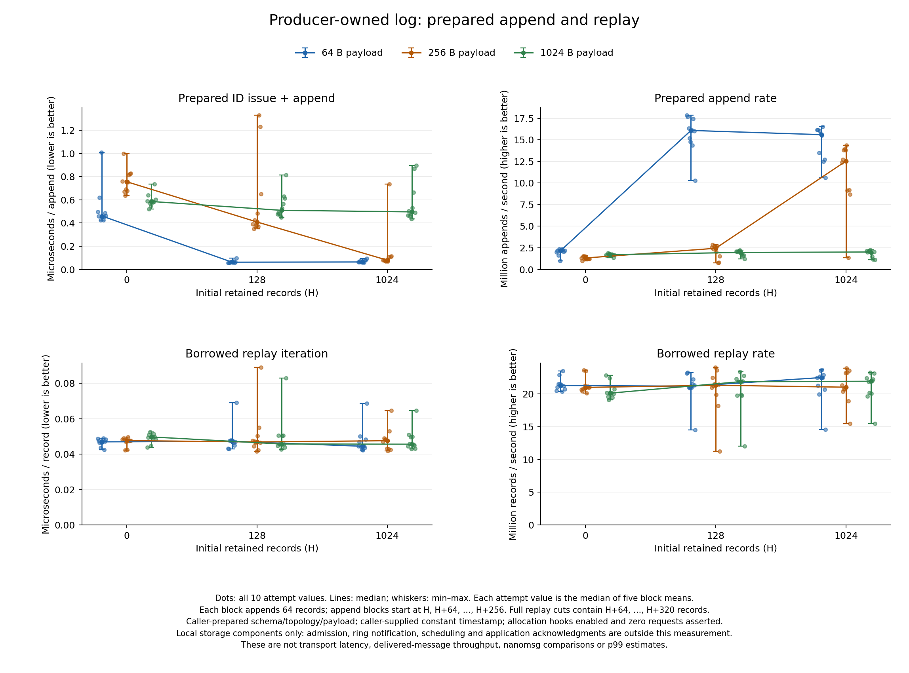
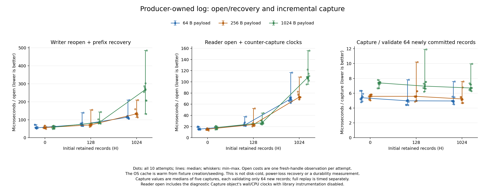

# Producer-owned append, recovery and replay: first component baseline

Framework **0.4.34** adds a private producer-owned log with prepared append, restart recovery, and replay. This study measures that storage component using real, locally mapped files. The first retained baseline covers publication-ID issuance plus append, incremental replay capture, borrowed replay iteration, and fresh-handle open/recovery. See the [storage contract](../../../docs/producer-log.md) and [focused test](../../../test/test_producer_log_append_performance.cpp).

**Append results vary substantially with fixture history and payload size.** The fixture reserves file space but does not prefault the whole mapped append area. First-use memory/page work and cache effects remain inside the measurement, and seeding different history lengths changes the starting state. The baseline does not separately identify their costs. A subsequent controlled probe below provides evidence for first-touch virtual-memory/backing-page work while leaving other contributors open. The much lower 64-byte and 256-byte results in some nonempty-history cases must not be presented as a benefit of retaining more history, an isolated steady-state result, or a causal speedup over another engine.

## Separate first-touch fault control

A [separate diagnostic probe](fault-probe/README.md) repeated the natural append workload twice and ran one experimental contrast that touched the unused backing pages before opening the writer. Each natural run recorded **110 major and 3 minor faults** across its 45 append blocks; the prefaulted run recorded **0 major and 113 minor faults**. The second natural run reproduced the baseline's history-dependent spread. In the single prefaulted run, H=0/128/1024 append medians were **61.2/51.4/52.7 ns** for 64-byte payloads, **72.3/63.1/61.9 ns** for 256-byte payloads, and **117.8/106.1/102.2 ns** for 1024-byte payloads. This supports first-touch virtual-memory/backing-page work as a material cost. These fault classifications do not prove physical disk I/O or fully explain every history-dependent difference. The prefaulted contrast has **one invocation** and a different preparation procedure; its measurements remain separate from the ten-attempt baseline, its tables and its plots.

## Measured results

Each cell is the median across ten attempt values. An attempt value is the median of five block means; each block issues and appends 64 publications. Rates are calculated for each attempt and then summarized independently, so rounded median rates need not equal the reciprocal of rounded median times.

| Initial retained records (H) | Payload | ID + append (µs/record) | Append rate (million/s) | Borrowed replay (ns/record) | Replay rate (million/s) |
| ---: | ---: | ---: | ---: | ---: | ---: |
| 0 | 64 B | 0.461 | 2.168 | 46.92 | 21.31 |
| 0 | 256 B | 0.757 | 1.321 | 47.61 | 21.00 |
| 0 | 1024 B | 0.586 | 1.706 | 49.67 | 20.13 |
| 128 | 64 B | 0.062 | 16.083 | 47.20 | 21.19 |
| 128 | 256 B | 0.410 | 2.446 | 46.87 | 21.34 |
| 128 | 1024 B | 0.510 | 1.964 | 45.69 | 21.89 |
| 1024 | 64 B | 0.064 | 15.595 | 44.42 | 22.51 |
| 1024 | 256 B | 0.080 | 12.540 | 47.54 | 21.04 |
| 1024 | 1024 B | 0.497 | 2.014 | 45.58 | 21.94 |



Dots retain all ten attempt values; lines show their median and whiskers their minimum and maximum. Variation is material: for example, the 256-byte H=1024 append attempt medians range from **69.67 to 736.33 ns**. All attempts remain in the summaries and figures. There are no per-message tail-latency or p99 estimates.

At these three history levels, append and incremental capture do not show a rise proportional to retained record count. That matches the intended separation between attach-time prefix recovery and established appends. The baseline alone does not isolate hardware/cache/page-fault costs well enough to establish a steady-state latency curve; the separate prefault control is an initial diagnostic contrast. Replay iteration medians stay within **44.42–49.67 ns/record** across the nine cases, while capture of each new 64-record suffix takes **4.96–7.40 µs**.

The H=1024/H=0 ratios below describe the observed fixture cases. They are not speedup claims or a fitted scaling law.

| Payload | ID + append ratio | Capture-64 ratio | Replay-per-record ratio | Writer open/recovery ratio |
| ---: | ---: | ---: | ---: | ---: |
| 64 B | 0.139 | 0.919 | 0.947 | 2.084 |
| 256 B | 0.105 | 0.937 | 0.999 | 2.351 |
| 1024 B | 0.847 | 0.907 | 0.918 | 4.559 |

## Open/recovery and incremental capture

Writer open claims the producer, advances its incarnation, validates the retained prefix and rebuilds bounded local indexes. That work happens before normal append timing. Reader open validates the existing prefix once; later captures validate only the newly committed suffix.

| Initial retained records | Payload | Writer open/recovery (µs) | Reader open including capture clocks (µs) | Capture 64 new records (µs) |
| ---: | ---: | ---: | ---: | ---: |
| 0 | 64 B | 54.85 | 15.35 | 5.40 |
| 0 | 256 B | 56.56 | 15.35 | 5.58 |
| 0 | 1024 B | 58.65 | 18.21 | 7.40 |
| 128 | 64 B | 74.00 | 22.65 | 4.98 |
| 128 | 256 B | 71.33 | 23.63 | 5.58 |
| 128 | 1024 B | 85.60 | 26.81 | 6.96 |
| 1024 | 64 B | 114.33 | 69.46 | 4.96 |
| 1024 | 256 B | 133.00 | 72.79 | 5.23 |
| 1024 | 1024 B | 267.40 | 108.31 | 6.71 |



Open/recovery has one observation per attempt. These are fresh handles over files whose OS cache was warmed by creation/seeding; they are not disk-cold or power-loss recovery measurements. The reader-open timer also includes the diagnostic `Capture` object's wall/CPU clock overhead, with library instrumentation disabled. Capture/replay work in the established path is timed separately.

## Workload and limits

- Ten sequential invocations cover all nine H/payload combinations, retaining **90 case reports, 450 append blocks and 28,800 timed appends**. All five capture and replay blocks for every case are also retained.
- Each log reserves **8 MiB** and **2,048 publication-index slots**, with one frozen destination Queue. Creation, physical reservation, initial history, writer/reader setup and result storage are outside hot-path timing. A separate log supplies 16 warmup appends and replay without changing the measured H=0 stream.
- The measured append includes `next_publication_id()` and `append()`, their result checks, and storage of acceptance results. Input schema/topology and payload are already prepared; the caller supplies a constant timestamp. This does not measure schema admission or clock sampling.
- H labels history before the first block. Subsequent append blocks start at `H+64`, `H+128`, `H+192` and `H+256`. Each capture validates 64 new records. Each replay iterates its entire frozen cut, containing `H+64` through `H+320` records; its denominator is the actual cut size.
- Timed replay checks the returned ordinal/payload size and consumes one payload byte per record. After timing, the test verifies every header, destination and payload byte, including publication identity across producer restart and uninterrupted Queue sequences.
- Each append, capture and replay timing block asserts **zero successful C++ allocation requests**. The replacement allocation hooks remain enabled during timing; they do not count direct `malloc` traffic or retained memory. A positive control checks the executable's counter.
- Library diagnostics are **OFF** in this retained latency/rate series. Its counter fields are consequently zero by compilation, not independent evidence of absent work. The same focused test in diagnostics-enabled validation checks for zero mapped reads, mappings/unmappings, file stats/growth and gate activity in established operations; reader open supplies a positive instrumentation control. These checks do not claim that every syscall is absent.

Admission, live ring transport, consumer scheduling, notifications and application acknowledgment costs are outside this component study. Its append rate counts accepted log records, and its replay rate counts borrowed record visits. Delivered-message throughput and nanomsg comparisons require the later matched transport benchmark. No previous engine or codec result is used as a measured speedup baseline here.

## Provenance and reproduction

The measured source is [`7b5206e37eb8eeeb04efaa39f4e839b66bced72f`](https://github.com/smangano/angaria/commit/7b5206e37eb8eeeb04efaa39f4e839b66bced72f). The [manifest](manifest.json) contains SHA-256 hashes for all **272 tracked implementation inputs**, the executable and static library, compiler details, build flags, architecture and every retained evidence file. Source, executable, library and build configuration were verified unchanged before and after collection.

The native executable is **macOS ARM64**, built with Apple Clang **21.0.0**, C++20, Release `-O3 -DNDEBUG`, and `-Wall -Wextra -Werror -g`. The Python coordinator reports x86_64; timing occurs inside the native ARM64 C++ executable. The optional CPU-model query was denied and its original error is retained in the manifest. No CPU affinity was requested.

[Raw evidence](raw/) retains every invocation's original stdout, stderr, GoogleTest XML, parsed JSON lines and validation result. [Build provenance](provenance/) retains the CMake cache, target flags and link command. [Attempt values](attempts.csv) and the [summary](summary.csv) can be reconstructed from those files:

```sh
python3 benchmarks/producer_log_append_study.py render benchmarks/results/milestone-4-producer-log-append --validate-only
python3 benchmarks/producer_log_append_study.py render benchmarks/results/milestone-4-producer-log-append
```

To collect a fresh series, use a checkout of the measured source commit, configure a Release build with testing enabled and diagnostics disabled, build the focused target, and choose a new output directory:

```sh
cmake -S . -B build/producer-log-study -DCMAKE_BUILD_TYPE=Release -DBUILD_TESTING=ON -DANGARIA_ENABLE_DIAGNOSTICS=OFF
cmake --build build/producer-log-study --target angaria_producer_log_append_performance
python3 benchmarks/producer_log_append_study.py collect build/producer-log-study/angaria_producer_log_append_performance --source-commit 7b5206e37eb8eeeb04efaa39f4e839b66bced72f --output benchmarks/results/producer-log-append-rerun
```

The [collector](../../producer_log_append_study.py) refuses an unfrozen implementation or nonempty output directory. Any failed attempt is retained and invalidates the study rather than being discarded. The PNG figures above also have [append/replay SVG](append-replay-latency-throughput.svg) and [recovery/capture SVG](recovery-capture.svg) versions.
