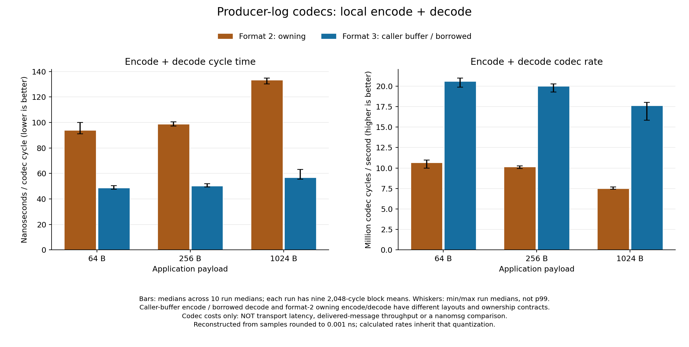

# Private producer-log codec cost

Step **4.31**, framework **0.4.33**, implements private [format-3 byte codecs](../../../docs/producer-log-format.md), not a new append or messaging runtime. This focused performance test supplies the step's measured evidence without pretending that nanomsg measures the cost of a standalone codec.

Ten complete invocations on macOS with a **native ARM64 C++ executable**, Release `-O3 -DNDEBUG`, AppleClang 21, strict warnings and library diagnostics OFF. Each payload/profile has nine alternating 2,048-cycle timed blocks per invocation. Bars/tables show medians across the ten per-run block medians; ranges are the full min/max run medians. These are block-mean codec times, not per-message p50/p99 or transport latency. No timed run is discarded.

| Payload | Owning control ns/cycle | Caller-buffer / borrowed ns/cycle | Owning control M cycles/s | Caller-buffer / borrowed M cycles/s | Cycle-time reduction |
| ---: | ---: | ---: | ---: | ---: | ---: |
| 64 B | 93.98 | 48.58 | 10.64 | 20.58 | 48.3% |
| 256 B | 98.65 | 50.05 | 10.14 | 19.98 | 49.3% |
| 1,024 B | 133.31 | 56.77 | 7.50 | 17.61 | 57.4% |

The new path makes **zero successful C++ allocations per cycle**, versus **three** in the owning control. Every run checks full logical results, matching payload/identity checksums, and that the new decoded payload borrows the encoded record. The ordinary CI test fails on allocation/borrow violations, not on noisy wall-time differences.



## Interpretation and limits

The control is the existing **format-2 owning body encode/decode API**, not the current receive path. That receive path uses separate metadata loading and mapped payload access. The new API encodes into a preallocated caller buffer and returns a borrowed view, with a different native representation. This result supports the expected direction for the new component; its ratio is not a transport, replay, acknowledgment or nanomsg speedup.

The timing executable contains allocation replacement hooks for both profiles. Capture is disabled during timed blocks, but the allocating control still traverses those hooks. Small warmed fixtures, a local clock and block timing omit IPC, scheduling, file mapping/growth, commit stores, log recovery, schema resolution and real application work. They do not establish sustained messaging capacity or production tail latency. The chart does not predict the later producer-owned runtime's delivered rate.

Producer record bytes are 256/448/1,216 for these payloads. Control body bytes are 240/432/1,200; its full legacy allocation would be 448/640/1,408 including envelope/receipt/padding. The control times its body codecs, not that full allocation's materialization. New consumer acknowledgment storage is separate and not implemented yet; these byte counts are not total Session-space savings.

The CPU model query is unavailable under the measurement execution context, and its original error is retained in the manifest. Native executable architecture and OS/compiler details are recorded. The coordinator is x86_64 Python; all timers are inside the native ARM64 C++ process, and coordinator/process startup is outside them. Both profiles run in that same executable and execution context. Do not pool this dataset with hosted diagnostic builds or other hosts.

The JSON samples print to 0.001 ns. Summaries/rates are reconstructed from those rounded block values and inherit that quantization. Allocation counts and byte geometry are exact. Run ranges and raw blocks remain available, including the slowest new 1,024-byte run; none is hidden by a tail label or excluded as an outlier.

## Evidence and reproduction

The [manifest](manifest.json) records source commit **`83904777e11515c083fe9cc517f1baf53281d149`**, 258 source-input hashes, executable/library hashes, commands, host/build context and all ten outcomes. Later commits add evidence/docs/workflow artifact retention without changing those measured C++/CMake/VERSION inputs.

[Raw records](raw/) retain every stdout/stderr, GTest XML and three-record JSONL output. There are **30 verified payload cases**, **540 timed block means** and **1,105,920 timed encode/decode cycles**. Warmup and allocation-guard cycles are separate. [summary.csv](summary.csv) retains all six profile/payload medians and run ranges; [SVG](latency-throughput.svg) is available for export.

Configure the strict ordinary build as in the [format guide](../../../docs/producer-log-format.md), with `ANGARIA_ENABLE_DIAGNOSTICS=OFF` and `-Wall -Wextra -Werror -g`. Build `angaria_producer_log_performance`, then choose a fresh output directory:

```sh
python3 benchmarks/results/milestone-4-producer-log-codecs/collect.py \
  build/angaria_producer_log_performance --output /tmp/angaria-codec-results
python3 benchmarks/results/milestone-4-producer-log-codecs/generate_figures.py \
  --root /tmp/angaria-codec-results
```

The collector refuses to overwrite raw evidence. Its recorded build labels assume the Release/diagnostics-OFF configuration above; compare them with the actual CMake cache when reproducing. The reconstruction validates dimensions, byte geometry, all block values, cached medians/rates within printed rounding and allocation counts before producing tables/plots. `--validate-only` performs reconstruction without changing artifacts. The ordinary platform workflows retain their own CTest logs with `CODEC_PERFORMANCE` observations; those are separate checks, not additions to this fixed ten-run local dataset.
