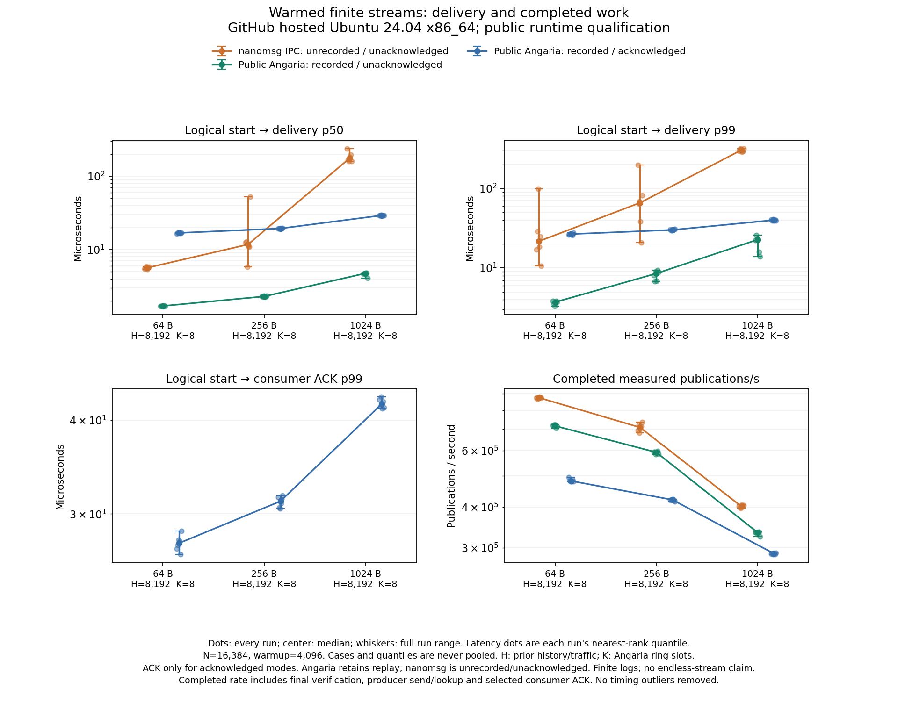
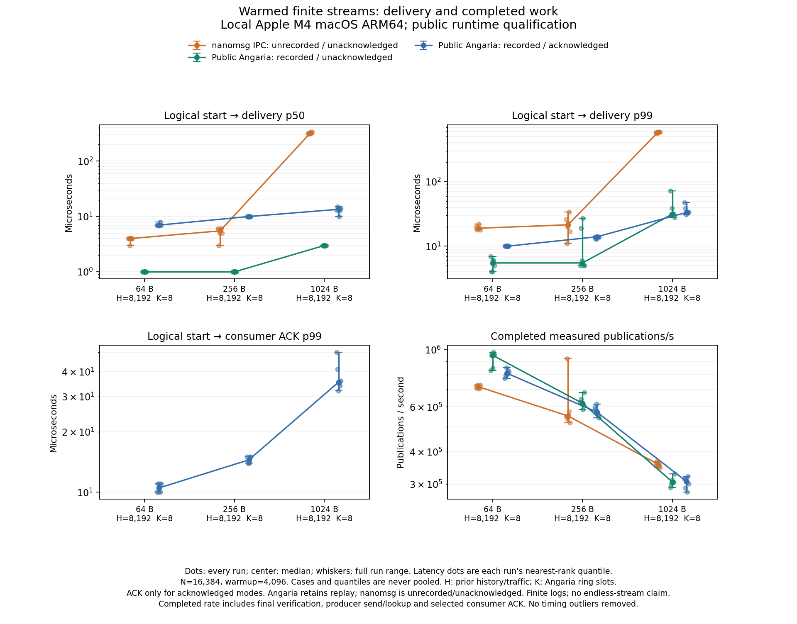

# Public runtime admission — retained qualification

Raw samples and profiler payloads described below are retained in the maintainer archive, not this checkout. Reports, plots, summaries and provenance remain here. [Archive catalog and restore instructions](../README.md#restore-archived-evidence) identify snapshot `2026-11-28-332118be2291`; restore its payloads before running the verification or figure commands below.

Both retained full matrices are complete: 207 Mac attempts and 207 Linux attempts, all successful, source `462193232d0c96ae5f958a63464f9782a34ac09f`. Each manifest has 207 raw-archive hashes and no failures. Every report has zero pending messages, accepted counts equal delivered counts, and acknowledged counts equal accepted counts for the acknowledged profile. The figures below summarize medians of per-run measurements; samples are not pooled. Core cases have six runs per profile. The longer finite stream has three.

The public profiles exercise Session, Task, QueueWriter, and SourceQueueSet, including publication ID issuance, send retries, ordinary publication-status lookup, header/identity validation, and complete-payload verification. The unacknowledged profile still records messages for replay. The acknowledged consumer additionally commits an application acknowledgment after verifying each delivery. Producer send/status reports acceptance; it does not wait for that acknowledgment. Nanomsg has neither Angaria's replay log nor its application acknowledgment semantics, so delivery comparisons do not imply equivalent guarantees.

## Evidence and reproduction

Framework **0.4.39**, PR [#70](https://github.com/smangano/angaria/pull/70). The full measurement source is [`4621932`](https://github.com/smangano/angaria/tree/462193232d0c96ae5f958a63464f9782a34ac09f). Both modes use the public application API, with required/none acknowledgment, the same one-Queue schema/payload and the pinned classic nanomsg 1.3.0 dependency. All accepted Angaria messages remain recorded. No power-loss durability is claimed.

- [Mac full matrix](macos-arm64/manifest.json): 207 attempts, independent raw reconstruction and six plot families. Its native ARM64 executable was built with Apple Clang 21 in strict Release mode.
- [Linux full matrix](linux-x86_64/manifest.json): 207 attempts from [hosted qualification 46136395156](https://github.com/smangano/angaria/actions/runs/46136395156), reconstructed locally from the downloaded raw archives. The runtime instrumentation is OFF in both full comparisons.
- [Linux ARM64 smoke](linux-arm64-smoke/manifest.json) and [macOS ARM64 smoke](macos-arm64-smoke/manifest.json): 12 attempts each, independently verified; these are correctness checks, not full performance samples.
- [Focused checks](focused/): strict Release **745/745 CTest entries**, public contracts and deterministic performance guards. Instrumented checks cover zero hot allocations, Session-gate attempts/acquisitions, prefix/topology work and explicit native read/map/unmap/stat/growth. Informational same-process cycle times are not IPC latency or a measured speedup.
- Two untimed preflight stops are retained in [preflight-7a033bb](preflight-7a033bb/failure.log) and [preflight-7f59b60](preflight-7f59b60/failure.log). The first found a retired-driver reference in shared metadata; the second correctly rejected an uncommitted smoke-guard edit. Neither launched timed participants or belongs in the 414-attempt full-matrix population. The collector fix and a real-metadata regression test are committed.

The external archive retains every host's `raw/attempt-*.tar.gz`, command/control transcript and binary sample sidecar. Each host directory here keeps the manifest hashes, computed reports and available build provenance. No timed outlier was removed. `qualification-summary.json` and `comparison.csv` derive from those bytes; `figures.json` lists the complete plot set. Data from different cases or hosts is never pooled. Full matrices use balanced orders, warmup, configured pacing, slow/paused consumers and longer finite streams; see [methodology](../../../docs/end-to-end-qualification.md) and [public performance scope](../../../docs/public-runtime-performance.md).

```sh
python3 -B benchmarks/run_end_to_end.py verify benchmarks/results/milestone-4-public-runtime/macos-arm64
python3 -B benchmarks/run_end_to_end.py verify benchmarks/results/milestone-4-public-runtime/linux-x86_64
python3 -B benchmarks/run_end_to_end.py render benchmarks/results/milestone-4-public-runtime/linux-x86_64
```

`render` independently reconstructs raw evidence before drawing; it needs Matplotlib. Use a new output path and the pinned source/build instructions in the public performance guide to collect another matrix. The original 14-day workflow artifacts are preserved in the external archive, so their expiration does not remove the measurement evidence. Restore the catalog-listed payloads before using the commands above.

## Linux x86_64



The hosted Ubuntu 24.04 runner reports an Intel Xeon 6975P-C under KVM, four logical CPUs arranged as two cores with two threads each. The compiler is GCC 13.3; the benchmark executable is native x86_64. These are results from this virtual machine, not an isolated or pinned physical-machine comparison.

| Payload | Profile | Throughput, thousands/s | Delivery p50, us | Delivery p99, us |
| --- | --- | ---: | ---: | ---: |
| 64 B | Public unacknowledged | 715.309 | 1.711 | 3.716 |
| 64 B | Public acknowledged | 482.745 | 16.920 | 26.642 |
| 64 B | Nanomsg | 875.088 | 5.635 | 21.598 |
| 256 B | Public unacknowledged | 592.331 | 2.308 | 8.520 |
| 256 B | Public acknowledged | 421.938 | 19.436 | 30.059 |
| 256 B | Nanomsg | 707.300 | 11.776 | 65.859 |
| 1024 B | Public unacknowledged | 334.228 | 4.764 | 22.657 |
| 1024 B | Public acknowledged | 287.630 | 29.284 | 39.867 |
| 1024 B | Nanomsg | 402.573 | 174.480 | 302.169 |

Nanomsg wins throughput at every payload, with disjoint observed run ranges: 64 B unacknowledged 703–723k/s, acknowledged 480–496k/s, and nanomsg 865–881k/s; 256 B 584–597 / 417–424 / 680–736k/s; 1024 B 324–335 / 286–289 / 398–408k/s. Public unacknowledged throughput is 16–18% below nanomsg. Public acknowledged throughput is 29–45% below it.

Public unacknowledged delivery p50 and median per-run p99 are lower at every payload. The acknowledged profile has higher 64 B p50 and p99 than nanomsg, and higher 256 B p50, while its 256 B and 1024 B p99 values are lower. Acknowledgment completion p50/p99 is 17.695/27.423 us at 64 B, 20.474/31.182 us at 256 B, and 31.331/42.005 us at 1024 B. These acknowledgment times measure a stronger boundary than nanomsg delivery.

For the 131,072-message measured stream:

| Profile | Throughput, thousands/s | Delivery p50, us | Delivery p99, us | Delivery p99.9, us |
| --- | ---: | ---: | ---: | ---: |
| Public unacknowledged | 714.998 | 1.707 | 4.611 | 29.420 |
| Public acknowledged | 480.732 | 17.029 | 27.453 | 32.461 |
| Nanomsg | 862.379 | 5.664 | 31.428 | 46.196 |

Nanomsg retains its throughput advantage in this longer finite test; both Angaria modes have lower median p99 and p99.9. Nanomsg's p99.9 run range is 34.882–123.070 us, versus 28.929–29.703 us unacknowledged and 32.161–33.024 us acknowledged. Median per-run maxima are 98.058 / 104.335 / 69.577 us, so even the p99.9 advantage does not establish an advantage at every tail boundary.

At offered loads of 50k/s and 100k/s, all profiles maintain the requested rate. Scheduled-to-delivery p99 is respectively 5.290/7.642 us unacknowledged, 10.772/10.181 us acknowledged, and 31.544/19.925 us nanomsg. One nanomsg 100k/s run has scheduled p99 of 1159.866 us; it remains in the results. This Linux result differs from Mac, where nanomsg has the better scheduled p99.

Across retained-history sizes 0 -> 8192 -> 65536, unacknowledged rates are 721.311 -> 715.309 -> 709.569k/s, with overlapping run ranges. Acknowledged rates are 480.601 -> 482.745 -> 483.028k/s. Unacknowledged p99 is 4.624 -> 3.716 -> 4.037 us; acknowledged p99 is 26.654 -> 26.642 -> 26.504 us. There is no material history-related latency growth over this tested span. These short tests do not prove independence from arbitrarily large histories.

At 64 B, inclusive CPU per publication is 2.801 us unacknowledged, 4.146 us acknowledged, and 2.287 us nanomsg. The longer stream gives 2.798 / 4.160 / 2.318 us. The acknowledged producer retries under credit pressure a median 23,546.5 times per 16,384 measured messages; the unacknowledged producer has zero retries in every 64 B core run. Increasing acknowledged credit from 1 to 64 raises median rate from 443.627k/s to 489.846k/s, but raises delivery p50 from 3.365 to 129.356 us and p99 from 5.383 to 146.006 us. Queue depth is an observable latency/throughput tradeoff.

With 50 us of consumer work, measured rates converge to approximately 19–19.5k/s, but inclusive CPU is 102.574 / 105.080 / 52.348 us per publication. Angaria's polling and retrying therefore cost nearly twice the CPU of nanomsg in this case. At 50k/s offered load, Angaria uses approximately 40 us CPU per publication, consistent with two polling roles occupying nearly two cores; nanomsg uses 33.285 us. These CPU scopes include library threads and the coordinated completion tail and are not isolated API costs.

All Linux measured major-fault counts are zero in the reported core and longer-stream cases. The 64 B runs have 832 / 840 / 0 median minor faults and the longer streams 6656 / 6720 / 0. This differs from the Mac's deterministic producer major-fault counts; fault classifications across operating systems should not be treated as equivalent or taken as proof of storage I/O.

## Mac ARM64 comparison



The local Apple M4 benchmark executable is native ARM64. Its coordinator Python reports x86_64, which does not change the executable's architecture. The public unacknowledged / public acknowledged / nanomsg median rates are:

| Payload | Unacknowledged, thousands/s | Acknowledged, thousands/s | Nanomsg, thousands/s |
| --- | ---: | ---: | ---: |
| 64 B | 953.117 | 810.496 | 718.758 |
| 256 B | 619.265 | 572.206 | 552.231 |
| 1024 B | 305.441 | 306.673 | 358.551 |
| Longer 64 B stream | 1092.877 | 995.428 | 1150.269 |

Public modes lead the Mac core median rates at 64 B and 256 B, whereas nanomsg leads all Linux core rates. At 256 B the Mac nanomsg run range is wide, 519–926k/s, so the median lead does not describe every run. Nanomsg leads 1024 B and the longer finite-stream throughput on both hosts.

Mac longer-stream delivery p99.9 is 107 / 141 / 19 us, so nanomsg has the better far tail there, whereas Angaria has the better median p99.9 on Linux. Mac scheduled-to-delivery p99 at 100k/s is 68 / 84.5 / 12 us, again reversing the Linux ordering. The contrast argues for reporting both hosts and both logical-start and scheduled-start latency, rather than attributing the difference to one mechanism without further evidence.

At a slow or paused consumer, low p99 should not be mistaken for the absence of stalls. Mac paused-consumer maxima are roughly 20–30 ms across all profiles despite Angaria's low p99. The small bounded Angaria queues limit how many messages carry the pause, whereas buffering can spread the wait across more nanomsg messages. This is a queueing-policy difference, not a guarantee of a shorter worst stall.

## Assessment and follow-up

The new public interface exposes a usable recorded messaging path with low delivery latency, and the fully retained matrices validate both supported acknowledgment modes. The data does not support a blanket performance win. Linux throughput and CPU efficiency, Mac longer-stream far tails, and polling cost when the receiver cannot keep up remain concrete weaknesses.

The next useful diagnostic is a same-binary, same-host comparison of public and internal recorded profiles to isolate public admission/identity/status overhead from the connection core, followed by focused attribution of acknowledged credit retrying and producer-path work. Comparing different historical commits or different hosted virtual machines can suggest a regression but cannot by itself establish its cause. Any wait-policy optimization should retain scheduled latency, CPU, backpressure, and tail measurements so lower CPU does not conceal a latency regression.

These are finite single-producer/single-consumer test cohorts, not an endurance test, multicore scaling result, fanout qualification, or prediction of an application's complete throughput. Six core runs and three longer runs provide useful ranges but limited evidence for very rare events. Mac sub-microsecond values that round to zero should not be interpreted as zero work.

## Additional plots

Each host also retains PNG and SVG versions of `history-sensitivity`, `offered-load`, `backpressure`, `cpu-faults` and `long-stream`. The longer-stream plots include p99.9; offered-load plots retain intended-schedule latency rather than hiding delayed publication starts. Every point is an observed run, centers are medians and whiskers show the full observed range.

The macOS producer records 256 major faults per core interval and 2048 per longer interval, while nanomsg records zero; Linux classifies the corresponding activity as minor faults. These counters identify further investigation work, not proof of storage I/O or a causal explanation of tail latency. The tested storage is physically reserved, without prefaulting every future message page.

## Public ownership-check audit

The deterministic counters cover explicit file/mapping/Session work; they do **not** count every system call. Source inspection found repeated `getpid()` ownership checks. On glibc since 2.25, `getpid()` makes an actual Linux system call rather than using the former PID cache. [Linux man-pages](https://man7.org/linux/man-pages/man2/getpid.2.html)

For one established Queue and an ordinary successful operation, the current source contains these calls:

| Operation | Public API | Private core |
| --- | ---: | ---: |
| Issue ID / buffered send / accepted status (each) | 1 | 0 |
| Unacknowledged receive | 3 | 1 |
| Fresh acknowledged receive | 4 | 2 |
| Acknowledge or release | 3 | 1 |

The measured ID/send/status/receive path therefore makes **six** such calls per unacknowledged publication, versus one privately; the path including acknowledgment makes **ten**, versus three privately, before any empty polls, credit retries or scans past other Queues. These are source-level counts for the stated paths, not a syscall trace or attribution of measured time. Repeated nonblocking polling pays the checks again.

The first Source PID check must reject inherited objects before atomic shared-pointer loads or local mutexes; another Task check repeats it. Native producer/progress ownership already uses a syscall-free retained descriptor check with fork invalidation. A focused follow-up can reuse an initialized fork-aware process token, retain Thread/parent checks and preserve rejection before inherited locks. A plain cached PID would break fork handling. This PR does not remove those ownership protections or silently change the fork contract.

The separate matched public/private controls use the same core64 workload and all five profiles in one binary/job. They distinguish the price of the public admission layer from differences between historical hosted runs; they do not by themselves assign every cycle to PID calls or mutexes.

## Same-job public/private controls

The [25 retained controls](linux-public-core-controls/manifest.json) run the five profiles in one ordinary Release executable on one Linux x86_64 runner, with five cyclic rotations so each occupies every execution position. [Workflow 46137615095](https://github.com/smangano/angaria/actions/runs/46137615095) is green. Source [`fa3766c`](https://github.com/smangano/angaria/tree/fa3766ca210b7c1e9efae11d9fe1e95c6bb6641e) adds only the collector/test and lifecycle comment clarification to the measured runtime. There is no message-engine optimization between the full matrix and these controls. Every attempt completes and independently reconstructs; [summary JSON](linux-public-core-controls/summary.json) and [CSV](linux-public-core-controls/comparison.csv) retain medians and full ranges.

The workload matches core64: 16,384 measured messages after 4,096 warmup, H=8,192, K=8. The private profiles call the current producer/connection core directly with its narrower fixture ownership; they are not another public message engine or a proposed application API.

| Profile | Completed thousands/s | Delivery p50 / p99, µs | Inclusive CPU, µs/publication |
| --- | ---: | ---: | ---: |
| Private unacknowledged core | 905.619 | 1.374 / 4.308 | 2.213 |
| Public unacknowledged | 724.347 | 1.691 / 3.487 | 2.766 |
| Private acknowledged core | 641.509 | 12.490 / 21.954 | 3.122 |
| Public acknowledged | 482.637 | 16.690 / 26.669 | 4.123 |
| Nanomsg | 875.974 | 5.700 / 17.502 | 2.286 |

Public throughput is **20.0% below the current private unacknowledged core** and **24.8% below the current private acknowledged core**, with disjoint observed throughput ranges: 717–731 versus 891–922k/s, and 478–493 versus 637–643k/s. Producer-path p50 rises from 0.917 to 1.183 µs unacknowledged and from 1.282 to 1.755 µs acknowledged. Those paths include the coordinated workload's retries and lookup; they are not isolated function costs.

This establishes a measurable public-layer cost on the same host and binary. It does not assign that cost entirely to PID checks: public handles also serialize Process operations, retain lifetime/decoding context and enforce Thread/parent semantics. The source audit identifies redundant checks within that layer; a focused fork-aware-check optimization should measure latency/throughput and Linux syscall counts while retaining ownership/crash tests. Disabling protection or using an ordinary static PID cache is not the proposed fix. There is no Session-gate or retained-history scan to remove from this current hot path.

```sh
python3 -B benchmarks/public_runtime_controls.py verify benchmarks/results/milestone-4-public-runtime/linux-public-core-controls
```

The on-demand `qualify-public-controls` PR label runs this focused suite. Its samples remain separate from the full public matrices; they cannot be pooled as extra runs of those populations.
