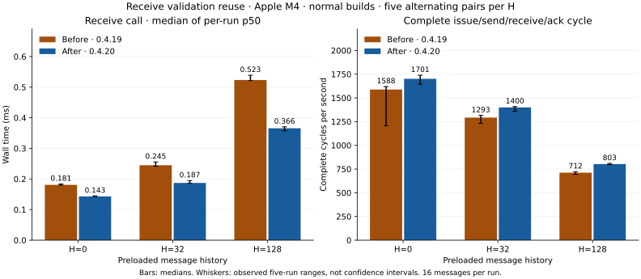
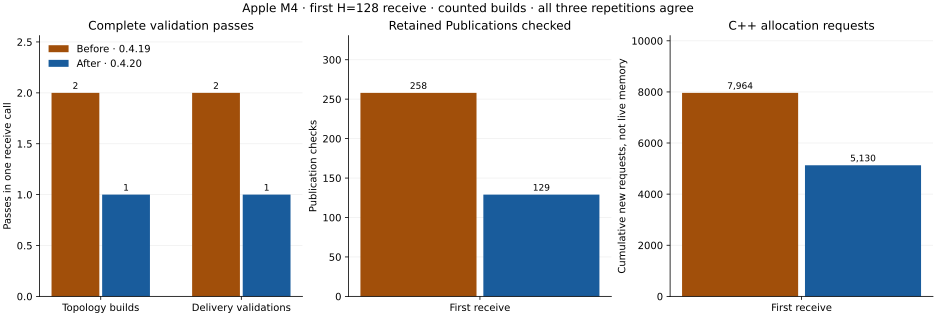

# Receive validation reuse measurements

Step **4.18**, framework **0.4.20**. The [guide and risk assessment](../../../docs/performance-receive-validation.md) define trusted issuance reuse. The [diagnostic method](../../../docs/performance-diagnostics.md) defines geometry, counters, timing windows and outcomes.

## Provenance

The **before** normal executable is the exact retained 0.4.19 binary, SHA256 `62eaa1098d30bb51c622dd37b99c8dada5e802b4229f4e75af3ce8f01ac8438d`, compiled from `b805fd880e5769dd9e0069499ae4735d96a8863c`. It was preserved before rebuilding. Its measurement checkout is merged staging `cdd475128683c3521b1d775bc28c36c7b690ee8d`, with all **128 input hashes** identical to the preceding measured source. The manifest names that measurement checkout rather than claiming the executable was compiled there. Original compiler/cache settings were retained beside it.

The **after** executables are built from `762b4baa2a43630763f316d0e797a68de6814972`, version 0.4.20, with **128 input hashes** shared by normal/enabled builds. Common input differences are VERSION and four source files: delivery_progress.h/.cpp, source_receive.cpp and delivery_loss.h. Later commits add documentation/results/CSV attributes only. Builds use Apple clang 21, Release `-O3 -DNDEBUG`, plus `-Wall -Wextra -Werror -g`. Diagnostics are OFF for timing comparisons and ON for attribution.

The local host is Apple M4, ten logical CPUs, 16 GiB, macOS 27.0.1, native ARM64 executables, with an x86_64 Python 3.10.15 coordinator. Measurements occurred November 26, 2026 in New York (November 27 UTC). Sessions use the local Data volume. No builds or tests ran during measurement. Host isolation, thermal/frequency/affinity controls and cache flushing were not used. Small studies do not qualify production tail latency.

## Populations and ordering

- [Fresh before normal](macos-arm64-before-normal/): 33 validated complete runs.
- [After normal](macos-arm64-after-normal/): 33 validated complete runs.
- [After enabled](macos-arm64-after-enabled/): 75 validated complete runs, including None/Counts/Timings controls.
- [Alternating serial cost](alternating/): 30 validated complete runs, fifteen per variant; five pairs per H=0/32/128. [order.csv](alternating/order.csv) names each adjacent pair and execution sequence.
- [Hosted Linux after](linux-x86_64-after/): 54 validated complete runs, including all six loaded polling cases, plus a separate syscall trace.

Full matrices ran sequentially: before normal, then (after builds/tests completed) after normal and after enabled. Fresh Sessions use sixteen-message windows, four channels, eight-entry rings and unchanged history/capacity/payload/Field controls. Measured channels use default recovery delivery (RecoverFromLog); allowed-loss evaluation retains separate generic validation and may perform extra passes. Serial/backlog uses nine active claims; concurrent thread/process cases use two plus requested idle consumers. Their rates are separate populations.

The additional serial study uses fifteen adjacent before/after pairs, alternating AB then BA (eight AB, seven BA pairs), with H=0,32,128 per repetition. Ordering is deterministic, not randomized. It reuses the [existing comparison harness](../milestone-4-gate-handoff/run_interleaved.py), whose hash is in both manifests. The harness imports each checkout's own runner/version/metadata globals and reuses its validators/artifact writer. Whole-invocation times in order.csv include startup/preload and are not per-operation latency.

Raw reports are compressed JSON lines with CSV run/summary/phase tables and TOML metadata. Latency summaries take nearest-rank quantiles within each run, then medians across runs; samples are not pooled. Ratios of variant medians differ from medians of paired percentage changes. The guide compares variant medians from five alternating normal runs per variant. Initial three-run full matrices remain retained. Untargeted issue/send/ack latencies have small mixed changes, rather than establishing zero overhead; loaded elapsed ranges overlap.

Count comparisons use identical-shape [retained 0.4.19 enabled cases](../milestone-4-operation-validation/macos-arm64-after-enabled/) and new enabled runs. All three repetitions agree for every quoted first-receive counter. Before counted source hashes match the preserved baseline; fresh normal runs supply timing comparisons. Across matched counted serial samples, prefix/gate/recovery work stays the same; all nonreceive counters stay identical.

## Plots



Bars are medians of five alternating sixteen-message normal runs per variant/H. Left: median of per-run receive p50. Right: median of per-run complete-cycle rates. Whiskers are observed five-run min/max ranges, not confidence intervals. The original H=0 before-rate outlier remains visible.



The separate counted controls show first H=128 receive work, with all three repetitions agreeing. Allocation counts are cumulative successful C++ new requests in the captured thread, not live/peak memory. [PNG performance](receive-performance.png) and [PNG work](receive-work.png) are also retained. [Regenerate both](generate_figures.py) with matplotlib; the generator reuses the preceding report's JSON/quantile helpers. Benchmark runners need only Python's standard library.

## Linux evidence

[Linux CI run 45934030482](https://github.com/smangano/angaria/actions/runs/45934030482) produced the unchanged downloaded artifact. Its synthetic merge is `4c541443f04cf70a777dd7f23ba37ff828896eff`; all 128 inputs match the measured after source. The eighteen-case matrix uses eight-message windows and completes **54/54** workloads, all six loaded cases at 8/8. Timed first H=128 receive matches local topology/delivery/native counters: one build, one complete delivery validation, 129 Publications, one prefix scan/321 visits, 18 maps and 47 stats. Heap counts differ (5,239 Linux versus 5,130 Mac allocation requests for that call); they are not asserted equal across libraries/platforms/window lengths or collection modes. Absolute hosted timings are not a controlled platform comparison or fairness guarantee.

The separate [syscalls.txt](linux-x86_64-after/syscalls.txt) covers startup, setup, H=32 preload, eight serial messages, controls and teardown. Relative to the [retained 0.4.19 trace](../milestone-4-operation-validation/linux-x86_64-after/syscalls.txt), whole-program getpid falls **89,342→78,202**, while fstat **6,876**, pread64 **2,169**, mmap **3,002** and munmap **2,981** remain unchanged. Its H=32 geometry differs from the H=128 per-call example. Fewer logical metadata requests reduce repeated ownership-check work, while the main evidence here is duplicate validation/heap removal. Do not divide whole-program totals by eight or interpret traced times/shares as ordinary operation latency.

## Reproduce

Build matching before/after checkouts at the recorded commits and use each checkout's corresponding executable/driver with a new result directory:

```sh
python3 -B benchmarks/run_diagnostics.py MATCHING_EXECUTABLE \
  --suite diagnostic --repetitions 3 --output NEW_RESULTS \
  --host-label 'DESCRIBE THE ACTUAL HOST'
```

For the additional serial study:

```sh
python3 -B benchmarks/results/milestone-4-gate-handoff/run_interleaved.py \
  --before-root BEFORE_CHECKOUT --before-executable BEFORE_BINARY \
  --after-root AFTER_CHECKOUT --after-executable AFTER_BINARY \
  --output NEW_COMPARISON --host-label 'DESCRIBE THE ACTUAL HOST'
```

Temporary Session files are removed. Rebuilds can change executable hashes; retain your own settings/hashes. Result directories must be new. A validated workload that reaches its cooperative budget is not a completion; inspect actual progress/outcomes.
