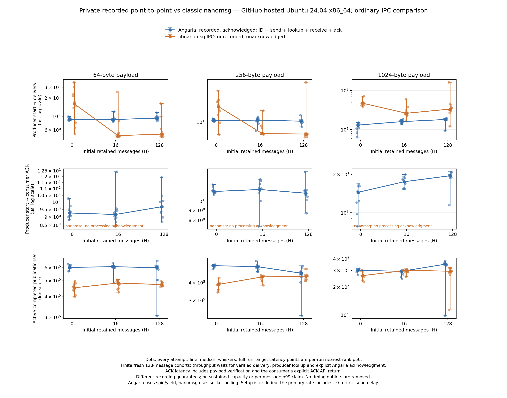
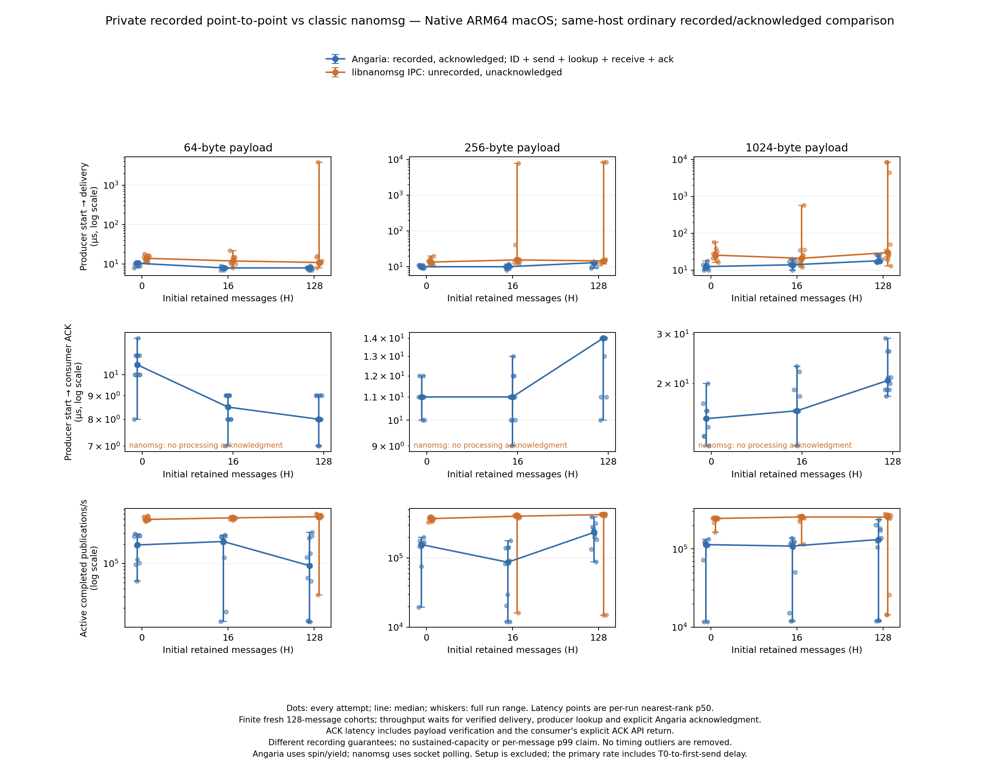

# Optional acknowledged progress: matched process measurements

Framework **0.4.37**, milestone step **4.35**, implements [consumer-owned acknowledged progress](../../../docs/recorded-acknowledged-progress.md) over the same producer-owned message log. This study retains **720 complete attempts** in four separate 180-attempt matrices. Every attempt completed, with no budget stops or discarded timing outliers.

**Within their own Linux pairs**, Angaria has higher median active completed throughput in **7/9 unacknowledged cells** and **8/9 acknowledged cells**. Nanomsg has higher median active throughput in **all nine cells of each Mac matrix**. These are host-specific finite-cohort observations with different processing guarantees, buffering and wait policies. They establish neither intrinsic transport speedups nor sustained capacity.

The two Linux jobs used **different CPU models**: Intel Xeon 6975P-C for the unacknowledged pair and AMD EPYC 9V45 for the acknowledged pair. Do not estimate acknowledgment overhead by dividing their rates or latencies. Both pairings contain their own nanomsg control on the same job. The Mac pairs use the same Apple M4 workstation but separate sequential matrices and preparation states; their differences alone also do not isolate acknowledgment cost.

## Workload and completion boundaries

Each matrix uses five alternating ABBA/BAAB blocks: ten runs per profile in each H/payload cell. **H=0/16/128** means accepted messages retained and drained before the measurement; acknowledged preloads are acknowledged before timing. Every fresh cohort sends **128 new messages** at zero offered interval. Payloads are **64/256/1,024 bytes**. Angaria uses **eight logical Queue credits** and spin/yield waiting; classic libnanomsg **1.3.0 IPC PUSH/PULL** requests **131,072-byte socket buffers** and socket polling. Both have one producer process and one consumer process on the same host; nanomsg's background threads remain part of its profile. No CPU affinity is requested.

All payload bytes, publication IDs/order and Angaria headers are checked. Angaria records every acceptance, validates the exact Binary schema and performs an ordinary accepted-ID lookup. Nanomsg is unrecorded and has no Angaria ID or outcome lookup. Acknowledged Angaria additionally certifies the consumer's explicit progress after payload verification; unacknowledged Angaria creates no processing receipt file. None of these profiles promises power-loss durability.

- **Delivery latency:** producer logical start, before payload fill/hash, ID issuance, send and backpressure, to successful consumer receive API return.
- **Consumer ACK latency:** the same start through the acknowledged consumer's explicit ACK API return, including payload verification. Nanomsg has no processing acknowledgment, so its ACK series is absent. The producer does not synchronously wait for an ACK after each send; this is queued acknowledged processing, not a measured request/reply round trip to the producer.
- **Primary common-T0 completed rate:** 128 divided by the interval from the declared common start until all required completion evidence is available. Angaria waits for both the final producer accepted-ID lookup and the final consumer verification, plus final consumer ACK when selected. Nanomsg waits for final consumer byte verification.
- **Secondary active completed rate:** the same completion boundary, starting at the first actual send. It excludes T0-to-first-send delay and remains a finite fresh-cohort observation.

Latency tables report the median of ten **per-run nearest-rank p50s**. Rates report medians of ten independently calculated cohort rates. Each cell has 1,280 timed deliveries per profile, below the retained 10,000-sample minimum for p99. No per-message tail estimate or steady-state capacity is reported. CPU/RSS/thread/storage metadata are retained; the CPU intervals include control/lead waits and background threads, and are not isolated per-API CPU measurements. No per-phase VM-fault or cache-contention attribution is collected in these IPC matrices.

The native clock reports **1 ns resolution on Linux** and **1 µs on the Mac**. One-quantum Mac medians and equal rounded delivery/ACK medians do not establish sub-microsecond precision or a free acknowledgment. The Linux builds use GCC 13.3; the native Mac executable uses Apple Clang 21. Both use ordinary Release optimization and debug locations, with diagnostics/Cachegrind OFF. Detailed flags and executable architecture are retained independently of the Python coordinator.

The following H=0 tables are representative; linked CSVs/plots preserve all nine cells, all ten attempt values, and full ranges. The completed-rate tables keep both denominators visible.

## Linux unacknowledged: Intel Xeon 6975P-C

| Payload | Angaria delivery (µs) | Angaria consumer ACK (µs) | Nanomsg delivery (µs) |
| ---: | ---: | ---: | ---: |
| 64 B | 1.625 | Not applicable | 65.449 |
| 256 B | 1.915 | Not applicable | 52.413 |
| 1,024 B | 4.059 | Not applicable | 66.103 |

| Payload | Angaria common-T0 (thousand/s) | Nanomsg common-T0 (thousand/s) | Angaria active (thousand/s) | Nanomsg active (thousand/s) |
| ---: | ---: | ---: | ---: | ---: |
| 64 B | 414.82 | 367.28 | 651.12 | 534.98 |
| 256 B | 372.65 | 349.71 | 523.15 | 478.82 |
| 1,024 B | 214.10 | 233.51 | 273.48 | 291.67 |

[Primary values and full ranges](linux-x86_64-unacknowledged/comparison.csv), [active values and full ranges](linux-x86_64-unacknowledged/active-comparison.csv), [primary plot](linux-x86_64-unacknowledged/latency-throughput.png), [active plot](linux-x86_64-unacknowledged/active-window-latency-throughput.png), [manifest](linux-x86_64-unacknowledged/manifest.json).

## Linux acknowledged: AMD EPYC 9V45

| Payload | Angaria delivery (µs) | Angaria consumer ACK (µs) | Nanomsg delivery (µs) |
| ---: | ---: | ---: | ---: |
| 64 B | 8.941 | 9.257 | 15.959 |
| 256 B | 10.663 | 11.211 | 19.468 |
| 1,024 B | 13.051 | 14.463 | 47.255 |

| Payload | Angaria common-T0 (thousand/s) | Nanomsg common-T0 (thousand/s) | Angaria active (thousand/s) | Nanomsg active (thousand/s) |
| ---: | ---: | ---: | ---: | ---: |
| 64 B | 421.14 | 346.83 | 599.79 | 452.16 |
| 256 B | 386.37 | 298.00 | 525.06 | 388.38 |
| 1,024 B | 250.66 | 223.08 | 300.72 | 264.24 |

[Primary values and full ranges](linux-x86_64-acknowledged/comparison.csv), [active values and full ranges](linux-x86_64-acknowledged/active-comparison.csv), [primary plot](linux-x86_64-acknowledged/latency-throughput.png), [active plot](linux-x86_64-acknowledged/active-window-latency-throughput.png), [manifest](linux-x86_64-acknowledged/manifest.json).



## macOS ARM64 unacknowledged: Apple M4

| Payload | Angaria delivery (µs) | Angaria consumer ACK (µs) | Nanomsg delivery (µs) |
| ---: | ---: | ---: | ---: |
| 64 B | 1.000 | Not applicable | 15.000 |
| 256 B | 2.000 | Not applicable | 11.000 |
| 1,024 B | 5.500 | Not applicable | 27.500 |

| Payload | Angaria common-T0 (thousand/s) | Nanomsg common-T0 (thousand/s) | Angaria active (thousand/s) | Nanomsg active (thousand/s) |
| ---: | ---: | ---: | ---: | ---: |
| 64 B | 12.21 | 12.44 | 265.29 | 477.62 |
| 256 B | 11.99 | 12.37 | 144.23 | 395.20 |
| 1,024 B | 11.40 | 12.13 | 100.44 | 243.35 |

[Primary values and full ranges](macos-arm64-unacknowledged/comparison.csv), [active values and full ranges](macos-arm64-unacknowledged/active-comparison.csv), [primary plot](macos-arm64-unacknowledged/latency-throughput.png), [active plot](macos-arm64-unacknowledged/active-window-latency-throughput.png), [manifest](macos-arm64-unacknowledged/manifest.json).

## macOS ARM64 acknowledged: Apple M4

| Payload | Angaria delivery (µs) | Angaria consumer ACK (µs) | Nanomsg delivery (µs) |
| ---: | ---: | ---: | ---: |
| 64 B | 10.500 | 10.500 | 14.000 |
| 256 B | 10.000 | 11.000 | 13.500 |
| 1,024 B | 12.500 | 15.000 | 25.500 |

| Payload | Angaria common-T0 (thousand/s) | Nanomsg common-T0 (thousand/s) | Angaria active (thousand/s) | Nanomsg active (thousand/s) |
| ---: | ---: | ---: | ---: | ---: |
| 64 B | 12.15 | 12.45 | 194.41 | 488.58 |
| 256 B | 11.83 | 12.35 | 156.52 | 372.10 |
| 1,024 B | 11.51 | 12.14 | 113.63 | 245.22 |

[Primary values and full ranges](macos-arm64-acknowledged/comparison.csv), [active values and full ranges](macos-arm64-acknowledged/active-comparison.csv), [primary plot](macos-arm64-acknowledged/latency-throughput.png), [active plot](macos-arm64-acknowledged/active-window-latency-throughput.png), [manifest](macos-arm64-acknowledged/manifest.json).



## Start delay, interpretation and remaining work

Across each Mac matrix, median producer/consumer start jitter is about **10 ms** for both profiles. This dominates many common-T0 rates, even while active message work finishes much sooner. Linux start jitter medians are about **83–100 µs**, depending on the role/profile/job. Both intervals are retained, and the initial delay is not silently removed from primary throughput. These observations do not isolate which scheduling or waiting mechanism caused the delay.

Receipt commits add fixed local state work to acknowledged delivery, and that work remains visible. The expected direction is forward log traversal and bounded progress independent of retained-prefix length, with extra processing work confined to acknowledged bindings. The deterministic checks retain zero hot successful-path allocations, filesystem/mapping operations and Session-gate work; the unacknowledged control continues to omit receipts. Real-process comparisons provide observed delivery/ACK latency and completed throughput rather than substituting instruction/allocation counts for them.

Queue limits and waiting shape the backlog, so the lower Angaria delivery medians in some cells are not an isolated transport-cost advantage. In the AMD acknowledged pair, nanomsg has lower delivery medians in several history cells while Angaria retains higher completed throughput in most cells. Short-cohort variability, larger-payload work, cold memory/page effects and long-run saturation remain part of workstream step 7's qualification before public admission. The separate first-touch probes in earlier steps remain explanatory evidence; no new page-fault cause is inferred from these IPC timing distributions.

## Correctness and sanitizer qualification

The strict diagnostics-OFF and ON builds each pass **982 CTest cases** (981 before the receipt-consistency follow-up below), including all seventeen public primer programs. The new progress/storage tests use independent bytes and actual interrupted operations. They qualify stale-token rejection, pinned repetition, release/close, timestamp presence at epoch zero/negative times, full-log progress, generation/issuance exhaustion, and SIGKILL across image/selector/receipt/Source/applied/hint boundaries. Source installation is stopped after 40 of 80 bytes to exercise genuinely torn state. Repeated interrupted recovery preserves the original acknowledgment time; interrupted replacement attachment preserves the never-exposed candidate incarnation.

Both processing modes pass the five actual-Session-gate/paused-producer/full-peer/log-full/recovery independence scenarios. An additional case pauses another consumer's committed acknowledgment while unrelated traffic continues. The private binding remains one Queue, one exact Binary schema and Process Tasks; public Task/Thread lifecycle integration is later work.

The scoped native **ASan+UBSan run passes 53 cases**, including the instrumented independent exec worker. New Queue/progress implementations and tests are instrumented; unchanged foundation and GoogleTest archives are not. LeakSanitizer is unsupported on this platform, so leak detection is disabled. The [final sanitizer manifest and logs](validation/receipt-consistency/sanitizers/) retain exact commands, scope, hashes and empty test stderr; the [initial 52-case run](validation/sanitizers/) remains preserved. Focused [normal](validation/focused-normal.stdout.txt) and [diagnostics](validation/focused-diagnostics.stdout.txt) performance checks retain positive controls and deterministic zero-work guards; their local clock samples are separate from the IPC matrices.


## Post-measurement receipt consistency follow-up

Final review tightened the owner receipt getter to require the correspondence in both directions: an Issued receipt names the active pin, and the receipt at the active pin is Issued. Supported operation sequences already satisfy this condition. A deliberate malformed Pending row at an active pin previously escaped that getter's one-way check. The new regression reproduces the failure before the fix and verifies `IoError`, persistent handle failure after byte repair, retained owning-copy validity and correct replacement redelivery afterward. This is malformed-state rejection under qualification, not support for live external mutation.

The stricter predicate changes no valid transition, layout, scan, allocation or native operation. The [paired focused check](validation/receipt-consistency/paired-focus.json) runs five alternating ABBA/BAAB blocks, ten executable attempts per side, against the pre-fix **550fbf1** executable on native macOS ARM64. Median run-median same-process ID/send/lookup/receive/ACK cost is **993.2 → 956.1 ns**; pinned repeat is **27.3 → 27.3 ns** and release/redelivery is **261.4 → 257.8 ns**. Ranges overlap substantially (complete-cycle run medians 938–1,744 ns before and 933–3,002 ns after), so these noisy component samples support no speedup claim. Allocation and native-work guards remain zero; the normal and diagnostics suites each pass 982 tests, and the final scoped sanitizer run passes 53.

The four full IPC matrices above remain measurements of **ea0bbe9**, before this final getter predicate. They are not relabeled as post-fix timings. This isolated validation follow-up uses its own focused check; the complete raw matrices and original source/build hashes remain unchanged.

## Evidence and reproduction

All four timed matrices use frozen source **`ea0bbe9`**, framework **0.4.37**. The Mac collector verifies source/build/library/executable inputs unchanged before and after collection. The Linux matrices run the same commit in separate hosted jobs: [unacknowledged](https://github.com/smangano/angaria/actions/runs/46109220436) and [acknowledged](https://github.com/smangano/angaria/actions/runs/46109222467). Each Linux x86_64 comparison job passes 24 real adapter cohorts and five deadline cases. Its additional Linux ARM64 and macOS ARM64 jobs each pass the 24 adapter cohorts. Imported Linux provenance comes from its own runner metadata, not the Mac build snapshot. Each matrix retains original worker reports, compressed raw attempt archives, compiler/clock/resource/storage metadata and reconstructable summaries. Every raw attempt remains included.

The Linux timed executable SHA-256 is **`ec45f3411d273083e2b514e3cce3b7aede0c77799ecb4385b7391fab0ff22b8d`** in both jobs, despite their different CPU models. The Mac timed executable is likewise identical between its two modes. After collection, an analysis-only change wraps plot labels; all data, numeric summaries, runtime and timed IPC inputs remain as recorded. Source hashes identify the original frozen renderer too.

To verify any retained matrix and reconstruct its two figures:

```sh
python3 -B benchmarks/recorded_connection_study.py render benchmarks/results/milestone-4-recorded-acknowledged/linux-x86_64-acknowledged --validate-only
python3 -B benchmarks/recorded_connection_study.py render benchmarks/results/milestone-4-recorded-acknowledged/linux-x86_64-acknowledged
python3 -B benchmarks/recorded_connection_study.py render benchmarks/results/milestone-4-recorded-acknowledged/linux-x86_64-acknowledged --active
```

For a fresh ordinary Release comparison, use the frozen source/build inputs and a new output directory. The collector checks the source commit and never overwrites retained evidence. The local environment must permit Unix-domain sockets. Select `recorded-connection` for the unacknowledged control:

```sh
python3 -B benchmarks/recorded_connection_study.py collect build/recorded-ipc-normal/angaria_ipc_comparison --source-commit ea0bbe9 --angaria-profile recorded-acknowledged-connection --output /tmp/angaria-acknowledged-new-study --blocks 5 --messages 128 --histories 0,16,128 --payload-bytes 64,256,1024 --ring-slots 8 --start-lead-ms 100
```

The current renderer preserves the earlier unacknowledged datasets' values. No old-engine speedup, consumer execution-order trace, public runtime admission, power-loss recovery or sustained-capacity claim is made by this step.
