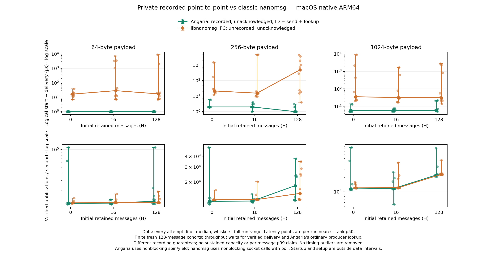
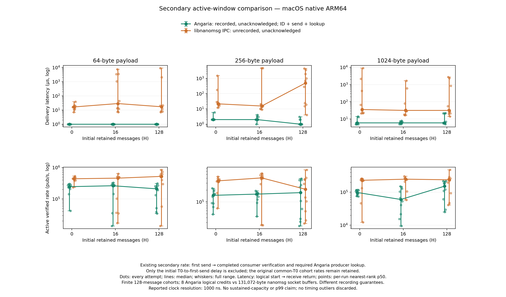
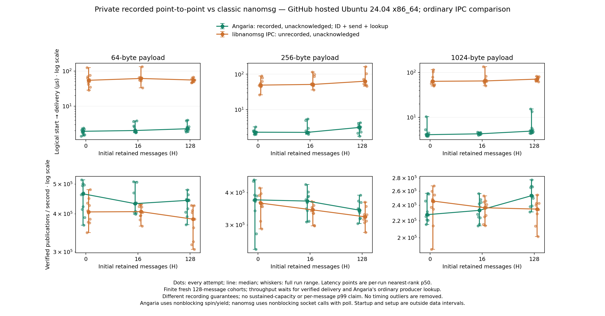
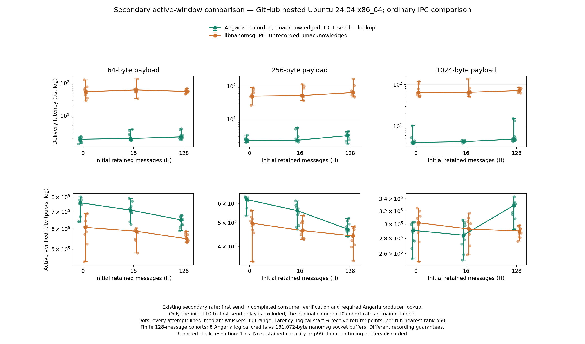

# Recorded point-to-point delivery: first process comparison

Framework **0.4.35**, step **4.33**, connects the producer-owned message log to private recorded/unacknowledged endpoints. This study measures one independent producer process communicating with one independent consumer process on the same machine, using the [new endpoint implementation](../../../docs/recorded-queue.md) and classic libnanomsg 1.3.0 IPC PUSH/PULL.

**The throughput result depends on the host.** At these settings Angaria has lower observed message-latency medians on both hosts. On the native ARM64 Mac, nanomsg has higher median active throughput in all nine cells. On Linux x86_64, Angaria has higher median cohort and active throughput in seven of nine cells; two 1,024-byte cells favor nanomsg. Mac cohort rates are strongly affected by delay before the producer's first send. Both the primary and active intervals remain visible, and hosts are kept separate.

## macOS ARM64 measurements

The host is an **Apple M4**, with a native ARM64 timed executable and Apple Clang **21.0.0**, Release `-O3 -DNDEBUG`, strict C++ warnings and `-g`. Library diagnostics and Cachegrind instrumentation are **OFF**. Five alternating ABBA/BAAB blocks produce ten attempts per profile in each history/payload cell: **180 complete attempts**, with no failures, budget stops or discarded timing outliers.

H is the number of accepted messages retained and drained before the measured cohort. Each cohort sends and verifies **128 new messages**, with a zero-interval offered schedule. Angaria has **8 logical Queue credits**; nanomsg requests **131,072-byte send/receive socket buffers**. Logical credit and socket-buffer capacity are different limits; queueing and waiting behavior therefore remain part of the comparison.

| H | Payload | Angaria latency (µs) | nanomsg latency (µs) | Angaria cohort rate (thousand/s) | nanomsg cohort rate (thousand/s) |
| ---: | ---: | ---: | ---: | ---: | ---: |
| 0 | 64 B | 1 | 16.5 | 12.20 | 12.41 |
| 0 | 256 B | 2 | 21.5 | 11.82 | 12.33 |
| 0 | 1,024 B | 6 | 35.5 | 11.50 | 12.10 |
| 16 | 64 B | 1 | 28.5 | 12.28 | 12.63 |
| 16 | 256 B | 2 | 15.5 | 11.94 | 12.43 |
| 16 | 1,024 B | 6 | 31.5 | 11.73 | 12.17 |
| 128 | 64 B | 1 | 17 | 13.22 | 12.57 |
| 128 | 256 B | 1 | 492.5 | 18.10 | 14.67 |
| 128 | 1,024 B | 6 | 31.5 | 22.63 | 23.23 |

Latency is measured from the producer's **logical start**, before payload preparation/hash, ID issuance and send/backpressure, to the consumer's successful receive return. Every message is checked against independent expected bytes and publication identity. The table shows the median of ten **per-run nearest-rank p50** latency values. These are descriptive fresh-cohort observations. Each cell contains only 1,280 deliveries per profile, below the study's 10,000-sample minimum for p99 reporting.

The reported native `CLOCK_MONOTONIC` resolution is **1 µs** on this host. All 64-byte Angaria per-run p50 values are one clock quantum; this does not establish sub-microsecond precision. Adjacent-clock-read calibration is retained and never subtracted. API timing deltas can be quantized to zero without implying a free operation.

The **cohort rate** is 128 divided by the interval from the declared common start T0 until both required boundaries have completed: consumer payload verification and, for Angaria, the producer's ordinary accepted-ID lookup. Each table rate is the median of ten separate-run rates. Lookup can overlap delivery, so the message-latency metric does not wait for lookup after the consumer has received the message. The throughput denominator does include a later lookup. Rates are not calculated from the rounded latency medians.



Dots show every attempt, lines show medians and whiskers show the full minimum/maximum run range. Both rows use logarithmic scales. Variation matters: nanomsg's 256-byte H=128 per-run latency medians span **4–4,406 µs**, and its 64-byte H=128 range reaches **9,002 µs**. Angaria's 1,024-byte H=128 medians span **5–22 µs**. The summary and plots retain these runs.

## Start delay and active intervals

The primary rate includes the declared T0-to-first-send delay. At H=0, median producer start jitter is about **10 ms** for both profiles. This is much larger than the median active first-send-to-completion intervals, which range from **0.291–1.314 ms** there. The timing difference is directly reconstructed for every retained attempt:

```text
cohort_verified_ns - active_verified_ns = first_send_start_ns - T0
```

This equality holds for all 180 attempts. It explains why a low message-latency median can coexist with a low common-T0 cohort rate. It does not identify the scheduling or waiting mechanism that produced the delay.

The separately retained **active rate** starts at the first send call and ends at the same verified/resolved completion boundary. It excludes the initial start delay but remains a finite-cohort observation. It is not sustained transport capacity.

| H | Payload | Angaria active rate (thousand/s) | nanomsg active rate (thousand/s) |
| ---: | ---: | ---: | ---: |
| 0 | 64 B | 245.65 | 439.14 |
| 0 | 256 B | 146.42 | 341.49 |
| 0 | 1,024 B | 98.07 | 229.68 |
| 16 | 64 B | 262.86 | 458.61 |
| 16 | 256 B | 157.35 | 405.88 |
| 16 | 1,024 B | 60.10 | 248.12 |
| 128 | 64 B | 209.87 | 521.78 |
| 128 | 256 B | 171.32 | 208.99 |
| 128 | 1,024 B | 151.92 | 237.60 |



This secondary figure is reconstructed from the rate already recorded during the original run. It changes no message timestamp, raw report, primary cohort rate or measurement population. Its latency row remains logical start to receive return; its rate row uses the active verified/resolved completion interval.

Nanomsg's median active rate is higher in every measured cell. The ratio of these cell medians to Angaria's ranges from **1.22 to 4.13** across these settings. Different recording, schema checks, lookup, buffer and wait behavior all contribute work; this study does not isolate the cost of any one difference. Neither the lower Angaria latency nor the active-rate result is an old-engine speedup measurement or proof of an architectural limit.

History cases also differ in cache and startup conditions. The tests establish incremental log traversal and no shared Session gate in ordinary messaging, but these timings do not isolate history scaling from hardware, cache or scheduling effects. The IPC harness does **not collect per-phase VM-fault counters**; no page-fault, cache-contention or physical-I/O conclusion is inferred from this series.

## Guarantees and workload boundaries

| Property | Private Angaria profile | Classic nanomsg IPC profile |
| --- | --- | --- |
| Acceptance | Complete immutable message committed to the producer-owned log. | Successful PUSH API send. |
| Recording and replay | Every accepted message retained with its original publication header and accepted destination. | No Angaria message log. |
| Processing acknowledgment | None. | None. |
| Producer identity/outcome path | ID issuance, schema-validating send, and ordinary lookup of the accepted ID. | PUSH send; no Angaria ID or lookup. |
| Receive path | Bound `MessageView`, Queue order, and independent returned credit. | PULL receive into a caller-owned buffer. |
| Waiting | Nonblocking polling with thread yield on empty/full. | Nonblocking socket calls and nanomsg poll on unavailable work. |
| Completion evidence | Consumer verified every byte and the producer resolved every accepted ID. | Consumer verified every byte. |

The benchmark includes one ordinary lookup per accepted Angaria ID. Lookup checks producer-owned committed acceptance; it does not wait for consumer processing or act as a processing acknowledgment.

The same versioned binary envelope, sequence/timestamps and payload pattern are used for both profiles. The producer fills/hashes the payload; the consumer verifies and hashes it. Angaria setup uses real registered definitions and resolves the actual schema reference before binding the private endpoints. The measured path invokes no old Session/Task messaging APIs. Endpoint open/recovery, Registry setup, physical reservation, preload/drain, clock calibration, control barriers and report serialization are outside message/data timing. First-use memory work during ordinary sends/receives remains included.

Both profiles run in the same UDS-enabled execution context. No CPU affinity is requested. The controller and original resource reports retain worker/process CPU, coordinator CPU, peak RSS, thread counts, storage sizes and start jitter. CPU intervals include configured lead/control waits and nanomsg background threads; they are not isolated per-message API CPU measurements. Data-file reservations and sealed catalog sizes are accounted for separately. Recording is not a claim of power-loss durability.

The initial Angaria binding is deliberately private: one outgoing Queue, one Source input and one exact Binary schema per producer/consumer pair. Integrated public Task lifecycle, multi-Queue/schema endpoint sharing, acknowledgment progress, public TOML admission and runtime replacement remain prerequisites described in the [implementation plan](../../../docs/recorded-unacknowledged-delivery-plan.md). The public API and its acknowledged default are unchanged. This series does not claim delivery fan-out, consumer execution-order replay or public-profile admission.

## Linux x86_64 matching-cohort measurements

The explicit Linux series matches the Mac workload dimensions: **128 new messages, H=0/16/128, 64/256/1,024-byte payloads, 8 Angaria credits, 131,072-byte socket buffers, zero offered interval and five ABBA/BAAB blocks**. All **180 attempts completed**, ten per profile per cell. This is GitHub-hosted Ubuntu 24.04 x86_64 on an **Intel Xeon 6975P-C**, using GCC **13.3.0**, Release optimization, and diagnostics/Cachegrind disabled. Reported monotonic-clock resolution is **1 ns**.

| H | Payload | Angaria latency (µs) | nanomsg latency (µs) | Angaria cohort rate (thousand/s) | nanomsg cohort rate (thousand/s) |
| ---: | ---: | ---: | ---: | ---: | ---: |
| 0 | 64 B | 1.916 | 54.490 | 464.54 | 405.29 |
| 0 | 256 B | 2.324 | 49.365 | 375.07 | 364.24 |
| 0 | 1,024 B | 4.083 | 63.746 | 227.59 | 245.73 |
| 16 | 64 B | 2.014 | 61.368 | 431.36 | 406.12 |
| 16 | 256 B | 2.296 | 51.538 | 371.07 | 342.86 |
| 16 | 1,024 B | 4.269 | 64.938 | 233.15 | 236.58 |
| 128 | 64 B | 2.261 | 55.426 | 442.07 | 383.71 |
| 128 | 256 B | 3.162 | 63.444 | 342.06 | 322.36 |
| 128 | 1,024 B | 4.908 | 71.314 | 253.22 | 234.82 |



The metric definitions and different recording/completion guarantees are unchanged. Producer and consumer start jitter medians across this series are approximately **92 µs** and **89 µs**, respectively. The declared-T0 delay is therefore still relevant, while substantially smaller than in the Mac series. These cross-host observations do not isolate a cause: CPU, OS, compiler, clock granularity and execution environment differ.

| H | Payload | Angaria active rate (thousand/s) | nanomsg active rate (thousand/s) |
| ---: | ---: | ---: | ---: |
| 0 | 64 B | 759.74 | 608.08 |
| 0 | 256 B | 623.38 | 497.87 |
| 0 | 1,024 B | 291.04 | 302.08 |
| 16 | 64 B | 710.67 | 587.41 |
| 16 | 256 B | 561.13 | 464.21 |
| 16 | 1,024 B | 284.33 | 293.05 |
| 128 | 64 B | 650.66 | 549.27 |
| 128 | 256 B | 471.18 | 441.60 |
| 128 | 1,024 B | 328.91 | 290.15 |



Angaria has higher median active rate in all six 64/256-byte cells and the H=128 1,024-byte cell. Nanomsg remains slightly ahead in the two other 1,024-byte cells. There is no universal throughput winner across the two hosts, and these finite cohorts establish neither sustained capacity nor production tail latency. Each profile/cell retains 1,280 deliveries, with no p99 estimate.

The [Linux manifest](linux-x86_64/manifest.json), [original metadata](linux-x86_64/manifest.toml), [all reports](linux-x86_64/reports.jsonl.gz), [raw attempt archive](linux-x86_64/raw-attempts.tar.gz), [primary values](linux-x86_64/comparison.csv) and [active values](linux-x86_64/active-comparison.csv) preserve the observations and full run ranges. Source commit is [`2dfee18bd7e21fcb7be362c45152df8d5de39f7f`](https://github.com/smangano/angaria/commit/2dfee18bd7e21fcb7be362c45152df8d5de39f7f); timed runtime and IPC adapter code are unchanged from the Mac source commit. The Linux executable's SHA-256 is `193390502bf53b62f289a1e9afdb520d0f04f247d1e2657dd275f2dbff558ae7`, identical to the initial 16-message Linux control. The two Linux populations remain separate; changing workload settings did not rebuild a different timed executable.

## Initial Linux short-cohort control

The first on-demand Linux x86_64 run used the IPC runner's default **16 messages per cohort**, with **H=0/32/128**, instead of the Mac series' explicit 128 messages and H=0/16/128. All **180 attempts completed** on GitHub-hosted Ubuntu 24.04 x86_64 with GCC **13.3.0**. This valid initial matrix is retained as a [separate short-cohort control](linux-x86_64-cohort16/manifest.json); it is not pooled with the Mac data or any subsequent explicit 128-message Linux series.

Its [primary figure](linux-x86_64-cohort16/latency-throughput.png), [secondary active-window figure](linux-x86_64-cohort16/active-window-latency-throughput.png), [original metadata](linux-x86_64-cohort16/manifest.toml), [all reports](linux-x86_64-cohort16/reports.jsonl.gz) and [raw attempt archive](linux-x86_64-cohort16/raw-attempts.tar.gz) preserve the actual workload and every observation. Its source commit is [`c363a29f15db8a74ba54140788da1f85c4acc584`](https://github.com/smangano/angaria/commit/c363a29f15db8a74ba54140788da1f85c4acc584). Imported Linux provenance comes from the original runner metadata; Mac build/library details are not substituted for that host's missing build snapshots.

An analysis-only follow-up makes packed metadata derive its message-count label from the actual cases and rejects summaries/plots that would pool different cohort sizes. It changes no runtime or IPC timing code. The original Mac 128-message records, numeric plot values and raw evidence remain unchanged.

## Evidence and reproduction

Mac measured source: [`8da7d23107f7da3603213a180f1b9b38afa1ca40`](https://github.com/smangano/angaria/commit/8da7d23107f7da3603213a180f1b9b38afa1ca40). The [Mac manifest](macos-arm64/manifest.json) records **283 frozen source/harness input hashes**, executable/Angaria/nanomsg static-library hashes, compiler/build flags and architecture. Source, executable, libraries and build inputs were verified unchanged before and after the run. The Python coordinator is x86_64; the timed C++ executable is native ARM64. Linux has its own source/binary/compiler metadata above; host datasets and the initial short-cohort control are not pooled.

- [Original runner metadata](macos-arm64/manifest.toml), [build provenance](macos-arm64/provenance/), and original [stdout](macos-arm64/runner.stdout.txt)/[stderr](macos-arm64/runner.stderr.txt).
- [All reports, losslessly compressed](macos-arm64/reports.jsonl.gz), [all raw attempt directories](macos-arm64/raw-attempts.tar.gz), [run table](macos-arm64/runs.csv), and original [metric summary](macos-arm64/summary.csv).
- [Plot/table values and full ranges](macos-arm64/comparison.csv), [PNG](macos-arm64/latency-throughput.png), and [SVG](macos-arm64/latency-throughput.svg).
- [Secondary active-window values](macos-arm64/active-comparison.csv), [PNG](macos-arm64/active-window-latency-throughput.png), and [SVG](macos-arm64/active-window-latency-throughput.svg), reconstructed by the separate [postprocessing script](generate_active_figures.py).

The archive preserves each original setup/producer/consumer stream, commands, control events and report, including all per-message rows. Reconstruction checks hashes, all 180 ordered attempts, original worker REPORT events against archived stdout, exact requested workload dimensions, identities, byte hashes, lookup outcomes, completion counts and derived summary/rate values. No raw text is normalized or timing outlier discarded.

With a checkout of the measured source and its optional comparison build:

```sh
python3 -B benchmarks/recorded_connection_study.py render benchmarks/results/milestone-4-recorded-connection/macos-arm64 --validate-only
python3 -B benchmarks/recorded_connection_study.py render benchmarks/results/milestone-4-recorded-connection/macos-arm64
python3 -B benchmarks/results/milestone-4-recorded-connection/generate_active_figures.py benchmarks/results/milestone-4-recorded-connection/macos-arm64
```

To collect a fresh series, configure Release with `ANGARIA_BUILD_IPC_COMPARISON=ON`, testing enabled and diagnostics/Cachegrind disabled. Build `angaria_ipc_comparison`, then use a new output directory:

```sh
python3 -B benchmarks/recorded_connection_study.py collect build/recorded-ipc-normal/angaria_ipc_comparison --source-commit 8da7d23107f7da3603213a180f1b9b38afa1ca40 --output benchmarks/results/recorded-connection-rerun --host-label 'native ARM64 Mac rerun'
```

The collector rejects unfrozen source and existing destinations. Local execution must allow Unix-domain sockets. A failed or incomplete attempt retains its evidence and cannot produce a validated performance plot. The `pack` command retains output from the same runner on another host without substituting local build provenance for that host's metadata.
