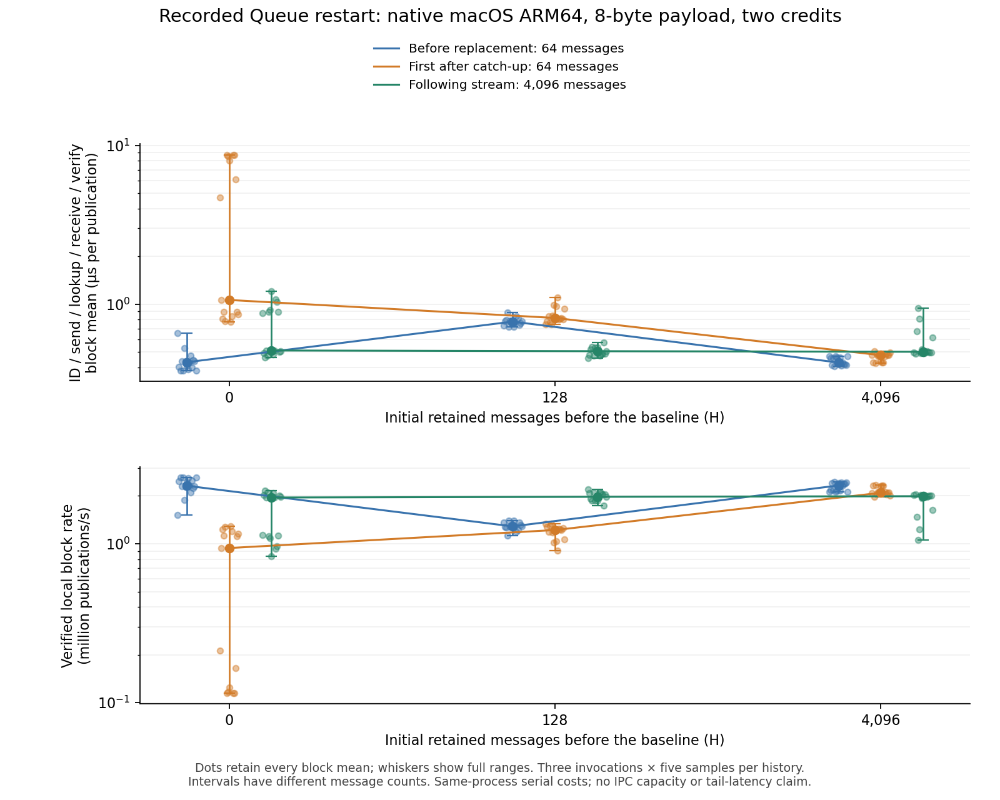

# Recorded Queue restart and catch-up qualification

Framework **0.4.36**, milestone step **4.34**, qualifies workstream step 5's [restart and connection independence](../../../docs/recorded-queue.md#restart-and-connection-independence). This step adds failure tests and a cold recovery checkpoint; it changes no established messaging algorithm. The [previous independent-process nanomsg comparison](../milestone-4-recorded-connection/README.md) remains pinned to its original source. The measurements below are **same-process component costs**, not a replacement IPC comparison or a transport speedup.

## Local measured costs

The timed executable is native **macOS ARM64**, Apple Clang 21, Release `-O3 -DNDEBUG`, with strict warnings, debug locations, and diagnostics/Cachegrind **OFF**. Three complete invocations each take five fresh samples for H=0/128/4,096. Every sample uses an 8-byte prepared payload, two Queue credits and an 8 MiB physically reserved file; the reservation is not prefaulted. No CPU affinity is requested.

H is the number of accepted and drained messages before a timed **64-message baseline**. Both endpoints then close. Producer and consumer replacement opening are timed separately; the replacement consumer replays all **H+64** retained messages. A second replacement replay gathers native work counts outside wall-time measurement. The first **64 new messages after catch-up** and a following **4,096-message stream** are timed separately. The longer stream includes its first-use page work. A final 64-message block gathers diagnostic counts separately.

Every live cycle issues an ID, sends, resolves the accepted ID, receives, and verifies publication identity, Queue order, the returned header and all payload bytes. Payload construction and endpoint setup are outside the cycle interval. Replay verifies the original producer incarnation/ID, Queue sequence, payload and replacement consumer identity. Borrowed views are used; ownership copies are separately qualified by the functional tests.

Each table value is the **median of all 15 block means** for that history, with none discarded. Rates are the reciprocal of the corresponding median mean cost. These are not per-message latency quantiles. The intervals have different lengths and preparation states, so their differences are not causal recovery overhead or speedup estimates.

| H | Retained on replacement | Baseline (µs/publication) | First 64 after catch-up (µs/publication) | Following 4,096 (µs/publication) | Following verified rate (million/s) | Replay (ns/record) |
| ---: | ---: | ---: | ---: | ---: | ---: | ---: |
| 0 | 64 | 0.432 | 1.064 | 0.512 | 1.955 | 99.6 |
| 128 | 192 | 0.777 | 0.820 | 0.506 | 1.975 | 99.0 |
| 4,096 | 4,160 | 0.430 | 0.478 | 0.502 | 1.991 | 90.1 |



Dots retain every sample; whiskers show full ranges. For example, the H=0 first post-catch-up block spans **0.778–8.721 µs/publication**, despite its 1.064 µs median. This variation remains visible. The longer streams average approximately 0.5 µs per verified publication here; that does not establish sustained independent-process capacity, first-message latency or p99 behavior.

Cold opening validates the affected retained prefix and allocates/maps its bounded local state. That work is intentionally outside message and replay timing:

| Retained records | Producer replacement open (µs) | Consumer replacement open (µs) |
| ---: | ---: | ---: |
| 64 | 93.25 | 66.29 |
| 192 | 102.92 | 72.25 |
| 4,160 | 294.08 | 233.79 |

The expected direction is increased cold validation work with retained history, one forward replay traversal, and established messaging without a repeated historical scan or Session transaction. Observed replay means stay near 90–100 ns/record across these cases, while cold open increases for the longest history. Natural message-block timings remain sensitive to first-use memory work; they do not show that retaining more history makes messaging intrinsically faster.

## Fault counts and deterministic performance guards

`getrusage(RUSAGE_SELF)` samples minor and major page-fault counts immediately around the baseline and both post-catch-up intervals, outside their clocks. These windows also contain clock/allocation-capture plumbing; they are not per-API hardware attribution. Every official first 64-message post-catch-up block reports **one major fault**, and each following 4,096-message stream reports **48 major faults**. All counts, including minor faults and the baseline, are retained in the original JSON reports.

This is consistent with the earlier [separate first-touch fault probe](../milestone-4-producer-log-append/fault-probe/README.md), which contrasted natural and prefaulted preparation. The counts do not isolate the full cost of faults, cache behavior or scheduling, and Darwin's major-fault classification does **not prove physical disk I/O**. Reserving a file is not the same as making all its mapped pages ready for immediate access. Explicit prefaulting is not part of this measured profile.

All baseline, replay and post-catch-up allocation guards remain zero. The separate diagnostics-ON suite checks zero hot native read/stat/map/unmap/grow and Session-gate work, with the existing cold-open positive controls proving the counters are wired. Zero explicit mapping or filesystem calls does not establish zero virtual-memory work. No noisy wall-time value is used as a CI pass/fail threshold.

## Failure and independence evidence

The strict diagnostics-OFF and ON builds each pass **923 CTest cases**. Fourteen added independent-process cases qualify:

- SIGKILL at partial materialization, before log commit, after log commit, before descriptor exposure, before its stamp, and after its stamp. Only committed records are delivered; successor lookup/retry and continued Queue order agree with that boundary.
- Consumer death before and after credit publication, repeated replacement replay across 62 small-ring wraps, and no duplicate transport credit. Frozen cuts and complete owning Message copies survive peer and endpoint exit.
- Stale published descriptor generations fail closed before credit; repairing the descriptor does not revive the failed handle. Existing tests retain stale setup rejection before incarnation changes. Live resource replacement remains unsupported.
- Established independent producer/consumer processes finish while the actual Session gate remains held, with positive busy checks before and after completion. Other cases leave a distinct same-Session connection paused, offline/full or log-full.
- A replacement recovery is paused after taking its actual log claim. Another established connection completes while that claim and the Session gate remain held. Killing recovery permits later affected-stream replacement, lookup, replay and new sending without releasing the Session gate.

These are private fixed-topology endpoints with supplied sealed catalogs. The real Session identity/directory and administrative gate are used, but public Task lifecycle/admission integration and optional application acknowledgments remain subsequent work. Process interruption is qualified; power-loss durability is not claimed.

## Retained evidence and reproduction

Measured source commit: **`19a7b8b`**, with runtime/tests unchanged from **`cdca6f7`**. The [manifest](native-arm64/manifest.json) freezes source, executable, static library, compiler, build configuration and collector hashes before and after all invocations. The timed executable's architecture is checked independently of the Python coordinator. Original [stdout/stderr, GoogleTest XML and validation outcomes](native-arm64/raw/) and [build provenance](native-arm64/provenance/) remain intact. The [summary](native-arm64/summary.json) is reconstructed from those raw reports, retaining all 15 block means per case.

Exploratory runs which motivated separating the intervals and adding fault counts are preserved under [exploratory](exploratory/). Their harness revisions and populations differ from the frozen official study and are not pooled into these tables or plots.

From this checkout, reconstruct and verify:

```sh
python3 -B benchmarks/recorded_restart_study.py render benchmarks/results/milestone-4-recorded-restart/native-arm64 --validate-only
python3 -B benchmarks/recorded_restart_study.py render benchmarks/results/milestone-4-recorded-restart/native-arm64
python3 -B benchmarks/results/milestone-4-recorded-restart/plot.py
```

To collect again, check out the measured source, configure a Release build with diagnostics and Cachegrind explicitly OFF, build `angaria_recorded_queue_performance`, and select a new output directory. The collector refuses changed implementation inputs, changed collectors or an existing output directory:

```sh
python3 -B benchmarks/recorded_restart_study.py collect build/owned-log-normal/angaria_recorded_queue_performance /tmp/angaria-restart-new-study --source-commit 19a7b8b --attempts 3
```

The collector retains failed attempts and rejects incomplete studies. Plot reconstruction needs Matplotlib; the native performance tests and evidence validation do not.
