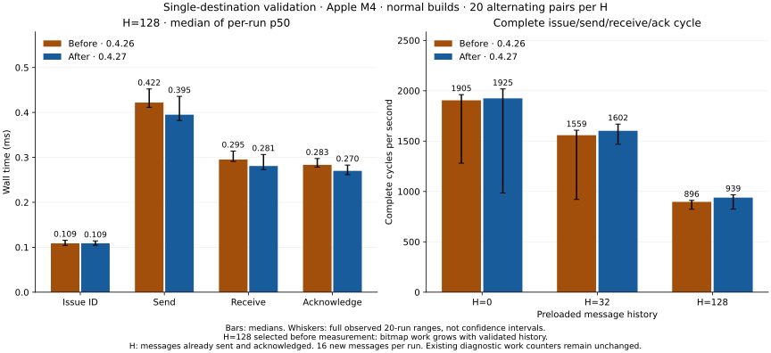
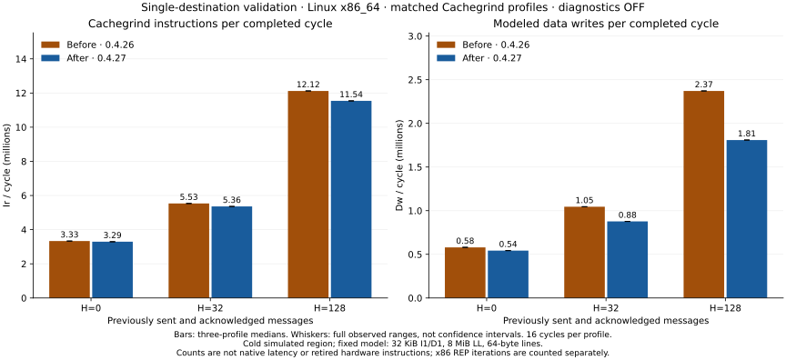

# Single-destination Publication validation measurements

Raw samples and profiler payloads described below are retained in the maintainer archive, not this checkout. Reports, plots, summaries and provenance remain here. [Archive catalog and restore instructions](../README.md#restore-archived-evidence) identify snapshot `2026-11-28-332118be2291`; restore its payloads before running the verification or figure commands below.

Step **4.25**, framework **0.4.27**. The [guide and risk assessment](../../../docs/performance-single-destination.md) explain the specialization: keep all destination validation, but skip the 8 KiB uniqueness bitmap when a Publication has exactly one destination. Multi-destination uniqueness checks remain. APIs, stored formats, recovery guarantees, synchronization and history-scan frequency are unchanged.

## Native timing results

**H** is the number of messages already sent and acknowledged before the measured window. Each fresh Session then completes sixteen new issue-ID/send/receive/acknowledge cycles. The primary study fixed **twenty adjacent before/after pairs per H** before launch. Ordering alternates AB/BA deterministically; it is not randomized. The H=128 operation plot was selected before measurement because the avoidable bitmap work grows with validated history.

The table uses the median of twenty per-run complete-cycle rates. Brackets show the full observed range, not a confidence interval. Change is the ratio of after/before medians; the adjacent-pair statistic is reported separately.

| H | Before cycles/s [range] | After cycles/s [range] | Change | Median paired change | After faster |
|---|---:|---:|---:|---:|---:|
| 0 | 1904.80 [1280.95, 1961.49] | 1924.65 [985.10, 2017.77] | +1.04% | +1.20% | 12/20 |
| 32 | 1558.68 [921.30, 1607.80] | 1602.22 [1468.57, 1668.82] | +2.79% | +2.65% | 18/20 |
| 128 | 896.42 [824.03, 911.97] | 939.16 [824.31, 966.77] | +4.77% | +4.80% | 18/20 |

At H=128, ordinary public-call wall times improve as follows. These are medians of per-run p50 values; individual-message tail latency is not represented by these medians.

| Operation | Before ms [range] | After ms [range] | Change | After lower |
|---|---:|---:|---:|---:|
| issue | 0.108646 [0.104125, 0.115500] | 0.108791 [0.104417, 0.114209] | +0.13% | 9/20 |
| send | 0.422021 [0.411458, 0.452292] | 0.395041 [0.382083, 0.435750] | -6.39% | 19/20 |
| receive | 0.295291 [0.291000, 0.314125] | 0.280812 [0.272958, 0.306500] | -4.90% | 19/20 |
| acknowledge | 0.283354 [0.278417, 0.297416] | 0.270020 [0.261667, 0.282916] | -4.71% | 20/20 |



[PNG](single-destination-performance.png). Whiskers retain every run, including unfavorable outliers. H=0's small 1.04% throughput change is noisy: adjacent-pair changes range from −23.10% to +23.87%; send p50 is lower in only ten of twenty pairs. H=32 has a slow before outlier and a maximum paired gain of +72.24%; that run remains in the evidence. H=128 throughput improves in eighteen pairs, with paired changes from −3.16% to +14.15%. ID issuance does not validate Publications and is essentially unchanged (+0.13% p50 at H=128). These results support a modest workload-specific benefit, not a universal speedup or production tail-latency guarantee.

## Full native controls

The unchanged [matched-control coordinator](../milestone-4-payload-preparation/run_matched_controls.py) runs eleven cases, three adjacent pairs each. All before and after workloads complete sixteen messages with no pending or unacknowledged work. The table includes all cases. Brackets again show full three-run ranges. Backlog reports publication and drain separately; process work excludes startup/exit, while the additional exit-inclusive row includes the measured process interval.

| Case | Rate | Before /s [range] | After /s [range] | Change |
|---|---|---:|---:|---:|
| 1: Serial H=0 | complete cycles | 1939.39 [1820.01, 1974.99] | 1952.57 [1834.56, 1967.82] | +0.68% |
| 2: Serial H=32 | complete cycles | 1588.88 [1537.06, 1589.77] | 1641.17 [1576.49, 1648.42] | +3.29% |
| 3: Serial H=128 | complete cycles | 901.32 [886.81, 908.35] | 955.80 [878.42, 956.77] | +6.04% |
| 4: Other-Queue H=128 | complete cycles | 896.38 [882.76, 901.47] | 930.64 [921.11, 957.30] | +3.82% |
| 5: Capacity ×16, H=128 | complete cycles | 679.11 [667.51, 682.79] | 702.76 [698.04, 710.19] | +3.48% |
| 6: 256 bytes, H=128 | complete cycles | 860.92 [849.26, 878.26] | 912.06 [905.78, 932.26] | +5.94% |
| 7: 256 bytes / 32 Fields, H=128 | complete cycles | 834.94 [833.84, 872.62] | 903.01 [892.39, 924.43] | +8.15% |
| 8: Backlog H=128 | drained messages | 1589.08 [1587.68, 1590.13] | 1717.97 [1705.81, 1727.98] | +8.11% |
| 8: Backlog H=128 | published messages | 1827.22 [1698.31, 1862.07] | 1999.26 [1974.16, 2005.99] | +9.42% |
| 9: Thread stream H=128 | complete cycles | 819.43 [794.54, 821.90] | 833.17 [830.31, 842.72] | +1.68% |
| 10: Three idle pollers H=128 | complete cycles | 459.95 [456.96, 478.38] | 479.15 [380.38, 496.02] | +4.17% |
| 11: Process H=128 | exit-inclusive | 663.85 [663.03, 666.36] | 698.40 [685.91, 702.01] | +5.21% |
| 11: Process H=128 | work phase | 861.70 [859.98, 867.42] | 909.93 [902.47, 913.79] | +5.60% |

Not every operation improves: H=0 control send p50 rises 1.79% (0.207000→0.210708 ms); its ID p50 rises 0.25%. Other untargeted ID medians also vary. The three-idle after stream includes a slower 380.38/s run despite its higher median. All raw operation statistics, adjacent-pair ranges and whole-window results remain in [analysis.json](analysis.json), the raw reports and generated CSVs. Three repetitions are a small control sample.

## Unchanged diagnostic work

Enabled diagnostics are attribution controls rather than the primary latency population. All **603 paired Counts sample counter dictionaries**, across three repetitions of each H, are identical before/after. Heap allocation, native mapping/stat/read counts, gate acquisitions, recovery checks, topology builds and validation passes do not fall. The removed bitmap is stack scratch, not a heap allocation recorded by those counters.

For the first H=128 cycle, issue/send/receive/acknowledge each retain one prefix scan, visiting 319/319/321/321 records respectively. Send still validates 128 historical Publications; receive and acknowledgment each validate 129. Avoiding bitmap initialization does not remove those passes. No cache, weaker validation, persisted state or additional lifetime obligation is introduced.

## Matched Linux Cachegrind evidence

[Comparison run 46002344246](https://github.com/smangano/angaria/actions/runs/46002344246) builds the immutable PR base and source head in the **same hosted Ubuntu x86_64 job**, then profiles base before head. Each version's own runner contributes three fresh-Session profiles per H, sixteen complete cycles each. All eighteen profiles complete and validate. Setup/preload, controls and teardown are outside the cold measured region. This is a new matched comparison, not a comparison against the earlier step's different hosted machine.

Both versions use Intel Xeon 6975P-C, GCC 13.3.0, glibc 2.39, Valgrind/cg_annotate 3.22.0, Release `-O3 -DNDEBUG` plus `-g`, profiling hooks ON and diagnostics OFF. The fixed simulated model is I1/D1 **32 KiB, 8-way**, LL **8 MiB, 16-way**, all **64-byte lines**, with cache and branch simulation enabled. All thirteen raw event totals are identical across the three repetitions within each H/version. Normalized counts below are per completed cycle, not per isolated send.

| H | Instructions before→after | Change | Data-write references before→after | Change |
|---|---:|---:|---:|---:|
| 0 | 3,332,771.6250→3,294,733.8750 | -1.14% | 579,676.1875→542,740.1875 | -6.37% |
| 32 | 5,532,540.1875→5,359,214.1875 | -3.13% | 1,045,367.2500→877,103.2500 | -16.10% |
| 128 | 12,120,576.0625→11,541,340.0625 | -4.78% | 2,371,050.6875→1,808,802.6875 | -23.71% |



[PNG](single-destination-work.png). These are simulated x86 instruction/reference counts, not CPU cycles, native latency or retired hardware instructions. Cachegrind counts x86 REP iterations separately. Their percentage reduction does not predict the same percentage speedup on x86 or Apple ARM.

The raw source rows show the mechanism. Before, the bitmap declaration at `publication_metadata.cpp:251` contributes 589,824 / 2,686,976 / 8,978,432 data-write references over each H=0/32/128 sixteen-cycle region: 576 / 2,624 / 8,768 complete 8 KiB clears. At H=128, that is 68.5 MiB of semantic zero writes. After, there are **no raw cost rows in the entire bitmap branch at lines 264–274**, including its new declaration at line 265, in any of the nine profiles. The common timestamp validation at line 281 still executes. This proves the clear is absent from the measured one-destination path; it does not claim a smaller reserved stack frame.

At H=128, the entire region loses 9,267,776 instruction events and 8,995,968 data-write references. These differences exactly match the reduction in `check_publication` flat self counts (instructions 9,750,016→482,240; writes 9,092,416→96,448). The saving includes bitmap initialization and uniqueness bookkeeping while all row checks continue.

Cache metrics are mixed, and denominators matter. At H=128, D1 data misses fall 64,912→61,099.3125 per cycle (−5.87%), yet D1 data miss rate rises 1.16133%→1.21590% because total references shrink faster. LL data misses fall 426.125→420.5625 per cycle, while their rate rises 0.007624%→0.008369%. Branch mispredictions fall 3.28%, but their rate rises 3.38761%→4.24636%. H=0 instruction-cache misses rise 272,459→273,564 over the sixteen-cycle region. The evidence establishes less work, not improvement in every cache or predictor metric.

## Provenance and retained populations

The before source checkout is merged staging **`8bc39075a858c82fb72a401169a1ec796368359d`**, version 0.4.26. The exact normal binary was preserved from the prior profiling step's strict Release build using source inputs at `0fc124c3e6ccb87b8bea108ead2a1d70c19cee39`; the [current before-normal manifest](alternating/before-normal/manifest.toml) retains its executable hash and copied build settings. All 129 recorded input hashes match both that source and this merged checkout. The enabled baseline was refreshed at the merged base before editing source/version. The after source is **`c2bd1c04cceb7f71fb124313d74f767dbc6010b8`**, version 0.4.27. Only **VERSION and `src/publication_metadata.cpp`** differ among the 129 measurement inputs. Later commits add evidence/documentation only. Source manifests are tracked-clean at measurement time; copied CMake caches preserve actual compiler options rather than claiming the old normal binary was compiled in the measurement checkout.

The local host is Apple M4, ten logical CPUs, 16 GiB, macOS 27.0.1, native ARM64 executables, Apple clang 21. The Python 3.10.15 coordinator runs x86_64. Native builds use Release `-O3 -DNDEBUG` plus `-Wall -Wextra -Werror -g`. All benchmark execution uses matching default execution requests; elevated Git/worktree setup is separate. Builds and tests finish before measurement. There is no host isolation, affinity, thermal/frequency control or cache flushing. [execution-contexts.toml](execution-contexts.toml) records the populations and ordering.

The workload uses four registered channels, eight-entry rings, eight-byte payloads with one Field unless a control says otherwise, and the default RecoverFromLog policy. Serial/backlog retains nine active claims; thread/process uses two plus requested idle consumers. Measurements are short sixteen-message windows, not sustained capacity or a ten-process trading-system qualification.

| Population | Validated invocations | Retained evidence |
|---|---:|---|
| [Before enabled](macos-arm64-before-enabled/) / [after enabled](macos-arm64-after-enabled/) | 75 + 75 | None/Counts/Timings controls |
| [Alternating normal](alternating/) | 60 + 60 | Twenty pairs per H; order log |
| [Matched normal controls](matched-controls/) | 33 + 33 | Eleven cases × three pairs; order log |
| [Same-job Cachegrind](cachegrind-comparison/) | 9 + 9 | Raw events, annotation, commands, reports, versions, manifests |
| [Linux source CI after](linux-x86_64-after/) | 54 | Eighteen eight-message cases × three; six three-idle streams complete |

**408 validated invocations** are retained: 336 local, eighteen Cachegrind and 54 Linux CI. All local/profiling workloads complete sixteen messages; Linux CI workloads complete eight, with no pending or unacknowledged messages. There are **25 generated CSV tables** (eighteen native, four Cachegrind, three Linux), plus the two separate order logs. Independent audit regenerated all 25 CSVs byte-for-byte, checked executable/source/coordinator hashes and order logs, validated each population against its matching driver, and checked raw Cachegrind event-row conservation. [analysis.json](analysis.json) retains the full computed metrics and audit summary.

The figure generator validates the plotted report/simulation inputs, unchanged Counts counters and summary consistency. It does not repeat every independent provenance, whole-report validation or byte-for-byte regeneration check. Artifacts remain verbatim, including raw text whitespace and profiler counts.

| Executable | SHA256 |
|---|---|
| Native before normal | `143795b6257a74859a4cd6b601b292b9c7fa3aa7ea1d7af97724af8ff0aea097` |
| Native before enabled | `3634594556e640bcc9b825f3fe9f48c7de7bb37499a5af32c17b864a5c6bcee9` |
| Native after normal | `004786460eed0ee69a63f6ddf4079b7cd4ce002601c3494d831d5c5be357abb2` |
| Native after enabled | `743746118a6f4208de7e08107d84c6bf1c338126dafed6a7c9e3f6709ba9a6c6` |
| Linux Cachegrind before | `ad93474472b288d9f6ce6254ca6be537b11d52ea7acb65fa5eb3c12073611eac` |
| Linux Cachegrind after | `e490fac9a19e020680b4dc85b9d67db373dcafe121c8a1f3f57021702fd12b80` |

## Qualification and Linux control

Strict local Release diagnostics OFF/ON each pass **825/825 tests**, in 17.83/18.24 seconds. This includes two focused single-destination codec tests, existing multi-destination duplicate checks, public/recovery/ownership qualification, demos, benchmark smoke tests and all seventeen primer programs. Public examples require no update for this internal specialization.

At source commit c2bd1c0, [Linux x86_64 CI](https://github.com/smangano/angaria/actions/runs/46002235039) passes **825/825** (9.14 seconds); [native profile CI](https://github.com/smangano/angaria/actions/runs/46002234951) passes **825/825** on Linux ARM64 (12.35 seconds) and macOS ARM64 (21.29 seconds). The separate matched Cachegrind job also passes all eighteen profiles. Final documentation/data commits run ordinary CI again before review readiness.

The retained Linux artifact has synthetic merge `d85a89755ebc3ceca7ce6cdb08b637b8cbb36b41`, with all 129 code input hashes matching the measured after source. Its whole-program [syscall trace](linux-x86_64-after/syscalls.txt) includes setup, H=32 preload, eight measured serial cycles, controls and teardown: 66,431 `getpid`, 6,733 `fstat`, 5,384 `newfstatat`, 3,002 `mmap`, 2,981 `munmap`, 2,169 `pread64`. These are not isolated operation counts; traced seconds/percentages are not native timing evidence. The CPU-only bitmap change does not promise fewer native calls.

## Reproduce

Build matching before/after checkouts and binaries, preserving their own runners and flags. With new output directories, run the enabled diagnostic matrix in each tree:

```sh
python3 -B benchmarks/run_diagnostics.py MATCHING_ENABLED_EXECUTABLE \
  --suite diagnostic --repetitions 3 --output NEW_ENABLED_RESULTS \
  --host-label 'DESCRIBE THE ACTUAL HOST'
```

From the repository root, run the unchanged normal coordinators:

```sh
python3 -B benchmarks/results/milestone-4-gate-handoff/run_interleaved.py \
  --before-root BEFORE_CHECKOUT --before-executable BEFORE_NORMAL_BINARY \
  --after-root AFTER_CHECKOUT --after-executable AFTER_NORMAL_BINARY \
  --repetitions 20 --output NEW_ALTERNATING_RESULTS \
  --host-label 'DESCRIBE THE ACTUAL HOST'
python3 -B benchmarks/results/milestone-4-payload-preparation/run_matched_controls.py \
  --before-root BEFORE_CHECKOUT --before-executable BEFORE_NORMAL_BINARY \
  --after-root AFTER_CHECKOUT --after-executable AFTER_NORMAL_BINARY \
  --output NEW_CONTROL_RESULTS --host-label 'DESCRIBE THE ACTUAL HOST'
```

On Linux x86_64, use the [Cachegrind build/runner instructions](../../../docs/performance-cachegrind.md) in each checkout, on the same machine with matching flags/model. Alternatively apply `profile-cachegrind-compare` to the PR once to request the immutable base/head comparison. Reapplying is needed to profile a later source commit; later documentation-only commits retain the verified source artifact without another profiling job.

Regenerate both SVG/PNG figures with matplotlib:

```sh
python3 -B benchmarks/results/milestone-4-single-destination/generate_figures.py --plot all
```

The generator supports `--plot native` and `--plot cachegrind`. The benchmark coordinators require only the Python standard library. Rebuilding may change executable hashes; record the new source, settings, host and execution context. Retain incomplete/error attempts if a new run reaches its budget rather than converting partial progress to completion.
