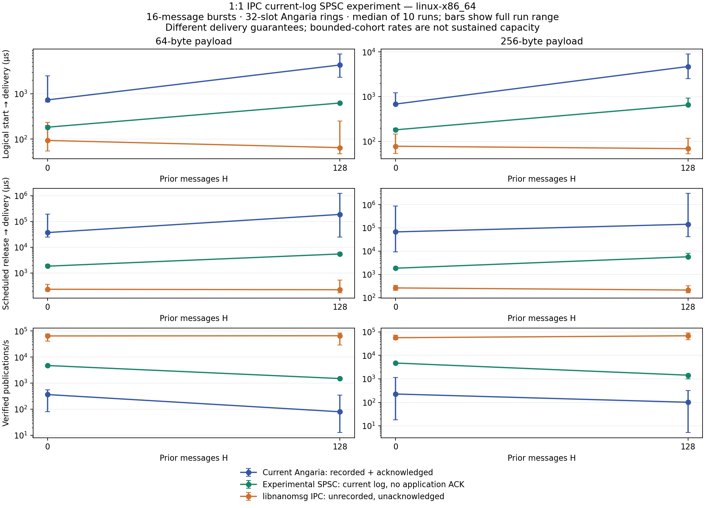
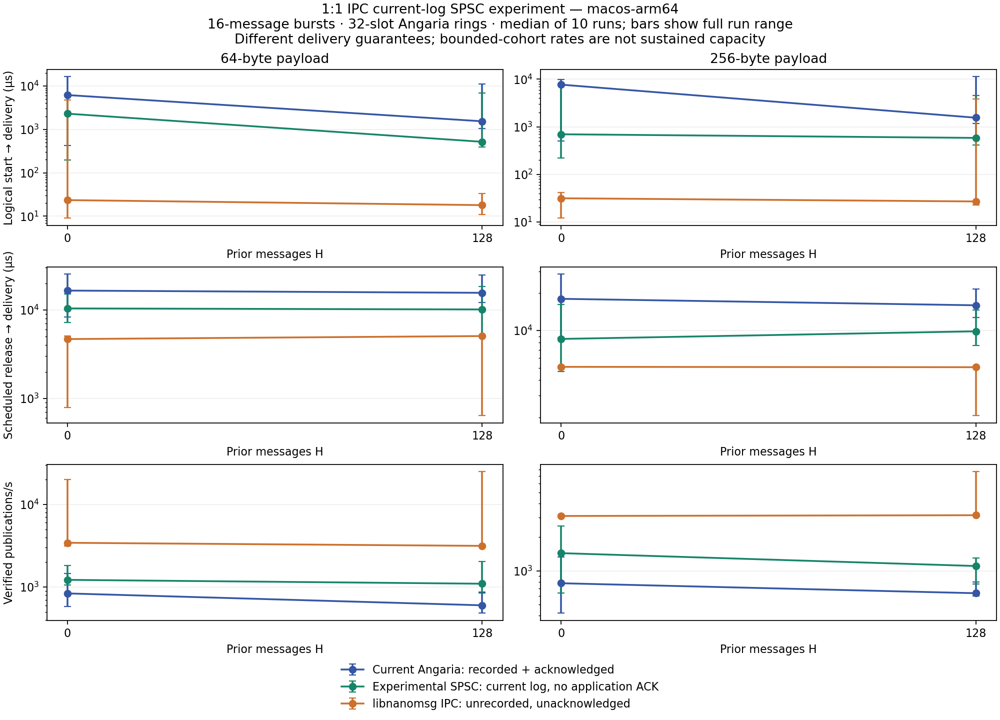
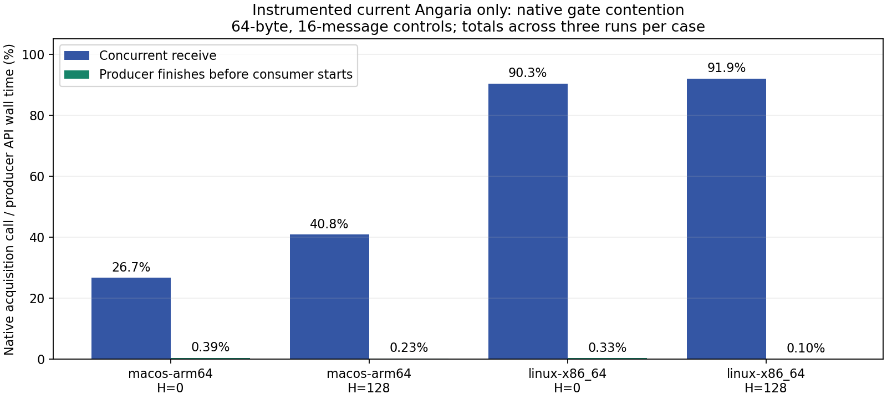

# Stall diagnosis and the current-log SPSC experiment

Raw samples and profiler payloads described below are retained in the maintainer archive, not this checkout. Reports, plots, summaries and provenance remain here. [Archive catalog and restore instructions](../README.md#restore-archived-evidence) identify snapshot `2026-11-28-332118be2291`; restore its payloads before running the verification or figure commands below.

Step **4.29**, framework **0.4.31**, provides a replay-preserving experiment with substantially better observed latency and completed throughput. On the hosted Linux 64-byte/H=128 case, the experimental path delivers **1,510 publications/s versus 80/s** for current acknowledged Angaria, while median logical-start delivery latency falls **4.32 ms → 0.63 ms**. The experiment removes consumer gate/receipt operations; it retains current producer ID issuance, validation and serialized log commit. It supplies no application processing acknowledgment.

## Ordinary latency and completed throughput

Each cell contains ten fresh 16-message bursts, alternating all three profiles in rotating forward/reverse blocks. H counts prior verified messages; Angaria retains them in the log, whereas nanomsg retains no replay history. Angaria rings have 32 slots. Tables show the median across per-run nearest-rank medians, or the median of per-run verified rates. Run ranges remain in the plots and [complete table](comparison.csv); none were discarded.

| Linux, 64 B | H | Logical start → delivery | Scheduled release → delivery | Verified publications/s |
| --- | ---: | ---: | ---: | ---: |
| Current Angaria, recorded/acked | 0 | 734 µs | 37.052 ms | 367 |
| Experimental SPSC, recorded/unacked | 0 | 184 µs | 1.831 ms | 4,764 |
| nanomsg IPC, unrecorded/unacked | 0 | 94 µs | 0.232 ms | 64,924 |
| Current Angaria, recorded/acked | 128 | 4,319 µs | 188.018 ms | 80 |
| Experimental SPSC, recorded/unacked | 128 | 626 µs | 5.453 ms | 1,510 |
| nanomsg IPC, unrecorded/unacked | 128 | 65 µs | 0.222 ms | 66,132 |

The experimental/current verified-rate ratios are **13.0× at H=0** and **18.8× at H=128**. These compare different acknowledgment contracts and different consumer implementations. They do not isolate the cost of an atomic instruction or acknowledgment call. Accepted-message logging remains mandatory in both Angaria columns. Nanomsg has neither that log nor processing acknowledgments in this profile.



Rates use common T0 through last verification. They are **bounded-cohort observations, not sustained capacity**. Scheduled latency retains the original release time for every burst message. This exposes early stalls that per-message logical-start medians can hide. Each cell has only 160 delivery observations/profile; production p99/p99.9 estimates are unavailable.

The local Apple M4 study independently improves the 64-byte/H=128 verified rate **600 → 1,095/s**, and logical-start latency **1.53 → 0.52 ms**. The result is less dramatic than Linux. Worker startup jitter has a roughly **5 ms** median on this Mac, imposing a substantial floor on short-cohort scheduled latency and rates, including nanomsg. The separately retained first-send-to-last-verification rate exposes that effect; it must not replace the common-T0 result silently. No cross-host samples are pooled.



## What causes the stalls

The separate instrumented current-Angaria controls distinguish local mutex acquisition, native `flock` acquisition, and gate-held work. The table divides summed native-acquisition-call time by summed producer ID/send API wall time across three diagnostic runs, using 64-byte/16-message cohorts. Native call time includes waiting/descheduling inside the call; it does not isolate kernel execution alone.

| Host | H | Concurrent receive | Producer finishes before consumer starts |
| --- | ---: | ---: | ---: |
| Linux x86_64 | 0 | 90.28% | 0.327% |
| Linux x86_64 | 128 | 91.91% | 0.102% |
| macOS ARM64 | 0 | 26.66% | 0.389% |
| macOS ARM64 | 128 | 40.84% | 0.234% |



The process-local mutex contributes only a small fraction of these producer intervals. On Linux/H=128, concurrent diagnostic consumers perform **1,277 empty polls and 1,464 prefix scans** across three runs; producer-first consumers perform **zero empty polls and 96 prefix scans**. Separate empty-wait controls, delivering no messages, hold the native gate for **299.6 ms across three 100 ms data windows** and perform **891 prefix scans** at H=128. These are internal gate/prefix counters, not estimates inferred from public receive-call counts.

Together, the direct native-acquisition observations, producer-first control and empty-wait work identify cross-process gate interference and repeated preparation as major causes of the observed stalls. The existing handoff preference is process-local. The prototype's consumer avoids that shared gate and per-message receipt mutations, and the ordinary runs show the resulting improvement under the explicitly weaker application-acknowledgment contract. Instrumented times are not substituted for ordinary performance measurements; gate-held intervals overlap other phases and are never added to their exclusive accounting.

A focused waiting/backoff change remains a candidate for the current acknowledged path. The prototype still slows as retained history grows because its producer uses the existing full preparation and shared append authority. Producer preparation/history reuse and the later producer-owned-log evaluation remain separate next steps. This PR changes no current admission/wait policy and supplies no starvation-free or hard-latency guarantee.

## Acceptance, replay and experimental limits

Public `QueueWriter::send` remains the acceptance authority. Every exposed payload is an immutable, permanently committed Publication in the original Session log. Separate ring cursors do not acknowledge application processing or change existing Pending receipts. The twelve prototype tests qualify real process termination after commit/before descriptor exposure and during a provisional append, live catch-up and owning replay, restart duplicates, ring credits/wrap, retained borrowed/owning messages, stale/malformed references and `LogFull`.

This is a fixed-topology, one-Queue current-log experiment. Native Task handles must outlive their experimental endpoints. Consumer restart begins at the connection's start and can duplicate application delivery. Catch-up may precede descriptor publication; a later receive drains the late descriptor and returns its credit. There is no reclamation, fan-out, multiple-input Source scheduling, public profile negotiation or power-loss durability. The [guide](../../../docs/stall-study.md) defines the mapping, lifetime, restart and qualification boundaries.

## Provenance and retained evidence

Measured source: **`c0fab0d4479ff60db9580e9a1cea9663f83e7ddf`**. Both hosts retain **150 attempts**: 120 ordinary concurrent comparisons, 12 ordinary backlog controls, 12 completed diagnostic delivery controls and six intentionally budget-limited empty controls. Every host verifies **2,304 deliveries**. All **136 source hashes in each leaf** match the measured checkout. Ordinary and diagnostic executables have distinct recorded hashes. Later figure/document changes do not change those measured inputs.

Linux uses GitHub-hosted Ubuntu 24.04, Intel Xeon 6973P-C, GCC/G++ 13.3.0 and Release `-O3 -DNDEBUG -g`. Local macOS uses Apple M4 ARM64, Apple Clang 21.0.0, Release optimization and the recorded strict warning/debug flags. All three local profiles use identical IPC-enabled execution permissions. Within each host, ordinary profiles share one executable/toolchain; instrumented builds and populations stay separate. Classic libnanomsg 1.3.0 remains statically pinned by exact commit, archive hash and runtime/header ABI.

[Hosted qualification and measurements](https://github.com/smangano/angaria/actions/runs/46077661240) pass on Linux x86_64, Linux ARM64 and macOS ARM64. The ordinary source CI passes its expanded 832-test suites. [Validation records](validation.json) preserve relevant log evidence. The public primer's seventeen runnable lessons were reviewed; the private prototype is not presented as a public unacknowledged API.

- [Mac study](macos-arm64/study.json), [Linux study](linux-x86_64/study.json): complete/incomplete attempt accounting and executable identities.
- [Mac raw study archive](../README.md#restore-archived-evidence), [Linux raw study archive](../README.md#restore-archived-evidence): all manifests, source hashes, commands, process/control output, message rows and diagnostic CSVs.
- Each host directory also retains five scoped compressed report files, manifests, and outcome/summary CSVs. No Sessions or IPC socket files are retained.
- [Derived measurements](comparison.csv), [diagnostic totals](diagnostic-findings.json), and [reconstruction/plot script](generate_figures.py). Retained CSV/SVG text has normalized whitespace; raw archives preserve original files.

Build and collect another study using the [guide](../../../docs/stall-study.md). With Python and Matplotlib, recreate plots from retained evidence:

```sh
python3 -B benchmarks/results/milestone-4-stall-study/generate_figures.py
```
