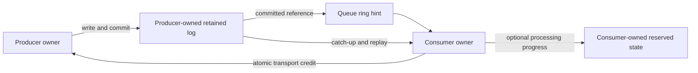

# Independent messaging protocol: step 1 design

**Status: design for review, not implemented.** Milestone 4 step **4.30**, framework **0.4.32**, supplies step 1 of the [recorded messaging performance plan](recorded-unacknowledged-delivery-plan.md#implementation-steps-for-review). It specifies ownership, acceptance, delivery and processing-progress boundaries before new codecs or runtime code are written. The existing public runtime still follows its documented Session-gated protocol.

The first implementation is bounded, fixed-topology, local point-to-point messaging. Every acceptance is recorded. Application acknowledgment is configurable and remains enabled by default. Independent connections acquire no common Session lock and change no common Session transaction state while communicating. Independent means disjoint producer-stream and consumer/Source owners; sharing a Source, producer stream or fan-out acceptance group legitimately shares that group's scheduling and backpressure.

Before 1.0 there is no backward-compatibility requirement. The proposed native storage format is **3.0**, with a new synchronization revision. Step 2 fixes its byte layouts and identifiers. Public admission replaces the old engine and requires fresh Sessions; it adds no old-format reader, migration utility or long-lived dual-engine switch. Unsupported formats are rejected before mutable access. Pinned source revisions retain historical benchmark reproducibility.

## 1. Chosen boundaries

| Question | Decision for the first protocol |
| --- | --- |
| Log owner | One logical producer Task owns one append stream, shared by its outbound Queues. One native owner serializes that stream's operations. |
| Acceptance authority | One aligned atomic committed tail in that producer's log. The tail is the end of the immutable accepted prefix, not the physical file size. |
| Allocation | A separate preallocated file per producer. No per-message file growth, mapping creation, Session allocation or global byte-counter update. |
| Ordering | Producer append order and per-Queue accepted order. No Session-wide commit ordinal. |
| Identity | Caller-visible publication ID issued from owner-local memory within a persistently distinguished Task incarnation. |
| Transport credit | Logical accepted Queue sequence versus consumer-returned Queue sequence. Descriptor publication is a hint, not acceptance or credit authority. |
| Processing progress | Consumer-owned, reserved Source operation storage and per-Queue receipt rows. Producers never mutate consumer receipts. |
| Topology | Establish and seal the supported Registry/schema/topology snapshot before data operations. No live topology mutation or destructive reconfiguration in this first profile. Task replacement does not reseal the Session or stop unrelated connections. |
| Offline destination | A configured destination may accept while its consumer is offline, within its available credit and reserved storage. Acceptance does not assert consumer liveness. |
| Unacknowledged replacement | Replay from the retained Queue beginning by default; duplicates across consumer replacement are allowed. Transport credit never proves application processing. |
| Acknowledged replacement | Preserve acknowledged progress, release an old pin to Pending, and redeliver nonterminal work with a new consumer token. |
| Initially supported delivery policy | Recover from log. `AllowLoss` returns `UnsupportedPolicy` until a separate implementation qualifies its loss/gap rules. |
| Failure scope | Process termination on a running system with coherent local mappings. No per-message disk flush or power-loss durability work. |
| Retention | Never overwrite committed message bytes or reuse receipt rows in this profile. Reject at the configured byte/record bound; rotation/reclamation is later work. |

These restrictions keep the first protocol small. Source selection across several inputs, Publishing fan-out/partial retries, live topology changes, notification transports and reclamation remain separately reviewed extensions. Their ownership must not reintroduce a Session data-operation gate.

The Session creates and identifies these resources during setup. It is absent from the data-operation arrows.

## 2. Setup, files and capacity

Creation validates TOML through cpptoml, resolves schemas and policies, creates stable native claim files, reserves storage, and publishes a sealed Registry/catalog. Endpoints validate the catalog and open/map their resources once. Cached codecs and checked metadata belong to the endpoint lifetime. Schema definitions needed by retained messages remain available for the retained Session lifetime.

The file separation is logical and intentional; exact names and byte offsets become the step-2 codec contract:

| Resource | Owner and contents |
| --- | --- |
| `session.ang` | Sealed Session identity, Registry/schema/topology catalog, capacities and resource directory. The administrative gate is used for construction and inspection of administrative state only. |
| `claims/task-<id>.lock` | Stable native Task lifetime claim. A live paused owner retains its claim and cannot be displaced by a timeout. |
| `owners/task-<id>.ang` | Reserved Task incarnation/control state, updated only under that Task's exclusive claim. |
| `producers/task-<id>.ang` | Immutable stream header, producer-owned atomic committed tail, and reserved append bytes. Consumers map immutable committed data read-only. |
| `connections/queue-<id>.ang` | Fixed ring descriptors and separately aligned producer/consumer atomic communication words. |
| `progress/source-<id>.ang` | Reserved Source operation images, working progress rows and per-message latest receipt rows for acknowledged mode. Only the consumer owner accesses their bodies. |

Each producer has a byte quota and a **publication capacity**, the maximum number of accepted publication records retained in its first bounded stream. Queue sequence numbers therefore fit that producer's publication capacity. Every acknowledged outbound Queue reserves that many receipt rows. This can overreserve space when traffic is uneven; the first protocol accepts that explicit space cost to remove allocation and resizing from delivery progress. Unacknowledged Queues reserve no processing-receipt ledger.

Creation accounts for all producer file reservations, Registry/catalog bytes, rings, owner controls and acknowledged progress storage against declared limits. A Queue's ring capacity is a separate transport-credit limit. All additions/multiplications and host address conversions are checked before publication. Producer-local ID indexes and receiver lookup caches have reserved, bounded sizes derived from these capacities; no unbounded hidden acceptance ledger is permitted.

Also bound file descriptors, mapping count and mapped address bytes per process. A consumer reuses one read-only producer mapping across inputs from that stream. File length remains its reserved capacity; committed length advances separately. Initial storage reservation must use the qualified platform allocation path and fail creation if it cannot establish the supported backing. Mapping and atomic binding failures occur at open, before the endpoint starts data work. Later segmentation needs its own quota, mapping and peer-discovery transition; it is not a hot-path fallback.

Producer-tail, consumer-credit and owner-control words occupy distinct 256-byte-aligned regions in the proposed layout. Qualification checks this spacing against the supported native profile; it must not assume all hosts have a 64-byte coherence line. The implementation copies only the meaningful bytes of a progress image, not arbitrary maximum-capacity padding. Measure cache traffic and snapshot-copy cost before tuning the spacing further.

## 3. Native ownership and reader rules

Task claims remain the authority for exclusive process/thread ownership. A Thread Task retains its parent Process claim. Each endpoint is bound to its opening thread; application code coordinates threads or uses separately owned Thread Tasks instead of concurrently invoking one stream/Source. A local endpoint table rejects duplicate opens that would create a second writer. These ownership rules are established at open and checked with local captured process/thread context during operations; there is no per-message native claim acquisition or Session resource scan.

Reacquiring a Task advances its persisted incarnation before endpoints open. Use two bounded owner-control images and one atomic generation/slot selector: prepare the inactive image, publish the selector, and apply the qualified control-publication fence before reuse. Only the exclusive Task owner or its successor reads/writes these image bodies. Consumers identify a publication by the claim stored in its immutable record; they do not inspect another Task's live control image. Incarnation exhaustion fails attachment rather than wrapping.

All concurrently accessed mutable words use the qualified native atomic adapter, including ring descriptor words. Ordinary `std::atomic` fallback locks or plain accesses to live words are not an interprocess qualification. Release/acquire orders visibility; it does not flush storage. Existing native control-publication ordering is reused for selectors that guard reusable storage.

| Bytes | Permitted readers |
| --- | --- |
| Sealed catalog and committed message records | Any qualified endpoint holding the mapping, after checking identity/bounds and acquiring the required committed tail. |
| Ring descriptors, credits, committed tails and optional progress hints | Through native atomic accessors only. |
| Task control and Source operation/working/receipt bodies | Sole current owner; successor only after native exclusive ownership is obtained. |

Two buffers plus a selector are **not** a license for plain concurrent peer reads: the writer could reuse a slot while a peer copies it. Producers do not read Source image/receipt bodies. Initial live inspection reads immutable logs and atomic hints; an exact processing-progress snapshot requires cooperation from the Source owner or quiescent exclusive ownership. Holding a Session lock alone establishes neither.

## 4. Producer recording and acceptance

A stream header binds Session identity, producer Task, reserved byte/count capacities, format and synchronization profile. The tail initially equals the data-area beginning. Only the producer owner changes it, and it never decreases.

Each record contains its complete bounded length, stream position, producer claim/publication ID, exact logical publication header, schema/catalog identity, payload bytes, and ordered destination outcomes. An accepted destination includes Queue identity, Queue sequence and enqueue time. Record bytes also contain enough framing to walk forward to the next record. There is no Session manifest or global operation generation. Step 2 defines canonical encodings and padding; native C++ structs are never copied as wire layouts.

The producer performs one serialized attempt:

1. Resolve an already accepted ID before considering a new append. For a new ID, validate owner, message/schema bounds, destination snapshot, output capacity, byte/count quota and connection credit. Prepare all fallible result/index storage before acceptance.
2. Assign the next Queue sequence for each accepted destination, using producer-local caches derived from the committed stream. For `AllDestinations`, any known rejection leaves this new publication unaccepted. The first point-to-point profile has one destination.
3. Materialize the complete immutable record at the current committed tail. Do not publish its descriptor or advance acceptance state while it is incomplete.
4. Release-store the record's end into the producer's committed tail. **This single store accepts the message.** Accepted record bytes in the data area below the new tail are thereafter immutable; the control header still contains the mutable tail.
5. Install the prepared local lookup/counter state, publish destination descriptors where still useful, and return the recorded outcome. No postcommit allocation or semantic validation may turn acceptance into a known rejection.

A consumer first acquire-loads the tail, then reads only complete records covered by that acquired boundary. A descriptor alone is never sufficient. A crash before the tail store leaves an unaccepted suffix; the successor can overwrite only that suffix, without truncating the reserved file. A crash after the store leaves an accepted record, regardless of descriptor or return-value publication.

Counters and lookup caches are derived state. On producer replacement, scan and validate that producer's committed prefix once, rebuild its accepted-ID index and per-Queue sequence caches, and ignore the unaccepted suffix. No second persisted counter is required to agree atomically with acceptance. Recovery does not take another producer's lock or the Session administrative gate.

`LogFull` identifies byte or publication-count exhaustion before acceptance; diagnostics identify the exhausted bound. Unsupported policy, invalid identity/schema and insufficient output capacity also fail before acceptance. Storage/access failure with unresolved commit evidence returns uncertainty or closes the affected endpoint; it cannot invent a known rejection. No claim is made about power-loss recovery or external mutation of live files.

## 5. Publication identity and uncertain results

Keep `PublicationId = (Session, producer Task, incarnation, sequence)` and let the caller retain it before send. `next_publication_id()` increments a nonwrapping owner-local counter; it does not append or journal. Gaps are valid. Every ownership reacquisition has a new persisted incarnation, so losing an uncommitted local counter cannot reuse an old identity.

New acceptances use issued IDs from the current claim in increasing sequence order. Issuing several IDs does not permit an older unsent ID to be accepted after a newer one. An already accepted ID is resolved first, regardless of that ordering check. An old-incarnation ID can be queried, but cannot create new acceptance. These rules replace the old retirement machinery rather than keeping a compatibility path.

An accepted-ID retry compares the original request's meaningful input header fields, including schema and payload format, exact payload bytes/flags, and original endpoint/destination snapshot, returns the existing outcome, and appends nothing. Different request content is `Conflict`. The bounded owner-local accepted-ID index is rebuilt at attachment and updated from preallocated storage after commit. A same-owner error settles its attempt against the acquired committed boundary before accepting another append.

Absence from a log is not a known rejection while another live/paused attempt could still commit. Actor-owned settled lookup, or recovery after obtaining the ended owner's claim, can prove nonacceptance. Cross-owner inspection of an unresolved live attempt reports unknown/in-progress instead. Death after commit but before the caller sees success remains an accepted ID discoverable after restart. Exactly-once external application effects are not promised.

## 6. Logical credit and descriptor rings

For a Queue, let `A` be its last accepted sequence, `C` its monotonically returned transport-credit sequence, and `K` its ring capacity. The sole producer may accept `q = A + 1` only when `q - C <= K`, using checked nonwrapping arithmetic and validated bounds. Producer caches are reconciled after a commit before preparing the next attempt. Consumers can advance `C`; they cannot consume credit from another producer. An offline consumer is eligible until this bound is reached.

The ring slot for `q` contains its publication reference, record end and Queue sequence stamp. All live slot words use native atomic access. The producer writes the reference words and release-publishes the stamp. The consumer acquire-loads the stamp and verifies its expected Queue identity/sequence, generation and committed record range before exposing a view. A slot is reused only after its previous logical sequence has credit returned. It never owns the payload.

The descriptor fast path is allowed only for an expected sequence **greater than the already returned credit watermark**. That slot cannot yet be reused, and the consumer finishes copying its descriptor before returning credit. For replay/redelivery at or below the watermark, bypass the ring and resolve the immutable log: a producer is free to reuse that slot, and reading its old stamp could otherwise race with rewriting the reference words. Atomic words alone or a second stamp read do not make such a credited slot a stable snapshot.

There is no descriptor head/tail occupancy calculation that can contradict log catch-up. The consumer returns logical credit only after it has finished reading the descriptor and established its own delivery/reference state. It never advances a transport tail past an unpublished head. Producer and consumer communicate the accepted/consumed sequence, not a count of descriptor writes that happened to complete.

If a descriptor is missing, the consumer examines newly committed records from its cached stream scan position, with a bounded scan batch per receive attempt. It checks destination rows and each input's next Queue sequence; it does not scan the retained prefix on every poll. No new committed bytes means an atomic-tail check and ordinary timeout/wait handling, with no Source progress transaction. The one-input/one-output case encounters its next record directly. Streams shared by several outbound Queues can require scanning new records for other destinations; that is explicit work within the shared producer scope, not a history-independent claim for arbitrary routing.

Every consumed message advances that Queue's forward scan position to its record end, including a message reached through a ring hint. Otherwise the first missing hint would rewalk history already delivered through the ring. Keep this position per input Queue; a future Source must not skip another input's messages by sharing one scan cursor across several Queues from the same producer. Repeated delivery of a current/released acknowledged pin resolves its stored immutable reference rather than scanning backward.

This also handles a producer paused after commit but before descriptor publication. Consumers may discover and consume that accepted record without taking over the live producer. On resume, the producer may skip an already credited descriptor. If a late descriptor is written during the credit race, the consumer ignores its already consumed Queue sequence; it cannot redeliver it or return credit twice. The immutable log reference remains safe through ring wrap.

Admission uses logical credit even when catch-up wins the race. Deriving credit from a descriptor head would be incorrect here. Failure tests must force both the late-write race and multiple wraps, rather than relying on the producer/consumer usually running in order.

## 7. Recorded delivery without application acknowledgment

The Source caches its next delivery/scan positions locally and returns a `MessageView` without a processing token. It prepares the complete header and cached decoding context, establishes the local borrow, then returns logical credit with the appropriate release ordering. Receiving is not certification that the application processed the message. There is no per-message processing receipt or Source commit image for this mode.

The view's public borrow ends on the next receive invocation, including timeout/error, or explicit Source close/destruction. Committed bytes remain retained, but applications use `copy_message()` to keep a message beyond the borrow contract. Copying preserves the exact header observed at delivery and the dependencies needed to decode the payload. Copying a span does not extend a borrow.

On consumer replacement, the default starts delivery at the retained Queue beginning. It can duplicate previously received/processed messages; the new header records the new consumer/dequeue observation. Credit never decreases: replay at or below the previous credit watermark does not return it again, while newly consumed sequences advance it. Thus replacement can recover old accepted messages even if their descriptors have wrapped. A start-at-tail/resume-bookmark option is a separate explicit policy, not an inferred processing acknowledgment.

## 8. Optional acknowledged progress

Acknowledged Sources return `Delivery` with a `MessageView` and exact `DeliveryToken`. Their immutable message storage and acceptance protocol are identical to unacknowledged delivery. Recoverable progress remains available when message storage is full.

### Reserved state

Each acknowledged Source reserves:

- Current Source state: consumer context, issuance counter, at most one in-flight pin/token/dequeue time, and bounded scheduling state.
- Per-input Queue progress: contiguous acknowledged watermark, oldest pending/scan position, returned-credit repair value and last acknowledgment time with presence.
- Per-Queue receipt rows indexed by accepted Queue sequence. A zero row means never-issued Pending for an accepted destination. Rows retain the latest issuance/dequeue and terminal acknowledgment metadata, including after release or replacement. They do not contain message payloads.
- Two bounded operation images, an atomic generation/slot selector and an atomic applied-generation word.

This preserves per-message latest receipt inspection; it is not an unlimited event history. Returning to a released message can produce a later issuance/dequeue observation. Recording every historical receive/release event still belongs to the optional trace. Receipt capacity is reserved at setup, and rows are never reclaimed in this first protocol.

### One local progress commit

An operation image describes only the affected Source state, one selected Queue progress row and one receipt row, including their absolute after-values and identities. It is not a generic Session redo-command engine and does not copy the whole retained ledger or maximum-sized Source table for each operation.

The sole consumer owner:

1. Finishes any previously selected operation whose applied generation lags. Validates the current claim/token and prepares the local return value and borrow before mutation.
2. Writes the complete next image to the inactive slot. It includes the next nonwrapping generation and exact captured timestamps.
3. Publishes the atomic selector with the qualified control-publication primitive. **This selector store commits processing progress.**
4. Applies the primitive's full ordering barrier before dependent writes or reuse of the previously active slot. Installs the selected image's absolute after-values into the reserved working/receipt rows.
5. Publishes applied generation only after the complete installation, with the required reuse ordering. Repairs/publishes derived atomic credit or acknowledged-watermark hints, then returns the prepared result.

The owner must complete installation before beginning another operation image. A successor first obtains exclusive Task ownership, reads the selected complete image, and reapplies its absolute after-values if installation was interrupted. An inactive image is never promoted just because it looks complete. Invalid identities/generations fail the affected owner closed. No peer reads partially installed plain rows, and no retained-message scan is required to repair the selected operation.

Applied generation certifies row installation, not hint publication. Attachment and uncertain-operation settlement must therefore reconcile credit/acknowledgment hints from the committed working rows even when applied generation already equals the selected generation. Use monotonic, bounds-checked updates; never decrease a returned credit or publish acknowledgment beyond committed progress. Recovery visits all inputs owned by that Source, not merely the last image's selected Queue. This is bounded by configured input count and closes the crash-after-applied-before-hints gap.

Crash before selector publication leaves the old state authoritative. Crash after publication commits the new state, including its original timestamps, even if installation or the return was interrupted. The two-image reuse fence and applied-generation ordering must be qualified by real process interruption, including the next operation starting to recycle the old slot. Release/acquire alone must not be assumed to cover reuse of the previously authoritative bytes.

### Operation behavior

| Operation | Committed effect |
| --- | --- |
| Fresh receive | Select the Queue's oldest nonterminal message, assign a new Source issuance/dequeue time, install matching Issued receipt and pin, then return `Delivery`. Return transport credit only after this commit; recovery repairs an interrupted credit return. |
| Receive while pinned | Return the exact same token, dequeue time and payload view. Do not reschedule, issue a new counter or journal another operation. |
| Acknowledge | Require the exact pin/token; mark the receipt Acknowledged, advance its Queue's contiguous terminal watermark, capture acknowledgment time with presence and clear the pin in one local operation. |
| Release | Require the exact token; restore Pending and clear the pin while retaining historical issuance/dequeue fields. No acknowledgment advance occurs. |
| Close | Release any pin, preserve counters/progress, and end the borrow after a settled commit. Idle close needs no progress write. |
| Replacement | Repair the selected operation first, preserve terminal progress, and release a predecessor pin to Pending. Fresh issuance uses the new consumer claim; predecessor tokens cannot complete it. |

Use the [current receive](native-receive.md) and [progress](native-progress.md) documents as the semantic test matrix, not as a requirement to retain their journal/layout. Preserve unchanged-state failures that leave a borrow valid, uncertain progress that invalidates the borrow until settled, epoch-zero/negative timestamp values with explicit presence, parent/incarnation checks and nonwrapping counters. Reserve a terminal-resolution generation before fresh issuance so generation exhaustion does not strand a newly issued pin. Repeated receive of an existing pin remains available when fresh issuance is exhausted.

Credit and acknowledgment are separate. Credit is monotonic even after release or replacement redelivery of an older sequence. Producers may read a separate atomic acknowledged-watermark hint after committed progress, but never infer acknowledgment from credit. A hint may lag a paused consumer after commit; exact receipt inspection uses the owner/cooperative snapshot. No promise of immediate peer notification is inferred from the local commit.

The first point-to-point Source has one input. A future multi-input Source retains one pin, adds bounded scheduling changes to the selected image, and still changes only consumer-owned progress. Allowed loss needs a separate design for loss ranges, receipt history and issued pins; it is rejected until that work exists.

## 9. Recovery and lifetime summary

| Interruption | Authority and action |
| --- | --- |
| Record partly written, committed tail unchanged | Unaccepted suffix. Producer successor reuses it after validating its own committed prefix. |
| Tail advanced, descriptor absent, producer live but paused | Accepted. Consumer discovers the newly committed range without owner takeover. |
| Tail advanced, caller missed result | Accepted ID/outcome is recovered from that producer's log. No duplicate acceptance on identical-ID retry. |
| Consumer catches up before a late descriptor | Queue order and logical credit prevent duplicate live delivery; late hints have no authority. |
| Unacknowledged consumer exits after returning credit | No processing certificate. Retained messages remain replayable; replacement may duplicate. |
| Inactive Source image partly written | Old selected operation/working state remains authoritative. |
| Source selector committed, rows partly installed | Selected absolute after-values are replayed by that Source's successor. |
| Issuance committed, credit not returned | Pin/operation evidence repairs the monotonic credit; application delivery may repeat after replacement. |
| Acknowledgment committed, reply/hint absent | Acknowledgment survives process exit; replacement preserves the watermark and original timestamp. |
| Paused owner, full connection or local recovery | That scope may stall. Disjoint established owners never acquire its lock or the Session administrative gate. |

Unrelated owners still share real host resources such as CPU, memory bandwidth and storage writeback. Independence removes software-wide serialization; it is not a hard latency or starvation-freedom guarantee.

Producer restart rebuilds bounded owner-local indexes from its retained prefix. Source repair uses its reserved selected image and fixed rows, not all publication payloads. A Source can cold-scan its input stream to rebuild delivery lookup positions; repeated ordinary calls thereafter continue from cached positions. Acknowledged next-pending selection follows its Queue watermark/pin, not an unbounded successor search on every acknowledgment.

Retained logs and catalog keep borrowed bytes/decoding references stable for the Session lifetime. Neither ring wrap nor credit nor acknowledgment frees them. Deleting or rotating a live Session is unsupported until a reclamation protocol exists. Closing endpoints can release local mappings only after their advertised borrows end; owning `Message` copies retain their own bytes and decoding context.

## 10. Ordering, replay, inspection and API impact

Message replay enumerates committed records within each producer and preserves each Queue's accepted order and recorded destination outcomes. Capture across producers records a vector of committed-tail cuts, not a fictional global transaction number. A timestamp/deterministic merge is an inspection convenience, not proof of execution order. Optional execution tracing can later retain exact Source selection/delivery observations with its own cost and retention contract.

The logical `MessageHeader` remains consistent in `Message` and `MessageView`, including timestamps, identities and destination context. Copies preserve the observed header rather than recomputing it from later receipts. Acknowledged `Delivery` continues to carry the processing token. The unacknowledged receive surface returns a message view with no token obligation; public names/signatures are reviewed at admission rather than pretending the current headers already implement it.

Configuration needs explicit producer log byte/publication capacities and Source acknowledgment mode, with `required` as the default and `none` as the opt-in mode. These are proposed TOML settings for the new version, not keys accepted by the current loader. Unsupported storage, notification, loss or Queue Set combinations fail before activating endpoints. Do not silently accept old TOML/API shapes merely to preserve pre-1.0 compatibility.

Live message-log inspection can read acquired immutable prefixes while messaging continues. Receipt inspection/export obtains a Source-owner snapshot or quiescent ownership and records that cut; a Session lock cannot make its plain mutable rows safe. The new inspector/primer must explain that distinction. Full receipt history remains bounded by reserved accepted records; full execution-event history is optional.

## 11. Required evidence and next implementation boundary

Step 2 implements reviewed codecs and independent byte fixtures, not the entire runtime. Subsequent append, delivery, recovery and acknowledgment PRs must qualify their own boundaries as they become executable.

Every implementation step includes and runs either a focused performance unit test or a full matched benchmark against nanomsg, selected for its scope and reported in that PR. For example, codecs measure bounded encode/decode cost, producer append measures commit latency/throughput across retained-history sizes, and Source progress measures issue/acknowledge/release cost. Once a changed messaging path is runnable, use matched end-to-end latency and verified throughput comparisons for material path/policy changes. Retain baselines and results, state the expected direction, and investigate unexpected regressions before integration. This design-only step defines the checks; it adds no runtime path or speedup claim. The consolidated pre-admission evidence must also include:

- Native atomic/profile qualification on Linux x86_64, Linux ARM64 and macOS ARM64; macOS x86_64 by request. Incompatible version/profile/policy rejection precedes mutable access.
- Real termination before/after the committed tail; live pause after commit; late-descriptor/credit races; multiple wraps; full byte/count/credit limits; same-ID retry conflicts and uncertain-result recovery.
- Real interruption at every Source image/selector/installation boundary, including slot reuse, original timestamp replay, log-full progress, close/replacement cleanup and stale tokens.
- Two or more disjoint producer/consumer pairs progressing while the Session gate is held or another pair is paused, full or recovering. Exercise both acknowledgment modes, ID issuance, empty receives and normal outcome lookup.
- Zero Session gate acquisitions/common transaction writes, per-message file growth/mapping creation, full-prefix scans or topology rebuilds in ordinary admitted operations. Catch-up scans only newly committed ranges in bounded batches; cold replay/recovery is separately measured.
- Matched ordinary end-to-end latency and verified throughput, warm steady streams and short bursts reported separately, retained-history sensitivity, saturation/slow-reader behavior and CPU cost. Publish plots against pinned baseline/current-log experiment and explicitly different-contract nanomsg. Diagnostic/native/cache counters explain measurements; they do not replace them.
- Primer, API, TOML, inspector/export and current storage docs switch together when the old runtime is removed. The seventeen current primer lessons remain current-runtime examples until then; no nonworking new protocol example is presented as runnable.

Risk assessment: the first protocol trades fixed reservation and offline recovery scans for bounded ordinary work, and frozen topology for simpler ownership. It preserves latest per-message processing receipts at an explicit storage/copy cost in acknowledged mode. It accepts no power-loss guarantee and no synchronous notification guarantee from atomic progress hints. These are named scope choices to measure and review, not reasons to add a Session-wide fallback to messaging.
