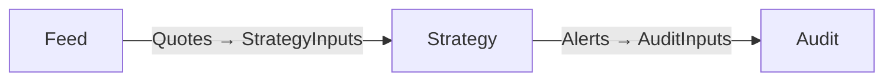

# A native multi-process market monitor

Lesson 17, milestone 4 step 4.10, framework **0.4.12**, connects three independent C++ processes through Angaria's mapped Queues. Feed produces Quotes, Strategy checks each price against a fixed threshold, and Audit receives the resulting PriceAlerts. Setup creates their shared Registry once, then exits.



There are two Queues and two consumer-owned Source Queue Sets. Each Source has one Active Queue, matching the current implementation. Strategy is both a consumer and a producer; these are two roles in the same logical Task. Source selection among several inputs follows in milestone 5, and Publishing fan-out follows in milestone 6.

## Read the public application

| Source | What it demonstrates |
| --- | --- |
| [17_native_pipeline.cpp](../examples/primer/17_native_pipeline.cpp) | Command-line validation and reporting the original Error code, path, and message. |
| [native-pipeline.toml](../examples/primer/native-pipeline.toml) | Four named Tasks, two Queues/Sources, seven Fields, three exact schemas, ring capacity two, and recovery delivery. |
| [producers.cpp](../examples/primer/native_pipeline/producers.cpp) | `Session::create_from_file`, named attachment/writer setup, schema-driven encoding, explicit publication IDs, same-ID outcome resolution, and retained acceptance lookup. |
| [consumers.cpp](../examples/primer/native_pipeline/consumers.cpp) | Named Sources, finite receive waits, complete MessageHeader inspection, owning copies, exact decoding, release/redelivery, stale tokens, forwarding, acknowledgment, and explicit close. |
| [roles.h](../examples/primer/native_pipeline/roles.h) | Application command declarations and small domain constants. It contains no configuration or Result wrappers. |

Every fallible Angaria call has a visible Result/Error check. The role functions organize this application; the actual Session, Task, codec, and endpoint calls remain in their source files. The application uses public headers and APIs, with no private crash hooks, fabricated records, or test-only counter edits.

## Run the complete walkthrough

Build using the [README instructions](../README.md#build-and-test). The application also builds with `BUILD_TESTING=OFF`; Python is needed only for the coordinator below. Give the coordinator a new workspace path whose parent already exists:

```sh
primer_workspace=$(mktemp -d "${TMPDIR:-/tmp}/angaria-primer.XXXXXX")
python3 test/native_pipeline.py ./build/angaria_primer_17_native_pipeline \
    examples/primer/native-pipeline.toml --workspace "$primer_workspace/17-market"
```

The coordinator reserves that new workspace, copies the TOML file into it, and leaves the Session and role transcripts available for inspection. It refuses an existing file, directory, or dangling symlink. Omitting `--workspace` runs in a temporary workspace and removes only that temporary workspace afterward. CTest runs the same public commands as `native_pipeline`.

Expected summary:

```text
Recovered six quotes across ring wrap and Feed/Strategy replacement.
Decoded exact Quote v1/v2 layouts and audited six linked alerts.
Release/redelivery rejected the old token; cold lookups preserved acceptance.
Initialization, ownership, CLI, and workspace conflicts preserved existing data.
EOF before forwarding leaves the Quote available for replacement.
Native pipeline passed.
```

A retained run also prints its workspace location. Read `logs/feed-original.log`, `logs/feed-replacement.log`, `logs/strategy-original.log`, `logs/strategy-replacement.log`, and `logs/audit.log` for the individual roles. Status and rejected-command diagnostics have their own logs. A separate `eof-control` Session and its logs demonstrate clean abandonment before forwarding, followed by replacement processing.

The complete run proceeds as follows:

1. Setup creates `market-session` next to the copied TOML. All three business Tasks are registered before their processes attach.
2. Feed publishes Quotes 1–4 while Strategy is offline, then reports that its sends completed. The ring holds only the latest two references, but all four messages remain in the log.
3. Strategy receives Queue sequence 1 from that backlog, copies its complete header and bytes, and pauses **before forwarding or reserving an output publication ID**. The coordinator terminates this Strategy and the original Feed only after their explicit readiness messages.
4. A replacement Feed attaches to the same logical Task and publishes Quotes 5–6. Its incarnation advances and its publication sequence starts again at 1. The Quotes Queue sequence continues from the prior producer's messages.
5. Audit and the replacement Strategy run as independent live processes. Replacement first restores the unfinished input delivery. Strategy deliberately releases that first borrow, receives it with a new token, and verifies that its old token is stale. It then decodes and forwards all six Quotes, acknowledging each input after its PriceAlert is accepted.
6. Audit receives and acknowledges the six PriceAlerts. After all business processes exit, separate status commands query retained Feed and Strategy identities. The killed Strategy's first incarnation has no accepted output.

Pipes coordinate readiness and termination; they do not carry Quotes or PriceAlerts between the application roles. Message bytes travel through the two Angaria Queues. Each readiness wait, child wait, and receive wait is bounded. No arbitrary delay stands in for a completed send or an acquired borrow.

## Understand the schema and identity output

Quote versions 1 and 2 both contain 16 bytes. Version 1 stores PriceTicks then Quantity; version 2 stores Quantity then PriceTicks. Strategy selects the exact schema from the received MessageHeader before interpreting either value. Equal byte lengths cannot identify a schema.

The automated run produces these business values:

| Input Queue sequence | Quote version | Feed incarnation / publication sequence | PriceTicks | Quantity | AboveLimit |
| --- | --- | --- | --- | --- | --- |
| 1 | 1 | 1 / 1 | 10001 | 10 | false |
| 2 | 2 | 1 / 2 | 10002 | 20 | false |
| 3 | 1 | 1 / 3 | 10003 | 30 | false |
| 4 | 2 | 1 / 4 | 10004 | 40 | true |
| 5 | 1 | 2 / 1 | 10005 | 50 | true |
| 6 | 2 | 2 / 2 | 10006 | 60 | true |

The threshold is 10004 price ticks. This small monitor emits one PriceAlert per Quote, including prices below the threshold. It is a transport example rather than an order-execution system.

A PriceAlert carries the original Feed Task, incarnation, publication sequence, input Queue sequence, price, quantity, and Boolean comparison result. Its 43-byte Binary body links the derived message to its input. All participants share one Session, whose identity Setup prints; that Session identity completes the original publication identity. Strategy's outgoing MessageHeader has its own publication identity. Audit prints both the incoming Strategy identity and the Feed provenance from the payload.

The `HEADER` report displays publication, enqueue, and dequeue timestamps as signed nanoseconds. The copied Message keeps the complete original header unchanged. Release ends the old borrow; redelivery gets a new token and dequeue context, while the owning copy remains usable. The example checks identity and presence rather than assuming that UTC timestamps strictly increase.

## Try the roles yourself

For a smaller run without termination, use a different fresh Session. These commands run the business processes one after another, so both Queues demonstrate retained backlog:

```sh
manual_workspace=$(mktemp -d "${TMPDIR:-/tmp}/angaria-manual-market.XXXXXX")
cp examples/primer/native-pipeline.toml "$manual_workspace/settings.toml"
configuration="$manual_workspace/settings.toml"
./build/angaria_primer_17_native_pipeline init "$configuration"
./build/angaria_primer_17_native_pipeline feed "$configuration" 1 6
./build/angaria_primer_17_native_pipeline strategy "$configuration" 6
./build/angaria_primer_17_native_pipeline audit "$configuration" 6
./build/angaria_primer_17_native_pipeline status "$configuration" Feed 1 1
```

`feed FIRST COUNT` chooses deterministic example values; numbers and counts are limited to 1..1000, and the complete range must fit. Invalid command-line syntax and out-of-range counts reject before attaching to the Session. `feed --hold` pauses after completed sending. `strategy --hold-first` pauses after borrowing the first input and before creating any output; Enter permits processing, while EOF abandons that run without forwarding. The automated walkthrough uses those pauses to terminate the exact owners at known application boundaries.

The `status` command must attach to the requested logical sender Task. That attachment advances its current incarnation even though the subsequent lookup does not alter the recorded acceptance. A competing live owner returns `OwnershipBusy`. The numbers printed in the STATUS line identify the requested old publication, not the new status process's claim.

## Recovery boundaries

Sending a PriceAlert and acknowledging its Quote are two commits. This walkthrough kills Strategy before forwarding, so its replacement produces one output per input. A crash after forwarding but before acknowledgment can make a replacement process the input again. An application that must suppress repeated external work needs its own idempotency record or transaction design; Angaria does not combine these two commits with an external side effect.

On an uncertain send result, Feed and Strategy query the original PublicationId. They do not allocate a replacement identity to guess at the outcome. If the input acknowledgment remains uncertain, the old borrowed view must no longer be used; see the [primer's interruption guidance](primer.md#when-an-operation-is-interrupted).

This application demonstrates process replacement on a running local filesystem. The [native qualification matrix](native-qualification.md) separately covers exact journal cuts, full logs, final counters, and actual OS file-growth failure. Performance measurements and the milestone completion audit remain step 4.11; generalized message replay remains milestone 10.
