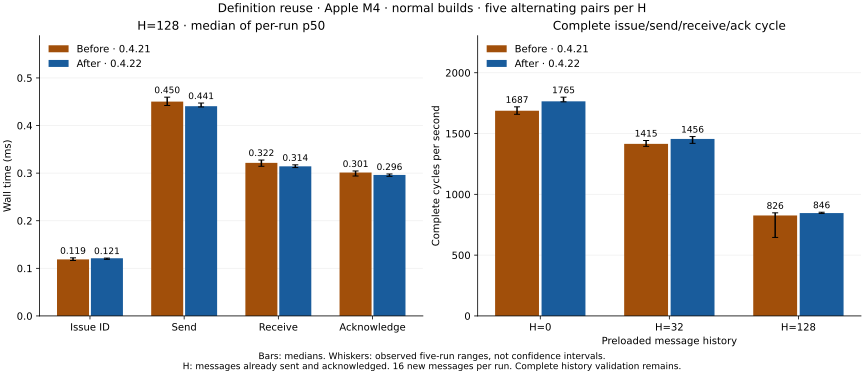
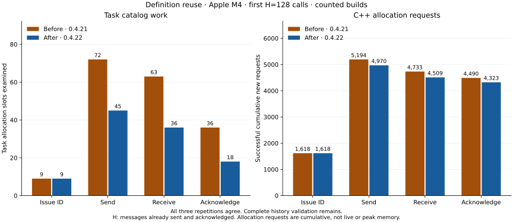

# Reusing definitions within one operation

Milestone 4 step **4.20**, framework **0.4.22**, continues [direct delivery lookup](performance-delivery-lookup.md). It removes repeated loading of Task definitions and retained Queue/Source definitions during one gate-held operation. Public APIs, stored formats, native protocols, headers and payload lifetimes are unchanged. Integration into `main` remains held for measured improvements and qualification.

## What changes

A **definition** records an entity's identity, configuration and registration metadata. Queue and Source definitions can have retained revisions; delivery validation must use the definition effective when each Publication was accepted, rather than substituting today's definition.

`runtime_topology` already decodes and validates complete Queue/Source definition histories. Previously `runtime_validate_delivery` decoded those records again into a second owning history. It now borrows the complete checked histories during that same call. The shared private `RetainedTopologyDefinition<T>` type in [topology_state.h](../src/topology_state.h) holds each owning definition and its record reference. Delivery's per-identity indexes hold pointers into those owners. Its historical lower-bound lookup, registration-revision checks and Publication/receipt validation remain.

Schema loading also uses Task definitions to check that Field and Schema creators existed at registration. Previously the Field and Schema paths each loaded Tasks. The generic schema loader now loads Tasks once and shares them through both paths. Delivery validation reuses the complete Task catalog already checked by topology. Private overloads accept checked Task spans; standalone generic Field/schema loaders still load and validate fresh Tasks as needed. The Fields-only schema overload retains a fresh Task load because its caller supplies no Task catalog.

No definitions or pointers are retained between operations. Repeated Field/Schema preparation in later message construction and payload-codec creation remains outside this focused change.

## Risk assessment

Under the [performance/correctness guidance](../AGENTS.md#performance-and-correctness), decoding the same immutable definitions twice under an unchanged mutation guard adds cost without new evidence. The reuse interval contains no Session mutation. Complete historical topology checks finish before delivery validation receives its spans; the Task catalog comes from `runtime_tasks(access)` under that same live access and continuously held guard.

Trusted Task inputs must be complete and unmodified, from that access, without intervening Session mutation. Arbitrary, stale or cross-access catalogs violate this private precondition. The history spans have the same requirement and are supplied only by `runtime_topology`. Their owners remain alive and unchanged until validation returns; no pointer escapes into a public object, payload borrow or later operation.

All original Field/Schema decoding, policy, index completeness, uniqueness, creator attribution, registration revision and version-chain checks remain. Historical Queue/Source selection keeps its exact record-order and revision rules. Delivery still freshly reads mutable Task, Source, Queue, receipt and ring state. No checks are cached across recovery, mutation, claim replacement, another process's commit or operation boundaries. Generic entry points remain available for deliberate corruption fixtures and validate freshly.

This removes repeated checks within a short unchanged context. Unsupported raw writes that bypass the gate and arbitrary memory corruption during that interval remain outside the coordination protocol. No detection frequency changes across public operations. Full-prefix and complete delivery-history validation remain history-dependent costs; this is not an incremental-validation design.

## Qualification and measurements

Private read-observer tests distinguish logical immutable-copy requests from physical reads. They exercise retained topology history with Publications, Task/Field/Schema attribution, generic versus trusted loader equivalence, and fresh corruption rejection without writes. Existing historical-transition, corrupt-index/creator/schema, ownership, receipt, allowed-loss, recovery and exhaustion tests remain relevant. The primer continues to use the same public API.

The unchanged diagnostic workload compares preserved 0.4.21 executables with normal and enabled 0.4.22 builds. Normal builds supply timing comparisons; enabled controls explain Task slots, allocations and native work. Fresh Sessions, history/capacity/payload/Field controls, serial/backlog/thread/process workloads, raw outcomes and source/executable hashes are retained. Adjacent alternating pairs complement sequential full matrices. Plots show observed ranges, not confidence intervals or production-tail guarantees. CI has no performance thresholds. Generic Task loading now happens in a wrapper outside the SchemaLookup diagnostic scope. That phase's inclusive boundary therefore differs from the preceding build; whole-operation timing and work counters supply the comparisons. No claim depends on treating that nested phase as an unchanged region.

The [result directory](../benchmarks/results/milestone-4-definition-reuse/README.md) records measurements and plots. Further definition reuse during message preparation, remaining history searches, allocation/copy costs, file checks/growth and idle polling remain candidates. The full scan and Session-wide mutation gate still limit scaling.

## Recorded results

The [retained evidence](../benchmarks/results/milestone-4-definition-reuse/README.md) compares fresh normal/enabled populations and alternating serial pairs. Measured source is **`57066388605e21635062c2af3b0a91a59da42318`**. The preserved 0.4.21 executables were not rebuilt; all 128 baseline inputs match the preceding measured source. Only VERSION and the six production files implementing definition reuse differ among measurement inputs.

### Ordinary calls and complete cycles

Five adjacent alternating pairs at each H use fresh sixteen-message serial windows on the Apple M4, with diagnostics OFF. H is the number of previously sent and acknowledged messages. Within each run, p50 uses nearest rank; table cells compare medians of those per-run statistics. Complete-cycle rate uses completed messages divided by the entire issue/send/receive/ack window, then the median. Rates are not reconstructed from operation medians.

| H | Send ms, before → after | Receive ms, before → after | Acknowledge ms, before → after | Complete cycles/s, before → after |
| --- | ---: | ---: | ---: | ---: |
| 0 | 0.239209 → 0.231625 | 0.143084 → 0.133167 | 0.130000 → 0.122083 | 1,687.47 → 1,765.10 |
| 32 | 0.274958 → 0.265375 | 0.178167 → 0.167250 | 0.165125 → 0.156542 | 1,415.12 → 1,455.62 |
| 128 | 0.450209 → 0.440500 | 0.321541 → 0.314250 | 0.301167 → 0.296208 | 826.01 → 845.72 |

Receive medians fall **6.9%/6.1%/2.3%**, and complete-cycle medians rise **4.6%/2.9%/2.4%** at H=0/32/128. At H=128 send/ack medians fall 2.2%/1.6%. These are modest observed timing changes, with overlapping H=128 five-run ranges. All five H=128 send pairs improve; receive and acknowledge each include one slightly slower pair. H=128 receive paired changes range from 3.7% lower to 0.2% higher. Percentages comparing variant medians differ from the median of paired percentages. The figure retains all observed ranges and the original slow before-cycle run; whiskers are not confidence intervals.

ID issuance is an unchanged-work control: its H=0/32/128 medians rise 0.2%/1.7%/2.0%, with overlapping observed ranges. The exact work counts are unchanged. This does not establish zero overhead or prove that small timing changes are caused by the optimization.

### Definition and allocation work

All three counted repetitions agree on the following first H=128 calls:

| Operation | Task slots examined, before → after | C++ allocation requests, before → after | Requested bytes, before → after |
| --- | ---: | ---: | ---: |
| Issue ID | 9 → 9 | 1,618 → 1,618 | 308,544 → 308,544 |
| Send | 72 → 45 | 5,194 → 4,970 | 749,532 → 712,900 |
| Receive | 63 → 36 | 4,733 → 4,509 | 633,740 → 597,108 |
| Acknowledge | 36 → 18 | 4,490 → 4,323 | 602,436 → 574,964 |

Task-slot checks fall **37.5%/42.9%/50.0%** for send/receive/ack. The counter counts allocation-table slots examined, including unused slots; it is not the number of distinct Tasks. Allocation requests fall **4.3%/4.7%/3.7%**, and requested bytes **4.9%/5.8%/4.6%**. These are cumulative successful C++ new requests/bytes in the captured thread, not live/peak memory or all process allocations. Observer tests independently establish that complete Task and retained Queue/Source definitions are copied once in the targeted validation paths.

Across all **603 samples in nine matched counted runs**, only the Task-slot, allocation-request and allocated-byte work counters change. ID-issuance counters are entirely identical. Prefix, topology, delivery, Publication lookup, native mapping/read/stat, gate and recovery counts are unchanged. For example, first H=128 receive still performs one prefix scan/321 record visits, one topology build, one delivery validation and 129 Publication checks, with 16 maps, zero native reads and 45 stats. The optimization reduces repeated definition work, not complete-history scrutiny.

### Controls and limits

The initial sequential matrices are retained. Their receive medians rise **14.2%/14.5%/5.0%** at H=0/32/128. Untargeted ID medians also rise substantially: 0.048875→0.076459 ms, 0.061042→0.083084 ms and 0.097959→0.119125 ms. This is consistent with host/ordering variation; that explanation is an inference, not an established cause. Alternating adjacent pairs reduce this confound without controlling scheduling, heat, frequency, cache state or code-layout effects. No report or outlier was discarded.

At H=128, sequential receive rises 4.2% with unrelated history, 3.5% with a 256-byte payload, 3.5% with 32 Fields and 3.2% with backlog. The sixteen-times-capacity control falls 8.7%; its send/ack medians fall 7.6%/5.5%. These controls are not additional controlled alternating comparisons.

All thread/process workloads complete sixteen messages. The no-idle stream interval ranges from 18.875–20.961 ms before to 20.382–21.563 ms after (median 4.5% higher). Three-idle ranges are 36.321–50.650 and 36.965–42.400 ms (median 0.9% higher); its receive p50 rises 0.846042→1.170666 ms. Process ranges are 18.214–23.180 and 19.315–20.649 ms (median 9.6% lower). These ranges overlap. Waiting and scheduling contribute to concurrent receive time; no universal stream-speedup or fairness claim follows.

Enabled H=128 receive p50 is 0.310042/0.317917/0.317583 ms in None/Counts/Timings modes, versus 0.303833 in the initial ordinary matrix. These sequential observations are not a causal instrumentation-overhead estimate. Normal alternating samples supply timing comparisons, enabled counters explain the work removed, and CI qualifies behavior without timing thresholds.

Strict local diagnostics OFF/ON and measured-source CI pass **817/817 tests** on all three automatic platform profiles. Hosted Linux completes **54/54** eight-message workloads, including all six loaded cases, with 128 input hashes matching the measured source. Its first H=128 Task-slot counts match local controls; complete validation/native counts remain unchanged. The result README links CI logs and records heap and whole-program syscall observations with their limitations. The complete retained population is **300 runs** (246 local plus 54 Linux).
