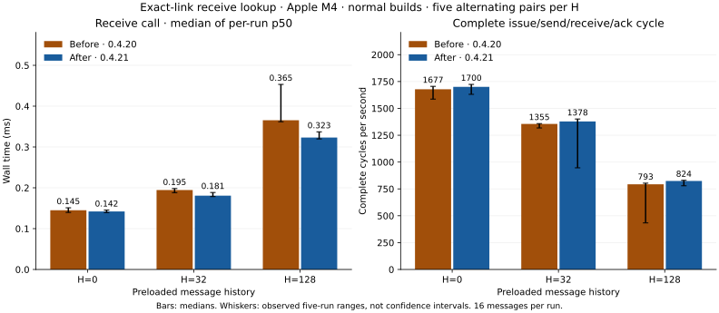
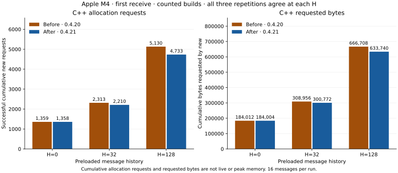

# Resolving the oldest pending delivery directly

Milestone 4 step **4.19**, framework **0.4.21**, continues [receive validation reuse](performance-receive-validation.md). Receive now resolves the Queue's recorded oldest-pending delivery directly instead of scanning Publication metadata again to find it. The complete topology and delivery-history checks still run. Public interfaces, stored formats, protocol versions, message headers and payload lifetimes are unchanged. Integration into `main` remains held for measured improvements and qualification.

## The repeated work

A **delivery link** is the file offset of a destination row inside a committed Publication. A Queue's live state records the link of its oldest nonterminal delivery. [Full delivery validation](native-validation.md) already proves that this root agrees with the complete retained history and receipt progress.

Previously issuance ignored this location until after another search: it decoded Publications from the beginning, compared Queue/sequence identities, and finally checked that the discovered link matched the root. At H=128, the first serial receive decoded 129 Publications during complete validation, then decoded those same 129 again to locate its pending sequence. H counts messages already sent and acknowledged before the measurement window; it does not count messages still pending.

The shared private [delivery-history helper](https://github.com/smangano/angaria/blob/b4ec8ae/src/delivery_history.h) now resolves an exact link for the current native direct-send profile. Direct Publications have one destination immediately following their 64-byte envelope and 128-byte fixed prefix. Subtraction is checked before deriving the Publication offset. The ordinary metadata reader then requires an exact committed Publication boundary and kind, validates canonical bounded metadata without copying payload bytes, and rejects unsupported Publishing acceptance. The helper also checks direct/single-destination shape and exact link, Queue and sequence equality. Issuance retains its fresh Pending receipt check before journal execution.

The existing scanning helper remains for acknowledgment's next-sequence lookup, where the Queue does not yet contain the successor link. Existing pins still return before fresh selection and lookup. Allowed loss still decides whether to commit a gap before issuance; surviving pending deliveries use the same direct resolver.

## Risk assessment

The [performance/correctness guidance](../AGENTS.md#performance-and-correctness) favors removing this duplicate search: the exact pointer has already been validated under the operation's continuously held mutation gate, and the selected record is checked again. No full-history validation or corruption check is removed. Queue, Source, claim and receipt reads remain fresh. There is no cache across operations or mutations and no new trusted-snapshot API.

The resolver deliberately supports the current direct, single-destination native profile. Multi-destination Publishing support must provide row-aware resolution rather than silently reuse first-row arithmetic. Explicit shape/identity checks and the current capability fence reject unsupported records. Neither a wraparound ring entry nor a Queue sequence alone substitutes for the committed Publication boundary. Invalid offsets, wrong kinds, mismatched identities and malformed metadata fail before progress writes.

Unsupported raw writers that bypass the mutation gate and arbitrary memory corruption are outside the existing protocol. This change adds no new tolerance or continuous-detection promise for them. Normal recovered operations still validate all history. Recovery, acknowledgment/release, exact cleanup, deadlines, Source close fences and borrowed view lifetimes keep their existing behavior.

## Qualification and measurement

Private tests compare the exact resolver with the retained-history search at early, middle and late positions, including overwritten ring entries. A read observer verifies bounded reads of only the selected Publication's metadata and no payload copying; the scanning control demonstrates the extra reads it replaces. Invalid links and Queue/sequence mismatches reject without changing the file. Existing public receive, allowed-loss/gap, pin repeat, ordering, close, cleanup, recovery and full-log tests remain applicable.

The unchanged diagnostic workload compares preserved 0.4.20 executables against normal and enabled 0.4.21 builds. Normal builds supply latency comparisons; enabled controls explain allocation and native work. Fresh Sessions, geometry/history/capacity/payload/Field controls, independent process/thread workloads, all outcomes and source/executable hashes are retained. Adjacent alternating serial pairs complement sequential full matrices. Observed ranges are not confidence intervals or production-tail guarantees; CI records correctness and diagnostics without timing thresholds.

Measurements and plots are recorded in the [result directory](../benchmarks/results/milestone-4-delivery-lookup/README.md). One full prefix scan and delivery validation, decoding/allocation, acknowledgment's successor search, native resource checks and idle polling remain costs. This focused optimization does not make receive independent of retained history.

## Recorded results

The [retained evidence](../benchmarks/results/milestone-4-delivery-lookup/README.md) contains fresh normal/enabled controls, alternating serial pairs and hosted Linux qualification. Measured source is **`22bab0c42d835eb37b5c92454f41362590a5c55f`**. Before inputs match the preceding measured 0.4.20 source; the preserved executables were not rebuilt. The only changed measurement inputs are VERSION, delivery_history.h and delivery_progress.cpp.

### Alternating ordinary calls

Five adjacent alternating pairs per H use fresh Sessions and sixteen-message serial windows on the Apple M4, with diagnostics OFF. Within each run p50 uses nearest rank; the table compares medians of those per-run values. Complete cycles/s uses each run's completed messages divided by its whole issue/send/receive/ack interval, then the median. Rates are not reconstructed from latency medians.

| Preloaded history H | Receive before, ms | After, ms | Reduction | Complete cycles/s before | After | Increase |
| --- | ---: | ---: | ---: | ---: | ---: | ---: |
| 0 | 0.145125 | 0.142083 | 2.1% | 1,677.48 | 1,700.17 | 1.4% |
| 32 | 0.194542 | 0.180792 | 7.1% | 1,355.21 | 1,378.36 | 1.7% |
| 128 | 0.365458 | 0.323125 | 11.6% | 793.08 | 824.13 | 3.9% |

Whiskers show observed five-run ranges, not confidence intervals. All five H=32 and H=128 receive pairs improve; H=0 pairs include increases as well as decreases. H=128 paired changes range from 28.7% lower to 8.5% lower, including an original slow before run. Percentage changes in the table compare variant medians; the median paired percentage is a different statistic. All untargeted issue/send/ack five-run ranges overlap. Their median changes are small and mixed, including H=32 ID issuance 2.4% higher and H=128 send 0.2% higher.

### Counted work

The first counted receive at each H has these exact values in all three repetitions:

| H | C++ allocation requests before | After | Requested bytes before | After |
| --- | ---: | ---: | ---: | ---: |
| 0 | 1,359 | 1,358 | 184,012 | 184,004 |
| 32 | 2,313 | 2,210 | 308,956 | 300,772 |
| 128 | 5,130 | 4,733 | 666,708 | 633,740 |

At H=128, allocation requests fall **7.7%** and cumulative requested bytes **4.9%**. These are successful C++ new requests on the captured thread, not live/peak memory or all process allocations. Map attempts fall **18→16**, stat attempts **47→45**; H=0/32 remain at 7 maps and 36 stats. Mapping-window locality makes these counts workload-dependent.

Complete validation is unchanged: at H=128 both versions perform **one topology build, one delivery validation, 129 Publication checks and one full-prefix scan with 321 record visits**. No native read calls occur in that receive. The private observer test separately demonstrates three bounded metadata-copy requests for the selected record, versus three per visited Publication in the scanning control; those requests are not physical native reads. The enabled counters do not count these extra metadata decodes as validated Publications.

### Controls and limits

**Execution-context clarification, step 4.21:** the initial sequential before and after matrices used different execution-permission requests. Their timing deltas below remain archived observations and cannot isolate the optimization. The primary adjacent alternating comparison ran both versions under matching settings. See the [methodology correction](performance-diagnostics.md#match-execution-settings-as-well-as-code). This is a provenance correction; raw reports and source measurements are unchanged.

The initial sequential normal matrices are retained separately. Their receive medians at H=0/32 rise **18.1%/5.0%**, while H=128 falls **5.3%**. Before runs have generally lower untargeted call times than the later populations, consistent with host or ordering variation; that explanation is an inference, not a measured cause. The adjacent alternating comparison reduces this confound but does not eliminate scheduling, thermal or frequency variation. No runs or outliers were discarded.

Other sequential H=128 controls reduce receive p50 by 5.3% for unrelated history, 9.1% for sixteen-times capacity, 7.7% for 256-byte payloads, 8.4% for 32 Fields and 8.1% for backlog. Concurrent receive times include waiting for publication and scheduling. The no-idle thread stream completes in 20.829–20.874 ms before and 21.080–21.486 ms after (median elapsed 2.8% higher); its receive p50 rises from 0.351 to 0.892 ms. Three-idle stream elapsed ranges overlap (34.424–44.700 versus 37.042–41.893 ms). Independent-process elapsed ranges are 20.091–24.390 ms before and 19.592–20.072 ms after; its median falls 4.8%. These small sequential observations support no universal stream-speedup or fairness claim. All requested messages complete with zero pending/borrowed obligations in the retained populations.

Instrumentation controls and all raw outcomes remain available. Hosted Linux timings are observations on a different host and eight-message window, not a controlled cross-platform speed comparison. Three-platform CI and retained Linux work counts provide correctness and mechanism corroboration without performance thresholds.

Strict local diagnostics OFF/ON and measured-source CI each pass **814/814 tests** on the three automatic platform profiles. The retained Linux matrix completes **54/54** eight-message workloads, including all six loaded cases. Its 128 input hashes match the measured source; first H=128 receive preserves the full validation counts and records 16 maps/45 stats. The result README links CI logs, records the different Linux heap counts and explains the separate whole-program syscall trace. The complete evidence population is **300 runs** (246 local plus 54 Linux).
