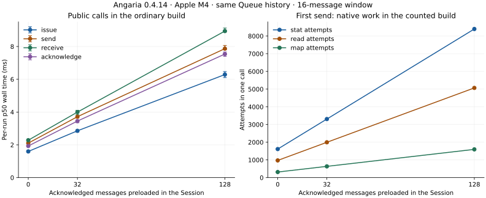

# Milestone 4 diagnostic findings

Step **4.12**, Angaria **0.4.14**, identifies two problems that must be addressed before milestone 4 enters `main`: repeated work over the Session's complete history, and poor progress when idle consumer threads compete for the Session gate. This PR measures existing behavior. It changes neither transport algorithms nor validation/recovery guarantees.

The [measurement guide](performance-diagnostics.md) defines phases, counters, workload geometry, and reproduction commands. The [retained experiments](../benchmarks/results/milestone-4-diagnostics/README.md) contain raw calls, progress for unfinished runs, summaries, source/executable hashes, and the original executable's stack profile. **Measured source: `d2b84634bfee781818481f39c22bfbc9ac9a6b58`.** Later commits in this PR add findings and retained data only.

## Normal public calls become slower as history grows

The primary latency evidence uses a Release build with internal diagnostics **OFF**, on an Apple M4 with ten logical CPUs, 16 GiB memory, and macOS 27.0.1. The executable is native ARM64; the Python coordinator is x86_64. Three runs per case use a fresh Session, four registered channels, nine attached Tasks, eight-entry rings, recovery-from-log delivery, and a 16-message serial window. Payloads contain eight fixed-ASCII bytes. History H means H messages have already been sent and acknowledged before that window begins; the window itself adds another 16.

Each cell below is the median of three per-run p50 values, in milliseconds. Within each run p50 uses nearest rank. These small windows establish scaling and work counts; they do not qualify production tail latency.

| Acknowledged history H | Issue ID | Send | Receive | Acknowledge | Complete cycles/s |
| --- | ---: | ---: | ---: | ---: | ---: |
| 0 | 1.597 | 2.105 | 2.283 | 1.930 | 125.97 |
| 32 | 2.856 | 3.718 | 3.997 | 3.451 | 70.77 |
| 128 | 6.288 | 7.869 | 8.942 | 7.541 | 32.63 |

Cycle throughput is 16 divided by that run's entire issue/send/receive/ack window, then the median across runs. It is not the reciprocal of send latency. At H=128, retained status lookup, identical retry, and empty receive also take about 4.5–4.7 ms, despite appending no new message.

The left panel shows the three-run median p50, with the minimum/maximum run p50 as its range, not a confidence interval. The right panel shows exact first-send counters, identical across all three counted runs. [Regenerate the figure](../benchmarks/results/milestone-4-diagnostics/generate_figure.py) with matplotlib.

## Preparation repeatedly visits the whole committed prefix

The **committed prefix** is the sequence of committed arena records ending at the authoritative allocation tail. It includes immutable definitions, Publications, and transaction records; it is separate from the short journal for a pending mutation. The current public operation creates a RuntimeAccess, recovers/validates state, rebuilds its record index, loads topology, and validates delivery history. Mutation preflight repeats snapshot validation. Several of those stages traverse information already examined under the same gate.

The first fresh send in each controlled counted run performs:

| Preloaded messages H | Full-prefix scans | Prefix record visits | Indexed records | Map attempts | Read attempts | Stat attempts | C++ allocation requests | Requested bytes |
| --- | ---: | ---: | ---: | ---: | ---: | ---: | ---: | ---: |
| 0 | 3 | 189 | 63 | 316 | 972 | 1,613 | 2,577 | 301,188 |
| 32 | 3 | 381 | 127 | 636 | 1,996 | 3,309 | 4,943 | 551,740 |
| 128 | 3 | 957 | 319 | 1,596 | 5,068 | 8,397 | 11,969 | 1,421,884 |

Each also performs one complete index scan, one topology reconstruction, one delivery validation, and a lookup proving the issued publication is absent. Delivery validation and that lookup each visit H existing Publications. Healthy recovery checks occur, but **no non-idle journal recovery** occurs in these serial cases. Replaying a crashed transaction is therefore not the cause of these steady-state costs.

ID issuance, receive, and acknowledgment also perform three prefix scans and an index scan in this workload. Status, identical retry, and empty receive still scan and index the prefix once. At the first H=128 receive, the counters include two topology reconstructions, 258 validated-Publication visits, 1,897 map attempts, and 9,335 stat attempts.

This is history-dependent work even when every earlier message has been acknowledged. The observed scan counts and code paths establish at least linear work in retained history per operation. Repeating that work while history grows produces at least quadratic cumulative scan work for a long stream. The three history points are not a fitted performance model for arbitrary sizes.

Allocation numbers are cumulative successful C++ `new` requests in the captured thread, not live memory, peak memory, or all process allocations. Enabled builds also contain private timing metadata. Mapped-byte counts similarly represent requested mapping extents, not resident pages.

## Native metadata and mapping work dominate

In the H=128 timed serial send, the median per-run shares of **exclusive** wall time are:

| Phase | Share |
| --- | ---: |
| Native stat helper | 27.3% |
| Native read helper | 21.2% |
| Native map helper | 20.0% |
| Native unmap helper | 13.9% |
| Combined native helpers | **82.4%** |
| Prefix scan's own work, excluding timed children | 8.6% |
| Delivery validation's own work | 3.3% |
| Record index's own work | 2.5% |
| File growth | 1.4% |

Shares are calculated within each run and then summarized; rounded component medians need not add exactly. Native helper regions include checks/bookkeeping and nested native calls are subtracted for exclusive values. Inclusive phases overlap and must not be summed. Uncontended operation CPU time is close to wall time, and the native gate remains held for almost the whole call. Most of this work serializes other participants.

A separate profile of the **unchanged step-4.11 executable** corroborates the result: `fstat`, `pread`, `mmap`, and `munmap` account for 81.4% of 3,372 sampled main-thread instruction locations. A whole-program resource run records 0.70 s user CPU, 2.34 s system CPU, and 627,603 page reclaims. These include setup/warmup/teardown and are not exact per-send syscall durations. The [original-binary evidence](../benchmarks/results/milestone-4-diagnostics/environment/README.md) retains both reports and their limitations.

Three managed runs and three direct-host runs of that identical original executable have overlapping send-p50 ranges: their medians are 5.301 and 5.129 ms. This small, non-randomized comparison gives no evidence of a large execution-environment explanation. It does not prove zero environmental overhead.

## Idle polling exposes a separate progress problem

The thread-stream control attaches only its producer and consumer. With H=128 and no idle pollers, all three normal-build runs complete their 16 messages, with median throughput 30.61 messages/s. Independent producer/consumer processes with the same two active claims also complete all 16, at 31.60 messages/s. Process startup and attachment are outside those intervals; these figures are not a comparison with the nine-claim serial cohort.

On that same macOS host, adding **three threads polling distinct empty Sources** changes the outcome. All three normal-build runs reach the cooperative five-second budget: accepted/acknowledged counts are **1/1, 1/0, 1/0**. The six enabled-build runs also stop with little progress: None mode gives **1/1, 0/0, 2/1**; Timings gives **1/0, 1/1, 5/2**. Pending messages and checksums remain consistent. These are retained incomplete experiments, not successful 16-message throughput samples.

The earlier unbounded-reporting experiment failed to finish within 30 seconds locally; the initial Linux smoke likewise exceeded 30 seconds with one idle poller. The new tool retains actual progress, pending/borrowed state, blocked-call intervals, and complete idle-poll aggregates when the budget is reached. Already started calls finish consistently, so a five-second work budget is not a hard deadline.

The timed runs localize the delay. In one three-idle-poller run, a send takes **5,003.579 ms**, including **4,994.957 ms acquiring the gate**, with only **19.359 ms of calling-thread CPU** and **8.613 ms of native gate ownership**. The three idle threads together make **32,839,460 gate attempts**, only **818 successful**, and hold the native gate for about **3,795 ms** during that phase. These are complete aggregate observations even though the stored raw idle-call sample is truncated. The acquisition phase includes local coordination, native locking, checks, and scheduling; it does not separately measure mutex versus native-lock wait.

The implementation permits repeated nonblocking receive attempts to reacquire the process-local/native gate while another participant waits; it promises no fairness. The evidence justifies investigating gate acquisition and idle polling alongside scan/mapping costs. It does not establish starvation freedom after a particular fix, or prove the same severity with independent-process idle consumers: that experiment is not present here.

## Linux corroborates both problems

The [hosted Linux dataset](../benchmarks/results/milestone-4-diagnostics/linux-x86_64/) has 54 validated runs, with eight-message windows rather than the local sixteen. Its enabled/None serial send p50 rises from **5.263 ms at H=0** to **10.126 ms at H=32** and **26.239 ms at H=128**. The first H=128 send has exactly the same 3 prefix scans, 957 prefix-record visits, 319 indexed records, 1,596 map attempts, 5,068 read attempts, and 8,397 stat attempts as macOS. Its synthetic PR-merge checkout has all 127 recorded measurement input hashes identical to the measured local head. Hosts, compilers, page sizes, and window lengths differ; absolute timing and allocation-byte comparisons across platforms are not controlled experiments.

Of those 54 runs, 43 complete and 11 reach the five-second budget. Even **without additional idle threads**, five of six producer/consumer thread streams stop after accepting zero or one of their requested eight messages. All six three-idle-poller streams stop early. All six independent-process cases complete their eight messages. Thus the progress investigation must cover the ordinary two-thread producer/consumer case too, including a consumer polling before its producer can acquire the local gate. In one timed two-thread run, producer ID issuance spends **5,011.360 ms acquiring the gate**. During that interval the consumer repeatedly acquires it **336 times**, with about **5,001.857 ms of aggregate native ownership**, before its receive call returns Timeout. This directly shows a waiting producer being delayed while the polling consumer repeatedly does gated validation. It does not identify which underlying mutex/native-lock scheduling decision causes every stall.

A separate `strace -f -c` invocation covers initialization, H=32 preloading, eight serial messages, controls, and teardown. It counts **714,840 `getpid`**, **501,067 `fstat`**, **304,616 `pread64`**, **99,840 `mmap`**, and **99,819 `munmap`** calls. Repeated process-ownership checks in native resources are another candidate for reducing redundant work. They protect fork/ownership behavior, so simply removing or indefinitely caching them is not an acceptable fix. The trace reports 37.0% of traced syscall time in `getpid`; tracing perturbs each syscall, so that percentage is not its share of an ordinary send's time.

The full tests pass on Linux x86_64, Linux ARM64, and macOS ARM64, **796 tests per profile**. Experimental budget stops pass only after progress, data, and reporting invariants are checked. There is no CI timing threshold or implication that observed poor progress is acceptable for milestone integration.

## Other controls and observation overhead

At H=128, normal-build send p50 is 7.869 ms for the baseline geometry. Moving the 128 historical messages to an unrelated Queue gives 7.617 ms: the cost follows the Session's history rather than just the measured Queue. Reserving sixteen times the capacities gives 7.961 ms. Increasing the payload to 256 bytes gives 7.708 ms; splitting those bytes into 32 Field references gives 7.928 ms. Publishing the batch before draining gives 7.896 ms. Within these small cases, none explains the large slowdown as well as repeated history work. This does not show that payload size, Task limits, schema complexity, or backlog are free at larger scales.

Matched H=128 serial send p50 is **7.869 ms OFF/None**, **7.994 ms ON/None**, **7.960 ms ON/Counts**, and **8.752 ms ON/Timings**. Timings is about 11.2% above the ordinary build in this experiment. Counts being slightly faster than ON/None illustrates run variability. Cases were sequential, not randomized; these are observed differences, not a causal overhead estimate or confidence interval. Use ordinary builds for improvement claims and the instrumented build to explain work.

## Proposed fix sequence and qualification

1. **Reuse validated information within one unchanged gate-held operation.** Eliminate repeated prefix/index/topology work where the same validated state is already available. Keep all existing failure checks. This is the narrowest first candidate, with exact scan/read/map/allocation counters to verify what it removes.
2. **Reduce native mapping/stat/read churn.** Examine safe reuse of fixed metadata mappings, grouped reads, and repeated ownership checks once the repeated scans are removed. Keep borrowed payload address stability, rollback bounds, process-death cleanup, and corruption rejection intact.
3. **Improve idle-consumer progress.** Measure acquisition delay and producer/consumer progress with empty polling; evaluate bounded backoff or a fairer acquisition/wakeup approach. Reducing per-poll validation cost may help but does not itself establish fairness. Include independent-process idle polling in that qualification.
4. **Re-measure and agree a representative target before integration.** Repeat ordinary and counted controls, history sweeps, stream/process cases, idle load, append accounting, recovery/corruption tests, and the three automatic CI profiles. Then decide whether longer-lived incremental state is needed.

Cross-call caching requires an explicit invalidation design. Definitions/history, mutable claims/receipts/pins, other-process commits, recovery, and rollback do not share one sufficient change indicator. Registry revision or append tail alone cannot prove that all relevant state is unchanged. No validation guarantee should be removed under the label of caching.

This evidence prioritizes scan reuse and native metadata work; it does not yet measure a speedup. File growth is a later candidate if it becomes material after those costs fall. Milestone 4's integration into `main` remains held for reviewed improvements and agreed workload targets. The [roadmap](../ROADMAP.md) retains the subsequent feature scope.
