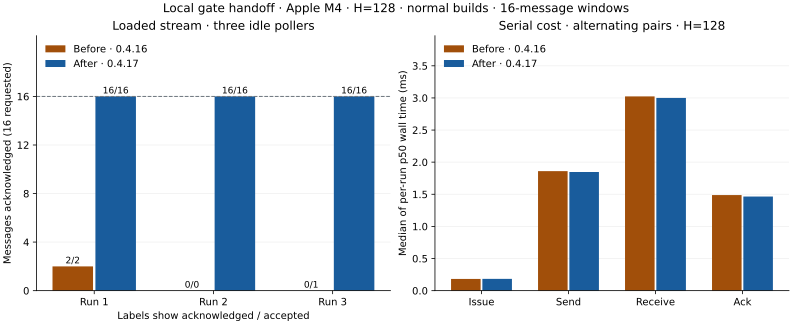

# Giving queued operations a local gate handoff

Milestone 4 step **4.15**, framework **0.4.17**, addresses the polling stalls retained in the [diagnostic findings](performance-diagnostics-findings.md) and [mapped-window measurements](performance-prefix-windows.md). It gives an announced local blocking operation an opportunity to take the mutation gate before nonblocking polls reacquire it. The public application interface, mapped format, and synchronization protocol retain their current versions. Milestone integration into `main` remains held for measured improvements and qualification.

## Why handoff matters

`Source::receive` uses nonblocking gate attempts so a deadline does not wait indefinitely for ownership. When an empty Source keeps retrying, its active thread can repeatedly win the controller's process-local mutex while a producer's blocking acquisition waits to be scheduled. The earlier Linux timed run records a producer waiting about five seconds while the consumer acquires the gate 336 times. Faster metadata work reduced each visit but did not resolve the loaded polling cases.

A **blocking request** now announces itself just before attempting the local mutex. The controller counts these requests in process-local atomic state. A try-acquire checks that count before allocating a guard and again after winning the mutex. If a blocker is announced, it returns `OwnershipBusy`, leaving a handoff opportunity. The second check covers a blocker arriving between the first check and the actual mutex attempt.

The announcement ends once the blocker owns the local mutex; that ownership then excludes polls while resource checks and native locking proceed. RAII withdraws an announcement on errors, exceptions, and lock failures. Guard allocation happens before announcing, reducing the interval in which a request reserves preference without being ready to lock.

The count belongs to the shared controller for this Session in this process. It is not persisted. Native `flock`, ordering fences, thread-affine guards, recursive-entry rejection, process ownership checks, and recovery remain the existing mechanisms. A private observer coordinates deterministic qualification; application calls supply no observer.

## Risk assessment

The [project guidance](../AGENTS.md#performance-and-correctness) gives performance and correctness equal priority. This small admission rule targets the measured overtaking problem without adding a persistent queue or changing native lock ownership.

- Preference belongs to announced blocking requests. A try caller can receive Busy while the mutex is momentarily free, including when the announced thread is descheduled. A finite receive can therefore still time out.
- Sustained blocking demand can delay try-only consumers. This is a class preference, with no FIFO ordering among blockers, starvation-free scheduling, cross-process fairness, or hard response-time promise. Bounded workloads must be measured in both ordinary and loaded cases rather than inferring fairness from one run.
- Returning Busy before checking native resources matches the existing contention paths: resource errors are checked once an attempt can proceed. Fork ownership is rejected before touching the inherited counter or mutex. Successful local acquisition withdraws the count before later native/resource failures, and RAII covers earlier failures.
- Uncontended blocking calls add an atomic increment/decrement, and try calls add counter checks. These use sequential consistency for a straightforward ordering argument. Measurements compare ordinary-call cost as well as progress under polling load. The live count is bounded by simultaneous local acquisition attempts; additional overflow machinery is not warranted by that failure model.

The change preserves exclusion and recorded transaction semantics. It deliberately changes local admission preference, so Busy/Timeout results can occur in an otherwise free interval. An already started operation still finishes consistently even when its caller's work budget expires.

## Qualification and measurements

Three new private controller tests force a free-mutex handoff, the first-check/lock race, and announcement cleanup after returned errors and exception unwinding. Their handshakes establish ordering; deadlines only detect a broken test protocol. Existing tests cover recursive acquisition, guard moves/lifetimes, wrong-thread/controller/fork use, native exclusion, resource failures, and process death.

The unchanged public diagnostic workload compares preserved 0.4.16 normal executables with the new normal build, then uses enabled counts/timings to locate remaining acquisition delay. Fresh Sessions, matched geometry and active claims, three repetitions, raw partial progress, and the [existing measurement method](performance-diagnostics.md) are retained. Serial/backlog and independent-process controls distinguish local handoff effects from unrelated work. Small sequential studies do not qualify production tail latency. CI records observations without timing thresholds.

The [retained evidence](../benchmarks/results/milestone-4-gate-handoff/README.md) contains **33 initial normal-before**, **33 normal-after**, **75 enabled-after**, an additional **30 alternating serial-cost runs**, and **54 hosted Linux runs**. Measured after source is **`5feaaac03350acec53efb8d76aa4e2b8eda21ecc`**. The preserved 0.4.16 baseline binary and all 127 inputs match the preceding measured source; both after builds and Linux inputs match the measured after source. Only VERSION and the two controller files differ among measurement inputs.

### Loaded progress

The normal Mac study requests sixteen messages after H=128 history, with three additional threads polling distinct empty Sources. Each accepted/acknowledged pair is retained separately:

| Run | Before outcome | Before accepted / acknowledged | After outcome | After accepted / acknowledged | After work interval |
| --- | --- | ---: | --- | ---: | ---: |
| 1 | Budget stop | 2 / 2 | Complete | 16 / 16 | 210.356 ms |
| 2 | Budget stop | 0 / 0 | Complete | 16 / 16 | 223.183 ms |
| 3 | Budget stop | 1 / 0 | Complete | 16 / 16 | 242.671 ms |

Before intervals end near the cooperative five-second budget. They do not measure the time required to complete sixteen messages, so dividing five seconds by an after interval would not be a valid completion-speedup claim. All after runs leave zero pending or borrowed-at-stop messages and the expected checksum. The six enabled loaded runs also finish 16/16; all 75 enabled workloads complete. Ordinary two-thread and independent-process controls finish before and after. Serial/backlog uses nine claims, while matched concurrent cases use two plus requested idle consumers; their rates are not interchangeable cohorts.

The earlier identical-shape 0.4.16 timed loaded cases contain per-run worst blocking-call acquisition phases of about **1.50, 3.98, and 2.49 seconds**. The three new timed loaded runs observe maxima of **4.99, 5.25, and 5.49 ms**, across all 48 completed issue/send/ack calls per run. Acquisition includes checks, local coordination, native locking, and scheduling, not just mutex wait. Before populations are incomplete and differ in sample count; these examples locate the handoff change without establishing a tail bound or latency ratio.

### Ordinary-call cost

The initial sequential full-matrix comparison shows higher after medians in several ordinary cases. Its send p50 values are **0.497→0.584 ms**, **0.792→0.833 ms**, and **1.746→1.763 ms** at H=0/32/128. Those observations remain in the retained data; the policy's cost is not assumed to be zero.

An additional check alternates fifteen adjacent before/after pairs (AB then BA), five pairs per history. Both variants have fresh Sessions and the same sixteen-message serial workload. The table summarizes **five per-run nearest-rank p50 values per variant**, then compares the medians; this differs from taking a median of within-pair percentage changes.

| History H | Send before, ms | Send after, ms | Change in those medians |
| --- | ---: | ---: | ---: |
| 0 | 0.545 | 0.553 | +1.5% |
| 32 | 0.857 | 0.842 | −1.8% |
| 128 | 1.860 | 1.847 | −0.7% |

Across issue/send/receive/ack cases, changes in variant medians range about **−3.4% to +2.3%**, with overlapping run ranges. H=0 issuance is higher in every adjacent pair, by roughly 1–4%, so a small policy cost remains plausible. Deterministic alternating order reduces one-way drift but provides no host isolation, frequency/thermal control, or causal zero-overhead proof. Both studies are small and their original results remain visible. The observed finite-work progress benefit is the reason for this tradeoff.

All matched uncontended counted operations retain the same counters as 0.4.16. First H=128 send remains **2 scans / 638 record visits, 324 maps, 791 reads, and 1,409 stats**. The policy changes admission rather than reducing that work.

### Hosted qualification and remaining costs

The hosted Linux matrix completes **54/54** eight-message workloads, including all six loaded streams, with all 127 input hashes matching the measured after source. This independently corroborates progress in the finite cases, while differing hardware, scheduling, and window length prevent a controlled platform comparison. The separate serial syscall trace has the same native call totals as 0.4.16, consistent with the unchanged uncontended work.

Both strict local Release builds, diagnostics ON and OFF, pass **803/803** tests. Hosted Linux x86_64, Linux ARM64, and macOS ARM64 also qualify the code with all 803 tests, including original benchmark smoke and native walkthroughs. All seventeen primer targets remain included.

The idle threads still spin. In the new timed loaded runs they make about **1.62–1.82 million gate attempts** and consume roughly **0.55–0.68 CPU seconds across three threads** during about **0.19–0.23 seconds of elapsed work**. That is substantial CPU pressure. Comparing its ratio to old five-second incomplete runs would mix different completed work. A waiting policy and remaining metadata/native costs remain separate targets; this step does not establish fairness under sustained blocking load.

Native metadata access and history-dependent validation remain separate optimization candidates.
