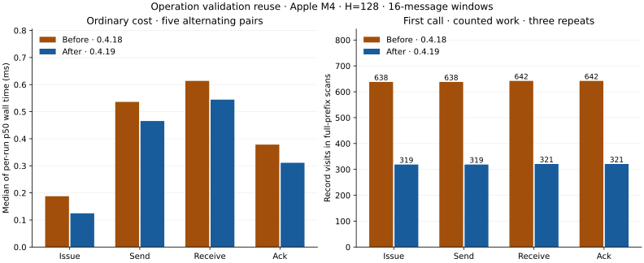

# Reusing one operation's validated history

Milestone 4 step **4.17**, framework **0.4.19**, continues the [performance investigation](performance-diagnostics-findings.md) after [runtime mapping reuse](performance-runtime-windows.md). It removes a second full committed-prefix scan from the first execution attempt of a private gate-held runtime operation. General journal entry points and later attempts still validate freshly. Public interfaces, stored formats, native locking, and delivery/recovery rules retain their existing versions. Integration into `main` remains held for measured improvements and qualification.

## What changes

The **committed prefix** is the retained record history ending at the authoritative allocation tail. A private **RuntimeAccess** recovers the Session and validates that history when an operation begins. It holds the mutation gate until the operation ends, retaining owning record envelopes for exact-boundary lookup. Previously journal preflight scanned the same history again before preparing the first mutation, despite that continuously held gate. The preceding H=128 first send counted two scans and 638 record visits.

RuntimeAccess now offers its initial validated snapshot and record ranges to a friend-only journal path on its first `execute` attempt. The snapshot used for this decision is private and separate from the working snapshot that progress code can update. Eligibility is consumed before owner checks, plan checks, allocation, recovery or execution; an invalid plan or failed append does not restore it. Moving an access carries its owned guard, journal and record ranges; a moved-from journal rejects execution.

The journal still checks guard/controller ownership, stable native resources, Idle control, current canonical roots and physical file length. If execution entry performed recovery, or current roots/length differ, it uses the normal fresh-validation path before classifying a stale plan. A matching first attempt reuses the already validated framing. Plan identity, generation exhaustion, size budgets, new record contents, predecessor references, redo targets, actor/domain rules and accepted materialized bytes retain their checks. Error settlement and process-death recovery still validate freshly.

The general `MutationJournal::execute`, `snapshot` and `recover` methods retain their existing validation paths. Generic execution and snapshots validate the prefix freshly; recovery retains its existing Idle/non-Idle behavior. Later execution attempts on the same RuntimeAccess also use generic execution. No reusable token is accepted from a caller, and there is no cache shared between operations or gate acquisitions.

## Risk assessment

The [project guidance](../AGENTS.md#performance-and-correctness) gives performance and correctness equal priority. Under the supported protocol, other processes and threads cannot alter committed state while this operation continuously owns the mutation gate. The duplicate scan adds history-dependent work without a supported intervening writer. Execution already trusted preflight's owning ranges during materialization/apply; this change extends that trust interval back to the same operation's entry validation.

- This changes validation frequency on a narrowly trusted internal path. The first attempt relies on facts established at operation entry rather than re-reading every historical envelope before commit. A raw file write or same-root corruption injected between those points may therefore escape that second scan. Private callers must keep the same guard, journal, Session and file binding, and must not alter committed metadata directly. Qualification fixtures that deliberately change storage use generic fresh APIs or consume the one-use path before doing so.
- External writers bypassing coordination, arbitrary memory corruption, and hardware faults during an operation are not made safe by either design. A second scan cannot guarantee their absence. The accepted tradeoff is to avoid this repeated precaution during a short, gate-held operation while retaining complete validation at each new operation and on generic journal calls.
- Matching roots alone do not establish reusable validation. Only RuntimeAccess supplies the private snapshot and owning ranges created by its entry validation, under its still-held guard. The comparison includes operation generation and physical size; Registry revision or tail alone would miss FixedState progress. Non-Idle recovery at execution entry disables reuse even if rollback restores the original roots.
- Eligibility ends before the first attempt, including errors and exceptions. Later retries, multiple FixedState progress operations, changed state, and uncertain-outcome repair cannot reuse it. The implementation shares preflight and execution machinery rather than duplicating transaction or recovery logic.
- Reuse still copies owning ranges needed by journal execution; it is not an allocation-free path. No mapped span or payload view changes owner or lifetime. Existing atomic loads/fences, class preference at the gate, rollback limits, and corruption rejection on fresh entry remain in force.

Application code uses the same API. The guarantee is coordinated mutation and validated operation entry, not continuous detection of unsupported file tampering inside an operation. This trust boundary and the changed validation frequency are deliberate performance choices.

## Qualification and measurements

Private tests cover moved operation state, repeated execution and stale plans, first-attempt rejection consuming eligibility, unchanged-root corruption on fresh paths, and real append-growth failure followed by rollback and retry. Existing generic journal corruption, recovery, exhaustion, native ownership/fork, public delivery, and payload lifetime tests remain relevant. These are storage qualification fixtures, not application examples.

The unchanged diagnostic workload compares preserved 0.4.18 executables with fresh normal and enabled builds. Matched geometry, history/capacity/payload/Field controls, separate thread/process cases, complete or budget-stop outcomes, raw operation samples, and source/executable hashes are retained. Normal builds provide the timing comparisons; enabled counts/timings explain work. Adjacent alternating pairs check ordinary serial cost separately from sequential full matrices. No CI timing threshold or production-tail guarantee is introduced.

The [retained evidence](../benchmarks/results/milestone-4-operation-validation/README.md) includes **33 fresh normal-before**, **33 normal-after**, **75 enabled-after**, **30 alternating serial runs**, and **54 hosted Linux runs** (225 total). Measured after source is **`b805fd880e5769dd9e0069499ae4735d96a8863c`**. Before and after each retain 128 input hashes; the preserved baseline matches the preceding measured 0.4.18 source. Compiler/optimization settings and workload controls match.

### Ordinary performance

The primary comparison uses five alternating sixteen-message serial runs per variant at each preloaded history H on the Apple M4. Each latency cell is the median of per-run nearest-rank p50 values. Percentage changes compare variant medians, rather than taking a median of paired percentages. Complete-cycle rate is each run's completed messages divided by its full issue/send/receive/ack window, then the median; it is not reconstructed from latency medians.

| Preloaded history H | Send before, ms | Send after, ms | Latency reduction | Complete cycles/s before | After |
| --- | ---: | ---: | ---: | ---: | ---: |
| 0 | 0.258 | 0.241 | 6.4% | 1,428.15 | 1,577.22 |
| 32 | 0.313 | 0.291 | 7.3% | 1,111.14 | 1,237.78 |
| 128 | 0.536 | 0.465 | 13.2% | 579.88 | 678.74 |

At H=128, issuance falls **0.188→0.125 ms** (33.6% lower), receive **0.614→0.544 ms** (11.3%), and acknowledgment **0.378→0.311 ms** (17.8%). Complete-cycle throughput rises about **17.0%**. All five H=128 paired send p50 values improve, by about **4.6–16.1%**, without discarding any pair.

The initial three-run full matrices show H=128 send **0.503→0.452 ms** (10.1% lower), issuance about 33% lower, receive about 11% lower and acknowledgment about 17% lower. **Small-history send is not uniformly faster:** its initial H=0 medians are **0.25150→0.25175 ms** (+0.1%), and H=32 improves about 1.5%, versus 6.4%/7.3% in the alternating study. Run ranges and ordering differ; these finite host samples support a history-work reduction, not a universal latency claim.

Unrelated-Queue history, sixteen-times capacity, payload/Field controls and backlog all complete, with initial send reductions of roughly **4–9%**. All ordinary thread, independent-process and three-idle-poller cases finish sixteen messages before and after. Loaded elapsed windows overlap: before **43–51 ms**, after **41–47 ms**, with medians about **45.43→45.39 ms**. This does not establish a consistent loaded-throughput improvement. The gate admission rule and busy-spin waiting remain unchanged.

### Work removed and remaining costs

All three matching counted repetitions agree for each first-call H=128 value:

| Work in one public call | Before | After |
| --- | ---: | ---: |
| Issue/send full-prefix scans / record visits | 2 / 638 | 1 / 319 |
| Receive/ack full-prefix scans / record visits | 2 / 642 | 1 / 321 |
| Separate runtime index scans | 0 | 0 |
| Send map attempts / native read attempts / stat attempts | 23 / 7 / 68 | 21 / 7 / 65 |
| Send C++ allocation requests | 6,688 | 5,194 |
| Send cumulative requested bytes | 937,084 | 749,532 |
| Issue C++ allocation requests | 3,112 | 1,618 |
| Receive C++ allocation requests | 9,468 | 7,964 |
| Acknowledgment C++ allocation requests | 5,994 | 4,490 |

Every committed record is still scanned at operation entry. The removed visits are the second scan of those same records under the held gate, not a persistent history cache or skipped entry validation. Recovery/error paths and generic/later executions retain fresh scans. Read-only controls do not gain this first-execution shortcut. Allocation counts describe successful cumulative C++ `new` requests, not live/peak memory or all process allocation.

Enabled H=128 send medians are **0.468 ms None**, **0.484 ms Counts**, and **0.472 ms Timings**; the initial normal build observes **0.452 ms**. Counts being slower than Timings here illustrates run variability; these are not causal overhead estimates. Normal builds supply the performance comparisons.

Both strict local Release configurations, diagnostics ON and OFF, pass **809/809** tests, including all three new tests, updated real rollback/retry qualification, original benchmark smoke, native walkthroughs and seventeen primer programs. Hosted Linux x86_64, Linux ARM64 and macOS ARM64 also pass all 809 tests for the measured code. The retained Linux matrix completes 54/54 eight-message workloads, including all six loaded cases, with 128 matching input hashes. It independently confirms one first-send scan/319 visits and 21 maps/7 reads/65 stats. Different hardware/library/window sizes limit direct timing/allocation comparisons; the separate whole-program syscall trace is corroboration, not ordinary latency evidence.

Delivery-history validation, repeated decoding and thousands of allocations remain substantial. One full-prefix scan still scales with retained history; generic recovery can scan more. Idle polling still spins and native file growth/resource checks remain costs. This step adds no cross-call cache, waiting policy, fairness guarantee or latency bound.
