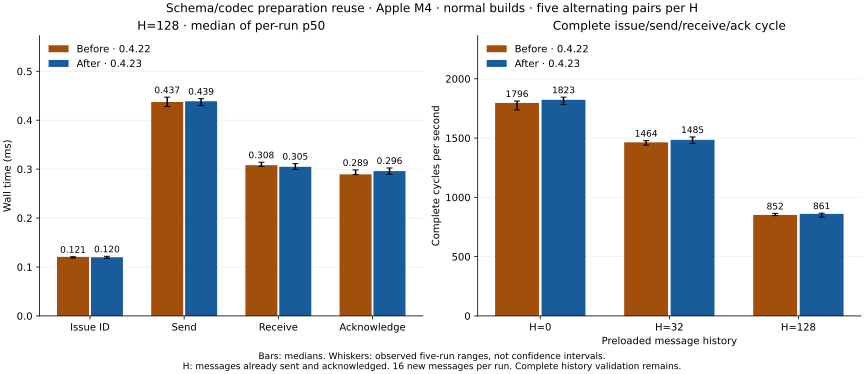
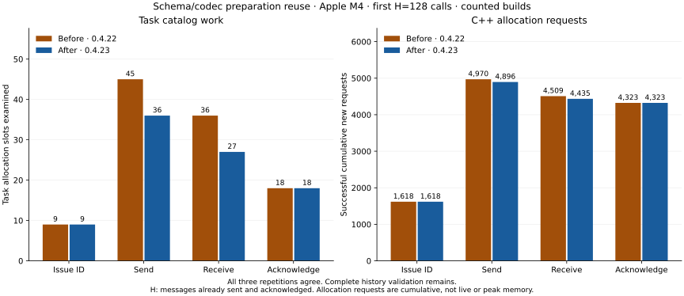

# Sharing checked schema preparation with payload codecs

Milestone 4 step **4.21**, framework **0.4.23**, continues [definition reuse](performance-definition-reuse.md). Send and receive now share fresh schema/Field preparation with their payload codec rather than loading the same Fields and Tasks again. Public APIs, stored formats, native protocols, headers and view lifetimes are unchanged. Integration into `main` remains held for measured improvements and qualification.

## What changes

A **payload codec** interprets application bytes using an exact message schema and its Field definitions. Resolving that schema already loads and validates Tasks, Fields and message schemas. Previously codec construction then loaded Tasks and Fields again under the same unchanged operation guard.

The private [LoadedSchemaContext](../src/runtime_state.h) owns the selected `LoadedSchema` and complete checked Field catalog. `runtime_schema_context` loads Tasks once, Fields once and schemas using those checked definitions, then selects the requested schema. Generic `runtime_schema` delegates to this fresh loader and returns the owning selected schema, preserving its invalid-ID and missing-schema behavior.

The [typed codec helper](../src/payload_runtime.h) accepts that selected schema and its checked Fields. It performs no live reads and builds an owning `BinaryPayloadCodec`; no input span or Task authority is retained. Its generic RuntimeAccess overload remains available and freshly loads Fields for callers that supply no prepared catalog.

Fresh Binary send uses the context at the original message-validation point, after any Source reconciliation. Other send formats still resolve the schema without constructing a Binary codec. Receive loads the context at the original post-mapping point, checks the exact retained schema reference and then constructs the codec. An existing local pin repeat still preserves its original mapping and dependencies.

## Risk assessment

The [performance/correctness guidance](../AGENTS.md#performance-and-correctness) supports removing a repeated Field/Task load when the same complete definitions are already checked under an unchanged mutation guard. Each endpoint preparation creates a fresh context. No pre-issuance topology is reused after issuance, no cross-operation cache is introduced, and no native ownership or mutation authority is attached to the copied context.

Receive keeps its existing order: commit issuance, read Publication metadata, run `before_mapping`, map the payload, load fresh schema context, verify the exact schema reference, construct the codec, run `before_binding`, bind the message and transfer mapping ownership. All fallible preparation remains after issuance, and failures still perform exact release cleanup or preserve discoverable uncertain state. This change does not add a trusted metadata-mapping overload or move schema construction across those hooks.

Tasks, Fields and schemas retain their full policy, index completeness, uniqueness, creator attribution, registration revision and version-chain checks during context loading. Codec construction retains the existing snapshot-based dependency and payload checks. Generic loaders remain fresh for corruption qualification. Immutable owning definitions can support codec construction after their live Session closes; they do not establish permission to mutate that Session or infer current Task ownership.

There is no Session mutation between the fresh context load and typed codec construction in endpoint callers. Unsupported raw writes bypassing the gate and arbitrary memory corruption during that short interval remain outside the coordination protocol. Later operations revalidate storage. MessageHeader copying, payload mapping ownership, close/deadline fences, token identity and recovery guarantees retain their existing behavior.

## Qualification and measurements

Focused tests cover fresh context definition reads, generic/typed codec equivalence and owned metadata lifetime. Public receive read-observer qualification distinguishes complete-history validation from message preparation and checks that the second preparation Field load disappears. Existing Binary/non-Binary admission, schema/Field corruption, mapping/binding failure cleanup, pin repeat, owning copies, deadlines, close, allowed loss, recovery and exhaustion tests remain relevant. The primer still uses the same public API.

The unchanged diagnostic workload compares preserved 0.4.22 executables with normal and enabled 0.4.23 builds. Normal builds supply timing comparisons; enabled controls explain Task slots, allocations and native work. Fresh Sessions, history/capacity/payload/Field controls, serial/backlog/thread/process workloads, raw outcomes and source/executable hashes are retained. Adjacent alternating pairs complement sequential matrices. Plots show observed ranges, not confidence intervals or production-tail guarantees. CI has no timing thresholds.

The [result directory](../benchmarks/results/milestone-4-payload-preparation/README.md) records measurements and plots. Complete prefix/delivery validation, repeated selected-Publication metadata reads, remaining identity/successor searches, allocation/copy costs, file checks/growth and idle polling remain candidates. Full-history scanning and the Session-wide mutation gate still limit scaling.

## Recorded results

The [retained evidence](../benchmarks/results/milestone-4-payload-preparation/README.md) includes **312 local runs** and **54 hosted Linux runs**, 366 total. Measured source is **`48d561f7a33d1a9d6f150d50e1b7dde87f7e431d`**. Preserved 0.4.22 binaries were not rebuilt; all 128 baseline inputs match the preceding measured source. Only VERSION and the five production files implementing preparation reuse differ among measurement inputs.

### Execution settings and comparison scope

The initial sequential before matrices ran with a `require_escalated` execution request because measurements followed worktree setup in that same command. Initial after matrices used `use_default`. Their cross-variant timing deltas therefore cannot isolate the optimization; they remain archived and are excluded from timing conclusions. The permission-profile penalty was not independently measured.

The original five-pair-per-history normal comparison already ran both versions under one `use_default` coordinator. It remains the primary study. A later eleven-case, three-pair normal matrix adds **66 matched control runs**, also under one default coordinator. The populations are kept separate, without pooling samples or replacing the primary results with a larger secondary gain. [Execution provenance](../benchmarks/results/milestone-4-payload-preparation/execution-contexts.toml) records the requests. The [methodology correction](performance-diagnostics.md#match-execution-settings-as-well-as-code) also annotates affected preceding reports; raw data is unchanged.

### Primary ordinary calls and complete cycles

Five adjacent alternating pairs per H use fresh sixteen-message serial windows on the Apple M4, with diagnostics OFF. **H means history:** messages already sent and acknowledged before the window begins. Within each run, p50 uses nearest rank; the table compares medians of those per-run values. Complete-cycle rate uses completed messages divided by the entire issue/send/receive/ack window, then the median. It is not reconstructed from latency medians.

| H | Send ms, before → after | Receive ms, before → after | Acknowledge ms, before → after | Complete cycles/s, before → after |
| --- | ---: | ---: | ---: | ---: |
| 0 | 0.227208 → 0.222916 | 0.129875 → 0.125209 | 0.120375 → 0.118709 | 1,795.95 → 1,822.77 |
| 32 | 0.268709 → 0.270250 | 0.167291 → 0.163500 | 0.158875 → 0.157292 | 1,463.82 → 1,484.78 |
| 128 | 0.437291 → 0.438791 | 0.308042 → 0.304833 | 0.289416 → 0.296125 | 851.52 → 860.74 |

Receive medians fall **3.6%/2.3%/1.0%** at H=0/32/128, and cycle medians rise **1.5%/1.4%/1.1%**. These are small observed changes with overlapping five-run ranges for every operation, control and cycle rate. H=128 receive paired changes range from 3.0% lower to 1.8% higher. Send medians at H=32/128 rise 0.6%/0.3%; H=128 acknowledgment rises 2.3%. ID issuance medians fall 0.4%/0.7%/0.7% despite unchanged work. Timing noise and code-layout effects are not isolated. Whiskers are observed ranges, not confidence intervals or evidence of statistical significance. All reports and outliers remain.

### Exact work removed

All three counted repetitions agree on the first H=128 calls:

| Operation | Task slots examined, before → after | C++ allocation requests, before → after | Requested bytes, before → after |
| --- | ---: | ---: | ---: |
| Issue ID | 9 → 9 | 1,618 → 1,618 | 308,544 → 308,544 |
| Send | 45 → 36 | 4,970 → 4,896 | 712,900 → 702,844 |
| Receive | 36 → 27 | 4,509 → 4,435 | 597,108 → 587,052 |
| Acknowledge | 18 → 18 | 4,323 → 4,323 | 574,964 → 574,964 |

Send/receive each remove **nine Task slots, 74 allocations and 10,056 requested bytes** in these matched shapes. Task-slot work falls 20%/25%; allocation requests fall 1.5%/1.6%, and requested bytes 1.4%/1.7%. Slots include unused allocation-table slots, not just distinct Tasks. Allocations are cumulative successful C++ new requests in the captured thread, not live/peak memory or all process allocations.

Across 603 samples in nine counted run pairs, only send/receive Task-slot, allocation-request and allocated-byte counters change. Issue, acknowledgment, status, identical retry and empty-receive counters are identical. Prefix, topology, delivery, Publication lookup, native mapping/read/stat, gate and recovery counts remain. First H=128 receive still has one prefix scan/321 visits, one topology build, one delivery validation, 129 Publication checks, 16 maps, zero native reads and 45 stats. Counter comparisons establish the work removed; the initial populations' unmatched execution settings are not used to estimate a timing effect.

### Matched wider controls

The additional three-pair normal matrix uses the same eleven cases and workloads as the diagnostic driver, alternating adjacent before/after invocations under matching settings. All **66/66** workloads complete sixteen messages with zero pending or unacknowledged-at-stop deliveries.

| Matched control | Receive ms, before → after | Median change |
| --- | ---: | ---: |
| Serial H=0 | 0.129583 → 0.120625 | −6.9% |
| Serial H=32 | 0.165333 → 0.159125 | −3.8% |
| Serial H=128 | 0.312500 → 0.289666 | −7.3% |
| Unrelated history H=128 | 0.305583 → 0.297459 | −2.7% |
| Sixteen-times capacity | 0.439500 → 0.417542 | −5.0% |
| 256-byte payload, one Field | 0.325584 → 0.309958 | −4.8% |
| 256-byte payload, 32 Fields | 0.309292 → 0.307708 | −0.5% |
| Backlog | 0.306291 → 0.308875 | +0.8% |

The secondary H=128 send/receive/ack medians fall 6.0%/7.3%/1.8%, while unchanged-work ID issuance falls 4.3%. Their differences from the primary cohort demonstrate variability, not a reason to select the larger gain. Some three-run ranges do not overlap; this small study establishes no confidence interval or significance claim.

No-idle thread-stream elapsed ranges are 20.382–21.055 ms before and 19.767–21.556 ms after (median 4.2% lower). Three-idle ranges are 34.941–38.238 and 35.660–44.419 ms (median 5.4% higher). Process ranges are 18.472–19.586 and 18.308–20.202 ms (median 1.8% lower). All elapsed ranges overlap. Concurrent receive includes publication waiting and scheduling; no universal stream-speedup or fairness claim follows.

The after enabled H=128 receive p50 is 0.309958/0.311292/0.313000 ms in None/Counts/Timings, versus 0.305708 in the initial ordinary after matrix. These after populations share default execution settings but are sequential; they do not supply a causal instrumentation-overhead estimate. Normal matched comparisons supply timing observations, counters establish work reduction, and CI qualifies behavior without thresholds.

Strict local diagnostics OFF/ON and measured-source CI pass **820/820 tests** on all three automatic profiles. Hosted Linux completes **54/54** workloads, including all six three-idle-poller runs, with all 128 input hashes matching the measured source. Its first H=128 Task-slot counts match local controls and complete validation/native counts remain unchanged. The result README links logs and records heap and whole-program syscall evidence with explicit limits.
