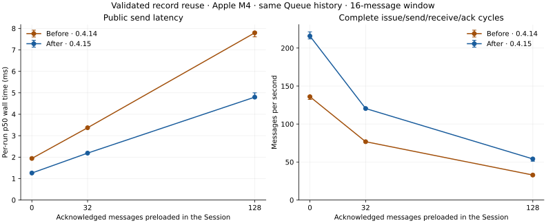

# Reusing validated record information

Milestone 4 step **4.13**, framework **0.4.15**, is the first optimization selected from the [diagnostic findings](performance-diagnostics-findings.md). It removes repeated reads of committed record framing during a public operation. The public API, native format, gate protocol, and recovery behavior are unchanged. Milestone integration into `main` remains held for further measured improvements and qualification.

## What changes

A **record boundary** is the exact starting offset of a committed arena record. Its validated metadata includes the decoded envelope (kind, size, and generation) and the immutable/mutable extents. The journal already walks these records, checks their boundaries and framing, and validates their manifest chain before returning a clean snapshot.

Previously RuntimeAccess discarded those decoded envelopes, then read and decoded the entire prefix again to build a lookup index. It now adopts the journal's owning record copies. Exact-boundary lookup reuses the shared `find_journal_record` helper; references into the middle of a record and references of the wrong kind still reject. The returned metadata does not alias mapped storage.

Mutation preflight also used to scan once to validate its clean snapshot and a second time to obtain the same record ranges. The first pass now supplies those ranges directly to local planning. Preflight still obtains its own fresh snapshot; it does not trust a snapshot from an earlier API call.

For a healthy direct mutation, the expected change is **three to two full-prefix scans**, and **one to zero separate runtime index scans**. Status, identical retry, and empty polling retain their fresh prefix validation but lose the separate index scan. Diagnostic counter/phase names remain available, so old and new reports can be compared without changing their schema.

## Risk assessment

Performance and correctness have equal standing under the [project guidance](../AGENTS.md#performance-and-correctness). This change removes repeated work rather than adding a long-lived cache or additional cache-validity machinery.

- Supported Session mutations are coordinated by the held gate. Re-reading an immutable envelope during the same validation/planning pass adds cost without a new supported state transition to observe. Planning between the reused scan and execution constructs local objects; it does not modify the Session.
- Every ordinary journal snapshot and execute entry still validates freshly. Another completed operation, a stale generation with an unchanged tail, failed preflight, and non-idle recovery retain their existing checks. Arbitrary external writes are not made safe by repeatedly rereading bytes within an operation.
- The private snapshot overload clears its output before work and moves record ranges into it only after complete validation. An error exposes neither old ranges nor a partly validated prefix. The copies own their metadata and remain stable while the operation uses them.
- RuntimeAccess retains two additional integer fields per record because it adopts the existing journal range type. That modest transient metadata cost replaces a second allocated vector and its complete reread. Allocation requests, cumulative requested bytes, and native work are measured below; none is a claim about peak or resident memory.

No documented delivery or corruption-rejection guarantee is weakened in this step. This is a scoped decision, not a rule that all current defensive checks must be preserved forever. Further reductions should be assessed against their measured benefits, supported failure model, implementation complexity, and explicitly accepted risks.

## Qualification and measurements

Two new journal tests demonstrate complete record exports across append/fixed-state/append operations and empty output after late historical corruption. Existing tests cover exact boundaries, forged interior references, wrong kinds, fresh access after appends, metadata inspection without retained-payload reads, stale plans, no-write rejection, process death, recovery, rollback, Source cleanup, and deadlines.

The measurement plan uses the unchanged public diagnostic workload and preserves the exact pre-change executables. Normal Release builds establish latency/throughput differences; enabled builds explain scan, read, mapping, stat, and allocation changes. Fresh Sessions, fixed geometry, matched history/bytes/Fields/capacities, and explicit incomplete outcomes retain the [diagnostic method](performance-diagnostics.md). Timing is never a CI pass/fail threshold.

The [retained results](../benchmarks/results/milestone-4-prefix-reuse/README.md) record **33 fresh normal-before**, **33 normal-after**, and **75 enabled-after** runs, plus hosted Linux evidence. Measured after source is **`a1d94eb6bc19bae02a7ab7740f486d8b3bc41968`**. The preserved baseline executable and all 127 measured input hashes match the diagnostic baseline; its new measurement checkout is merged staging `617cf16`. Compiler/optimization settings and workload are matched. The studies run sequentially rather than randomized, with three small repetitions and no thermal/load/cache controls; these are observed improvements, not confidence intervals or production tail guarantees.

Each latency cell below is the median of three per-run nearest-rank send p50 values. Throughput is the median of each run's completed messages divided by its entire issue/send/receive/ack window.

| Preloaded history H | Send before, ms | Send after, ms | Latency reduction | Complete cycles/s before | After |
| --- | ---: | ---: | ---: | ---: | ---: |
| 0 | 1.939 | 1.260 | 35.0% | 135.99 | 215.82 |
| 32 | 3.371 | 2.188 | 35.1% | 76.77 | 120.44 |
| 128 | 7.795 | 4.798 | 38.5% | 32.91 | 54.11 |

At H=128, ID issuance falls **6.117→3.241 ms**, receive **8.837→5.904 ms**, and acknowledgment **7.523→4.498 ms**. Complete-cycle throughput rises **64.4%**. Unrelated-Queue history, sixteen-times capacity, 256-byte payload/32-Field controls, and backlog also improve: send p50 reductions are about **35.6–37.7%** across those controls. On the local Mac, the matched two-claim thread and independent-process cases both finish their requested sixteen messages before and after. Their median cycle rates rise **30.61→51.74** and **32.27→52.76 messages/s**, respectively; neither is a comparison with the nine-claim serial cohort.

The first fresh H=128 send's work counters explain the gain:

| Work in one call | Before | After |
| --- | ---: | ---: |
| Full-prefix scans / record visits | 3 / 957 | 2 / 638 |
| Separate runtime index scans / visits | 1 / 319 | 0 / 0 |
| Map attempts | 1,596 | 958 |
| Read attempts | 5,068 | 3,007 |
| Stat attempts | 8,397 | 5,215 |
| C++ allocation requests | 11,969 | 8,558 |
| Cumulative requested bytes | 1,421,884 | 1,034,324 |

Before counter values come from the same-shape retained step-4.12 enabled cases; after values are identical across all three new counted repetitions. Fresh normal builds provide the timing comparison. All after raw samples and complete idle aggregates report zero separate index scans/visits. Observational status/retry/empty calls still scan the prefix once, but no longer reread it for a runtime index. Topology and delivery validation remain present, and healthy serial runs have no non-idle recovery.

**Polling progress remains unresolved.** All three before and after normal three-idle-poller streams reach their five-second cooperative budget. Before accepted/acknowledged pairs are **1/0, 0/0, 0/0**; after they are **1/1, 2/1, 1/0**. All six enabled after idle-load cases stop early too. These are censored progress observations, not complete-workload throughput. Less file work does not establish a fair handoff of the gate.

The hosted Linux matrix independently confirms the same per-send scan/read/map/stat reductions. Of 54 runs, 43 complete and 11 stop at the budget: five of six ordinary two-thread streams and all six three-idle-poller streams still stop early, while all six independent-process cases finish. Its eight-message windows and hosted hardware differ from the Mac studies, so their absolute timings are not a controlled speed comparison. The retained trace also shows process-ID/metadata/mapping calls remain frequent.

Both local strict Release configurations, diagnostics ON and OFF, pass **798/798** tests, including the two new tests. Hosted qualification verifies the same code on Linux x86_64, Linux ARM64, and macOS ARM64. The unchanged benchmark smoke and all seventeen primer walkthrough targets remain included. Timing is recorded rather than used as a speed gate.

This first change still performs history-dependent validation. Native helpers still account for about 81% of timed H=128 send wall time. It does not resolve the separately measured polling/gate handoff problem or establish bounded latency. The next candidates remain native metadata/mapping work and polling progress, informed by the updated measurements.
