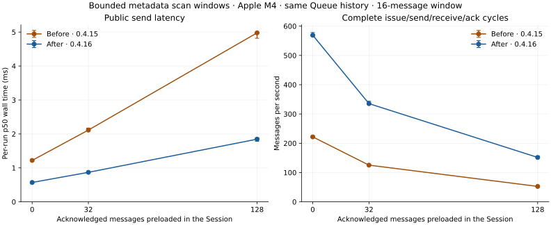

# Scanning history through bounded mapped windows

Milestone 4 step **4.14**, framework **0.4.16**, continues the [performance investigation](performance-diagnostics-findings.md) after [validated-prefix reuse](performance-prefix-reuse.md). It replaces repeated tiny native reads and mappings inside a committed-prefix scan with a scan-local **64 KiB mapping window**. The public API, mapped format, and synchronization protocol are unchanged. Integration into `main` remains held for measured improvements and qualification.

## What changes

The **committed prefix** is the retained arena ending at the authoritative allocation tail. Each record has an envelope, an atomic readiness word, immutable metadata, and any mutable storage. A scan checks every record and the manifests that describe completed append batches.

Previously each visited record required two envelope reads, a tiny readiness mapping, and a bounded metadata-body read; manifests required another read. Those calls repeatedly checked file size and process ownership and created/destroyed native mappings.

A private PrefixReader now keeps one bounded mapping while the scan traverses that region. It copies only the requested immutable metadata and loads readiness through `AtomicWord`. Copies crossing a window boundary refill the window in pieces; manifests larger than 64 KiB remain supported. The last window ends at the scan's tail. Only owning metadata copies leave the scan.

The same envelope assembly and validation code serves the window reader and the ordinary NativeFile reader. Accepted-batch validation, append materialization, RuntimeAccess reads, payload mappings, and the general NativeFile API keep their existing paths. A healthy operation still performs two full-prefix scans and no separate runtime index scan; this change reduces their native work rather than skipping validation.

## Risk assessment

Under the [project guidance](../AGENTS.md#performance-and-correctness), the native-call cost is weighed against the failures each repeated check can prevent.

- Supported Session mutations use the held gate. Rechecking ownership and physical size for every immutable slice inside the same scan adds substantial cost without a supported intervening writer. Journal entry and each new mapping still perform the ordinary native checks. There is no cache between scans or API calls.
- The mapping is bounded to at most 64 KiB of logical file bytes, rather than reserving an arbitrarily large contiguous address range for the entire log. Its first page can include bytes before the arena, but reader bounds prevent accessing them. A refill clears borrowed spans before releasing their owner.
- Recovery scans map only their base prefix, never provisional EOF. Their mapping leases end at or below that tail and disappear before rollback can shrink an unaccepted append. Payload views retain their independent ownership and pins.
- A mapping may virtually cover payload pages between metadata requests; the scanner does not inspect or copy those payload bytes. Envelope readiness is excluded from ordinary envelope copies and loaded only through the atomic adapter.
- Metadata scanning now uses mapped-I/O behavior for more bytes. Unsupported external truncation after a mapping is created, or an OS mapped-page I/O fault, can fault the process rather than returning a `pread` error. Existing readiness/payload mappings already depend on that native failure model. Repeated `fstat` cannot make arbitrary external truncation safe. This is an explicit tradeoff for fewer native calls, not a promise of hardware-failure containment.

The general NativeFile adapter retains fresh-size checks, independent handle limits, alias/shrink leases, and fork ownership rejection. Its adversarial external-truncation tests remain unchanged. Supported process-death recovery, stale plans, corruption rejection during normal validation, and rollback are qualified separately from unsupported concurrent file tampering.

## Qualification and measurement

Two new private journal tests cover a Task body crossing a window boundary, a manifest larger than one window, corruption beyond the third window, a partial final window, and actual FileGrowth failure followed by rollback and retry. Their framing fixture is not application topology setup. Existing atomic ordering, metadata-only payload inspection, NativeFile, guard/fork ownership, payload lifetime, recovery, and deadline tests remain relevant.

The unchanged diagnostic workload compares fresh normal Release runs before and after the change. Enabled runs explain actual native calls and allocation requests. The exact pre-change executables are preserved before rebuilding. Source/executable hashes, compiler flags, geometry, outcomes, and raw operation samples accompany the results. Small sequential runs describe this host; they do not qualify production tail latency. CI checks correctness and records observations without timing thresholds.

The [retained evidence](../benchmarks/results/milestone-4-prefix-windows/README.md) includes **33 fresh normal-before**, **33 normal-after**, and **75 enabled-after** local runs. Measured after source is **`10053fa7227fd26fc7d77bc0ac31410e164ae716`**. The preserved 0.4.15 binary and all 127 before inputs match the preceding optimization baseline; both after studies have identical inputs, with only VERSION and the journal implementation changed. Compiler/optimization settings and workload axes match.

Each cell below summarizes three separate 16-message runs on the Apple M4 host. Send p50 uses nearest rank within a run, then the median across runs. Cycle throughput is each run's completed messages divided by its complete issue/send/receive/ack window, then the median.

| Preloaded history H | Send before, ms | Send after, ms | Latency reduction | Complete cycles/s before | After |
| --- | ---: | ---: | ---: | ---: | ---: |
| 0 | 1.220 | 0.571 | 53.2% | 221.82 | 569.04 |
| 32 | 2.114 | 0.869 | 58.9% | 125.29 | 335.34 |
| 128 | 4.977 | 1.846 | 62.9% | 52.66 | 151.63 |

At H=128, ID issuance falls **3.314→0.182 ms** (94.5% lower), receive **5.966→3.011 ms** (49.5% lower), and acknowledgment **4.592→1.487 ms** (67.6% lower). Complete-cycle throughput rises **187.9%**, about **2.9×**. Unrelated-Queue history, sixteen-times capacity, payload/Field controls, and backlog also complete and improve, with send p50 reductions of about **59–64%**. Matched two-claim thread and separate-process studies complete all sixteen messages before and after, with median rates **51.94→137.06** and **51.83→154.85 messages/s**; these are not comparisons with the nine-claim serial cohort.

Counted first-send work at H=128 confirms the access-method change:

| Work in one call | Before | After |
| --- | ---: | ---: |
| Full-prefix scans / record visits | 2 / 638 | 2 / 638 |
| Separate runtime index scans | 0 | 0 |
| Map attempts | 958 | 324 |
| Native read attempts | 3,007 | 791 |
| Stat attempts | 5,215 | 1,409 |
| C++ allocation requests | 8,558 | 7,290 |
| Cumulative requested bytes | 1,034,324 | 968,388 |

Before counts use the identical-shape retained 0.4.15 enabled cases; fresh normal runs provide the timing comparison. After counts are identical across the three matching repetitions. Healthy serial cases perform no non-idle recovery. All records and manifests are still checked: mapped copies are not counted as `pread` calls. First H=128 ID issuance now needs only **10 maps / 9 native reads / 45 stats**, down from **644 / 2,225 / 3,851**.

**Polling progress remains unresolved.** All three normal three-idle-poller cases still reach the cooperative five-second budget. Before accepted/acknowledged pairs are **2/1, 2/2, 4/1**; after they are **2/1, 2/1, 1/0**. All six enabled idle-load cases stop early too. These censored outcomes do not prove a fair handoff after reducing gated work.

The [hosted Linux matrix](../benchmarks/results/milestone-4-prefix-windows/linux-x86_64-after/) independently confirms the same H=128 native counters: two scans/638 record visits, 324 maps, 791 reads, and 1,409 stats. Of 54 runs, 48 complete and all six three-idle-poller cases stop early. All ordinary two-thread and independent-process cases finish in this matrix. That observed outcome does not establish a fair gate handoff: the algorithm is unchanged, hosts/scheduling differ, and loaded polling still stalls. Its eight-message windows also differ from the local sixteen, so absolute hosted timing comparisons are not controlled speed measurements.

Both strict local Release configurations, diagnostics ON and OFF, pass **800/800** tests, including the two new tests. The original benchmark smoke, native process walkthroughs, and all seventeen primer targets remain included. Hosted profiles qualify the same code on Linux x86_64, Linux ARM64, and macOS ARM64.

Native helpers still account for about **69% of send** and **73% of receive** exclusive wall time in the H=128 timed study. The remaining work still scales with retained history, and the separate polling/gate handoff problem remains to be addressed. Further optimization of RuntimeAccess metadata reads is outside this focused scan-reader step.
