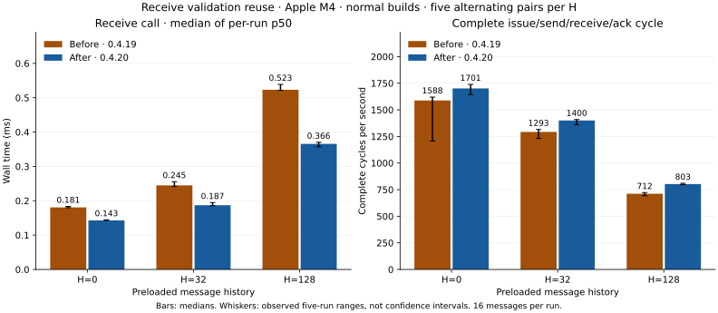
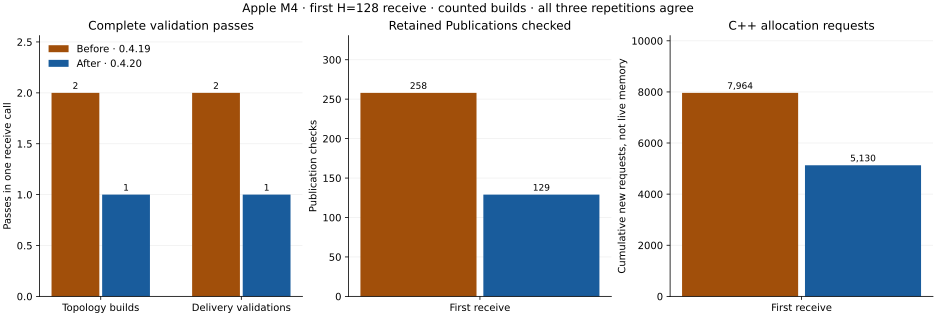

# Reusing receive selection validation during issuance

Milestone 4 step **4.18**, framework **0.4.20**, continues the [performance investigation](performance-diagnostics-findings.md) after [operation-entry validation reuse](performance-operation-validation.md). It removes duplicate topology construction and delivery-history validation between selecting a delivery and issuing it under the same mutation gate. Public application interfaces, MessageHeader/payload lifetimes, stored formats and native protocol versions are unchanged. Integration into `main` remains held for measured improvements and qualification.

## What changes

A **TopologySnapshot** is the private owning model built by `runtime_topology` within one recovered RuntimeAccess. Its construction checks definitions, current relationships and complete delivery history before selection. Previously receive built this model, selected a Source/Queue, then issuance built and validated the same model again while the gate was still held. The preceding first H=128 receive counted two topology builds, two delivery validations and 258 Publication checks (twice the 129 retained Publications).

Receive now passes its already validated model to a trusted private issuance overload. The general issuance function still builds a fresh model. Both paths share the same issuance body and retain native guard/capability checks, Session and consumer-claim checks, Thread-parent checks, fresh Source/Queue/receipt word reads, active-state/counter checks, exact delivery lookup, and journal execution.

The reuse applies to fresh issuance and an existing pin. Source reconciliation completes before selection validation. Allowed-loss evaluation retains its own generic validation: a successful empty result performs no transaction, so issuance can still use the earlier model; a committed gap or error returns from receive before issuance. Post-issuance mapping/binding failure releases through the generic progress path, validating freshly after the mutation.

## Risk assessment

The [project guidance](../AGENTS.md#performance-and-correctness) gives performance and correctness equal priority. Under the supported protocol there is no intervening writer while this unchanged receive operation continuously holds its mutation guard. A second full delivery-history pass repeats established facts at substantial cost.

- The trusted overload accepts only the complete, unmodified model from `runtime_topology(access)` under that same live access and continuously held guard, with no intervening Session mutation. An arbitrary model, a different access or an old model after progress violates this private precondition. It is not a public application API or a cache between receive calls.
- This changes validation frequency in a narrow internal interval. Unsupported raw metadata writes or arbitrary memory corruption between selection validation and issuance may no longer be caught by a duplicate pass. Fresh operations and generic progress functions still validate. The existing coordination model does not promise continuous detection of writers that bypass the gate.
- Fresh claim/parent, pin, Queue and receipt reads remain. Reuse removes complete-model reconstruction, not those checks. Existing pins preserve token, dequeue time and mapping identity; repeat receive still precedes fresh selection/counter checks.
- No validation is reused across a committed gap, issuance, release, acknowledgment, reconciliation mutation, or operation boundary. Allowed-loss null-result semantics are documented because that branch must remain free of transactions. Generic loss evaluation and post-issuance cleanup retain their validation paths.
- Existing deadline checks and Source close fences stay at their current boundaries. A faster validation pass does not create a hard response-time promise. Issuance still commits before payload mapping/binding; failed local preparation still performs exact cleanup or retains discoverable uncertain state.

No mapping or snapshot escapes the operation through this change. Payload views keep their existing independent owner and persisted pin. Generic primitives remain appropriate for qualification fixtures that deliberately modify storage. The accepted tradeoff is trusting the already validated model during this short, unchanged gate-held interval.

## Qualification and measurements

Focused private tests compare trusted and generic issuance/pin-repeat behavior, preserve participant/Queue rejection without writes, and verify generic progress still detects same-root corruption. Existing public receive, allowed-loss/gap, deadline, close, cleanup, recovery, ownership/fork, payload lifetime and full-log tests remain relevant. These private storage fixtures are separate from the primer's application examples.

The unchanged diagnostic workload compares preserved 0.4.19 executables with normal and enabled builds. Fresh Sessions, matched geometry/history/capacity/payload/Field controls, independent thread/process workloads, raw outcomes and source/executable hashes are retained. Normal builds supply timing comparisons; enabled counters explain which work disappeared. Adjacent alternating serial pairs complement sequential full matrices. Plots show observed per-run statistics, not confidence intervals or production-tail guarantees. CI records correctness and observations without timing thresholds.

The [retained evidence](../benchmarks/results/milestone-4-receive-validation/README.md) includes **33 fresh normal-before**, **33 normal-after**, **75 enabled-after**, **30 alternating serial runs**, and **54 hosted Linux runs** (225 total). Measured after source is **`762b4baa2a43630763f316d0e797a68de6814972`**. Before/after each retain 128 input hashes; the preserved baseline matches the preceding measured 0.4.19 source. Compiler settings and diagnostic workloads match. Measured channels use default RecoverFromLog delivery; generic allowed-loss evaluation may still perform additional validation passes.

### Receive latency and complete cycles

The primary comparison uses five alternating sixteen-message serial runs per variant at each preloaded history H on the Apple M4. Latency is nearest-rank receive p50 within each run, then the median across runs. Complete-cycle rate is each run's completed messages divided by its entire issue/send/receive/ack window, then the median. Percentage changes compare variant medians, not medians of paired percentages. Rates are not reconstructed from latency medians.

| Preloaded history H | Receive before, ms | Receive after, ms | Latency reduction | Complete cycles/s before | After |
| --- | ---: | ---: | ---: | ---: | ---: |
| 0 | 0.181 | 0.143 | 20.9% | 1,587.94 | 1,701.12 |
| 32 | 0.245 | 0.187 | 23.5% | 1,292.57 | 1,399.93 |
| 128 | 0.523 | 0.366 | 30.1% | 711.79 | 802.61 |

Complete-cycle throughput increases about **7.1%, 8.3%, and 12.8%** at H=0/32/128. Every H=128 paired receive p50 improves, by roughly **29.9–31.7%**. Whiskers in the plot show observed five-run ranges, not confidence intervals. The slower H=0 before-rate run remains included; these small samples do not establish production tail behavior.

The initial sequential matrices corroborate receive reductions of roughly **24%, 24%, and 30%** at H=0/32/128. Unrelated-Queue history, sixteen-times capacity, payload/Field controls and backlog all complete, with receive reductions of about **30–33%**. All ordinary thread, independent-process and loaded-polling cases complete sixteen messages before and after. Receive-call medians improve about **10–13%** in those concurrent cohorts, while their active claim counts and work boundaries differ from serial. Three-idle-poller elapsed ranges overlap (**35.8–46.5 ms** before, **35.5–43.0 ms** after); this is not a loaded scheduling or fairness guarantee.

**Other public calls are not claimed to improve.** Their matched counted work is unchanged, and alternating issue/send/ack medians have small mixed changes. H=32 issue/ack medians are about **2.1%/2.2% higher**, with overlapping run ranges and mixed paired changes. This study cannot assign those differences solely to the refactoring or prove zero overhead. The reduction claim targets receive validation and its measured call/cycle costs.

### Work removed

All three matching counted repetitions agree for first H=128 receive:

| Work in one receive call | Before | After |
| --- | ---: | ---: |
| Topology builds | 2 | 1 |
| Complete delivery validations | 2 | 1 |
| Retained Publications validated | 258 | 129 |
| Task slots visited | 90 | 63 |
| Full-prefix scans / record visits | 1 / 321 | 1 / 321 |
| Separate runtime index scans | 0 | 0 |
| Native map attempts / read attempts / stat attempts | 24 / 0 / 53 | 18 / 0 / 47 |
| C++ allocation requests | 7,964 | 5,130 |
| Cumulative requested bytes | 955,520 | 666,708 |

Allocation requests fall about **35.6%** and cumulative requested bytes about **30.2%**. They are successful cumulative C++ new requests, not live/peak memory or all process allocations. Every retained Publication is still validated in the initial complete model; only the second pass within that unchanged gate-held interval is omitted. Fresh live issuance checks remain. Prefix, gate and recovery counters are identical across matched counted serial samples; all nonreceive counters also remain identical.

Enabled H=128 receive medians are **0.369 ms None**, **0.372 ms Counts**, and **0.385 ms Timings**; initial normal observes **0.367 ms**. Observation overhead and run variability remain visible; normal builds provide the performance comparisons.

Both strict local Release configurations, diagnostics ON/OFF, pass **812/812** tests, including the three new private scenarios, existing public deadline/allowed-loss/cleanup/recovery tests, original benchmark smoke, native walkthroughs and seventeen primer programs. Hosted Linux x86_64, Linux ARM64 and macOS ARM64 also pass all 812 tests for the measured code. The retained Linux matrix completes 54/54 eight-message workloads, including all six loaded cases, with all 128 input hashes matching. It independently confirms one topology build, one delivery validation and 129 Publication checks, plus unchanged one prefix scan/321 visits. Heap/timing values need not match across platform/library/window differences; whole-program syscall evidence is separate from ordinary latency.

One full prefix scan and one delivery-history validation still scale with retained history. Decoding/allocation, file growth/resource checks and idle spinning remain costs. No cross-call cache, waiting policy, fairness guarantee or hard latency bound is added.
