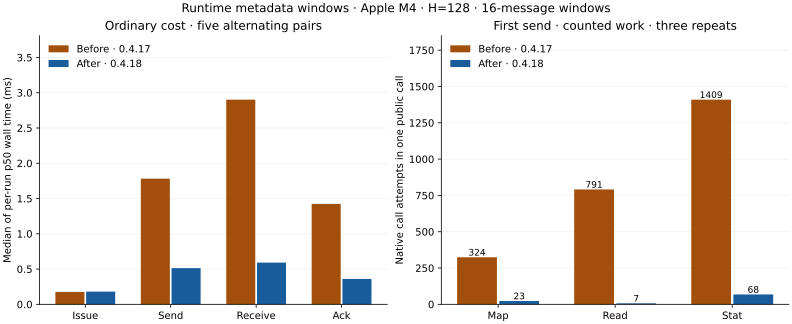

# Reusing bounded runtime metadata mappings

Milestone 4 step **4.16**, framework **0.4.18**, continues the [performance investigation](performance-diagnostics-findings.md) after [local gate handoff](performance-gate-handoff.md). It reuses small mappings while one public operation reads Session metadata. The public API, mapped format, synchronization protocol, validation rules, and payload ownership retain their existing contracts. Integration into `main` remains held for measured improvements and qualification.

## What changes

A **RuntimeAccess** is the private recovered view held under the mutation gate for one operation. It obtains an owning index of validated record envelopes, reads immutable metadata into owning byte vectors, and reads mutable words through the native atomic adapter. Previously each metadata request made another native read or short-lived mapping, repeating file-size and process checks. At H=128, the preceding counted first send still made 324 mappings, 791 native reads, and 1,409 stat attempts.

RuntimeAccess now keeps two independent **64 KiB mapping windows**: one for atomic words and one for immutable copies. A window retains only the last region used by that reader. Separating the readers avoids replacing a history mapping every time an operation inspects mutable state. Large requests proceed through successive windows. No returned vector borrows a window, and mutable values are loaded afresh with `AtomicWord::load_acquire`; retaining a mapping does not retain a previous word value.

The journal's existing scan-local reader shares the focused private window helper. Its range checks, envelope assembly, atomic readiness, and full-prefix validation remain in the journal. There is no mapping or decoded-state cache between operations. Payload views retain their own mappings and pins.

## Risk assessment

The [project guidance](../AGENTS.md#performance-and-correctness) gives performance and correctness equal priority. The supported operation holds the mutation gate throughout recovery, metadata reads, and mutation. Repeating a native call for every metadata slice does not protect against a supported intervening Session writer.

- Operation entry and each new mapping retain their ordinary ownership/resource checks. Each RuntimeAccess read also checks its guard's process/thread owner before reusing a window. A reused window avoids repeated native size checks and mapping construction. The private reader requires its owning operation's valid held guard; it is not a general unlocked file reader.
- Window ends are bounded by the operation's initial recovered file size/committed tail. A retained window also retains its native shrink lease until replacement or operation end. A subsequent append can roll back to that original end while these windows remain live. They cannot cover a provisional append, and their owners are destroyed before the operation releases its guard. Existing payload leases remain independent.
- Each reader retains at most 64 KiB of logical file bytes; journal and payload mappings are separate. A larger mapping can increase cumulative mapped-byte counters even while reducing native call counts; mapped bytes are not resident memory. A refill clears its borrowed span before releasing the mapping. Bounds checks precede requests, including empty ones. Only requested immutable slices are copied, and live synchronization words remain atomic even when a mapping virtually covers adjacent bytes or payload pages.
- Metadata reads now use mapped I/O more widely. Unsupported external truncation after mapping, or an OS mapped-page I/O fault, can fault the process rather than return a `pread` error. Existing readiness/payload mappings already use that native failure model. Repeated `fstat` cannot make arbitrary concurrent truncation safe. This is an explicit tradeoff, with no hardware-failure containment promise.

The general NativeFile adapter retains fresh-size checks, independent limits, alias/shrink leases, and fork rejection. All validation still runs; only its access method changes. Cross-process commits, recovery, and corruption are inspected by a fresh operation. History-dependent validation and idle-polling CPU pressure remain separate costs.

## Qualification and measurements

Private tests qualify copies and word ranges crossing window boundaries, movement of populated readers with their guard, fresh atomic values on a cache hit after a mapped update, bounds/empty reads, and actual append failure followed by rollback and retry with both runtime readers live. Existing metadata-only observation, journal boundary/large-manifest/corruption tests, public ownership/fork checks, recovery, and payload lifetime tests remain relevant. These are storage qualification fixtures, not application setup examples.

The unchanged diagnostic workload compares preserved 0.4.17 executables with fresh normal and enabled builds. Exact input/executable hashes, compiler settings, geometry, complete or budget-stop outcomes, and raw samples accompany the measurements. Normal builds supply performance comparisons; enabled counts and timings explain work. Adjacent alternating serial pairs check ordinary-call cost separately from sequential full matrices. CI records correctness and observations without timing thresholds. Small host studies do not qualify production tail latency.

The [retained evidence](../benchmarks/results/milestone-4-runtime-windows/README.md) contains **33 fresh normal-before**, **33 normal-after**, **75 enabled-after**, **30 alternating serial runs**, and **54 hosted Linux runs** (225 total). Measured after source is **`47da91cbcded7bf6c6bd160129eaccfa8de88b51`**. The preserved 0.4.17 baseline matches all 127 preceding inputs; both after builds share 128 hashes, including the new helper. The runner, compiler flags and workload controls match.

### Ordinary performance

The primary table uses five alternating sixteen-message serial runs per variant at each history H on the Apple M4. Send p50 is nearest rank within each run, then the median across runs; reduction compares those variant medians. Throughput is each complete run's messages divided by its issue/send/receive/ack window, then the median. It is not inferred from a sum of latency medians.

| Preloaded history H | Send before, ms | Send after, ms | Latency reduction | Complete cycles/s before | After |
| --- | ---: | ---: | ---: | ---: | ---: |
| 0 | 0.544 | 0.252 | 53.6% | 591.00 | 1,455.36 |
| 32 | 0.840 | 0.300 | 64.3% | 353.49 | 1,132.91 |
| 128 | 1.782 | 0.513 | 71.2% | 158.73 | 601.53 |

At H=128, receive falls **2.901→0.592 ms** (79.6% lower), and acknowledgment **1.423→0.360 ms** (74.7% lower). Complete-cycle throughput is about **3.8×** the before value. Every paired H=128 send p50 improves by roughly **70.4–71.5%**, without discarding any pair.

**ID issuance has a small observed cost at H=128:** its alternating medians rise **0.176→0.180 ms**, about 2.3%; individual paired changes range from about −1.4% to +4.2%. The initial sequential study also rises **0.174→0.180 ms**, about 3.4%. H=0/32 alternating issue medians improve instead. The shared reader adds local range/result handling to the already optimized journal scan; these small studies cannot isolate that cost from host/run variability. The accepted tradeoff is a possible small issuance cost alongside the much larger send/receive/ack benefit, with no zero-overhead claim.

The initial full matrices corroborate send reductions of about **49%, 62%, and 70%** at H=0/32/128. Unrelated-Queue history, sixteen-times capacity, payload/Field controls and backlog also finish, with send reductions of about **68–71%**. All ordinary thread, independent-process and loaded-polling cases complete sixteen messages before and after. Three-idle-poller elapsed windows fall from **210–259 ms** to **44–49 ms**. The process study retains an after outlier of about 81 ms beside two 27–28 ms runs; absolute medians are not production tail guarantees or controlled platform comparisons.

### Native work and remaining costs

All three matching counted repetitions agree for each quoted first-send value at H=128:

| Work in one public call | Before | After |
| --- | ---: | ---: |
| Full-prefix scans / record visits | 2 / 638 | 2 / 638 |
| Separate runtime index scans | 0 | 0 |
| Map attempts | 324 | 23 |
| Native read attempts | 791 | 7 |
| Stat attempts | 1,409 | 68 |
| C++ allocation requests | 7,290 | 6,688 |
| Cumulative requested bytes | 968,388 | 937,084 |

First receive drops **617→26 maps**, **1,267→0 reads** and **2,303→56 stats**; acknowledgment drops **311→16**, **492→0** and **962→46**. Both still perform two scans and 642 record visits. First issuance needs **8 maps / 0 reads / 34 stats**, versus 10/9/45. Zero read counters mean no `pread` attempts were recorded, not an absence of file-backed page access. Every retained record and manifest is still checked.

First-send cumulative mapped bytes decrease **2,899,360→926,408**, while issuance increases **255,496→368,336** because a reusable window covers more bytes than the old tiny request. Neither counter measures resident pages or peak memory. Allocation requests remain substantial and count cumulative C++ `new` requests rather than live allocation.

Enabled H=128 send p50 is **0.515 ms None**, **0.545 ms Counts** and **0.546 ms Timings**; the initial normal build observes **0.518 ms**. Instrumentation overhead and run variability remain visible, so improvement claims use normal builds. Native helper exclusive time now accounts for roughly **22% of send** and **18% of receive** in timed runs, down from the preceding study's roughly 69%/73% observations. Those fractions come from different runs and are not themselves a speedup ratio.

Both strict local Release configurations, diagnostics ON and OFF, pass **806/806** tests, including all three new tests, the original benchmark smoke, native walkthroughs and seventeen primer programs. Hosted Linux x86_64, Linux ARM64 and macOS ARM64 also pass all 806 tests for the measured code. The retained Linux matrix completes 54/54 eight-message workloads, including all six loaded cases, and independently confirms the first-send native counters with all 128 matching input hashes. Its whole-program syscall trace corroborates fewer native calls; traced time and different hardware/window sizes are not controlled ordinary-latency comparisons.

History-dependent full validation and thousands of allocations now form a larger share of the remaining cost. Idle polling still spins: new timed loaded runs record about 0.20–0.37 million attempts and 0.13–0.19 CPU seconds across the three idle threads during 0.045–0.065 seconds of elapsed work. This still puts pressure on roughly three cores. The gate retains its existing class preference and scheduling limits. This step adds no cross-call cache, waiting policy, fairness guarantee or latency bound.
