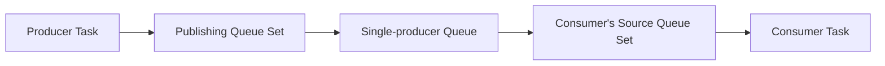

# A programmer's first guide to Angaria

Angaria helps a small group of C++ programs describe how they will communicate. Its design combines a shared **Registry**, which records the participants and their connections, with queues and policies that will control message delivery.

The runnable lessons follow the implemented public API through **milestone 3, step 3.6**, integration release **0.3.7**. Framework version **0.4.5**, milestone 4 step 4.4, adds private mapped payload storage and complete append sizing after the native history checks and helper consolidation. The thirteen examples and their output remain the public learning path; native Queue delivery remains planned. Angaria is incomplete and may change incompatibly before **1.0.0**.

You can run every example in this guide today. They create persistent sessions, register definitions, build connections, claim producer and consumer endpoints, encode scalar and basic logical payloads, and exchange completed capture files across processes for generic inspection. Sending, publishing, receiving, and acknowledgment through Angaria Queues arrive in later steps. Some of those operations already have declarations in the public headers; a declaration alone does not make an operation runnable.

## A few ideas before the code

A **process** is a running program. A **thread** is one path of execution inside a process. Two terminal windows can launch two independent processes, even when both run the same executable.

Angaria gives communication roles their own names and identities:

| Idea | Meaning |
| --- | --- |
| **Session** | One persistent workspace shared by cooperating programs. Its directory contains the session's stored state and coordination files. |
| **Task** | A named logical participant, such as `Feed` or `Strategy`. A Task can represent a process or a thread. |
| **Registry** | The Session's shared catalog of Tasks, Fields, message schemas, queues, ownership, and connections. |
| **Task claim** | Exclusive attachment to a Task. It says which running process or thread currently acts as that logical participant. |
| **Queue** | One producer Task's connection into one consumer-owned Source Queue Set. |
| **Source Queue Set** | A consumer's collection of input queues. Its selection policy will choose which input to receive from. |
| **Publishing Queue Set** | A producer's ordered list of destination queues. It will publish one message to those destinations. |
| **Field** | A named piece of message data with a declared representation, such as a 64-bit integer price. |
| **Message schema** | A message type and version with an ordered list of registered Fields. |

A Task ID identifies a registered role inside a Session. It is different from the operating system's process ID, or PID. A restarted `Feed` process keeps the registered `Feed` Task ID but receives a new claim **incarnation**, a counter that distinguishes this attachment from its predecessors.

For example, a feed and an order generator can each have their own queue in a risk consumer's Source Queue Set. Each queue still has one producer. Threads sharing a producer role must coordinate operations on a common queue. The [glossary](glossary.md) and [API contract](api.md) provide more detail once these ideas become familiar.

## Build the examples

Use Linux or macOS with a C++20 compiler, CMake 3.20 or later, and Boost 1.70 or later. The normal test build also needs GoogleTest and Python 3.9 or later. The [README build instructions](../README.md#build-and-test) give an Ubuntu package command. CMake fetches the pinned cpptoml headers for TOML loading; see the README for the offline override.

All thirteen lessons are included in milestone-3 integration release `0.3.7` on `main`. The [milestone review plan](milestones/milestone-3.md) records the six reviewed steps that added encoding, capture, and inspection to the earlier Registry lessons. Use the guide and examples from the same checkout so commands match the API you build.

Run these commands from the repository root:

```sh
cmake -S . -B build
cmake --build build --parallel
ctest --test-dir build --output-on-failure
```

To build the runnable examples without the test dependencies, use a separate directory:

```sh
cmake -S . -B build-primer -DBUILD_TESTING=OFF
cmake --build build-primer --parallel
```

The commands below assume the first build directory, `build`. Substitute `build-primer` if you used the second. The thirteen targets are named `angaria_primer_01_session` through `angaria_primer_13_process_exchange`, matching their source filenames. The generic inspection tool is `angaria_inspect`.

Examples 1–5, 9, and 11–13 need a directory that **does not exist yet**. Create a temporary parent directory once, then give each program a different child path:

```sh
primer_workspace=$(mktemp -d "${TMPDIR:-/tmp}/angaria-primer.XXXXXX")
```

This command works in the default shells on Linux and macOS. Keep this terminal open so the variable remains available. The examples create their child directories exclusively. They do not overwrite or remove an existing Session. To repeat an example, choose another child name.

## 1. Create and inspect a Session

Read [01_session.cpp](../examples/primer/01_session.cpp), then run:

```sh
./build/angaria_primer_01_session "$primer_workspace/01-session"
```

The program creates a Session and its creator Task, then inspects the stored metadata and finds that Task through the Registry. Session creation needs both configuration and a creator identity. The essential pattern is:

```cpp
angaria::SessionOptions options;
options._name = "First session";
options._directory = argv[1];
options._maxLogBytes = 1024 * 1024;
options._limits = angaria::CapacityLimits::empty().tasks(8).queues(8)
    .source_sets(4).publishing_sets(4).memberships_per_set(4)
    .fields(16).message_schemas(8);
options._defaults._ringCapacity = 8;

angaria::TaskDescriptor creator;
creator._name = "Setup";

auto created = primer::value(angaria::Session::create(options, creator));
const auto metadata = primer::value(created._session.metadata());
```

`CreatedSession` contains a Session handle and an attached creator Task handle. A **handle** is a C++ object that keeps the resources for an operation alive. Here, `created._session` gives access to the Session, and `created._creator` acts as its initial Task.

The small [example support header](../examples/primer/example_support.h) supplies two helpers. Later examples reuse the configuration above through `session_options`, including the 1 MiB log limit and ring capacity of eight entries. `value` checks Angaria results so the examples stay readable.

Most fallible operations return `Result<T>`, which is a `std::variant<T, Error>`. A variant holds one alternative at a time: either the requested value or an error. `primer::value` returns the value or throws a `std::runtime_error` containing the failure information. Each example catches exceptions at the top of `main`, prints the error, and exits unsuccessfully. A larger application can inspect the `Error` directly and choose whether to retry, ask for different settings, or stop.

The output reports the Session's name, framework version, creator Task ID, and Task capacity. For this fresh Session, `Setup` has Task ID 1 and the Task capacity is eight. The framework version comes from the built library, so later releases will print a newer value. IDs are local to a Session; do not use an ID from one Session in another.

## 2. Register roles, then attach to them

Read [02_tasks.cpp](../examples/primer/02_tasks.cpp):

```sh
./build/angaria_primer_02_tasks "$primer_workspace/02-tasks"
```

Registration and attachment do different jobs. **Registration** adds a durable logical definition to the Registry. **Attachment** claims that role for a running process or thread. Registering `Feed` does not start a feed program or claim the role on its behalf.

A Task has two useful ways to obtain a Registry. `task.registry()` returns an **actor-bound Registry**: mutations are attributed to that attached Task. `session.registry()` gives a lookup and inspection view. Trying to register through the Session's view returns `ReadOnlyRegistry`.

The example registers a `Consumer` role and retries its registration. Registering an identical Task descriptor again returns the same ID. Changing a descriptor under the same name returns `Conflict`; registration is not an implicit edit command. This behavior makes a repeated setup operation safe without silently changing an existing definition.

It also demonstrates attachment and reattachment. The first successful attachment has incarnation 1. After its claim closes, a replacement attachment has incarnation 2. Another live claimant for the same Task receives `OwnershipBusy`.

Resource lifetime matters here. C++ commonly uses **RAII**, meaning an object's lifetime controls a resource. Leaving a scope destroys its local objects. Angaria's dependent handles share ownership of a claim: a Task, its actor-bound Registry views, and its endpoints can each keep it alive. Closing the original Task variable releases the claim only after its last dependent handle also closes. The later multi-process example makes this visible.

The examples use process Tasks. Thread Tasks also exist, but require their parent process Task to be attached locally and must be used on the attaching thread. Start with process roles while learning the ownership model.

## 3. Describe messages before carrying data

Read [03_schemas.cpp](../examples/primer/03_schemas.cpp):

```sh
./build/angaria_primer_03_schemas "$primer_workspace/03-schemas"
```

Suppose a quote contains a price and a quantity. Instead of copying the compiler's in-memory C++ struct layout into storage, the Registry describes those pieces explicitly. The example registers fixed-width scalar Fields and two versions of a Quote schema.

A Field has a full 32-bit ID beginning with `0xEE`, a name, a base type, a declared byte size, and documentation. For example, `PriceTicks` can use a signed 64-bit integer. An application can define one tick as one cent and use an integer value of `12345` to mean 123.45. Angaria records the Field definition; the application still needs to explain the chosen units.

A schema is identified by both its message type and its version. Version 1 and version 2 remain separate definitions. Adding an instrument Field to version 2 preserves version 1, so older records can retain their original meaning. Looking up an exact version does not substitute the newest version.

The output includes both ordered Field lists:

```text
Quote v1 Fields: PriceTicks Quantity
Quote v2 Fields: PriceTicks Quantity Instrument
```

The program prints the retained schema Field lists and demonstrates immutable registration. Retrying the same definition succeeds. Changing the ordered Fields or documentation of an existing schema produces `SchemaConflict`; the example checks the documentation case. Give a changed schema a new version instead.

These are **definitions**, not encoded quote payloads. This example does not construct or transmit a quote. Lesson 9 uses these definitions for binary scalar encoding, and lessons 12–13 inspect captured records through those definitions. More Field families follow in milestone 9.

## 4. Connect one producer to one consumer

Read [04_connections.cpp](../examples/primer/04_connections.cpp):

```sh
./build/angaria_primer_04_connections "$primer_workspace/04-connections"
```

This program registers the wiring for a producer and a consumer. **Topology** means the connections between those registered participants. The producer owns a Queue and a Publishing Queue Set. The consumer owns the Source Queue Set containing that Queue.

The conceptual wiring is:



The arrows describe registered connections. This example does not move messages along them.

New topology entities start in **Draft** state. Drafts allow setup to assemble complete definitions before opening endpoints. **Activation** changes an entity to Active after its requirements pass. For this connection, the setup order is:

1. Register the Tasks, Source Queue Set, Queue, and Publishing Queue Set.
2. Activate the Source, whose member queues must already be fully configured.
3. Activate the Queue, which requires an Active Source and allocates its initial ring.
4. Activate the Publishing set, whose destination queues must be Active.
5. Attach the owning Tasks and open their endpoints.

A **ring** is bounded storage reused in a cycle. Later delivery code will use each queue's ring to reference messages in the log. At this step, activation allocates it without delivering messages.

The example opens a `QueueWriter`, a `SourceQueueSet`, and a `PublishingQueueSet` and prints their identities. Opening checks both activation and ownership: a Draft entity returns `NotActive`, and another Task's endpoint returns `WrongOwner`. A Source can have one open handle per live claim; a second open returns `OwnershipBusy`.

For a compact introduction, this program holds both producer and consumer roles in one OS process. A Task name does not require a separate executable. Example 6 launches the roles independently.

## 5. Build a bounded network and change a destination

Read [05_fanout.cpp](../examples/primer/05_fanout.cpp):

```sh
./build/angaria_primer_05_fanout "$primer_workspace/05-fanout"
```

Now `Feed` and `Strategy` each need connections to `Risk` and `Audit`. **Fanout** means one publication has several destinations. The registered topology contains four distinct queues:

| Producer | Queue | Consumer's Source |
| --- | --- | --- |
| Feed | QuotesToRisk | RiskInputs |
| Feed | QuotesToAudit | AuditInputs |
| Strategy | OrdersToRisk | RiskInputs |
| Strategy | OrdersToAudit | AuditInputs |

`Feed` owns `QuoteUpdates`, which references its two quote queues. `Strategy` owns `OrderUpdates`, which references its two order queues. There is no need for two producers to write the same queue. Each consumer has one Source collecting its incoming queues.

The example starts part of the configuration incomplete, then uses explicit draft operations to adopt ownership and assign a Queue to a Source. Adoption gives an unowned draft a registered owner. Assignment updates the Queue's Source and the Source's membership together. An Active Queue's producer and assigned Source are fixed.

After activation, the `Feed` owner removes `QuotesToAudit` from `QuoteUpdates`. This replaces that Publishing set's destination list; it does not delete the Queue or change who owns it. The program compares the old descriptor, which is an ordinary owning C++ copy, with a fresh Registry description. The old list has two destinations; the new list has one. It also prints the committed revision information.

Look for `QuoteUpdates destinations: 2 -> 1` in the output.

This demonstrates a live topology update. Per-publication destination snapshots will preserve earlier publications' routing when publication is implemented.

The configuration records higher priority for orders than quotes at `RiskInputs`, plus the default strict selection, spin waiting, log recovery, and all-destination acceptance policies. These are currently validated configuration choices. The example cannot demonstrate receiving priorities, busy waiting, recovery of a message, or acceptance across destinations yet.

The planned log-recovery default lets a lagging consumer find retained deliveries after its ring entries have been overwritten. An alternative will allow skipping stale deliveries while reporting the gap. All-destination acceptance will require every destination to accept a publication; configurable partial acceptance will report which destinations accepted and which rejected it. Selection will choose among available inputs, and waiting will control what a consumer does when none is ready.

## 6. Coordinate independent programs

Read [06_processes.cpp](../examples/primer/06_processes.cpp). This executable has four modes:

```text
angaria_primer_06_processes <init|inspect|producer|consumer> <session-directory> [--hold]
```

Only `init` creates a new directory. The other modes attach to that existing Session. `--hold` is valid for `producer` and `consumer`; it keeps endpoint handles alive until Enter or end-of-input. Without it, each mode prints its information and exits, which also makes it suitable for automated checks.

Initialize once in your original terminal:

```sh
./build/angaria_primer_06_processes init "$primer_workspace/06-processes"
printf '%s\n' "$primer_workspace/06-processes"
```

Copy the printed absolute path into each of three terminals. Run from the repository root in each terminal and set the same variable:

```sh
session_directory=/paste/the/printed/path/here
```

In terminal A, open the consumer role:

```sh
./build/angaria_primer_06_processes consumer "$session_directory" --hold
```

Its output includes `READY consumer incarnation=1`. Leave it waiting. In terminal B, open the producer:

```sh
./build/angaria_primer_06_processes producer "$session_directory" --hold
```

Its output includes `READY producer incarnation=1`. In terminal C, inspect the shared state and attempt a second producer:

```sh
./build/angaria_primer_06_processes inspect "$session_directory"
./build/angaria_primer_06_processes producer "$session_directory"
```

Inspection finds `Feed` and `Strategy` attached. The second command fails with `OwnershipBusy` because terminal B still owns `Feed`.

The inspector uses a read-only Registry view and claims neither Task. Attaching the Session still validates stored state and may complete recovery; an inspection view does not imply that the underlying file was opened read-only.

Press Enter in terminal B, then run its producer command again. It now prints `READY producer incarnation=2`. The logical Task ID stays the same. Press Enter to close that replacement and the consumer in terminal A, then inspect once more from terminal C. The definitions remain available after both roles close; their attachment status now reports offline.

The example intentionally lets the original Task variable close while endpoint handles remain alive. Those handles retain the claim, which explains why the second producer cannot attach until they close. Normal process termination also releases the native claim lock; recorded PID information is diagnostic rather than the authority for deciding ownership.

The producer reserves a publication identity, consisting of its claim and a sequence number. Reserving an identity does not publish a message. This walkthrough demonstrates separate processes sharing the Registry and enforcing endpoint ownership; actual producer-to-consumer delivery follows later milestones.

## 7. Move setup into a TOML file

So far, C++ code has supplied each definition. A configuration file lets you describe the same setup without changing and rebuilding that code. Angaria uses **TOML**, a text format with named values, tables such as `[session]`, and repeated tables such as `[[tasks]]`. The loader uses the pinned **cpptoml** library.

Read [07_configuration.cpp](../examples/primer/07_configuration.cpp) and its [configuration file](../examples/primer/configuration.toml). This example defines `Setup`, `Feed`, and `Consumer`, the connection from lesson 4, and the two-Field `Quote` schema. It supplies every capacity limit explicitly. Omitted policy choices keep the supported defaults.

Copy the configuration to a fresh directory before running it:

```sh
mkdir "$primer_workspace/07-configuration"
cp examples/primer/configuration.toml "$primer_workspace/07-configuration/settings.toml"
./build/angaria_primer_07_configuration "$primer_workspace/07-configuration/settings.toml" Setup
```

The file says `directory = "primer-session"`. A relative Session path starts from the **configuration file's parent directory**, so this creates `$primer_workspace/07-configuration/primer-session`. It does not depend on the shell's current directory. To repeat the lesson, use a new parent directory; creation refuses an existing Session.

The main API sequence is short:

```cpp
{
  auto created = primer::value(angaria::Session::create_from_file(argv[1], argv[2]));
  auto registry = created._session.registry();
  const auto queue = primer::value(registry.find_queue("FeedToConsumer"));
  const auto state = primer::value(registry.state(queue));
} // The creator claim closes when its last owning handle closes.

auto attached = primer::value(angaria::Session::attach_from_file(argv[1]));
```

The second creation argument is the name of a **Process Task declared in the file**. Here it is `Setup`. The creator uses its declared Task entry; the loader does not add a hidden extra participant. All initial registrations are attributed to that creator. Other declared Tasks start offline.

Creation checks types, ranges, names, references, supported policies, and capacity counts before applying the initial definitions. References can point forward in the file: a Thread may name a Process declared later, for example. Initial registrations and activation use the same rules as programmatic setup. Complete nonempty Sources, their Queues, and nonempty Publishing sets become Active; empty sets stay Draft. The completed Session becomes visible at its requested path only after setup succeeds.

Expected output includes:

```text
Created from TOML: Primer configuration
Creator: Setup
Source members: 1
Quote v1 Fields: 2
Connection active=yes
Reattached from TOML; creator attached=no
```

The program closes the creation handles before reattaching. `attach_from_file` finds the saved Session, checks its effective settings, and returns a Session handle. It does not rerun registrations, apply topology changes, or claim a Task. The Session name, application version, storage, log byte limit, capacities, and policy defaults must match; a disagreement returns `ConfigurationMismatch`. The resolved directory locates the Session and can differ from its original recorded location after relocation. Optional declarations are checked, and references can also name entities already registered in the Session. Supported runtime topology changes remain in place.

As with ordinary attachment, validation may finish interrupted recovery and write to the underlying file. A read-only Registry view still means that the view cannot perform configuration updates.

For an ordinary mistake, change `source_set = "ConsumerInputs"` in a copy to an unknown name. The error identifies the offending key path and reference. A misspelled key, a quoted number where an integer is required, or an out-of-range priority also fails explicitly. Syntax errors include the filename and the parser's line information where available. An unsuccessful creation does not publish a partially configured Session.

Known policies can still be unavailable. For example, `delivery = "allow_loss"` is part of Angaria's design but currently returns `UnsupportedPolicy`. The runnable examples use `recover_from_log`. The [configuration contract](configuration.md) lists the complete schema and the current implementation boundary.

## 8. Share a Registry and inspect its history

Read [08_registry.cpp](../examples/primer/08_registry.cpp). It combines the earlier lessons into a public-API program that several independent processes can run against one Session. The [complete Registry walkthrough](registry-walkthrough.md) explains each command and a manual multi-terminal run.

Start with the automated version, which creates a new Session and keeps it for inspection:

```sh
python3 test/registry_walkthrough.py build/angaria_primer_08_registry examples/primer/configuration.toml --session "$primer_workspace/08-registry"
./build/angaria_primer_08_registry inspect "$primer_workspace/08-registry"
```

The script copies lesson 7's TOML file into its own workspace and selects the new Session directory. It starts two registrar processes with separate Task claims. Each adds a Field, a message schema, and a Queue to the consumer's existing Source Queue Set. They also retry identical definitions and compete to register different definitions under one Task name. An exact retry keeps its identity; one conflicting definition wins and the other is rejected.

After both registrars exit, the inspector finds seven Tasks, three Queues, one Source, one Publishing set, four Fields, and four message-schema versions. Both `Quote` versions remain discoverable. The script then replaces a terminated endpoint owner and changes its Publishing destinations.

A **Registry revision** numbers a committed definition change. A **snapshot** copies the complete catalog at one such revision:

```cpp
auto registry = session.registry();
auto snapshot = primer::value(registry.snapshot());
for (const auto& message : snapshot._messages)
{
  std::cout << message._descriptor._name
            << " version " << message._descriptor._schema._version << '\n';
}
```

The copy owns its strings and lists. It remains usable after the original Registry view closes, and later updates do not change it. All its categories come from one consistent committed revision: a Queue and its Source's member list cannot describe different sides of a concurrent update.

`snapshot._revision` identifies the copied definitions. Passing an earlier saved revision returns the definitions from that point:

```cpp
auto earlier = primer::value(registry.snapshot(saved_revision));
```

Entities added later are absent, and a changed Publishing set retains its old destinations in the historical copy. `_currentRevision` reports the current committed Registry revision observed by the call. Source and destination order is preserved; the top-level entity lists use numeric identity order, with message schemas ordered by type and version.

Task claims and restart incarnations change independently of Registry revisions. A historical snapshot therefore contains definitions and topology, rather than past PID or attachment status. The example prints current claim information separately as `CURRENT`.

The inspector claims no Task. Its Session Registry rejects registration with `ReadOnlyRegistry`, and it can discover the saved catalog after the application processes exit. As in the earlier examples, normal Session attachment may complete interrupted recovery. This walkthrough qualifies Registry behavior on the tested profiles; it does not demonstrate message delivery or general session replay.

## 9. Encode a Quote payload

Read [09_payload.cpp](../examples/primer/09_payload.cpp), then run:

```sh
./build/angaria_primer_09_payload "$primer_workspace/09-payload"
```

A **payload** is the application data carried by a message. A **scalar** is one simple value, such as an integer or floating-point number. This example converts the scalar Fields of a Quote into bytes, then reads the same values back.

The program registers `PriceTicks` as int64, `Quantity` as uint64, and `Instrument` as uint32. Quote version 1 contains the first two Fields. `BinaryPayloadCodec` resolves that exact schema and owns a copy of its ordered Field definitions:

```cpp
constexpr std::uint64_t payload_limit = 64;
auto codec = primer::value(angaria::BinaryPayloadCodec::from_registry(
    session.registry(), quote_schema, payload_limit));
const std::array<angaria::ScalarValue, 2> values{
    std::int64_t{-2}, std::uint64_t{7}};
const auto bytes = primer::value(codec.encode(values));
const auto decoded = primer::value(codec.decode(bytes));
```

The named byte limit reserves no storage by itself. It tells the codec the largest payload this application is willing to build. This schema needs 16 bytes, so a limit of 15 fails with `CapacityExceeded` while compiling it.

`ScalarValue` is a variant containing one supported scalar type. Each input must have the exact registered C++ type. Here the first value is explicitly `std::int64_t`, and the second is explicitly `std::uint64_t`. A positive signed integer is still a different type from an unsigned integer. The codec reports a mismatch rather than silently converting it.

The bytes use **little-endian** order: the least significant byte of a multi-byte value comes first. Field values sit next to each other in schema order, without C++ structure padding. Look for:

```text
Quote v1 bytes: 16
Quote v1 hex: fe ff ff ff ff ff ff ff 07 00 00 00 00 00 00 00
Decoded v1: PriceTicks=-2 Quantity=7
Quote v2 bytes: 20
Decoded v2: PriceTicks=-2 Quantity=7 Instrument=42
Retained codec version: 1
Codecs remain usable after Session handles close.
Payload encoding only: no messages were sent.
```

Quote version 2 adds `Instrument`, making its payload four bytes longer. The earlier codec stays attached to version 1's immutable definition. In this program, the helper finishes all registrations and closes its Session and Task handles before either codec encodes. The codecs remain usable because they own their schema information and retain no Task claim.

The encoded byte vector and decoded value vector also own their data. Use `std::get<std::int64_t>(decoded[0])` to read the first value, and `std::get<std::uint64_t>(decoded[1])` for the second. Decoding requires the exact byte count; it rejects both truncated input and extra trailing bytes.

Keep the exact schema identity alongside the payload. These bytes contain neither their message type nor their version. A codec for another same-sized schema cannot determine that you supplied the wrong data. [Lesson 11](#11-wrap-a-payload-in-a-message-record) adds a portable header carrying the exact schema and source Session identity.

This lesson runs in application memory. The [payload format guide](message-payload.md) lists supported scalar types and error rules. Queue transport, publication, receiving, and acknowledgment follow their roadmap steps.

## 10. Encode logical Fields and preserve an output buffer

Read [10_logical_fields.cpp](../examples/primer/10_logical_fields.cpp) and its [TOML file](../examples/primer/logical-fields.toml). This lesson builds a small `OrderSettings` payload with a Boolean, bit flags, an enumeration, fixed ASCII text, and a signed 8-bit adjustment.

Copy the configuration into a fresh child of the temporary workspace:

```sh
mkdir "$primer_workspace/10-logical-fields"
cp examples/primer/logical-fields.toml "$primer_workspace/10-logical-fields/"
./build/angaria_primer_10_logical_fields "$primer_workspace/10-logical-fields/logical-fields.toml"
```

The file creates `logical-session` beside the copied TOML file. That Session directory must not already exist. To repeat the lesson, choose another fresh configuration directory. The program preserves an existing Session and reports `Conflict` instead of replacing it.

A Field's **logical meaning** tells a reader how to interpret its stored bytes. One byte could hold an ordinary number, a true-or-false answer, or several flags. Registered logical metadata records that distinction so an inspector can explain the value without the application's C++ types.

| Field | Representation | C++ payload value |
| --- | --- | --- |
| `Enabled` | Boolean: one byte, `00` for false or `01` for true. Other bytes are invalid. | `true` |
| `Flags` | Exactly 16 bits, stored little-endian. Bit 0 is the least significant bit. Basic widths are 8, 16, 32, and 64. | `BitFieldValue{0x8001}` |
| `Side` | A byte-sized **closed enumeration**, with `Buy = 1` and `Sell = 2`. Values outside this mapping are invalid. | `EnumValue{std::uint8_t{1}}` |
| `Instrument` | Exactly six ASCII bytes, each in the range `00..7f`. | `FixedAsciiValue{"IBM   "}` |
| `Adjustment` | A signed 8-bit integer, in `-128..127`. | `std::int8_t{-128}` |

These types are alternatives in `PayloadValue`. `ScalarValue` remains an alias for that type so lesson 9 still compiles. Logical wrappers keep a byte, bit field, enum, and Boolean distinct. The enum's `std::uint8_t` must match its declared byte storage; supplying `std::uint16_t` is a type error even for the number 1.

Configuration version 2 adds these logical declarations while version 1 keeps its earlier scalar syntax. For example, the actual file defines `Side` as:

```toml
[[fields]]
name = "Side"
id = 0xEE000012
type = "enum"
underlying = "byte"
enumerators = [{ name = "Sell", value = 2 }, { name = "Buy", value = "1" }]
```

Enum declarations can use TOML integers or canonical decimal strings. This preserves values up to the uint64 maximum, `"18446744073709551615"`, beyond TOML's signed integer range. Only enum values get this string form; settings such as `bits` and `size` still require TOML integers. Both forms normalize to the same numeric metadata. Inspection returns enum entries in numeric order, so this file prints `Side labels: 1=Buy 2=Sell`.

The program compiles the exact `OrderSettings` schema with a 64-byte payload limit, then closes every Session, Registry, and Task handle. The owning codec retains its Field definitions and enum labels. It constructs the payload with:

```cpp
const auto payload = primer::value(codec.encode({
    true, BitFieldValue{0x8001}, EnumValue{std::uint8_t{1}},
    FixedAsciiValue{"IBM   "}, std::int8_t{-128}}));
```

Fixed ASCII has no automatic terminator, padding, trimming, or truncation. `IBM` needs three explicit spaces to fill the six-byte Field here. A NUL byte is also permitted and preserved; it does not end the Field. Larger 128- and 256-bit Fields, UTF-8 pooled strings, and additional text representations follow in milestone 9.

Look for these complete output lines:

```text
OrderSettings payload bytes: 11
OrderSettings hex: 01 01 80 01 49 42 4d 20 20 20 80
Decoded: Enabled=true Flags=32769 Side=1 Instrument='IBM   ' Adjustment=-128
Rejected undeclared enum: InvalidArgument
Caller buffer unchanged: yes
Caller buffer matches owning payload: yes
```

The 11 bytes are one Boolean byte, two flag bytes, one enum byte, six ASCII bytes, and one adjustment byte. The first flag byte is `01` and the second is `80`, because the value `0x8001` uses little-endian order. Signed `-128` encodes as the final byte `80`.

`encode` returns an owning byte vector. When an application already owns an output buffer, `encode_into(values, output)` requires exactly `codec.payload_size()` bytes and checks all inputs before replacing any output byte. The lesson fills an 11-byte buffer with `a5`, tries an undeclared Side value of 3, and verifies `InvalidArgument` plus unchanged output. It then replaces that value with Buy and checks that successful caller-buffer encoding matches the owning payload.

Field definitions remain immutable. Changing an enum mapping, width, or logical meaning requires a new Field ID and name, followed by a new message-schema version referencing it. A new message version alone cannot edit a Field used by earlier schemas. The existing base codes 0 through 25 retain their meanings; signed int8 adds code 26.

New Sessions use mapped format 2.1 and advertise required logical-Field support at creation. This library also attaches to existing format-2.0 scalar Sessions, but adding logical Fields or int8 to them returns `UnsupportedPolicy`. Their format is never upgraded in place. Framework version, TOML version, and mapped-format version have separate purposes; the [logical Field contract](logical-fields.md) explains the bounds, ownership, and compatibility rules.

This example constructs and validates payloads in application memory. Lesson 11 adds a portable message envelope; Queue delivery follows its roadmap milestones.

## 11. Wrap a payload in a message record

Read [11_message_record.cpp](../examples/primer/11_message_record.cpp), then run:

```sh
./build/angaria_primer_11_message_record "$primer_workspace/11-message-record"
```

A **header** holds the information needed to interpret a payload. A portable **message record** stores that header followed by the payload bytes. The [record contract](message-record.md) specifies an 80-byte header, including the exact message type/version, payload format and length, full publication identity, initial publication time, and application flags. This Quote still has a 16-byte payload, so its complete record occupies 96 bytes.

The preparation helper creates a Session, registers the same price/quantity Fields used in lesson 9, and compiles Quote version 1. It then fills the header:

```cpp
MessageHeader header;
header._schema = schema;
header._format = PayloadFormat::Binary;
header._publication = primer::value(created._creator.next_publication_id());
header._publicationTime = UtcTimestamp{std::chrono::nanoseconds{42}};
header._flags = 0x80000001u;
header._payloadBytes = codec.payload_size();
```

The **publication identity** contains the Session ID, producer Task ID, that Task claim's incarnation, and a producer-local sequence. `next_publication_id()` persists an issued sequence before returning it. Issuing an ID does not send a message or establish that a publication has been accepted. The record codec checks the shape of these values; it cannot prove that a claim is live or a sequence was issued by its stated Session.

The timestamp is a caller-supplied count of UTC nanoseconds since the Unix epoch. This example deliberately uses 42 so its output is repeatable. It represents the record's initial publication time. Each destination can accept a delivery later, and each has its own dequeue and acknowledgment history. Those destination-specific times do not belong to this immutable header.

After the helper returns, every Session, Registry, and Task handle is closed. The main function constructs a payload with price `-2` and quantity `7`, then encodes its complete record:

```cpp
constexpr std::uint64_t record_limit = 96;
const auto bytes = primer::value(MessageRecordCodec::encode(
    prepared._header, payload, record_limit));
const auto borrowed = primer::value(MessageRecordCodec::decode_view(bytes, record_limit));
const auto values = primer::value(MessageRecordCodec::decode_binary(
    borrowed, prepared._codec, prepared._schemaSession));
```

`record_limit` includes both header and payload. A limit of 95 rejects this record with `CapacityExceeded`. `decode_header` checks exactly the first 80 bytes and the announced total against this budget, which lets a reader check the declared size before allocating a payload buffer. Header parsing alone does not prove the payload is present; full record decoding checks the exact complete length, including rejection of extra trailing bytes.

`decode_binary` requires the Binary format, an exact schema match, and the expected source Session identity. A type/version pair is local to a Session: another Session can register the same pair with different Fields. The helper therefore saves `created._session.identity()` independently of the record. Reading a Session ID from the record and passing it back as the expected identity would not check the schema's source. These checks compare declared metadata with your supplied context; they do not authenticate a sender. Deliberately changing the decoded view's version to 2 fails with `SchemaConflict`, even though the payload still has 16 bytes.

Look for these complete output lines:

```text
Message record bytes: 96
Header bytes: 80 Payload bytes: 16
Schema: Quote type=1 version=1
Producer: Task=1 incarnation=1 sequence=1
Publication time (demo): 42 ns
User flags: 2147483649
Decoded Quote: PriceTicks=-2 Quantity=7
Wrong schema version: SchemaConflict
Record cap 95: CapacityExceeded
Borrowed MessageView payload bytes: 16
Owning record survives input buffer release: yes
Record and payload codecs remain usable after Session handles close.
Record encoding only: no messages were sent.
```

`decode_view` returns a header value plus a **borrowed span** into the input record's payload bytes. Keep that input buffer alive and unchanged while using the span. `decode` instead copies the payload into an owning `MessageRecord`. The example destroys the original encoded buffer, then successfully decodes the owning record's retained payload.

`retained.view().message()` provides a `MessageView` whose payload is the original 16 application bytes. This adapter borrows the owning record, so keep that record alive too. It supplies the view shape used by future transport operations; this lesson makes no Queue call. The portable 80-byte header is separate from the native arena's storage and receipt records. Recognition of JSON, XML, CSV, or Text in a record header also does not provide a serializer for those formats; typed decoding here uses the Binary payload codec.

## 12. Capture and inspect multiple message types

Read [12_capture.cpp](../examples/primer/12_capture.cpp), then run these two programs:

```sh
./build/angaria_primer_12_capture "$primer_workspace/12-capture"
./build/angaria_inspect "$primer_workspace/12-capture/session" \
    "$primer_workspace/12-capture/capture.angcap"
```

A **capture** is a saved sequence of portable message records. This example writes four records into an ordinary binary file. The application's Session directory retains the Registry definitions needed to interpret them. Keep both the capture file and that source Session directory.

The first program creates a new workspace exclusively. Inside it, the program creates `session` and `capture.angcap`, registers the application Fields and message schemas, issues publication identities, and writes through `MessageCaptureWriter`:

```cpp
auto writer = primer::value(MessageCaptureWriter::create(output, 1024, 4096));
primer::value(writer.append(header, payload));
```

The first limit bounds one complete record; the second bounds the complete capture. The file contains the same 80-byte-header records from lesson 11, one after another. Ordinary capture writes do not have the native Session's transaction journal: an I/O failure may leave an incomplete final record. The reader reports that error instead of guessing where a later record might begin.

The producer prints a Session identity that changes each time you make a new workspace, followed by these fixed lines:

```text
Captured records: 4
Capture bytes: 371
Retained schemas: Quote v1, Quote v2, Order v1, Heartbeat v1
Capture encoding only: no messages were sent.
```

Quote version 1 stores `PriceTicks` then `Quantity`. Version 2 reverses their order, so both versions still occupy sixteen payload bytes. The inspector must choose the exact version recorded in each header. Substituting the newest version for the older record would interpret its bytes incorrectly.

The second command starts the generic [inspection tool](../tools/inspect.cpp). It includes no application-specific Quote or Order C++ type. It attaches to the source Session, copies an owning Field/schema catalog into `MessageInspector`, and closes the Session handles before reading the capture. A **catalog** here is the retained collection of Field and message-schema definitions. Those definitions supply names, types, order, enum labels, and exact versions.

The tool shows the two Quote layouts separately. It also renders Order's logical values and an empty Heartbeat:

```text
  [0] "PriceTicks" int64 = -2
  [1] "Quantity" uint64 = 7
```

```text
  [0] "Quantity" uint64 = 8
  [1] "PriceTicks" int64 = -3
```

```text
  [0] "Side" enum<byte> = "Buy" (1)
  [1] "Quantity" uint64 = 9
  [2] "Instrument" chars<6> = "IBM\x00 \x0a"
  [3] "Flags" bits16 = 0x8001
  [4] "Enabled" bool = true
  [5] "Adjustment" int8 = -128
```

Each group has a header identifying the message, source Session, producer, exact schema, sequence, timestamp, and flags. Heartbeat has only that header because its schema has no Fields. `\x00` and `\x0a` show the instrument's saved NUL and newline bytes. Names and enum labels are escaped too, so controls cannot masquerade as extra output lines. Fixed ASCII padding and control bytes remain visible.

`MessageInspector` checks the source Session identity independently of the record, then selects its exact registered schema. Missing versions return `NotFound`; a different Session returns `SchemaConflict`. Generic binary interpretation preserves each Field's logical rules. Other known payload formats can be captured as opaque bytes, but their serializers and semantic inspectors are later work.

The command has separate limits for record bytes, total capture bytes, retained/expanded catalog bytes, text per record, and total printed output. Run `./build/angaria_inspect --help` for the defaults and named overrides. For example, adding `--max-record-bytes 95` rejects the first 96-byte Quote before allocating its payload. Errors identify the record index and starting byte offset. If a later record fails, earlier complete records may already have been printed; a nonzero exit status means inspection did not finish successfully.

Error diagnostics also escape names and paths: a saved newline appears as `\x0a`, rather than starting another diagnostic line. This applies even when an invalid payload causes an error containing its Field name.

The capture is opened read-only. Obtaining its catalog uses normal native `Session::attach` and `Registry::snapshot`, which require a qualified matching native ABI and may perform recovery writes. This is not physically read-only or foreign-profile Session-file inspection. The capture contains message records, not an exported copy of every Registry definition; deleting the Session loses the catalog needed by this workflow.

The application writes ordinary files after constructing records in its own memory. Capture order, repeated IDs, and successful inspection do not establish Queue publication acceptance or delivery. The next lesson extends this to independent processes and producer replacement; native Queue operations remain with their roadmap milestones.

## 13. Exchange captures across processes and schema changes

Read [13_process_exchange.cpp](../examples/primer/13_process_exchange.cpp), then run its [walkthrough](../test/process_exchange.py):

```sh
python3 test/process_exchange.py build/angaria_primer_13_process_exchange \
    build/angaria_inspect --workspace "$primer_workspace/13-exchange"
```

The script starts independent programs and waits for explicit readiness signals. It keeps their Session and captures in the new workspace so you can inspect them afterward. Omit `--workspace` for a temporary run that cleans up its own files.

First, an initialization process registers `Feed`, two integer Fields, Quote v1, and an empty Heartbeat. A reader copies a `MessageInspector` catalog containing those definitions, closes its native handles, and waits. The reader now owns a picture of the definitions at that moment.

Next, a producer attaches to `Feed` and writes Quote and Heartbeat records. Only after it has flushed and closed the file does it report readiness. The script terminates that producer while it still owns the Task claim, then starts an updater that registers Quote v2. This version uses the same sixteen payload bytes in a different Field order. Replacement producers write v2 and then v1:

| Capture | Quote layout and values | Feed incarnation |
| --- | --- | ---: |
| `first/capture.angcap` | v1: price `-2`, quantity `7` | 1 |
| `new/capture.angcap` | v2: quantity `8`, price `-3` | 2 |
| `restart/capture.angcap` | v1: price `-4`, quantity `9` | 3 |

Each producer issues publication sequences `1` and `2` for its Quote and Heartbeat. A sequence starts again for a new incarnation. The full publication identity includes both values, so records from the terminated producer remain distinguishable from records written by its replacement.

When released, the waiting reader uses its original catalog to inspect both v1 captures. It rejects v2 with `NotFound`, because that definition was not present when the catalog was copied. Adding v2 to the Session never silently changes an existing inspector's definitions or the meaning of v1 bytes. A newly created inspector can discover the added version.

Finally, after every application process has exited, the script starts the generic CLI separately for each capture. These fresh inspectors find both exact versions in the retained Session. You can repeat one of those reads yourself:

```sh
./build/angaria_inspect "$primer_workspace/13-exchange/session" \
    "$primer_workspace/13-exchange/new/capture.angcap"
```

The example reserves each workspace and phase directory exclusively. Repeating a phase returns `Conflict` and preserves its earlier capture. Use a new workspace for another complete run. The [process-exchange contract](process-exchange.md) lists the individual commands and compatibility checks.

This lesson tests claim replacement after process termination on a running system. The terminated producer's file was already complete. It does not demonstrate recovery of an interrupted capture write or power-loss durability. Ordinary files carry the encoded records between these applications; native Queue send/receive and Queue Set scheduling remain future milestone work.

## What native transport will add

Milestone 4's [reviewed plan](milestones/milestone-4.md) builds on these thirteen programs. Its first step documents the [transport contract](native-transport.md); step 4.2 adds internal storage codecs. A **codec** translates values into specified bytes and checks bytes when reading them back. These new codecs check Publication headers, destination rows, delivery receipts, and ring entries. A **receipt** records one destination's delivery progress. The codecs also check the byte cost before building a record, including its reserved receipts and padding.

This is groundwork for sending through a Queue. Correctly encoding a record does not prove that its producer, schema, or destination belongs to a committed Session. Step 4.3 now checks these relationships when attaching a core delivery Session and inspecting its topology. It checks stored metadata without reading or copying the message payloads. It also checks that each received message has one matching Source pin, and that a ring entry points to the right retained message. A **pin** records which delivery is still borrowed by a consumer. These [history checks](native-validation.md) use private stored-message fixtures while the actual sending and receiving operations are being built. The [private codec tests](../test/README.md) explain the stored layout; today's thirteen programs continue using the implemented public APIs. New native delivery examples will become runnable as their API methods are implemented.

Step 4.4 adds the private storage underneath those future views. A **mapping** lets a program read stored bytes through an address in its own process. Its owner keeps that address valid while other operations append to the file. The new payload owner maps only a committed message's application bytes, without copying them; an empty message needs no mapping. This owner does not establish a delivery pin or implement receiving. The future Source handle must own both the pin and the mapping before it can return a borrowed view.

Before building an append, Angaria also checks its complete stored size: the message, destinations, receipts, alignment padding, and the journal's batch description and updates. A message that fits by itself can still exceed the Session limit once that bookkeeping is included. These checks and mapping lifetimes have [private tests](../test/README.md); applications continue to use the public examples above until sending and receiving are enabled in steps 4.6 and 4.7.

Instead of exchanging completed ordinary files, applications will send through Angaria's mapped Session storage. The **payload plane** retains the message bytes and their delivery history. A bounded **ring** keeps references to recent messages so a consumer can find them quickly. Replacing a ring entry does not acknowledge its message. A slow consumer using the default recovery policy can still follow the retained log.

An acknowledgment ends a delivery obligation; it does not reclaim physical log space in milestone 4. When the bounded log is full, new sends can fail while acknowledgment, release, and owner replacement still work. Optional allowed-loss delivery can skip stale pending messages and report a gap, while preserving a message the application has already received.

The planned receiving API returns a borrowed payload view: keep its Source and delivery alive while reading it. Acknowledging, releasing, or closing that Source ends the view's lifetime. The proposed explicit `close()` will report cleanup errors so a caller can retry instead of assuming cleanup succeeded. These operations and the separate initial-publication timestamp are design proposals in step 4.1, not new calls to add to today's programs.

Readers can now validate the core delivery format, but today's factories still create format 2.1 Sessions. Runnable native delivery will require a newly created Session with its delivery capability once sending is implemented. Older Sessions keep their existing meanings and are not silently upgraded. Milestone 4 first supports a Source with one Active Queue; milestone 5 will select among several Queues feeding that Source.

## Understand bounds and ordinary failures

Angaria targets small, bounded systems. Capacities reserve room for Tasks, queues, both kinds of Queue Sets, memberships, Fields, and schema versions. Named setters make adjustments readable:

```cpp
auto limits = angaria::CapacityLimits{}.tasks(16).queues(32).source_sets(8);
```

Unspecified values keep their defaults. Increasing a capacity affects a new Session's reserved storage; it does not enlarge an existing Session simply because a later process requests more room.

The log stores persistent definitions and updates. Registry entries can fit within their count limits while the log lacks room for another definition. Think of count limits as reserved catalog slots and log capacity as the byte budget for their contents and history.

| Result | What to check |
| --- | --- |
| `OwnershipBusy` | Another live claim owns this Task, or this claim already has the Source open. Close the relevant owners before retrying. |
| `Conflict` | A name or identity is already registered with a different definition. Inspect it; repeating the changed registration will not edit it. |
| `SchemaConflict` | An immutable message schema disagrees with the requested definition. Register an appropriate new version. |
| `CapacityExceeded` | A reserved entity or membership count is exhausted. Review the bounds for a new Session. |
| `LogFull` | The bounded log cannot hold the required append. Count capacity alone is insufficient. |

Exact registration retries are useful because they preserve the existing definition without appending another copy. In contrast, repeated topology edits can consume log space. Claims and incarnation replacement use reserved state, allowing Task replacement even when append space is exhausted.

## How this guide will grow

The learning sequence now completes milestone 3: TOML setup, independent-process Registry use, current/historical snapshots, scalar and logical payloads, and portable capture exchange with generic exact-version inspection across producer replacements. Planned YAML, JSON, and XML converters will produce TOML for the common loader.

The [roadmap](../ROADMAP.md) is the authority for upcoming features:

| Milestone | What the primer will add when implemented |
| --- | --- |
| 4 | Run the mapped message path; explain rings, log recovery, wraparound, and bounded failures. |
| 5 | Receive through multiple inputs, compare selection policies, and acknowledge or recover deliveries. |
| 6 | Publish to multiple destinations, compare all-destination and partial acceptance, retry rejected destinations, and run the five-process trading simulation. |
| 7 | Compare spinning with Linux eventfd waiting and explain wakeups and endpoint replacement. |
| 8 | Grow segmented storage and handle allocation limits and restart. |
| 9 | Use advanced Field types, shared pools, and additional serialization formats. |
| 10 | Inspect and replay sessions, convert configuration formats, and follow the qualified 1.0.0 walkthrough. |

The primer and its runnable sources are maintained together throughout the milestones. Examples compile against the public API, and automated walkthroughs check their observable behavior. Each feature change should update the relevant explanation and example; future chapters become runnable only after their operations exist. The [test reading guide](../test/README.md) offers more detailed scenarios, while the API and storage contracts explain guarantees beyond this introduction.

The older [v0 queue demo](../README.md#run-the-queue-demo) exercises an earlier prototype. Its delivery code and file format are separate from the Registry API taught here.
